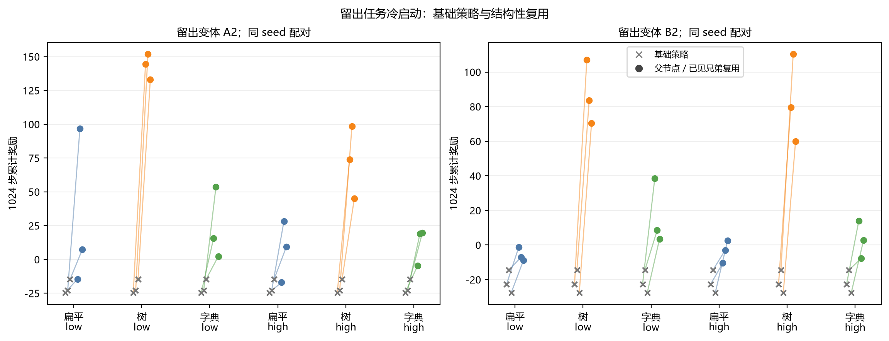

# 预训练后在线学习：A / B / 压缩 / C1 实验

## GitHub 研究档案入口

本仓库保存原 A、B、B+、压缩对照和 C1 快照，并在 **2026-10-15** 补充强对照、P0 和有界知识组织的三步机制实验：静态整合、从零无标签辨识、最小在线闭环。原快照保留在 `v0.1.0-ab-c1`，新增工作在 `codex/c1-strong-baselines` 分支。包含原始数据、模型、逐步日志、图表、成功与失败记录、验证过程、算法实现和引用。新闭环仍在 C1 受控环境中，不代表已完成一般环境的 C2/C3 基准。

| 阅读目的 | 入口 |
|---|---|
| 研究问题与当前边界 | [共同研究背景](docs/RESEARCH_SCOPE.md) |
| 全部实验、数据和结果索引 | [实验目录](docs/EXPERIMENT_INDEX.md) |
| 已实现的算法 | [算法说明](docs/ALGORITHM.md) · [源代码](src/online_rl/) |
| 成功、失败、错误修复和反例 | [完整记录](docs/SUCCESS_AND_FAILURE_LOG.md) |
| 已运行的强基线与未运行的相关/SOTA 方法 | [对照范围](docs/BASELINES_AND_RELATED_WORK.md) |
| 论文与软件引用 | [引用说明](references/README.md) · [BibTeX](references/references.bib) · [本快照引用](CITATION.cff) |
| 环境安装、检查与复现 | [复现说明](docs/REPRODUCIBILITY.md) |
| 所有归档文件的覆盖和校验 | [存档清单说明](docs/ARCHIVE_INVENTORY.md) · [SHA-256 清单](archive/manifest.json) |

先看当前核心报告：

- [当前V2结构与算法详解](docs/KNOWLEDGE_V2_STRUCTURE_AND_ALGORITHM.md)
- [V2：验证、算法优化及其仍未解决的问题](outputs/knowledge_v2_report/验证与优化结论.md) · [原始日志审计](outputs/knowledge_v2_report/audit.json)
- [V2冻结规程](docs/KNOWLEDGE_V2_VALIDATION.md) · [实现复核与评分限制](docs/KNOWLEDGE_V2_IMPLEMENTATION_NOTES.md) · [终点重访设计](docs/KNOWLEDGE_V2_REVISIT.md)
- [有界知识组织：三步结果与研究判断](outputs/knowledge_organization_report/结果与研究判断.md)
- [三步规程与后续控制](docs/KNOWLEDGE_ORGANIZATION_PROTOCOL.md) · [重访评估修正](docs/KNOWLEDGE_REVISIT_CORRECTION.md)
- [A/B 复验](outputs/validated/结果解读.md)
- [B+ 强基线与持久知识隔离](outputs/ab_plus/结果解读.md)
- [Top-K 失败与修复](outputs/compression_attempt/结果解读.md)
- [九种压缩替代方案](outputs/compression_alternatives/综合判断.md)
- [原 C1 固定结构共享机制](outputs/c1/结果解读.md)
- [C1 三项补齐报告](outputs/c1_supplement/结果解读.md)
- [更紧凑表示与更强全参数控制](outputs/c1_supplement/alternative_results.md)
- [补齐后的研究判断](docs/C1_SUPPLEMENT_CONCLUSIONS.md)
- [自动知识组织前需要明确的定义与猜想](docs/PRE_CORE_VALIDATION_PROTOCOL.md)
- [P0：独立局部学习与跨情境迁移诊断](outputs/pre_core_p0/结果解读.md)

P0 是 C1 后的隔离机制诊断：在统一修正坐标内学习，再由研究者交叉评估迁移；不是 C2、无标签结构发现或满容量整合。规程在正式运行前单独提交；原 A/B/C1 结果未重跑。

新三步实验完成九类静态编码/蒸馏、27 次同流路由比较、21 次未知边界在线运行和修正重访。静态策略蒸馏在同秩下明显减少损失；复杂在线组织尚未胜过单头更新和强统计控制器。报告保留该负结果，也明确区分修正包容量、整个持久状态与临时工作区。

随后V2完成33次新种子正式训练、独立评分诊断及15个终点重访，新增1,243,583次环境交互。修复槽分配回滚、改进无标签路由，并将局部学习保留与共享压缩分开后，在线成功率均值从修复后的旧方法14.89%升至19.69%，仍低于单头23.36%；终点重访成功率31.94%，高于单头26.39%。但同新路由独立int8已达30.56%，共享整合的独有增量仍弱，平均修正容量只节省约1.1%，没有标准基准SOTA或满容量持续学习结论。完整正负结果与整个恢复包账本均保留。

这些是受控导航任务的探索性结果。三个部署种子共用同一预训练权重；C1 主要比较使用真值路由，隐藏标签续训使用此前有标签校准的原型。与 AMAGO、离线转在线算法等仅作相关工作分析，不能解释为在其标准基准上击败 SOTA。

全部数据和 checkpoint 直接保存在 Git 中；初版快照最大单文件约 3.19 MB；新增完整日志的当前文件数与大小以 SHA-256 清单为准。原先排除数据和 checkpoint 的忽略规则已移除。临时第三方稿件提取物及本地环境不上传，实验负结果保留。使用 `python scripts/verify_archive.py` 可检查下载后全部归档内容的字节数和 SHA-256。



---

这是已经可运行的机制原型。使用 SB3 PPO 的采样、GAE、clipped loss 与 critic 更新，另实现路径残差策略、因果历史路由、知识保留/清空对照和状态账本。

## 结果位置

- `data/pretrain_source.npz`：20,000 条在源环境实际采集的专家交互；`data/pretrain_source.json` 包含采集时间和 hash。
- `data/foundation.pt` / `.json`：固定数据预训练权重及独立源/旋转环境评估。
- `outputs/autoresearch_validation/results.csv`：验证 seed 901 的三个预声明 PPO 配置试验。
- `outputs/pilot`：初轮 seeds 11、23、37，含揭示重复创建节点缺陷的原始负结果。
- `outputs/validated`：修正候选原型重复检查后，新的 seeds 41、53、67 的 A/B 复验。
- 每次运行有 `config.json`、`episodes.csv`、`capacity.csv`、`summary.json`、`router.json`、`agent.zip`。学习方法另保存最后一个真实 rollout 的观测/route、actions、old log-probs、优化器与重置版本。
- 汇总输出 `report.md`、`learning_summary.png`、`learning_summary.pdf`。
- 优先阅读 `outputs/validated/结果解读.md`；`provenance.json` 记录数据、配置、源码及原始日志校验值。

## 已执行的 A/B 补充与压缩尝试

- `outputs/ab_plus/结果解读.md`：历史清空/修正清除、优化器状态隔离、强解析基线及匹配初始化的 PPO 对照。
- `outputs/compression_attempt/结果解读.md`：五个预设 Top-k 保留比例；直接压缩均未同时满足原门槛，完整负结果保留。
- `outputs/compression_attempt/repair/结果解读.md`：单独固定 50% 比例、追加 8,192 在线步的修复诊断，未重新选择主候选。
- 规程为 `ab_plus_protocol.md`，配置为 `configs/ab_plus.json`、`configs/compression.json` 与 `configs/compression_repair.json`。新增结果共计 940,032 次实际仿真环境交互，不含先前 A/B。

复现时使用新的输出目录，或先备份原结果。下面为本次执行顺序，已有结果无需重新运行：

```powershell
& .\.venv\Scripts\python.exe scripts/run_ab_controls.py --config configs/ab_plus.json --output outputs/ab_plus
& .\.venv\Scripts\python.exe scripts/run_matched_online_references.py
& .\.venv\Scripts\python.exe scripts/run_compression_attempt.py
& .\.venv\Scripts\python.exe scripts/run_compression_repair.py
& .\.venv\Scripts\python.exe scripts/report_supplements.py
```

本次主要发现：清空历史后保留修正仍有复用效果；强解析控制器胜过原旋转环境中的梯度版本；简单截断损失回报，额外在线学习能修复部分压缩损失。稀疏修正及其优化器状态节省约 42%，整个恢复包仅节省约 1.7%，且没有计算加速。它们不构成父级共享或满容量整合的证据。

## Top-K 替代方式的已执行对照

- `outputs/compression_alternatives/综合判断.md`：先阅读的结论、方法取舍与适用范围。
- `outputs/compression_alternatives/结果解读.md`：九臂完整字节账本、逐情境和逐 checkpoint 对照、构建与在线学习成本。
- `compression_alternatives_protocol.md`、`configs/compression_alternatives.json`：事先固定的算法、预算和随机数安排。
- 三个已有 B 终点 × 九臂，共 27 次 8,192 步 PPO 修复、270 次无梯度部署，新增实际仿真交互 774,144 步。全部臂重置 Adam，和上一轮迁移动量的修复实验属于不同 cohort。

rank-2 动作对比分解和 BF16 在此任务中即时损失小于 Top-K，并保留在线更新能力。rank-2 适应学习状态为 3,280 B，BF16 为 3,128 B，Top-K50 为 3,648 B；完整恢复包的排序不同，分别约 108.15、106.06、107.11 KiB。精确动作对比坐标也是无损压缩诊断，但完整 Adam 状态为 4,688 B，超过 Top-K50 预算。结构化列剪枝和激活感知剪枝的负结果保留。

已有结果无需重新运行。新目录复现命令：

```powershell
& .\.venv\Scripts\python.exe scripts/run_compression_alternatives.py --output outputs/compression_alternatives_reproduction
& .\.venv\Scripts\python.exe scripts/report_compression_alternatives.py --root outputs/compression_alternatives_reproduction
```

原始模拟终点与过去在线日志用于构造与校准；上述压缩轮测试使用新随机流。该轮没有执行 Part C；之后独立执行的 C1 见下节。

## 原 C1：固定结构共享机制

- `outputs/c1/结果解读.md`：18个正式运行的完整结果、逐种子数据与图表。
- `c1_protocol.md`、`configs/c1.json`：验证修订、冻结配置与两档真实字节限制。
- 两个家族各三个区域变化，先在线学习每族两个变体，再测试留出第三个；对照为扁平修正、父子树与非层级共享字典。父参数由实际交互奖励学习，未写入手工教师。
- 正式训练1,142,784步、独立评估276,480步；失败和配置验证另计304,641步。82项测试通过。
- final_eval六任务成功率均值：低档flat/tree/dictionary为60.68%/100.00%/94.95%，高档为80.50%/99.60%/93.94%。树在两档、三个种子都满足每个任务≥80%。
- 低档树的新变体学习后有2/12个旧任务评估下降超过5百分点，重访后恢复；没有遗忘保证或整体计算加速证据。
- 结构、家族和区域特征为已给定先验。oracle阶段只隔离共享机制；后续隐藏编号与切换的部署续训使用此前按标签校准的原型，不能称为自动情境或树发现。另列的history_eval使用oracle路由。没有进入C2/C3。

新目录复现（正式阶段需要该目录的完整验证账本）：

```powershell
& .\.venv\Scripts\python.exe scripts/run_c1.py --mode precheck --output outputs/c1_reproduction
```

本轮原始验证和正式运行均已保存。正式续跑及报告入口为 `scripts/run_c1.py --mode formal` 和 `scripts/report_c1.py`；正式配置不使用结果排名再调参。所有局限及完整账本应结合报告阅读。

## C1 补充比较

三项补齐依次验证：无标签状态相关在线动作模型；与树等价的扁平分组以及分家族字典；独立调参的全参数、对角经验 Fisher EWC 和有界行为回放。随后在新种子上验证共享源输出基和更强的全参数情境输出头。所有候选、负结果、实际 optimizer/容量/交互账本均保留。

最重要的解释修正：树与同一加法分解的扁平分组在成对 PPO 中完全一致；专门的在线动作模型在本环境也非常强。因此当前 C1 不能把性能归因于树容器本身，或证明持久神经参数更新不可替代。补充比较仍是固定结构机制诊断，没有动态树发现和满容量知识淘汰。EWC 与行为回放是公开思想的自定义 PPO 改编，没有复现 published SOTA。

## 环境与评测范围

9×9 导航，4 个离散动作，最长 64 步；观测只含位置和目标。源数据来自 normal，部署改变命令到移动的映射（CW/CCW），部分区段加入 0.12 slip。旋转比早期文档中的轻微 wind 更明确地制造在线适应需求，属于机制诊断，不代表通用非平稳环境。

隐藏编号、旋转值和切换时刻不进入正式 history 方法的决策。世界按相同外生交互步日程切换，可能在回合内部切换。所有方法各自生成轨迹。`oracle_keep` 唯一读取隐藏旋转用于决策，只是诊断对照。

历史摘要采用源数据动作响应与观测位移的 dot/cross 统计，假设平面全局执行器响应具有结构。它不是通用 POMDP 表示，且当前只使用 PPO 随机采样，尚未实现专门的信息增益探测。

原阶段 B 使用根加叶的持久修正库，每个叶为 4×65 动作头增量（64 个 actor 特征及 bias）；整个 actor 网络不是按情境复制。原统一容器预分配 8 个修正槽，未使用槽也计入 payload。Top-K 与替代压缩在独立后续实验中执行，原 B 结果仍为稠密表示。原A/B没有父级共享提升结果；新的固定结构C1另见上节。路径求和接口与数学等价性不能独立充当共享泛化的实验证据。

新修正属于实验在线试用，未实现经校准的改进批准/安全回退门控。Route 匹配置信是经验分数。`route_accuracy` 是全部步骤中“已覆盖且家族正确”的比例；除以 `route_coverage` 才是已覆盖步骤中的正确比例。

## 运行

在项目根目录 PowerShell：

```powershell
uv venv --python 3.12 .venv
uv pip install --python .venv\Scripts\python.exe --index-url https://download.pytorch.org/whl/cpu --extra-index-url https://pypi.org/simple --index-strategy unsafe-best-match -r requirements.txt
$env:PYTHONPATH = 'src'
& .\.venv\Scripts\python.exe -m pytest tests -q
& .\.venv\Scripts\python.exe scripts/run_experiments.py prepare
& .\.venv\Scripts\python.exe scripts/autoresearch.py
& .\.venv\Scripts\python.exe scripts/run_experiments.py suite --config configs/selected.json --output outputs/reproduction --seeds 41,53,67
```

`autoresearch.py` 是已声明配置的自动试验/保留闭环，由本会话 agent 负责代码实现和修正；没有运行 Karpathy 原版 GPT/nanochat 训练器，也没有无限自治代码搜索。验证优化目标固定为 final CW success + 0.1×mean online episode return；只用于选配置。当前配置为残差方法所选，没有分别调到最优的全参数 PPO，因此不能将方法排名解释成最优算法比较。

## 统计与资源

每阶段、方法三个独立随机种子；小样本只作探索性机制验证。每个 A 运行 16,384 在线步，每个 B 运行 32,768 在线步。额外评估步和时间单独记录。B 的 mixed-context 回合只从分情境窗口统计中排除，所有奖励仍计入整体累计。

`evaluation_elapsed_s` 包含评估与结果保存，不能作为纯评估耗时；`online_elapsed_s` 为单独的在线交互/学习计时。三个部署种子共享同一个预训练权重，当前未测预训练种子差异。

256 KiB 上限指序列化 policy、optimizer、router、随机状态和固定数值 rollout 数组，不包含 Python/PyTorch 运行时。容量在 rollout/训练边界检查；process RSS 是这些检查点的采样最大值，不是连续测得的瞬时峰值。数据集、研究日志与分析结果存于磁盘，部署 agent 不可用它们恢复已删除知识。所有固定依赖见 `requirements-lock.txt`。

这种旋转环境允许基于历史估计动作映射的解析校正器；补充对照已经执行，该强 history-only 基线胜过当前梯度版本。因此原 A/B 不能证明参数更新在该环境中必不可少，也不能证明胜过所有临时适应方法。

## 软件与程序知识来源

- [Stable-Baselines3 PPO](https://stable-baselines3.readthedocs.io/en/master/modules/ppo.html)，实际版本 2.8.0；[PPO 论文](https://arxiv.org/abs/1707.06347)。
- [Gymnasium](https://gymnasium.farama.org/)，实际版本 1.2.2。
- [autoresearch 原始实验闭环](https://github.com/karpathy/autoresearch)，本项目进行了 RL 适配。
- Kassis, T., Agarwal, V., He, Y., Patel, D., & Brueckner, A. M. (2026). [Scientific Agent Skills: A Library of Procedural Knowledge for Research Agents](https://arxiv.org/abs/2609.00065)。stable-baselines3 与 matplotlib 技能用于接入与报告流程；该引用不表示原型性能已获外部验证。
