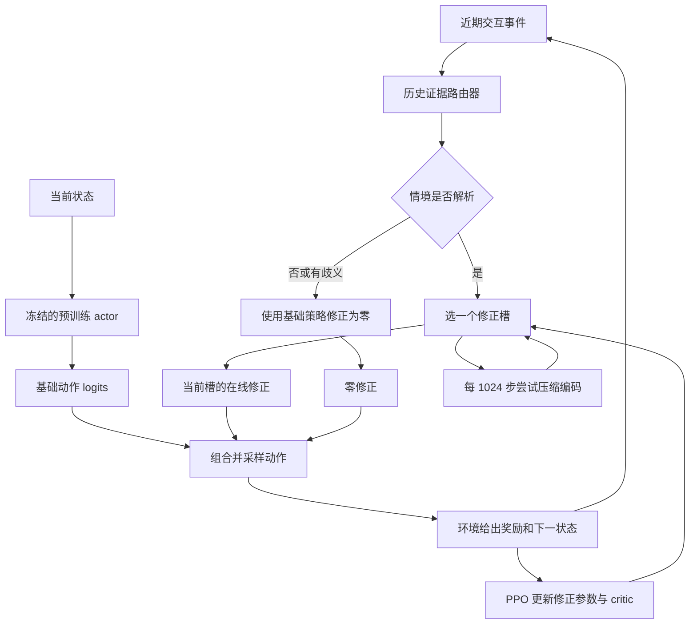

# 当前 V2 结构与算法

更新时间：2026-10-15。本文说明本仓库已实现并用于 V2 正式对照的 `evidence_router_nonblocking`。这是受控 C1 导航实验中的在线学习原型，不应解读为已经实现了自动知识树或一般环境下的持续学习系统。

## 一句话概览

当前系统由五部分组成：

1. 预训练得到并保持冻结的基础 actor；
2. 根据近期交互统计发现动力学情境的路由器；
3. 最多六个小型 actor 修正槽；
4. 使用真实奖励训练修正参数和共享 critic 的 PPO；
5. 每 1,024 个环境步尝试一次有界策略编码整合。

知识槽是扁平的。路由器负责选择槽，actor 修正参数负责改变动作分布。当前没有自动建立父子节点、把多个子情境的公共知识提升到父节点、合并分支或按收益拆分情境的算法。

## 数据流

在时间步 `t`，路由只使用已观测到的历史和当前状态；执行动作并观察结果后，才把新转移加入路由证据和训练数据。当前转移的结果不会反过来决定同一步已执行的动作。

## 1. 基础策略和在线修正

预训练策略从导航观测得到 64 维 actor 特征 `h₀(s)` 和四个动作 logits：

\[
z_0(s)=W_0h_0(s)+b_0.
\]

预训练 actor 在 V2 在线训练期间被冻结。在线可训练 actor 状态不是六个完整策略，而是六个修正张量：

\[
A_c\in\mathbb{R}^{3\times3\times3},\qquad c\in\{1,\ldots,6\}.
\]

每个槽有 27 个系数，六槽共 162 个。该参数化沿用当前导航任务的固定结构：环境被划为三个 x 轴区域；每一区域有一个 3×3 修正矩阵。它并不是任意的完整参数微调。

修正从预训练动作头和一个固定的 4×3 动作对比基底构造。令 `P` 为由预训练动作头投影得到的固定 3×65 特征基底，`H` 为固定的 4×3 动作对比基底，`φ₀(s)=[h₀(s);1]`，`b(s)` 为预设 x 区域，则：

\[
\Delta z_c(s)=H A_{c,b(s)}P\phi_0(s),\qquad
z_t(s)=z_0(s)+\Delta z_{c_t}(s).
\]

得到的 logits 经温度 `2.0` 的 softmax，并混合 `0.05` 的均匀动作概率。当前训练的是情境槽修正参数，不是基础 actor 的整个神经网络。

未解析情境对应 `route_id=0`、槽位 `−1`，此时修正为零，策略退回基础 actor。已解析到槽 `c` 时才使用 `A_c`。槽有代次编号；如果样本采集后其槽被替换，对应旧代次的 actor 样本会从 PPO policy loss 中屏蔽，避免用旧槽样本更新新情境的参数。

## 2. 路由器如何从历史判断情境

V2 没有用 RNN、Transformer 或训练出的历史编码器。`EvidenceRouter` 保留最多 32 个有效移动事件。每个事件提取：

\[
(\text{x 区域},\ \text{执行动作},\ \text{实际移动方向}).
\]

墙面阻挡且没有移动的事件被删失，不进入移动方向证据。每个持久情境原型保存计数表：

\[
N_c[\text{x 区域},\ \text{动作},\ \text{移动方向}]
\in\mathbb{N}^{3\times4\times4}.
\]

**奖励不参与当前路由判断。** 奖励进入 PPO 的回报和优势估计。路由器针对近确定性的当前动力学，比较近期历史与已有原型在共同获得支持的“区域—动作”单元上是否产生相同移动方向。

当前实现的主要规则如下：

- 证据尚少时返回未解析。
- 没有观测过的单元是未知，不自动视为冲突。
- 与已有原型兼容时，按共同匹配单元数及支持数排序；若最优匹配打平，保持歧义。
- 只有当近期后缀有足够重复支持，而且与每个旧原型均有足够受支持冲突，才创建新原型。
- 当前正式设置最多保留六个原型；满容量时按最近最少使用规则替换一个槽。

新原型需至少 4 个有效近期事件、至少 2 个受支持的不同单元；每单元至少 2 个支持事件。创建新原型时，与每个既有原型至少要有 2 个受支持冲突单元。这些门槛是启发式统计规则；返回的 confidence 不是校准后的后验概率，也不构成策略改进保证。

原型槽被替换时，路由计数、对应策略修正、该槽 anchor 和 actor 优化器状态一起清除。旧实现曾在分配新槽时覆盖别的槽尚未提交的试用更新；`PreservingTrialArm` 修复了这个问题，只清零被分配的槽并保留其他槽的 trial 参数。

## 3. 快速在线学习：PPO

神经策略每收集 256 个环境步形成一个 rollout，并用 PPO 更新。每个 1,024 步周期安排为：

| 周期内步数 | 用途 |
|---|---|
| 1–256 | PPO 训练 rollout 1 |
| 257–512 | PPO 训练 rollout 2 |
| 513–768 | PPO 训练 rollout 3 |
| 769–1,024 | 留出 rollout，不参与本周期 PPO 更新 |
| 周期结束 | 策略编码整合和持久化 |

配置使用 GAE（`γ=0.98`、`λ=0.95`）、PPO clip `0.2`、4 个 epoch、batch size 64、学习率 `0.003`、熵系数 `0.06`，并对过大的近似 KL 做 early stop。每周期 768 个环境步进入训练，256 步用于留出检查；留出步也计入在线交互成本。

PPO 更新当前观测所路由到的修正槽和一个共享 critic。**critic 当前没有接收情境路由编号：**它使用四个状态坐标与八个零占位特征，共 12 个输入。因此不同动力学情境的价值可能由同一 critic 混合估计。未解析情境的样本不更新修正 actor，但仍可更新 critic 和路由器统计。

未解析时，策略依赖温度变换、5% 均匀动作混合和 PPO 熵项进行普通探索。当前没有按“区分候选情境的信息增益”主动挑选动作的探索算法。

## 4. 慢速整合：压缩表示，不形成共享父参数

每周期把六个修正展开为矩阵 `M∈ℝ⁶ˣ²⁷`。整合的默认安全回退是独立 int8 编码，V2 尝试公共均值稀疏残差、双中心稀疏残差和截断 SVD 等更小表示。实际候选若超过预算则跳过。

候选只有同时满足下列条件才会采用：

\[
\text{candidate bytes}<\text{independent int8 bytes},
\]

以及相对独立 int8 回退策略，在当前留出状态和有限 anchor 状态上：

\[
\operatorname{mean}KL\le0.002,\qquad \max KL\le0.02.
\]

满足条件时选最小编码；没有候选通过则保留独立 int8。被选表示随后解码回六槽修正矩阵，继续在线更新；每次周期整合会重置 actor 优化器状态。

这里的 KL 门槛仅限制候选压缩相对当前 int8 策略的动作分布变化。它不证明新学到的策略比旧策略好，不保证历史任务的回报不下降，也不会自动把多个情境的在线数据联合训练成父节点参数。因此，V2 的“共享整合”目前主要指**参数矩阵的紧凑共同编码**，而不是多个情境共同更新一个共享知识节点。

## 5. 持久状态与容量边界

| 状态 | 用途与上限 |
|---|---|
| 近期移动事件 | 路由依据，最多 32 个有效移动事件 |
| 情境原型 | 重访时辨识动力学，最多 6 个槽 |
| 修正参数 | actor 修正矩阵最大预算 320 B；独立 int8 通常为 202 B |
| Anchor | 每槽最多 64 条状态，用于压缩失真检查 |
| critic、优化器、路由和 RNG | 保持训练与终点评估所需的持久状态 |

主 V2 checkpoint 持久化检查基础权重文件加 checkpoint 不超过 256 KiB。该限制不等同于整个 Python/Torch 进程的内存上限。当前只有六个真实情境、六个槽，没有测试情境数超过槽数后的长期容量压力曲线。保存的 checkpoint 可还原终点策略用于重访评估，但缺少环境状态、时间表位置和未完成 rollout，不能从任意中断时刻精确续训。

## 6. 与原研究目标的对应

| 目标能力 | V2 状态 |
|---|---|
| 部署后真实奖励驱动的参数更新 | 已实现：PPO 在线更新小型修正和 critic |
| 未知任务 ID/切换时刻下的情境处理 | 已实现有限的、从零建库的历史统计路由；规则依赖当前环境结构 |
| 清空近期历史后保留所学策略参数 | 已实现并做终点重访评估 |
| 限制持久存储 | 有六槽、编码预算和 checkpoint 边界；未验证超容量后的持续学习 |
| 局部更新失败时保留已学知识 | 已实现独立 int8 回退，减少整周期局部学习被撤销的风险 |
| 从在线经验自动发现共享—特化关系 | 尚未实现 |
| 自动提升公共知识、拆分/合并分支 | 尚未实现 |
| 区分情境识别置信与策略改进置信 | 只实现启发式识别分数和编码失真门槛；没有策略收益置信门控 |
| 未知情境下有目的地获取信息 | 尚未实现 |

因此，当前实际算法可概括为：

> **从历史转移统计中选择一个有限情境槽；以冻结预训练 actor 为底座，用真实奖励在线更新该槽的小型策略修正；每隔一段交互尝试将六槽修正压缩为更小表示，压缩未通过时保留独立参数。**

自动共享写入如何改变后续学习、固定容量满载后如何整理并取舍知识，仍是后续需要形成并验证的核心算法问题。

## 对应代码和实验

- [V2 主实验和条件配置](../scripts/run_knowledge_v2.py)
- [修正保留、PPO 与整合实现](../scripts/knowledge_v2_components.py)
- [在线训练、rollout 与 PPO](../scripts/run_knowledge_loop.py)
- [历史证据路由器](../src/online_rl/evidence_router.py)
- [策略修正参数化](../src/online_rl/c1_tensor_controls.py)
- [验证与优化结果](../outputs/knowledge_v2_report/验证与优化结论.md)
- [实现复核与评分限制](KNOWLEDGE_V2_IMPLEMENTATION_NOTES.md)
