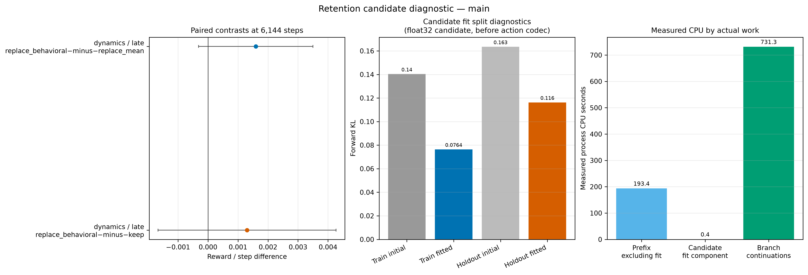

# E161 retention candidate confirmation report

Role: **confirmatory_e161_candidate_content**. Scientific status: **INCONCLUSIVE**.
Technical audit: **True**. The technical integrity result is reported separately from the scientific decision.

This offline report reads the saved cohort, step and rollout ledgers, checkpoint metadata, and bounded evidence artifacts. It makes no environment calls.

## Design and main decision

- Independent units: 16 deployment seeds, all retained; A/B family labels are balanced.
- Cases: 16; branches: 288; measured environment interactions: 2,244,608.
- Main futures: old_major, new_major. Balanced is a secondary boundary and does not enter the main estimate.
- Main estimand: average the two paired replicas within each future regime, then give old_major and new_major equal weight within seed.
- IUT direction passes: **False**; practical point threshold passes for both contrasts: **False**.
- Advancement requires both one-sided 95% Welch lower bounds above zero and both point estimates at least 0.002 reward/step.
- Welch inference uses equal A/B family means and the Welch-Satterthwaite degrees of freedom. The stratified seed bootstrap is a sensitivity analysis only.

| primary contrast | estimate | one-sided 95% lower | two-sided 95% Welch interval | direction | point threshold | bootstrap sensitivity interval |
|---|---:|---:|---|---|---|---|
| replace_behavioral-minus-replace_mean | 0.001591 | 0.000045 | [-0.000316, 0.003499] | True | False | [0.000055, 0.003110] |
| replace_behavioral-minus-keep | 0.001301 | -0.001132 | [-0.001665, 0.004267] | False | False | [-0.001191, 0.003825] |

Every configured seed remains in `analysis.json`; no old E130 result is pooled and no seed is excluded based on its significance or reward.

## Per-regime reward contrasts

These per-regime estimates include all three configured futures. `balanced` remains secondary.

| future | contrast | reward / step | two-sided 95% Welch interval | seeds |
|---|---|---:|---|---:|
| old_major | replace_behavioral-minus-replace_mean | 0.001386 | [0.000027, 0.002745] | 16 |
| new_major | replace_behavioral-minus-replace_mean | 0.001797 | [-0.001009, 0.004602] | 16 |
| balanced | replace_behavioral-minus-replace_mean | 0.001046 | [-0.001084, 0.003177] | 16 |
| old_major | replace_behavioral-minus-keep | -0.005452 | [-0.007743, -0.003162] | 16 |
| new_major | replace_behavioral-minus-keep | 0.008054 | [0.003896, 0.012212] | 16 |
| balanced | replace_behavioral-minus-keep | -0.001136 | [-0.004167, 0.001896] | 16 |
| old_major | replace_mean-minus-keep | -0.006838 | [-0.008218, -0.005459] | 16 |
| new_major | replace_mean-minus-keep | 0.006257 | [0.003823, 0.008692] | 16 |
| balanced | replace_mean-minus-keep | -0.002182 | [-0.003788, -0.000576] | 16 |

## Nested window and first-256-step recovery

The 1,536-step window and 6,144-step primary horizon are both retained by seed and regime. First-256-step recovery is reported per regime and in `analysis.json`.

| horizon | contrast | reward / step | two-sided 95% Welch interval |
|---:|---|---:|---|
| 1,536 | replace_behavioral-minus-replace_mean | 0.000394 | [-0.001825, 0.002614] |
| 1,536 | replace_behavioral-minus-keep | -0.002035 | [-0.004874, 0.000805] |
| 1,536 | replace_mean-minus-keep | -0.002429 | [-0.003963, -0.000894] |

| recovery population | future | contrast | reward / step |
|---|---|---|---:|
| allocated_only | old_major | replace_behavioral-minus-replace_mean | 0.001804 |
| allocated_only | new_major | replace_behavioral-minus-replace_mean | 0.001967 |
| allocated_only | balanced | replace_behavioral-minus-replace_mean | 0.001194 |
| allocated_only | old_major | replace_behavioral-minus-keep | -0.001633 |
| allocated_only | new_major | replace_behavioral-minus-keep | 0.003211 |
| allocated_only | balanced | replace_behavioral-minus-keep | 0.001476 |
| allocated_only | old_major | replace_mean-minus-keep | -0.003437 |
| allocated_only | new_major | replace_mean-minus-keep | 0.001244 |
| allocated_only | balanced | replace_mean-minus-keep | 0.000282 |
| all_bouts | old_major | replace_behavioral-minus-replace_mean | 0.000933 |
| all_bouts | new_major | replace_behavioral-minus-replace_mean | 0.002355 |
| all_bouts | balanced | replace_behavioral-minus-replace_mean | 0.001233 |
| all_bouts | old_major | replace_behavioral-minus-keep | -0.005496 |
| all_bouts | new_major | replace_behavioral-minus-keep | 0.008227 |
| all_bouts | balanced | replace_behavioral-minus-keep | -0.000308 |
| all_bouts | old_major | replace_mean-minus-keep | -0.006429 |
| all_bouts | new_major | replace_mean-minus-keep | 0.005872 |
| all_bouts | balanced | replace_mean-minus-keep | -0.001541 |

## Fit, codec, eviction, update, byte, and cost evidence

Training and holdout KL, source band counts, codec drift, source buffer and package bytes, slot evictions, rollout updates, and measured CPU costs are preserved in `analysis.json` by case, seed, future, replica, arm, and horizon where applicable.
- Raw CSV ledgers checked: 912; rollouts: 8,768; minibatch updates: 140,288.
- Evidence sidecar copies: 1,213,859 bytes; complete package limit: 262,144 bytes.
- Measured campaign CPU: 925.078 seconds.
- Fit KL is diagnostic; it does not replace reward as the primary outcome.

## Figure

## Provenance

Summary SHA-256: 8643ab86522a5edc79974f07d1569291131d5a250d5c7f3aa37d15775dc096cd  
Frozen config canonical SHA-256: fe1608707d5309ddd24867ab55fdff23249bf91f7a04158d949dd458ca1a7724  
Source manifest canonical SHA-256: 37bfa323d0534e198a9d14037e451003944050fb38b34e1dedccb274a066957a  
Runner SHA-256: 9b1e6c0123022943010d9a1e42c237aea095a71bc82fbfa480e7dbd7a349670f  
Reporter SHA-256: 249fe9d1ee3b05fa0c69214648d9bae2f480112e0f9b284e87e6bdf2ea773881
