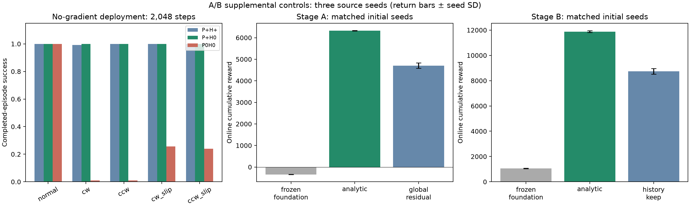

# A/B 对照补齐：结果与解释

**已完成：45 次无梯度部署、6 次优化器状态续训、12 次解析/冻结控制，以及 6 次匹配初始化的 PPO 在线基线。三个已有终点 checkpoint 共用一个基础预训练权重；结果是探索性机制证据。**

## 1. 清空历史后，持久参数是否仍有作用？

每次从实际磁盘 bundle 独立恢复，部署 2,048 步，关闭全部梯度。P+H+ 保留修正和当前历史；P+H0 保留修正但清空当前历史；P0H0 清除修正和当前历史。三者保留相同已学路由原型。表中为三个 checkpoint 的等权均值。

| 情境 | 保留参数＋历史 | 保留参数、清空历史 | 清除修正、清空历史 |
|---|---:|---:|---:|
| normal | 100.00% | 100.00% | 100.00% |
| cw | 99.23% | 100.00% | 1.04% |
| ccw | 100.00% | 100.00% | 1.04% |
| cw_slip | 100.00% | 100.00% | 25.71% |
| ccw_slip | 100.00% | 100.00% | 24.03% |

**解释：**CW/CCW 中，即使清空当前历史，保留参数版仍达到 100% 完整回合成功率，清除修正版均值约 1.04%。由于没有梯度更新，这个差异不能解释为测试期间重新训练或 Adam 动量改变动作。它支持已学修正的持久价值，但两者仍保留了识别原型，需要新反馈重新判断当前情境。

保留当前历史并非总有利：终点历史来自 CCW，直接部署 CW 会暂时用到过时证据；清空历史版反而恢复得更快。这不等于历史不必要，而说明临时情境证据与持久策略知识应具有不同生命周期。

## 2. 优化器状态的独立作用

保留同一策略修正，清空当前历史，在 CW→CCW 的 8,192 步流中继续训练。

| 状态 | 平均累计回报 | 平均新增优化器步 | 平均在线时间 |
|---|---:|---:|---:|
| retained_optimizer | 3099.82 | 492.3 | 5.11 秒 |
| reset_optimizer | 3032.99 | 475.7 | 5.08 秒 |

保留动量的均值略高，三个 checkpoint 不足以建立稳定的总体优势。PPO 的 KL 提前停止使实际更新次数不同；所有运行的基础 actor 参数均保持不变。

## 3. 强 history-only 基线改变了什么判断？

解析控制器仅从实际动作响应的近期历史估计全局旋转，对固定基础 actor 的动作做逆映射；无隐藏标签、无策略梯度。与从共同基础权重重新启动的 PPO 共享初始环境和动作随机种子、外生情境日程与交互预算，后续轨迹由各自行为生成。

| 阶段 | 方法 | 在线步/运行 | 累计回报均值 | 完整回合成功率 | 平均在线时间 | 梯度更新均值 |
|---|---|---:|---:|---:|---:|---:|
| A | frozen_foundation | 16,384 | -345.27 | 1.04% | 5.13 秒 | 0.0 |
| A | analytic | 16,384 | 6329.81 | 100.00% | 5.98 秒 | 0.0 |
| A | global_residual | 16,384 | 4706.31 | 97.92% | 10.18 秒 | 991.3 |
| B | frozen_foundation | 32,768 | 1054.21 | 63.38% | 10.59 秒 | 0.0 |
| B | analytic | 32,768 | 11875.88 | 99.86% | 12.10 秒 | 0.0 |
| B | history_keep | 32,768 | 8736.96 | 97.65% | 19.88 秒 | 1979.7 |

**重要负结果：解析控制器在原全局旋转任务中比当前梯度版本获得更高累计回报，并且没有梯度更新。**因此，原 A/B 不能证明这种环境必须依靠神经策略参数更新，也不能证明目前方法比所有临时适应方法更有效。这里仍有在线估计和经验使用，但没有形成新的神经策略权重。

这支持后续采用局部、非全局旋转的变化以及真正的共享/容量压力来检验研究问题。不能通过削弱解析基线获得优势，也不把当前负结果外推为所有部署后参数学习都无价值。

## 4. 核验、资源与限制

- 全部真实源 checkpoint 的基础 actor 与 foundation.pt 逐张量一致；策略、Adam 状态、路由、参数名称映射和新随机状态的文件读写已检查。
- 原终点没有保存全部历史 RNG，新 bundle 重建的是已学策略/优化器/路由，并采用明确的新部署随机种子；不是原训练随机过程的精确中断恢复。
- 无梯度分支保留 Adam 以便续训；解析分支没有 optimizer。计量的是声明的序列化核心和活跃训练缓冲，RSS 独立采样。框架对象、实验观察副本、日志和未使用的构造缓冲仍可能出现在进程 RAM 中，不声称与核心字节相等。
- 时间包含在线循环、日志及预算检查；不同控制器调用路径不同，不是隔离的单算子硬件基准。
- 每个控制分支的当前历史随着观测继续变化。P0H0 仅清除策略修正，没有删除识别原型。
- 解析 B 的预算初始化错误已修复；复用 57 个已完成记录，补跑 6 个 B 解析/冻结记录。原负结果和完成记录没有删除。

[原始汇总](summary.json) / [匹配在线基线](matched_online/summary.json) / [矢量图](supplement_summary.pdf) / [预声明规程](../../ab_plus_protocol.md)

## 软件与程序知识来源

使用 [Stable-Baselines3 PPO](https://stable-baselines3.readthedocs.io/en/master/modules/ppo.html)、[PPO](https://arxiv.org/abs/1707.06347)、[Gymnasium](https://gymnasium.farama.org/) 和 Matplotlib；版本见项目 requirements-lock.txt。实验循环参考 [autoresearch](https://github.com/karpathy/autoresearch)，未执行原始语言模型训练器。

stable-baselines3 与 matplotlib 技能支持实现和报告；程序知识来源为 Kassis, Agarwal, He, Patel & Brueckner（2026），[Scientific Agent Skills: A Library of Procedural Knowledge for Research Agents](https://arxiv.org/abs/2609.00065)。这些引用不构成外部性能验证。
