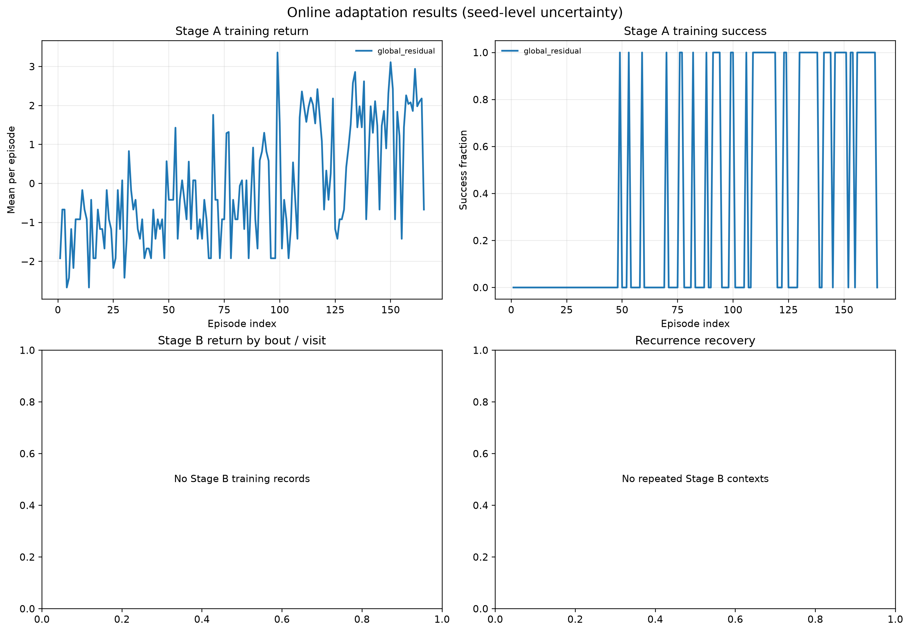

# Online adaptation report

Input directory: `D:\MovedFromC\ChatGPT\online\outputs\autoresearch_validation\trial_0`. This report was generated from logged run data.



Vector figure: [learning_summary.pdf](learning_summary.pdf)

## Data coverage

- Run directories: 1
- Episode records: 165 (0 marked evaluation)
- Training records used in curves and outcome summaries: 165
- Methods: global_residual
- Seed identifiers: 1
- Mixed-context episode records retained in overall counts: 0
- Distinct seed/method/stage groups: 1
- Curves first average within each seed and then across seeds. Confidence bands are 95% percentile bootstrap intervals resampled over seeds; episode rows are not treated as independent samples.
- Stage A and Stage B are independent seed/method groups. Stage B per-context exposure metrics exclude rows marked `mixed_context=true`; overall run totals still use the runner's cumulative summary values.
- Stage B records are grouped by each seed/method's recorded bout, visit, and context. Within each exposure, early means use the first up to 5 episodes and late means use the last up to 5. For exposures shorter than 10 episodes, these windows can overlap.

## Initial source pretraining evaluation

No `summary.pretrain` value was present in the run summaries.

## Stage A deployment training

| Method | Seeds | Training return (mean ± seed SD) | Success fraction (mean ± seed SD) |
|---|---:|---:|---:|
| global_residual | 1 | -0.079 ± 0.000 | 0.352 ± 0.000 |

### Baseline learning gate

Gate status was not explicitly recorded in the available summary/config JSON, so attainment cannot be determined without inventing a threshold.

### Evaluation episodes

| Stage | Method | Seed | Evaluation | Episodes | Steps | Mean return | Success fraction |
|---|---|---:|---|---:|---:|---:|---:|
| A | global_residual | 901 | shift_cw | 64 | 1,616 | 1.086 | 0.688 |
| A | global_residual | 901 | source_after_shift | 64 | 922 | 1.802 | 0.859 |

## Stage B unknown-route and revisit metrics

Operational definition: for each seed and method, the first chronological appearance of a recorded context in Stage B is an initial/unknown-route exposure; later exposures to that context are revisits. This is a logged-context proxy, not a claim about internal route knowledge.

No Stage B training exposures were available to summarize.

### Paired history retention comparison

| Outcome (history_keep − history_reset) | Paired seeds | Estimate | 95% paired seed-bootstrap interval | Reading |
|---|---:|---:|---:|---|
| Initial exposure early return | 0 | n/a | n/a | Insufficient matched seeds |
| Recurrence early-return recovery | 0 | n/a | n/a | Insufficient matched seeds |

Paired intervals resample matched seed clusters; they do not resample episode rows. An interval crossing zero is not a significance test, and with fewer than 5 pairs these contrasts are exploratory.

## Runtime, interaction, and capacity

| Stage | Method | Seeds | Online steps (mean ± seed SD) | Online time s (mean ± seed SD) | Updates (mean ± seed SD) | Online cumulative return (mean ± seed SD) | Evaluation steps (mean ± seed SD) | Evaluation time s (mean ± seed SD) | Peak agent state bytes | Peak process RSS bytes |
|---|---|---:|---:|---:|---:|---:|---:|---:|---:|---:|
| A | global_residual | 1 | 8192.000 ± 0.000 | 4.686 ± 0.000 | 128.000 ± 0.000 | n/a | 2538.000 ± 0.000 | n/a | 125,797 | 319,582,208 |

Runtime, interaction, updates, and evaluation costs come from each run's `summary.json`; per-episode cumulative `elapsed_s` values are not summed into a runtime estimate. `peak_agent_state_bytes` is reported as recorded and is not added to `rollout_bytes`, because the agent-state total already includes the rollout buffer. Process RSS is reported separately. The maximum recorded payload/RSS is not proof of all memory usage.

## Protocol and limitations

- Autoresearch trials select settings using validation seeds; the main seed is kept separate for the final evaluation. Evaluation results are not selected after inspecting test outcomes and then used for further tuning.
- The environment is a small synthetic navigation task. A small number of seeds and rotation/slip context shifts do not establish generalization to other worlds or shift families.
- There is no Phase C result here, so these data do not establish a shared-capacity conclusion.
- `oracle_keep` is diagnostic only and is excluded from formal method claims.
- The evaluated scope is a root plus leaf persistent residual bank with history routing. These runs do not establish parent-level sharing, compression efficiency, or a safe policy-improvement gate. The runner's `gain_gate` field describes experimental online trials; it is not the Stage A baseline gate.
- When fewer than 5 paired seeds are available, the seed-bootstrap intervals and paired contrasts are exploratory. No statistical-significance claim is made.
- Raw `episodes.csv` and `capacity.csv` files are retained in their run directories for review; this report does not replace them.

## Runner-supplied summaries

### Suite config `trial_0/config.json`

```json
{
  "a_steps": 8192,
  "agent_budget_bytes": 262144,
  "bc_updates": 1500,
  "bout_steps": 4096,
  "checkpoint": "data/foundation.pt",
  "dataset": "data/pretrain_source.npz",
  "ent_coef": 0.04,
  "gain_gate": "new residual uses are experimental online trials; no certified improvement gate in AB",
  "hidden_labels_agent_visible": false,
  "learning_rate": 0.001,
  "method": "global_residual",
  "novelty_threshold": 0.3,
  "oracle": false,
  "phase_C_shared_consolidation": false,
  "pretrain_transitions": 20000,
  "route_window": 16,
  "seed": 901,
  "sequence": [
    "cw"
  ],
  "stage": "A",
  "steps": 8192,
  "switch_rule": "fixed external interaction-step clock; changes may occur inside episodes"
}
```

### `trial_0`

```json
{
  "budget_bytes": 262144,
  "created_nodes": 0,
  "evaluation": {
    "shift_cw": {
      "episodes": 64,
      "mean_return": 1.0862499999999995,
      "steps": 1616,
      "success_rate": 0.6875
    },
    "source_after_shift": {
      "episodes": 64,
      "mean_return": 1.8021874999999998,
      "steps": 922,
      "success_rate": 0.859375
    }
  },
  "evaluation_steps": 2538,
  "limitations": [
    "synthetic globally rotated actuators and slip",
    "response dot/cross summary assumes planar action-response structure",
    "no shared parent promotion/compression evaluated in AB",
    "no calibrated policy-improvement safety gate",
    "payload+rollout hard bound; process RSS reported separately",
    "oracle_keep is diagnostic only"
  ],
  "method": "global_residual",
  "node_count": 1,
  "online_elapsed_s": 4.685880000004545,
  "online_steps": 8192,
  "peak_agent_state_bytes": 125797,
  "peak_process_rss_bytes": 319582208,
  "policy_resets": 0,
  "route_accuracy": 0.0,
  "route_coverage": 0.0,
  "seed": 901,
  "stage": "A",
  "updates": 128
}
```
