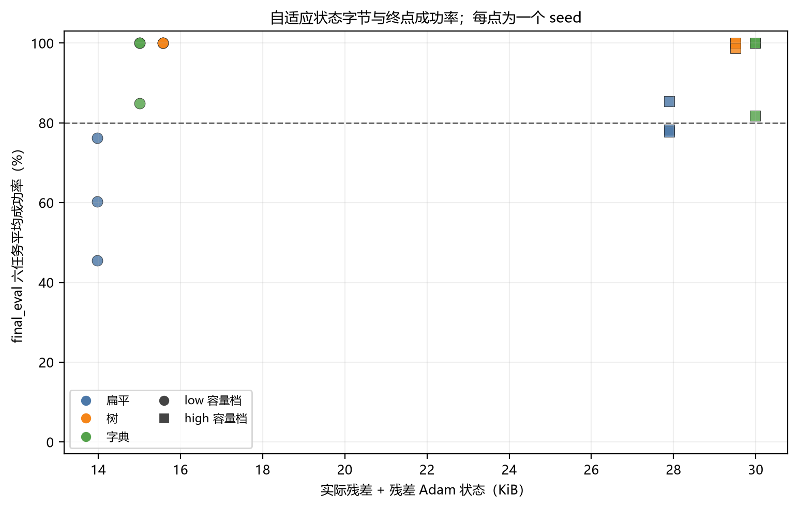
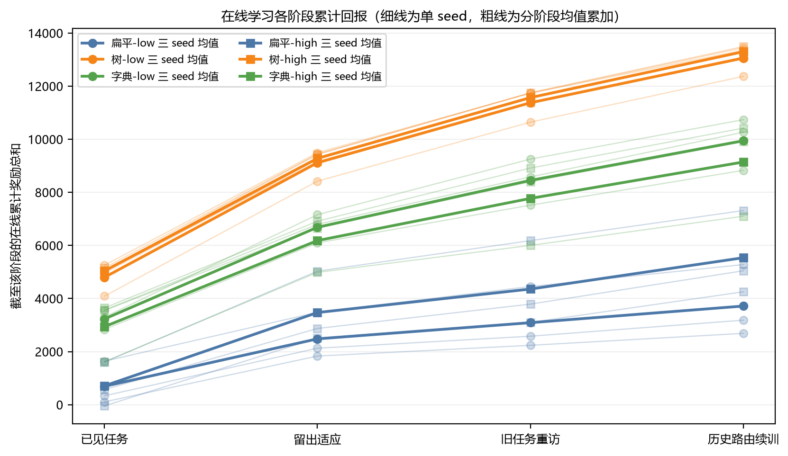
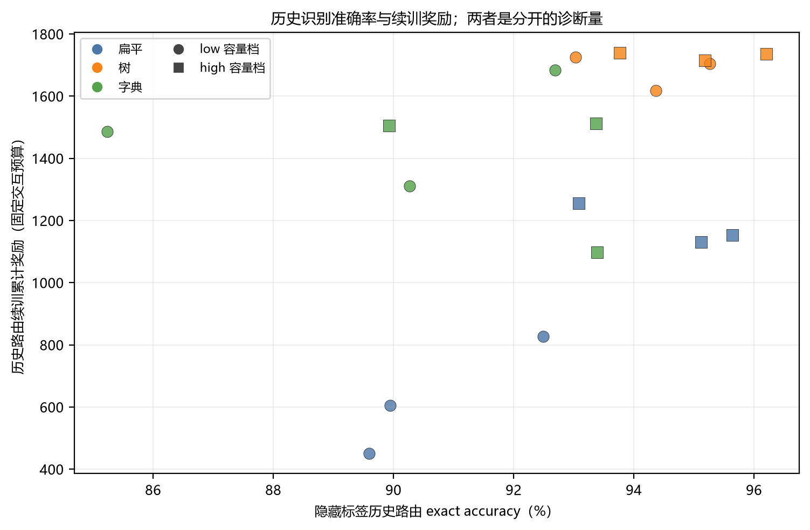
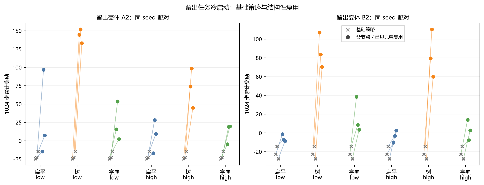

# C1 结果解读

## 主要结果

正式结果包含 **18 个 run**，final_eval 在 **90/108 个任务实例**达到单任务 80% 成功率目标；**10/18 个 run** 的六个任务全部达标。旧任务必须分别看适应后与重访后：adapted_eval 仅 **61/72** 个 seed×任务比较保持在 seen_eval 的 5 个百分点内；**11/72** 个比较在新任务适应后暂时下降超过 5 pp，重访后其中 **11** 个恢复到 5 pp 范围内。final_eval 的重访后闸门为 **70/72**；仍有 **2** 个比较未通过。最大即时下降为 **70.00 pp**（high 容量、字典、seed 97、A1）。这是描述性三 seed 结果。

A2/B2 冷启动的 36/36 个配对中，父节点或同族已见兄弟均值复用的 1024 步累计奖励高于基础策略；跨配对平均差为 **60.17**。下面保留每个 seed、方法、容量档和留出任务的原始配对值；不以总体均值替代失败或反向结果。

下表先按方法与容量档汇总三 seed 描述统计，逐 seed 数值紧随其后；它用于快速比较，不能掩盖单个失败。

| 容量档 | 方法 | final 达标任务数 | 六任务全达标 run | final 六任务均值成功率 | 保持闸门 适应后 / 重访后 | cold 复用 − 基础平均奖励 | 残差 + Adam 平均 bytes |
|---|---|---|---|---|---|---|---|
| low | 扁平 | 8/18 | 0/3 | 60.68% | 12/12 / 12/12 | 33.25 | 14,304 |
| low | 树 | 18/18 | 3/3 | 100.00% | 10/12 / 12/12 | 136.21 | 15,952 |
| low | 字典 | 17/18 | 2/3 | 94.95% | 9/12 / 12/12 | 41.46 | 15,364 |
| high | 扁平 | 13/18 | 0/3 | 80.50% | 12/12 / 11/12 | 22.75 | 28,560 |
| high | 树 | 18/18 | 3/3 | 99.60% | 12/12 / 12/12 | 99.04 | 30,208 |
| high | 字典 | 16/18 | 2/3 | 93.94% | 6/12 / 11/12 | 28.29 | 30,700 |

## 固定结构先验与表示诊断

在公开且有利的固定结构先验下，tree 的 parent 修正确由在线奖励更新得到；本实验的冷启动配对和终点结果显示，已学修正能迁移到留出变体。家族分组、树层级、特征映射、gate 与秩预算均在训练前固定。因此，证据支持“在预设共享结构中在线学到可迁移知识”，不支持“从数据自动发现共享结构”。这项架构先验限制发现性主张，但不否定在线奖励确实学到了有效 parent 参数。

Known-map observer 对固定 `data/foundation.pt` checkpoint 的动作重标记教师矩阵作离线可表示性诊断。它按构造分析 parent = Hᵀ(P_family − I)W_aug 与 child = Hᵀ(P_context,band − P_family)W_aug；诊断没有环境交互、agent 参数写入，也没有把教师权重灌入正式 agent。正式 agent 中的 parent 参数由在线奖励学习。

教师可精确加性分解为 family-parent rank 1 加 variant-local patch rank 1：六个上下文树父项与局部 patch 的 rank-1 相对 Frobenius 误差最大为 **3.08e-16**，完整 logits 重构误差为 **0.0**。扁平 rank 1 的教师重构误差为 **0.391–0.393**，rank 2 可精确表示；跨六任务堆叠的字典目标 rank 为 7，因此 K=6 的理论最佳相对误差下界为 **0.07361**，K=12 可精确表示。高容量 flat rank 2 / dictionary K=12 是表达能力控制；低容量 flat rank 1 和 dictionary K=6 对此教师目标先天地欠表达。

上述 rank 误差只针对固定 W0 logits 的动作重标记教师，不是 RL 最优回报或 argmax 分类目标；别的 rank 1 策略仍可能达到相同任务行为。因此，不能从该诊断说 rank 1 方法无法解决奖励任务。已知地图教师也不是在线学得的知识或真实策略改进保证。

一个边界例子：低容量 dictionary K=6 的 seed 71 在 final_eval 中六个任务均达到目标（各任务成功率见表）。这说明该诊断教师矩阵的精确可表示性不是 80% 奖励成功判据的必要条件；不能把 K=6 的矩阵逼近下界解释成任务失败预言。


每个单点结果都在下表逐项列出；“六任务全部通过”要求该 run 的 A0、A1、A2、B0、B1、B2 各自达到 80%。

## 冷启动：基础策略与公平结构复用

冷评估使用同一 seed 与动作随机数，基础策略走 foundation route，复用组走 tree 的父节点或 flat/dictionary 的已见同族兄弟均值 route；两组都不更新参数。每格是单次 1024 步累计奖励。

正式 run 使用冻结配置：learning rate = 0.01, temperature = 2.0。早期 calibration-index 错误中断的 precheck 与正式 run 隔离，完整验证账本在文末逐项列出。
| 容量档 | seed | 方法 | 留出任务 | 基础策略 | 结构复用 | 复用 − 基础 |
|---|---|---|---|---|---|---|
| low | 71 | 扁平 | A2 | -24.47 | -14.47 | 10.00 |
| low | 71 | 扁平 | B2 | -22.72 | -1.22 | 21.50 |
| low | 83 | 扁平 | A2 | -22.97 | 96.78 | 119.75 |
| low | 83 | 扁平 | B2 | -14.47 | -6.97 | 7.50 |
| low | 97 | 扁平 | A2 | -14.72 | 7.28 | 22.00 |
| low | 97 | 扁平 | B2 | -27.47 | -8.72 | 18.75 |
| low | 71 | 树 | A2 | -24.47 | 144.53 | 169.00 |
| low | 71 | 树 | B2 | -22.72 | 107.03 | 129.75 |
| low | 83 | 树 | A2 | -22.97 | 151.78 | 174.75 |
| low | 83 | 树 | B2 | -14.47 | 83.53 | 98.00 |
| low | 97 | 树 | A2 | -14.72 | 133.03 | 147.75 |
| low | 97 | 树 | B2 | -27.47 | 70.53 | 98.00 |
| low | 71 | 字典 | A2 | -24.47 | 15.53 | 40.00 |
| low | 71 | 字典 | B2 | -22.72 | 38.53 | 61.25 |
| low | 83 | 字典 | A2 | -22.97 | 53.53 | 76.50 |
| low | 83 | 字典 | B2 | -14.47 | 8.53 | 23.00 |
| low | 97 | 字典 | A2 | -14.72 | 2.28 | 17.00 |
| low | 97 | 字典 | B2 | -27.47 | 3.53 | 31.00 |
| high | 71 | 扁平 | A2 | -24.47 | -16.97 | 7.50 |
| high | 71 | 扁平 | B2 | -22.72 | -10.47 | 12.25 |
| high | 83 | 扁平 | A2 | -22.97 | 28.28 | 51.25 |
| high | 83 | 扁平 | B2 | -14.47 | -2.97 | 11.50 |
| high | 97 | 扁平 | A2 | -14.72 | 9.28 | 24.00 |
| high | 97 | 扁平 | B2 | -27.47 | 2.53 | 30.00 |
| high | 71 | 树 | A2 | -24.47 | 74.03 | 98.50 |
| high | 71 | 树 | B2 | -22.72 | 79.53 | 102.25 |
| high | 83 | 树 | A2 | -22.97 | 98.53 | 121.50 |
| high | 83 | 树 | B2 | -14.47 | 110.28 | 124.75 |
| high | 97 | 树 | A2 | -14.72 | 45.03 | 59.75 |
| high | 97 | 树 | B2 | -27.47 | 60.03 | 87.50 |
| high | 71 | 字典 | A2 | -24.47 | -4.72 | 19.75 |
| high | 71 | 字典 | B2 | -22.72 | 14.03 | 36.75 |
| high | 83 | 字典 | A2 | -22.97 | 19.03 | 42.00 |
| high | 83 | 字典 | B2 | -14.47 | -7.72 | 6.75 |
| high | 97 | 字典 | A2 | -14.72 | 19.53 | 34.25 |
| high | 97 | 字典 | B2 | -27.47 | 2.78 | 30.25 |

## 留出适应后的学习与终点评估

训练阶段累计回报来自真实在线交互。seen_eval 只覆盖旧任务；adapted_eval 在 A2/B2 适应后评估六个任务；final_eval 在旧任务重访后评估六个任务。差值以同一 run、同一旧任务的 seen_eval 为基准。

| 容量档 | seed | 方法 | 已见在线奖赏 | 留出适应在线奖赏 | 旧任务重访在线奖赏 | 历史续训在线奖赏 | 训练步 | 评估步 | oracle 校准转移 | 优化器更新 | 训练墙钟秒（含初始化） | 进程 CPU 秒（四训练阶段） |
|---|---|---|---|---|---|---|---|---|---|---|---|---|
| low | 71 | 扁平 | 333.96 | 1,792.98 | 452.74 | 604.43 | 63,488 | 15,360 | 57,344 | 3,958 | 54.15 | 53.16 |
| low | 83 | 扁平 | 105.71 | 1,726.48 | 404.24 | 450.18 | 63,488 | 15,360 | 57,344 | 3,968 | 56.04 | 54.80 |
| low | 97 | 扁平 | 1,638.46 | 1,841.98 | 970.74 | 826.18 | 63,488 | 15,360 | 57,344 | 3,958 | 56.44 | 55.14 |
| low | 71 | 树 | 5,050.96 | 4,379.48 | 2,310.99 | 1,704.18 | 63,488 | 15,360 | 57,344 | 3,947 | 55.33 | 53.45 |
| low | 83 | 树 | 4,088.96 | 4,331.48 | 2,222.99 | 1,726.18 | 63,488 | 15,360 | 57,344 | 3,943 | 56.47 | 55.16 |
| low | 97 | 树 | 5,253.46 | 4,238.23 | 2,245.99 | 1,618.18 | 63,488 | 15,360 | 57,344 | 3,949 | 55.78 | 53.84 |
| low | 71 | 字典 | 3,295.21 | 3,863.23 | 2,093.49 | 1,485.93 | 63,488 | 15,360 | 57,344 | 3,802 | 53.56 | 52.38 |
| low | 83 | 字典 | 3,560.46 | 3,235.48 | 1,784.24 | 1,684.18 | 63,488 | 15,360 | 57,344 | 3,822 | 55.42 | 54.25 |
| low | 97 | 字典 | 2,834.46 | 3,260.73 | 1,420.99 | 1,310.68 | 63,488 | 15,360 | 57,344 | 3,882 | 52.72 | 51.66 |
| high | 71 | 扁平 | -47.04 | 2,557.48 | 589.49 | 1,153.18 | 63,488 | 15,360 | 57,344 | 3,937 | 54.68 | 53.61 |
| high | 83 | 扁平 | 569.71 | 2,301.73 | 916.74 | 1,256.18 | 63,488 | 15,360 | 57,344 | 3,912 | 55.37 | 53.97 |
| high | 97 | 扁平 | 1,603.96 | 3,426.98 | 1,149.99 | 1,131.43 | 63,488 | 15,360 | 57,344 | 3,918 | 54.26 | 53.31 |
| high | 71 | 树 | 4,958.21 | 4,283.23 | 2,328.74 | 1,736.18 | 63,488 | 15,360 | 57,344 | 3,942 | 55.16 | 54.25 |
| high | 83 | 树 | 5,151.71 | 4,283.48 | 2,316.24 | 1,740.18 | 63,488 | 15,360 | 57,344 | 3,945 | 58.35 | 57.27 |
| high | 97 | 树 | 5,013.96 | 4,147.23 | 2,220.49 | 1,715.18 | 63,488 | 15,360 | 57,344 | 3,855 | 58.11 | 56.89 |
| high | 71 | 字典 | 3,644.46 | 3,266.23 | 2,004.24 | 1,504.43 | 63,488 | 15,360 | 57,344 | 3,573 | 55.80 | 54.77 |
| high | 83 | 字典 | 1,618.71 | 3,365.48 | 1,017.24 | 1,097.68 | 63,488 | 15,360 | 57,344 | 3,666 | 54.83 | 53.45 |
| high | 97 | 字典 | 3,553.21 | 3,097.48 | 1,745.24 | 1,512.43 | 63,488 | 15,360 | 57,344 | 3,660 | 53.64 | 52.84 |

注：墙钟列将 heldout 初始化时间与各次 `model.learn` 的 `online_elapsed_s` 相加；进程 CPU 列累加四个 `model.learn` 的 `online_process_cpu_s`，不含未单独计时的 heldout 初始化。


### 旧任务保持闸门

下降差值为成功率百分点，负数表示成功率高于 seen_eval。适应后闸门与重访后闸门分别按 adapted_eval、final_eval 相对 seen_eval 判定，阈值均为下降不超过 5 pp。

| 容量档 | seed | 方法 | 旧任务 | seen_eval | adapted_eval | final_eval | adapted − seen (pp) | final − seen (pp) | 适应后 5 pp 闸门 | 重访后 5 pp 闸门 |
|---|---|---|---|---|---|---|---|---|---|---|
| low | 71 | 扁平 | A0 | 41.67% | 41.67% | 41.67% | 0.00 | 0.00 | 通过 | 通过 |
| low | 71 | 扁平 | A1 | 12.50% | 12.50% | 40.00% | 0.00 | 27.50 | 通过 | 通过 |
| low | 71 | 扁平 | B0 | 12.50% | 12.50% | 12.50% | 0.00 | 0.00 | 通过 | 通过 |
| low | 71 | 扁平 | B1 | 96.15% | 96.15% | 96.97% | 0.00 | 0.82 | 通过 | 通过 |
| low | 83 | 扁平 | A0 | 30.00% | 30.00% | 40.00% | 0.00 | 10.00 | 通过 | 通过 |
| low | 83 | 扁平 | A1 | 96.15% | 96.15% | 93.33% | 0.00 | -2.82 | 通过 | 通过 |
| low | 83 | 扁平 | B0 | 0.00% | 0.00% | 0.00% | 0.00 | 0.00 | 通过 | 通过 |
| low | 83 | 扁平 | B1 | 0.00% | 0.00% | 0.00% | 0.00 | 0.00 | 通过 | 通过 |
| low | 97 | 扁平 | A0 | 12.50% | 12.50% | 12.50% | 0.00 | 0.00 | 通过 | 通过 |
| low | 97 | 扁平 | A1 | 100.00% | 100.00% | 100.00% | 0.00 | 0.00 | 通过 | 通过 |
| low | 97 | 扁平 | B0 | 53.85% | 53.85% | 53.85% | 0.00 | 0.00 | 通过 | 通过 |
| low | 97 | 扁平 | B1 | 100.00% | 100.00% | 100.00% | 0.00 | 0.00 | 通过 | 通过 |
| low | 71 | 树 | A0 | 100.00% | 100.00% | 100.00% | 0.00 | 0.00 | 通过 | 通过 |
| low | 71 | 树 | A1 | 100.00% | 100.00% | 100.00% | 0.00 | 0.00 | 通过 | 通过 |
| low | 71 | 树 | B0 | 100.00% | 100.00% | 100.00% | 0.00 | 0.00 | 通过 | 通过 |
| low | 71 | 树 | B1 | 100.00% | 100.00% | 100.00% | 0.00 | 0.00 | 通过 | 通过 |
| low | 83 | 树 | A0 | 100.00% | 100.00% | 100.00% | 0.00 | 0.00 | 通过 | 通过 |
| low | 83 | 树 | A1 | 100.00% | 100.00% | 100.00% | 0.00 | 0.00 | 通过 | 通过 |
| low | 83 | 树 | B0 | 100.00% | 100.00% | 100.00% | 0.00 | 0.00 | 通过 | 通过 |
| low | 83 | 树 | B1 | 100.00% | 100.00% | 100.00% | 0.00 | 0.00 | 通过 | 通过 |
| low | 97 | 树 | A0 | 100.00% | 100.00% | 100.00% | 0.00 | 0.00 | 通过 | 通过 |
| low | 97 | 树 | A1 | 100.00% | 100.00% | 100.00% | 0.00 | 0.00 | 通过 | 通过 |
| low | 97 | 树 | B0 | 100.00% | 94.12% | 100.00% | -5.88 | 0.00 | 未通过 | 通过 |
| low | 97 | 树 | B1 | 100.00% | 92.86% | 100.00% | -7.14 | 0.00 | 未通过 | 通过 |
| low | 71 | 字典 | A0 | 100.00% | 100.00% | 100.00% | 0.00 | 0.00 | 通过 | 通过 |
| low | 71 | 字典 | A1 | 97.37% | 100.00% | 100.00% | 2.63 | 2.63 | 通过 | 通过 |
| low | 71 | 字典 | B0 | 76.47% | 62.50% | 100.00% | -13.97 | 23.53 | 未通过 | 通过 |
| low | 71 | 字典 | B1 | 100.00% | 100.00% | 100.00% | 0.00 | 0.00 | 通过 | 通过 |
| low | 83 | 字典 | A0 | 81.25% | 45.45% | 100.00% | -35.80 | 18.75 | 未通过 | 通过 |
| low | 83 | 字典 | A1 | 97.06% | 100.00% | 100.00% | 2.94 | 2.94 | 通过 | 通过 |
| low | 83 | 字典 | B0 | 100.00% | 94.44% | 100.00% | -5.56 | 0.00 | 未通过 | 通过 |
| low | 83 | 字典 | B1 | 100.00% | 100.00% | 100.00% | 0.00 | 0.00 | 通过 | 通过 |
| low | 97 | 字典 | A0 | 0.00% | 0.00% | 12.50% | 0.00 | 12.50 | 通过 | 通过 |
| low | 97 | 字典 | A1 | 100.00% | 100.00% | 100.00% | 0.00 | 0.00 | 通过 | 通过 |
| low | 97 | 字典 | B0 | 96.55% | 100.00% | 100.00% | 3.45 | 3.45 | 通过 | 通过 |
| low | 97 | 字典 | B1 | 100.00% | 100.00% | 100.00% | 0.00 | 0.00 | 通过 | 通过 |
| high | 71 | 扁平 | A0 | 82.35% | 82.35% | 100.00% | 0.00 | 17.65 | 通过 | 通过 |
| high | 71 | 扁平 | A1 | 80.00% | 80.00% | 68.75% | 0.00 | -11.25 | 通过 | 未通过 |
| high | 71 | 扁平 | B0 | 12.50% | 12.50% | 12.50% | 0.00 | 0.00 | 通过 | 通过 |
| high | 71 | 扁平 | B1 | 68.75% | 68.75% | 100.00% | 0.00 | 31.25 | 通过 | 通过 |
| high | 83 | 扁平 | A0 | 81.82% | 81.82% | 100.00% | 0.00 | 18.18 | 通过 | 通过 |
| high | 83 | 扁平 | A1 | 100.00% | 100.00% | 100.00% | 0.00 | 0.00 | 通过 | 通过 |
| high | 83 | 扁平 | B0 | 0.00% | 0.00% | 100.00% | 0.00 | 100.00 | 通过 | 通过 |
| high | 83 | 扁平 | B1 | 12.50% | 12.50% | 12.50% | 0.00 | 0.00 | 通过 | 通过 |
| high | 97 | 扁平 | A0 | 12.50% | 12.50% | 12.50% | 0.00 | 0.00 | 通过 | 通过 |
| high | 97 | 扁平 | A1 | 100.00% | 100.00% | 100.00% | 0.00 | 0.00 | 通过 | 通过 |
| high | 97 | 扁平 | B0 | 53.85% | 53.85% | 53.85% | 0.00 | 0.00 | 通过 | 通过 |
| high | 97 | 扁平 | B1 | 100.00% | 100.00% | 100.00% | 0.00 | 0.00 | 通过 | 通过 |
| high | 71 | 树 | A0 | 100.00% | 100.00% | 100.00% | 0.00 | 0.00 | 通过 | 通过 |
| high | 71 | 树 | A1 | 100.00% | 100.00% | 100.00% | 0.00 | 0.00 | 通过 | 通过 |
| high | 71 | 树 | B0 | 100.00% | 100.00% | 100.00% | 0.00 | 0.00 | 通过 | 通过 |
| high | 71 | 树 | B1 | 100.00% | 100.00% | 100.00% | 0.00 | 0.00 | 通过 | 通过 |
| high | 83 | 树 | A0 | 100.00% | 100.00% | 100.00% | 0.00 | 0.00 | 通过 | 通过 |
| high | 83 | 树 | A1 | 100.00% | 100.00% | 100.00% | 0.00 | 0.00 | 通过 | 通过 |
| high | 83 | 树 | B0 | 100.00% | 100.00% | 100.00% | 0.00 | 0.00 | 通过 | 通过 |
| high | 83 | 树 | B1 | 100.00% | 100.00% | 100.00% | 0.00 | 0.00 | 通过 | 通过 |
| high | 97 | 树 | A0 | 100.00% | 100.00% | 100.00% | 0.00 | 0.00 | 通过 | 通过 |
| high | 97 | 树 | A1 | 100.00% | 96.97% | 100.00% | -3.03 | 0.00 | 通过 | 通过 |
| high | 97 | 树 | B0 | 94.12% | 94.44% | 100.00% | 0.33 | 5.88 | 通过 | 通过 |
| high | 97 | 树 | B1 | 100.00% | 100.00% | 100.00% | 0.00 | 0.00 | 通过 | 通过 |
| high | 71 | 字典 | A0 | 97.06% | 85.00% | 100.00% | -12.06 | 2.94 | 未通过 | 通过 |
| high | 71 | 字典 | A1 | 100.00% | 100.00% | 100.00% | 0.00 | 0.00 | 通过 | 通过 |
| high | 71 | 字典 | B0 | 100.00% | 96.15% | 100.00% | -3.85 | 0.00 | 通过 | 通过 |
| high | 71 | 字典 | B1 | 100.00% | 96.97% | 100.00% | -3.03 | 0.00 | 通过 | 通过 |
| high | 83 | 字典 | A0 | 95.45% | 76.92% | 100.00% | -18.53 | 4.55 | 未通过 | 通过 |
| high | 83 | 字典 | A1 | 100.00% | 100.00% | 68.75% | 0.00 | -31.25 | 通过 | 未通过 |
| high | 83 | 字典 | B0 | 61.54% | 61.54% | 100.00% | 0.00 | 38.46 | 通过 | 通过 |
| high | 83 | 字典 | B1 | 0.00% | 0.00% | 22.22% | 0.00 | 22.22 | 通过 | 通过 |
| high | 97 | 字典 | A0 | 70.59% | 61.54% | 100.00% | -9.05 | 29.41 | 未通过 | 通过 |
| high | 97 | 字典 | A1 | 100.00% | 30.00% | 100.00% | -70.00 | 0.00 | 未通过 | 通过 |
| high | 97 | 字典 | B0 | 100.00% | 80.00% | 100.00% | -20.00 | 0.00 | 未通过 | 通过 |
| high | 97 | 字典 | B1 | 100.00% | 36.36% | 100.00% | -63.64 | 0.00 | 未通过 | 通过 |

### 适应后的即时下降（超过 5 pp）

下表逐项列出 adapted_eval 相对 seen_eval 下降超过 5 pp 的旧任务对照。列出重访后的成功率与差值，以显示哪些暂时退化后来恢复。

| 容量档 | seed | 方法 | 旧任务 | seen_eval | adapted_eval | 即时差值 (pp) | final_eval | 重访差值 (pp) | 状态 |
|---|---|---|---|---|---|---|---|---|---|
| low | 97 | 树 | B0 | 100.00% | 94.12% | -5.88 | 100.00% | 0.00 | 恢复 |
| low | 97 | 树 | B1 | 100.00% | 92.86% | -7.14 | 100.00% | 0.00 | 恢复 |
| low | 71 | 字典 | B0 | 76.47% | 62.50% | -13.97 | 100.00% | 23.53 | 恢复 |
| low | 83 | 字典 | A0 | 81.25% | 45.45% | -35.80 | 100.00% | 18.75 | 恢复 |
| low | 83 | 字典 | B0 | 100.00% | 94.44% | -5.56 | 100.00% | 0.00 | 恢复 |
| high | 71 | 字典 | A0 | 97.06% | 85.00% | -12.06 | 100.00% | 2.94 | 恢复 |
| high | 83 | 字典 | A0 | 95.45% | 76.92% | -18.53 | 100.00% | 4.55 | 恢复 |
| high | 97 | 字典 | A0 | 70.59% | 61.54% | -9.05 | 100.00% | 29.41 | 恢复 |
| high | 97 | 字典 | A1 | 100.00% | 30.00% | -70.00 | 100.00% | 0.00 | 恢复 |
| high | 97 | 字典 | B0 | 100.00% | 80.00% | -20.00 | 100.00% | 0.00 | 恢复 |
| high | 97 | 字典 | B1 | 100.00% | 36.36% | -63.64 | 100.00% | 0.00 | 恢复 |

### 六个任务的 final_eval

任务成功计数以每个 heldout run 中 6 个独立 final_eval 成功率是否达到 80% 计算。未达标任务仍保留在任务级表格中。

| 容量档 | seed | 方法 | A0 | A1 | B0 | B1 | A2 | B2 | 达标任务 | 六任务全达标 |
|---|---|---|---|---|---|---|---|---|---|---|
| low | 71 | 扁平 | 41.67% | 40.00% | 12.50% | 96.97% | 70.59% | 100.00% | 2/6 | 否 |
| low | 83 | 扁平 | 40.00% | 93.33% | 0.00% | 0.00% | 100.00% | 40.00% | 2/6 | 否 |
| low | 97 | 扁平 | 12.50% | 100.00% | 53.85% | 100.00% | 100.00% | 90.91% | 4/6 | 否 |
| low | 71 | 树 | 100.00% | 100.00% | 100.00% | 100.00% | 100.00% | 100.00% | 6/6 | 是 |
| low | 83 | 树 | 100.00% | 100.00% | 100.00% | 100.00% | 100.00% | 100.00% | 6/6 | 是 |
| low | 97 | 树 | 100.00% | 100.00% | 100.00% | 100.00% | 100.00% | 100.00% | 6/6 | 是 |
| low | 71 | 字典 | 100.00% | 100.00% | 100.00% | 100.00% | 100.00% | 100.00% | 6/6 | 是 |
| low | 83 | 字典 | 100.00% | 100.00% | 100.00% | 100.00% | 100.00% | 100.00% | 6/6 | 是 |
| low | 97 | 字典 | 12.50% | 100.00% | 100.00% | 100.00% | 96.67% | 100.00% | 5/6 | 否 |
| high | 71 | 扁平 | 100.00% | 68.75% | 12.50% | 100.00% | 88.89% | 100.00% | 4/6 | 否 |
| high | 83 | 扁平 | 100.00% | 100.00% | 100.00% | 12.50% | 100.00% | 100.00% | 5/6 | 否 |
| high | 97 | 扁平 | 12.50% | 100.00% | 53.85% | 100.00% | 100.00% | 100.00% | 4/6 | 否 |
| high | 71 | 树 | 100.00% | 100.00% | 100.00% | 100.00% | 100.00% | 100.00% | 6/6 | 是 |
| high | 83 | 树 | 100.00% | 100.00% | 100.00% | 100.00% | 100.00% | 100.00% | 6/6 | 是 |
| high | 97 | 树 | 100.00% | 100.00% | 100.00% | 100.00% | 100.00% | 92.86% | 6/6 | 是 |
| high | 71 | 字典 | 100.00% | 100.00% | 100.00% | 100.00% | 100.00% | 100.00% | 6/6 | 是 |
| high | 83 | 字典 | 100.00% | 68.75% | 100.00% | 22.22% | 100.00% | 100.00% | 4/6 | 否 |
| high | 97 | 字典 | 100.00% | 100.00% | 100.00% | 100.00% | 100.00% | 100.00% | 6/6 | 是 |

## 达到 80% 的时间：留出阶段 episodes.csv

分别在 A2、B2 统计首个达到 ≥80% 的滚动 20 个已完成、非 mixed_context 回合窗口；步数从各自 8,192 步 heldout bout 开始计算。B2 的原始阶段 step 会先减去 A2 bout 的 8,192 步偏移。未达到或有效回合不足 20 时在各自 8,192 步预算末右删失。这个 episode 估计依赖阶段日志，不替代固定步数 final_eval。

| 容量档 | seed | 方法 | 任务 | 首次达标步 / 删失 | 达标前或删失时的有效回合 |
|---|---|---|---|---|---|
| low | 71 | 扁平 | A2 | 2,550 / 阶段 2,550 | 55 |
| low | 71 | 扁平 | B2 | 2,013 / 阶段 10,205 | 43 |
| low | 83 | 扁平 | A2 | 573 / 阶段 573 | 20 |
| low | 83 | 扁平 | B2 | ≥8,192（删失） | 136 |
| low | 97 | 扁平 | A2 | 1,355 / 阶段 1,355 | 44 |
| low | 97 | 扁平 | B2 | 6,124 / 阶段 14,316 | 138 |
| low | 71 | 树 | A2 | 459 / 阶段 459 | 20 |
| low | 71 | 树 | B2 | 449 / 阶段 8,641 | 20 |
| low | 83 | 树 | A2 | 422 / 阶段 422 | 20 |
| low | 83 | 树 | B2 | 479 / 阶段 8,671 | 20 |
| low | 97 | 树 | A2 | 419 / 阶段 419 | 20 |
| low | 97 | 树 | B2 | 376 / 阶段 8,568 | 20 |
| low | 71 | 字典 | A2 | 722 / 阶段 722 | 20 |
| low | 71 | 字典 | B2 | 1,069 / 阶段 9,261 | 30 |
| low | 83 | 字典 | A2 | 1,597 / 阶段 1,597 | 45 |
| low | 83 | 字典 | B2 | 3,106 / 阶段 11,298 | 73 |
| low | 97 | 字典 | A2 | 1,450 / 阶段 1,450 | 45 |
| low | 97 | 字典 | B2 | 2,437 / 阶段 10,629 | 64 |
| high | 71 | 扁平 | A2 | 3,155 / 阶段 3,155 | 81 |
| high | 71 | 扁平 | B2 | 2,510 / 阶段 10,702 | 57 |
| high | 83 | 扁平 | A2 | 1,208 / 阶段 1,208 | 31 |
| high | 83 | 扁平 | B2 | 6,407 / 阶段 14,599 | 127 |
| high | 97 | 扁平 | A2 | 1,698 / 阶段 1,698 | 57 |
| high | 97 | 扁平 | B2 | 1,972 / 阶段 10,164 | 53 |
| high | 71 | 树 | A2 | 540 / 阶段 540 | 20 |
| high | 71 | 树 | B2 | 422 / 阶段 8,614 | 20 |
| high | 83 | 树 | A2 | 527 / 阶段 527 | 20 |
| high | 83 | 树 | B2 | 409 / 阶段 8,601 | 20 |
| high | 97 | 树 | A2 | 698 / 阶段 698 | 24 |
| high | 97 | 树 | B2 | 484 / 阶段 8,676 | 20 |
| high | 71 | 字典 | A2 | 1,626 / 阶段 1,626 | 40 |
| high | 71 | 字典 | B2 | 2,649 / 阶段 10,841 | 76 |
| high | 83 | 字典 | A2 | 1,581 / 阶段 1,581 | 40 |
| high | 83 | 字典 | B2 | 2,015 / 阶段 10,207 | 42 |
| high | 97 | 字典 | A2 | 2,002 / 阶段 2,002 | 60 |
| high | 97 | 字典 | B2 | 1,909 / 阶段 10,101 | 46 |

## 自适应字节、共同容量上限与进程 RSS

自适应字节为 residual value + coordinate index + residual Adam tensor；不含共同冻结基础 actor 与 critic。`adaptive_cap_bytes` 是单独事先固定并强制执行的上限，完整 agent bundle 的安全余量不能挪给自适应张量。serialized core 是包含可恢复 agent/optimizer/router 状态的实测值；rollout 和进程 RSS 分开列出。容量比例比较 `peak_agent_bytes` 与事先固定的 `cap_bytes`；不把 RSS 或显式 tensor 下界当成可恢复序列化状态。

| 容量档 | seed | 方法 | 残差 + Adam bytes | final 达标数 | 六任务均值成功率 | adaptive tensor cap bytes | 共同全 agent cap bytes | peak agent bytes | 全 cap 余量 | peak/全 cap | peak serialized core bytes | peak rollout bytes | peak sampled RSS bytes | 显式 live tensor 下界 bytes |
|---|---|---|---|---|---|---|---|---|---|---|---|---|---|---|
| low | 71 | 扁平 | 14,304 | 2/6 | 60.29% | 15,952 | 188,416 | 164,598 | 23,818 | 87.4% | 141,046 | 23,552 | 327,008,256 | 140,128 |
| low | 83 | 扁平 | 14,304 | 2/6 | 45.56% | 15,952 | 188,416 | 164,534 | 23,882 | 87.3% | 140,982 | 23,552 | 327,647,232 | 140,128 |
| low | 97 | 扁平 | 14,304 | 4/6 | 76.21% | 15,952 | 188,416 | 164,534 | 23,882 | 87.3% | 140,982 | 23,552 | 328,024,064 | 140,128 |
| low | 71 | 树 | 15,952 | 6/6 | 100.00% | 15,952 | 188,416 | 170,694 | 17,722 | 90.6% | 147,142 | 23,552 | 326,815,744 | 141,528 |
| low | 83 | 树 | 15,952 | 6/6 | 100.00% | 15,952 | 188,416 | 170,694 | 17,722 | 90.6% | 147,142 | 23,552 | 327,315,456 | 141,528 |
| low | 97 | 树 | 15,952 | 6/6 | 100.00% | 15,952 | 188,416 | 170,694 | 17,722 | 90.6% | 147,142 | 23,552 | 326,905,856 | 142,320 |
| low | 71 | 字典 | 15,364 | 6/6 | 100.00% | 15,952 | 188,416 | 160,050 | 28,366 | 84.9% | 136,498 | 23,552 | 327,852,032 | 143,636 |
| low | 83 | 字典 | 15,364 | 6/6 | 100.00% | 15,952 | 188,416 | 160,050 | 28,366 | 84.9% | 136,498 | 23,552 | 326,565,888 | 143,708 |
| low | 97 | 字典 | 15,364 | 5/6 | 84.86% | 15,952 | 188,416 | 160,050 | 28,366 | 84.9% | 136,498 | 23,552 | 327,139,328 | 143,636 |
| high | 71 | 扁平 | 28,560 | 4/6 | 78.36% | 30,700 | 204,800 | 178,422 | 26,378 | 87.1% | 154,870 | 23,552 | 327,041,024 | 158,344 |
| high | 83 | 扁平 | 28,560 | 5/6 | 85.42% | 30,700 | 204,800 | 178,422 | 26,378 | 87.1% | 154,870 | 23,552 | 327,716,864 | 156,760 |
| high | 97 | 扁平 | 28,560 | 4/6 | 77.72% | 30,700 | 204,800 | 178,422 | 26,378 | 87.1% | 154,870 | 23,552 | 327,225,344 | 156,760 |
| high | 71 | 树 | 30,208 | 6/6 | 100.00% | 30,700 | 204,800 | 184,582 | 20,218 | 90.1% | 161,030 | 23,552 | 327,483,392 | 158,952 |
| high | 83 | 树 | 30,208 | 6/6 | 100.00% | 30,700 | 204,800 | 184,518 | 20,282 | 90.1% | 160,966 | 23,552 | 327,393,280 | 157,368 |
| high | 97 | 树 | 30,208 | 6/6 | 98.81% | 30,700 | 204,800 | 184,518 | 20,282 | 90.1% | 160,966 | 23,552 | 327,090,176 | 160,536 |
| high | 71 | 字典 | 30,700 | 6/6 | 100.00% | 30,700 | 204,800 | 175,218 | 29,582 | 85.6% | 151,666 | 23,552 | 327,118,848 | 163,940 |
| high | 83 | 字典 | 30,700 | 4/6 | 81.83% | 30,700 | 204,800 | 175,218 | 29,582 | 85.6% | 151,666 | 23,552 | 327,081,984 | 163,940 |
| high | 97 | 字典 | 30,700 | 6/6 | 100.00% | 30,700 | 204,800 | 175,218 | 29,582 | 85.6% | 151,666 | 23,552 | 327,528,448 | 163,796 |



累计在线回报图将每阶段在线累计奖励顺序相加，并以细线显示每个 run、粗线显示每个方法与容量档的三 seed 分阶段均值。各阶段预算不同，表中同时列出实际交互步。



## 历史路由诊断

history 是加载已训练 agent、清空近期历史后的 calibrated-history 隐藏标签续训。它继续在六段各 1,024 步在线交互中训练；下表分开列 exact/family route accuracy 与该阶段奖励。识别置信度或准确率不是策略收益证据，本实验也没有策略改进认证门控。

| 容量档 | seed | 方法 | exact accuracy | family accuracy | 父回退占比 | 基础回退占比 | history 在线奖励 | history 步 |
|---|---|---|---|---|---|---|---|---|
| low | 71 | 扁平 | 89.94% | 99.02% | 9.10% | 0.07% | 604.43 | 6,144 |
| low | 83 | 扁平 | 89.60% | 99.25% | 9.29% | 0.10% | 450.18 | 6,144 |
| low | 97 | 扁平 | 92.50% | 99.17% | 6.18% | 0.07% | 826.18 | 6,144 |
| low | 71 | 树 | 95.26% | 99.17% | 3.89% | 0.07% | 1,704.18 | 6,144 |
| low | 83 | 树 | 93.03% | 99.22% | 6.18% | 0.08% | 1,726.18 | 6,144 |
| low | 97 | 树 | 94.37% | 99.25% | 4.62% | 0.10% | 1,618.18 | 6,144 |
| low | 71 | 字典 | 85.24% | 99.12% | 13.88% | 0.07% | 1,485.93 | 6,144 |
| low | 83 | 字典 | 92.69% | 99.07% | 6.22% | 0.05% | 1,684.18 | 6,144 |
| low | 97 | 字典 | 90.27% | 99.22% | 9.05% | 0.07% | 1,310.68 | 6,144 |
| high | 71 | 扁平 | 95.64% | 99.19% | 3.47% | 0.07% | 1,153.18 | 6,144 |
| high | 83 | 扁平 | 93.08% | 99.15% | 5.79% | 0.08% | 1,256.18 | 6,144 |
| high | 97 | 扁平 | 95.12% | 99.30% | 3.99% | 0.05% | 1,131.43 | 6,144 |
| high | 71 | 树 | 96.21% | 99.20% | 2.78% | 0.05% | 1,736.18 | 6,144 |
| high | 83 | 树 | 93.77% | 99.24% | 5.39% | 0.10% | 1,740.18 | 6,144 |
| high | 97 | 树 | 95.18% | 99.19% | 3.65% | 0.07% | 1,715.18 | 6,144 |
| high | 71 | 字典 | 89.93% | 99.17% | 9.13% | 0.08% | 1,504.43 | 6,144 |
| high | 83 | 字典 | 93.39% | 99.14% | 5.83% | 0.08% | 1,097.68 | 6,144 |
| high | 97 | 字典 | 93.38% | 99.24% | 5.62% | 0.07% | 1,512.43 | 6,144 |



history_eval 在上述续训之后以已知 context route 对六个任务做独立无梯度评估。它测的是该续训后参数的条件表现，不是历史路由器在线识别表现；与主表中 history 续训前的 oracle-route final_eval 分开。

| 容量档 | seed | 方法 | 任务 | 成功率 | 评估累计奖励 | 成功/完成回合 | 评估未改参数 |
|---|---|---|---|---|---|---|---|
| low | 71 | 扁平 | A0 | 41.67% | 7.89 | 5/12 | 是 |
| low | 71 | 扁平 | A1 | 58.33% | 20.14 | 7/12 | 是 |
| low | 71 | 扁平 | B0 | 12.50% | -3.36 | 1/8 | 是 |
| low | 71 | 扁平 | B1 | 100.00% | 121.64 | 36/36 | 是 |
| low | 71 | 扁平 | A2 | 70.59% | 39.14 | 12/17 | 是 |
| low | 71 | 扁平 | B2 | 100.00% | 110.89 | 32/32 | 是 |
| low | 83 | 扁平 | A0 | 40.00% | 4.64 | 4/10 | 是 |
| low | 83 | 扁平 | A1 | 100.00% | 107.39 | 33/33 | 是 |
| low | 83 | 扁平 | B0 | 0.00% | -8.61 | 0/8 | 是 |
| low | 83 | 扁平 | B1 | 0.00% | -7.36 | 0/8 | 是 |
| low | 83 | 扁平 | A2 | 100.00% | 123.14 | 36/36 | 是 |
| low | 83 | 扁平 | B2 | 25.00% | 6.64 | 2/8 | 是 |
| low | 97 | 扁平 | A0 | 12.50% | -11.61 | 1/8 | 是 |
| low | 97 | 扁平 | A1 | 100.00% | 116.89 | 35/35 | 是 |
| low | 97 | 扁平 | B0 | 50.00% | 5.89 | 6/12 | 是 |
| low | 97 | 扁平 | B1 | 96.97% | 111.39 | 32/33 | 是 |
| low | 97 | 扁平 | A2 | 100.00% | 134.64 | 40/40 | 是 |
| low | 97 | 扁平 | B2 | 100.00% | 103.14 | 31/31 | 是 |
| low | 71 | 树 | A0 | 100.00% | 140.14 | 42/42 | 是 |
| low | 71 | 树 | A1 | 100.00% | 147.39 | 43/43 | 是 |
| low | 71 | 树 | B0 | 100.00% | 150.14 | 45/45 | 是 |
| low | 71 | 树 | B1 | 100.00% | 145.14 | 42/42 | 是 |
| low | 71 | 树 | A2 | 100.00% | 140.64 | 41/41 | 是 |
| low | 71 | 树 | B2 | 100.00% | 146.39 | 42/42 | 是 |
| low | 83 | 树 | A0 | 100.00% | 149.89 | 44/44 | 是 |
| low | 83 | 树 | A1 | 100.00% | 141.14 | 42/42 | 是 |
| low | 83 | 树 | B0 | 100.00% | 134.64 | 40/40 | 是 |
| low | 83 | 树 | B1 | 100.00% | 145.89 | 44/44 | 是 |
| low | 83 | 树 | A2 | 100.00% | 146.64 | 43/43 | 是 |
| low | 83 | 树 | B2 | 100.00% | 140.39 | 40/40 | 是 |
| low | 97 | 树 | A0 | 100.00% | 148.39 | 43/43 | 是 |
| low | 97 | 树 | A1 | 100.00% | 142.14 | 42/42 | 是 |
| low | 97 | 树 | B0 | 100.00% | 136.64 | 40/40 | 是 |
| low | 97 | 树 | B1 | 100.00% | 137.64 | 40/40 | 是 |
| low | 97 | 树 | A2 | 100.00% | 148.64 | 44/44 | 是 |
| low | 97 | 树 | B2 | 100.00% | 142.89 | 42/42 | 是 |
| low | 71 | 字典 | A0 | 100.00% | 142.64 | 42/42 | 是 |
| low | 71 | 字典 | A1 | 100.00% | 142.14 | 42/42 | 是 |
| low | 71 | 字典 | B0 | 100.00% | 146.39 | 44/44 | 是 |
| low | 71 | 字典 | B1 | 100.00% | 143.89 | 42/42 | 是 |
| low | 71 | 字典 | A2 | 100.00% | 134.89 | 39/39 | 是 |
| low | 71 | 字典 | B2 | 96.67% | 97.64 | 29/30 | 是 |
| low | 83 | 字典 | A0 | 100.00% | 125.14 | 38/38 | 是 |
| low | 83 | 字典 | A1 | 100.00% | 144.14 | 43/43 | 是 |
| low | 83 | 字典 | B0 | 100.00% | 145.89 | 43/43 | 是 |
| low | 83 | 字典 | B1 | 100.00% | 146.39 | 44/44 | 是 |
| low | 83 | 字典 | A2 | 100.00% | 149.14 | 44/44 | 是 |
| low | 83 | 字典 | B2 | 100.00% | 151.89 | 43/43 | 是 |
| low | 97 | 字典 | A0 | 64.29% | 10.64 | 9/14 | 是 |
| low | 97 | 字典 | A1 | 100.00% | 128.14 | 38/38 | 是 |
| low | 97 | 字典 | B0 | 100.00% | 133.39 | 39/39 | 是 |
| low | 97 | 字典 | B1 | 100.00% | 148.14 | 43/43 | 是 |
| low | 97 | 字典 | A2 | 100.00% | 136.89 | 41/41 | 是 |
| low | 97 | 字典 | B2 | 100.00% | 145.39 | 42/42 | 是 |
| high | 71 | 扁平 | A0 | 100.00% | 139.89 | 42/42 | 是 |
| high | 71 | 扁平 | A1 | 95.83% | 73.64 | 23/24 | 是 |
| high | 71 | 扁平 | B0 | 12.50% | -3.11 | 1/8 | 是 |
| high | 71 | 扁平 | B1 | 100.00% | 136.64 | 40/40 | 是 |
| high | 71 | 扁平 | A2 | 100.00% | 139.64 | 41/41 | 是 |
| high | 71 | 扁平 | B2 | 100.00% | 147.39 | 42/42 | 是 |
| high | 83 | 扁平 | A0 | 100.00% | 142.64 | 42/42 | 是 |
| high | 83 | 扁平 | A1 | 100.00% | 140.64 | 42/42 | 是 |
| high | 83 | 扁平 | B0 | 100.00% | 80.89 | 26/26 | 是 |
| high | 83 | 扁平 | B1 | 12.50% | -4.36 | 1/8 | 是 |
| high | 83 | 扁平 | A2 | 100.00% | 146.89 | 43/43 | 是 |
| high | 83 | 扁平 | B2 | 100.00% | 107.14 | 31/31 | 是 |
| high | 97 | 扁平 | A0 | 12.50% | -10.36 | 1/8 | 是 |
| high | 97 | 扁平 | A1 | 100.00% | 139.64 | 41/41 | 是 |
| high | 97 | 扁平 | B0 | 53.85% | 10.14 | 7/13 | 是 |
| high | 97 | 扁平 | B1 | 100.00% | 134.64 | 39/39 | 是 |
| high | 97 | 扁平 | A2 | 100.00% | 142.39 | 42/42 | 是 |
| high | 97 | 扁平 | B2 | 100.00% | 135.89 | 40/40 | 是 |
| high | 71 | 树 | A0 | 100.00% | 145.39 | 43/43 | 是 |
| high | 71 | 树 | A1 | 100.00% | 137.64 | 41/41 | 是 |
| high | 71 | 树 | B0 | 100.00% | 150.14 | 45/45 | 是 |
| high | 71 | 树 | B1 | 100.00% | 144.39 | 42/42 | 是 |
| high | 71 | 树 | A2 | 100.00% | 143.39 | 42/42 | 是 |
| high | 71 | 树 | B2 | 100.00% | 135.89 | 39/39 | 是 |
| high | 83 | 树 | A0 | 100.00% | 150.89 | 44/44 | 是 |
| high | 83 | 树 | A1 | 100.00% | 143.39 | 43/43 | 是 |
| high | 83 | 树 | B0 | 100.00% | 141.14 | 42/42 | 是 |
| high | 83 | 树 | B1 | 100.00% | 150.64 | 45/45 | 是 |
| high | 83 | 树 | A2 | 100.00% | 129.14 | 38/38 | 是 |
| high | 83 | 树 | B2 | 100.00% | 149.39 | 43/43 | 是 |
| high | 97 | 树 | A0 | 100.00% | 144.89 | 42/42 | 是 |
| high | 97 | 树 | A1 | 100.00% | 139.39 | 41/41 | 是 |
| high | 97 | 树 | B0 | 100.00% | 149.89 | 43/43 | 是 |
| high | 97 | 树 | B1 | 100.00% | 146.64 | 42/42 | 是 |
| high | 97 | 树 | A2 | 100.00% | 145.14 | 43/43 | 是 |
| high | 97 | 树 | B2 | 100.00% | 148.89 | 43/43 | 是 |
| high | 71 | 字典 | A0 | 100.00% | 79.64 | 24/24 | 是 |
| high | 71 | 字典 | A1 | 100.00% | 143.64 | 42/42 | 是 |
| high | 71 | 字典 | B0 | 100.00% | 122.39 | 37/37 | 是 |
| high | 71 | 字典 | B1 | 100.00% | 139.14 | 41/41 | 是 |
| high | 71 | 字典 | A2 | 100.00% | 143.39 | 42/42 | 是 |
| high | 71 | 字典 | B2 | 84.62% | 67.89 | 22/26 | 是 |
| high | 83 | 字典 | A0 | 100.00% | 109.64 | 34/34 | 是 |
| high | 83 | 字典 | A1 | 100.00% | 99.39 | 31/31 | 是 |
| high | 83 | 字典 | B0 | 96.67% | 95.14 | 29/30 | 是 |
| high | 83 | 字典 | B1 | 0.00% | -8.61 | 0/8 | 是 |
| high | 83 | 字典 | A2 | 100.00% | 143.39 | 42/42 | 是 |
| high | 83 | 字典 | B2 | 100.00% | 132.39 | 38/38 | 是 |
| high | 97 | 字典 | A0 | 100.00% | 127.64 | 38/38 | 是 |
| high | 97 | 字典 | A1 | 100.00% | 148.89 | 44/44 | 是 |
| high | 97 | 字典 | B0 | 100.00% | 141.89 | 41/41 | 是 |
| high | 97 | 字典 | B1 | 96.43% | 91.89 | 27/28 | 是 |
| high | 97 | 字典 | A2 | 100.00% | 141.39 | 42/42 | 是 |
| high | 97 | 字典 | B2 | 96.97% | 108.39 | 32/33 | 是 |

## 交互计数与验证前置条件

正式训练交互 **1,142,784 步**；正式固定策略评估 **276,480 步**。选定配置的六上下文 learnability precheck 另有 **55,296 步**（含训练与独立评估）。正式阶段 seen/heldout/revisit 以 oracle 任务 ID 路由并用于转移模型校准，共 **1,032,192 个标注在线转移**；选定 precheck 训练另有 **49,152 个**。history 的 **110,592 步**使用既有校准模型并隐藏任务标签，不计入标定样本。
全部预正式验证账本共 **286,721 个训练交互 + 17,920 个评估交互 = 304,641 步**，包括早期失败试验、超参数验证、最终选定的六上下文前置验证及一个未记录进 CSV 的实际环境步。原始 calibration-index 错误中断的 precheck 没有用于正式学习或校准；详见下方逐条记录。
选定 precheck：通过；六个上下文均需在最多 16,384 学习步后达到 80% 成功率。

验证前置六个上下文的逐项结果：

| 上下文 | 最终成功率 | 80% 前置 | 初始训练步 | 延长训练步 | 最终评估完成回合 |
|---|---|---|---|---|---|
| A0 | 100.00% | 通过 | 8,192 | 0 | 39 |
| A1 | 100.00% | 通过 | 8,192 | 0 | 41 |
| A2 | 100.00% | 通过 | 8,192 | 0 | 42 |
| B0 | 100.00% | 通过 | 8,192 | 0 | 43 |
| B1 | 100.00% | 通过 | 8,192 | 0 | 43 |
| B2 | 100.00% | 通过 | 8,192 | 0 | 42 |

## 全部预正式验证试验

以下附上 validation_ledger.json 中的全部 **40 条试验记录**，包括失败的初始前置运行、最终选中配置前的超参数试验与选中后六上下文前置验证。记录按原始 JSON 保留，避免只报告入选的六项。账本记录正式结果是否参与筛选：未参与。

### 验证记录 1

```json
{
  "eval_interactions": 0,
  "path": "outputs\\c1\\precheck\\A0\\extension\\steps.csv",
  "phase": "initial_precheck",
  "status": "calibration_index_error; policy outcomes retained",
  "train_interactions": 8192
}
```

### 验证记录 2

```json
{
  "eval_interactions": 0,
  "path": "outputs\\c1\\precheck\\A0\\initial\\steps.csv",
  "phase": "initial_precheck",
  "status": "calibration_index_error; policy outcomes retained",
  "train_interactions": 8192
}
```

### 验证记录 3

```json
{
  "eval_interactions": 0,
  "path": "outputs\\c1\\precheck\\A1\\extension\\steps.csv",
  "phase": "initial_precheck",
  "status": "calibration_index_error; policy outcomes retained",
  "train_interactions": 8192
}
```

### 验证记录 4

```json
{
  "eval_interactions": 0,
  "path": "outputs\\c1\\precheck\\A1\\initial\\steps.csv",
  "phase": "initial_precheck",
  "status": "calibration_index_error; policy outcomes retained",
  "train_interactions": 8192
}
```

### 验证记录 5

```json
{
  "eval_interactions": 0,
  "path": "outputs\\c1\\precheck\\A2\\extension\\steps.csv",
  "phase": "initial_precheck",
  "status": "calibration_index_error; policy outcomes retained",
  "train_interactions": 8192
}
```

### 验证记录 6

```json
{
  "eval_interactions": 0,
  "path": "outputs\\c1\\precheck\\A2\\initial\\steps.csv",
  "phase": "initial_precheck",
  "status": "calibration_index_error; policy outcomes retained",
  "train_interactions": 8192
}
```

### 验证记录 7

```json
{
  "eval_interactions": 0,
  "path": "outputs\\c1\\precheck\\B0\\initial\\steps.csv",
  "phase": "initial_precheck",
  "status": "calibration_index_error; policy outcomes retained",
  "train_interactions": 8192
}
```

### 验证记录 8

```json
{
  "eval_interactions": 0,
  "path": "outputs\\c1\\precheck\\B1\\extension\\steps.csv",
  "phase": "initial_precheck",
  "status": "calibration_index_error; policy outcomes retained",
  "train_interactions": 8192
}
```

### 验证记录 9

```json
{
  "eval_interactions": 0,
  "path": "outputs\\c1\\precheck\\B1\\initial\\steps.csv",
  "phase": "initial_precheck",
  "status": "calibration_index_error; policy outcomes retained",
  "train_interactions": 8192
}
```

### 验证记录 10

```json
{
  "eval_interactions": 0,
  "path": "outputs\\c1\\precheck\\B2\\initial\\steps.csv",
  "phase": "initial_precheck",
  "status": "calibration_index_error; policy outcomes retained",
  "train_interactions": 0
}
```

### 验证记录 11

```json
{
  "eval_interactions": 512,
  "path": "outputs\\c1\\precheck\\A0\\after_extension.json",
  "phase": "initial_precheck",
  "train_interactions": 0
}
```

### 验证记录 12

```json
{
  "eval_interactions": 512,
  "path": "outputs\\c1\\precheck\\A0\\after_initial.json",
  "phase": "initial_precheck",
  "train_interactions": 0
}
```

### 验证记录 13

```json
{
  "eval_interactions": 512,
  "path": "outputs\\c1\\precheck\\A0\\before.json",
  "phase": "initial_precheck",
  "train_interactions": 0
}
```

### 验证记录 14

```json
{
  "eval_interactions": 512,
  "path": "outputs\\c1\\precheck\\A1\\after_extension.json",
  "phase": "initial_precheck",
  "train_interactions": 0
}
```

### 验证记录 15

```json
{
  "eval_interactions": 512,
  "path": "outputs\\c1\\precheck\\A1\\after_initial.json",
  "phase": "initial_precheck",
  "train_interactions": 0
}
```

### 验证记录 16

```json
{
  "eval_interactions": 512,
  "path": "outputs\\c1\\precheck\\A1\\before.json",
  "phase": "initial_precheck",
  "train_interactions": 0
}
```

### 验证记录 17

```json
{
  "eval_interactions": 512,
  "path": "outputs\\c1\\precheck\\A2\\after_extension.json",
  "phase": "initial_precheck",
  "train_interactions": 0
}
```

### 验证记录 18

```json
{
  "eval_interactions": 512,
  "path": "outputs\\c1\\precheck\\A2\\after_initial.json",
  "phase": "initial_precheck",
  "train_interactions": 0
}
```

### 验证记录 19

```json
{
  "eval_interactions": 512,
  "path": "outputs\\c1\\precheck\\A2\\before.json",
  "phase": "initial_precheck",
  "train_interactions": 0
}
```

### 验证记录 20

```json
{
  "eval_interactions": 512,
  "path": "outputs\\c1\\precheck\\B0\\after_initial.json",
  "phase": "initial_precheck",
  "train_interactions": 0
}
```

### 验证记录 21

```json
{
  "eval_interactions": 512,
  "path": "outputs\\c1\\precheck\\B0\\before.json",
  "phase": "initial_precheck",
  "train_interactions": 0
}
```

### 验证记录 22

```json
{
  "eval_interactions": 512,
  "path": "outputs\\c1\\precheck\\B1\\after_extension.json",
  "phase": "initial_precheck",
  "train_interactions": 0
}
```

### 验证记录 23

```json
{
  "eval_interactions": 512,
  "path": "outputs\\c1\\precheck\\B1\\after_initial.json",
  "phase": "initial_precheck",
  "train_interactions": 0
}
```

### 验证记录 24

```json
{
  "eval_interactions": 512,
  "path": "outputs\\c1\\precheck\\B1\\before.json",
  "phase": "initial_precheck",
  "train_interactions": 0
}
```

### 验证记录 25

```json
{
  "eval_interactions": 512,
  "path": "outputs\\c1\\precheck\\B2\\before.json",
  "phase": "initial_precheck",
  "train_interactions": 0
}
```

### 验证记录 26

```json
{
  "eval_interactions": 0,
  "path": "precheck/B2/initial",
  "phase": "initial_precheck",
  "status": "one real step before calibration exception, not logged",
  "train_interactions": 1
}
```

### 验证记录 27

```json
{
  "context": "A0",
  "eval_interactions": 512,
  "learning_rate": 0.003,
  "phase": "validation_lr",
  "success_rate": 0.6428571428571429,
  "temperature": 1.0,
  "train_interactions": 16384
}
```

### 验证记录 28

```json
{
  "context": "A1",
  "eval_interactions": 512,
  "learning_rate": 0.003,
  "phase": "validation_lr",
  "success_rate": 1.0,
  "temperature": 1.0,
  "train_interactions": 16384
}
```

### 验证记录 29

```json
{
  "context": "A0",
  "eval_interactions": 512,
  "learning_rate": 0.02,
  "phase": "validation_lr",
  "success_rate": 0.5,
  "temperature": 1.0,
  "train_interactions": 16384
}
```

### 验证记录 30

```json
{
  "context": "A1",
  "eval_interactions": 512,
  "learning_rate": 0.02,
  "phase": "validation_lr",
  "success_rate": 0.3,
  "temperature": 1.0,
  "train_interactions": 16384
}
```

### 验证记录 31

```json
{
  "context": "A0",
  "eval_interactions": 512,
  "learning_rate": 0.01,
  "phase": "validation_lr",
  "success_rate": 0.3,
  "temperature": 1.0,
  "train_interactions": 32768
}
```

### 验证记录 32

```json
{
  "context": "A1",
  "eval_interactions": 512,
  "learning_rate": 0.01,
  "phase": "validation_lr",
  "success_rate": 1.0,
  "temperature": 1.0,
  "train_interactions": 32768
}
```

### 验证记录 33

```json
{
  "context": "A0",
  "eval_interactions": 512,
  "learning_rate": 0.01,
  "phase": "validation_temperature",
  "success_rate": 1.0,
  "temperature": 2.0,
  "train_interactions": 16384
}
```

### 验证记录 34

```json
{
  "context": "A1",
  "eval_interactions": 512,
  "learning_rate": 0.01,
  "phase": "validation_temperature",
  "success_rate": 1.0,
  "temperature": 2.0,
  "train_interactions": 16384
}
```

### 验证记录 35

```json
{
  "context": "A0",
  "eval_interactions": 1024,
  "learning_rate": 0.01,
  "phase": "selected_precheck",
  "success_rate": 1.0,
  "temperature": 2.0,
  "train_interactions": 8192
}
```

### 验证记录 36

```json
{
  "context": "A1",
  "eval_interactions": 1024,
  "learning_rate": 0.01,
  "phase": "selected_precheck",
  "success_rate": 1.0,
  "temperature": 2.0,
  "train_interactions": 8192
}
```

### 验证记录 37

```json
{
  "context": "A2",
  "eval_interactions": 1024,
  "learning_rate": 0.01,
  "phase": "selected_precheck",
  "success_rate": 1.0,
  "temperature": 2.0,
  "train_interactions": 8192
}
```

### 验证记录 38

```json
{
  "context": "B0",
  "eval_interactions": 1024,
  "learning_rate": 0.01,
  "phase": "selected_precheck",
  "success_rate": 1.0,
  "temperature": 2.0,
  "train_interactions": 8192
}
```

### 验证记录 39

```json
{
  "context": "B1",
  "eval_interactions": 1024,
  "learning_rate": 0.01,
  "phase": "selected_precheck",
  "success_rate": 1.0,
  "temperature": 2.0,
  "train_interactions": 8192
}
```

### 验证记录 40

```json
{
  "context": "B2",
  "eval_interactions": 1024,
  "learning_rate": 0.01,
  "phase": "selected_precheck",
  "success_rate": 1.0,
  "temperature": 2.0,
  "train_interactions": 8192
}
```




## 解释边界

- A/B 两个家族各三个任务变体，64 维基础 actor 特征与三段可见 x gate 固定为共同 195 维叶特征；树另有 65 维全局父特征并获得父节点架构先验。前述 known-map teacher 重构分析揭示了该归纳偏置与任务设计的匹配，不是动态结构学习或自动发现抽象。
- 所有正式 run 共用一个 foundation checkpoint；71、83、97 是部署学习 seed，不是三个独立预训练 seed。
- seen、heldout、revisit 在线训练由 oracle 任务 ID 路由，并为转移模型提供标注校准样本；history 是另一个阶段，隐藏标签并用已校准经验模型推断路由。独立评估流无梯度更新，也不写入路由校准 bank、参数或原型。冷评估的复用只读取已见残差。
- history 的非树 parent fallback 固定取同族前两个叶子的均值，即使第三个叶子后来已训练；tree parent 则通过三个叶子的 oracle 训练形成。因此 history 阶段的 route 比较不是最优后验路由或公平的三叶 fallback 基准，不能据此声称树在普遍隐藏标签路由上更优。主要共享机制证据应看 oracle-route 冷启动与受控终点评估。
- 预定容量上限按参数、Adam、router、满窗口和固定 rollout 的恢复序列化测量设定，再加安全余量；本轮并非满容量淘汰实验。RSS、显式张量工作区与可恢复序列化字节不能互换。
- history 使用 oracle 在线训练期间按标签校准的经验转移原型；历史推断仅接收状态、动作与下一状态。它是已校准模型上的隐藏标签部署续训，不是从零无监督情境发现。
- 先前的 AB 分析性 history-only 对照强于 PPO，但不属于本次 C1 基准。局部状态置换避免单一全局旋转，状态依赖的逆动作映射仍可能成为简单且强的在线模型基线；本实验未比较该基线，也未测试全量在线微调。因此，结果不能说明参数梯度是必要的，或优于所有在线学习者。更广泛的论文主张还需加入状态感知的 history/model-based 基线与全量在线微调。
- 结果是三 seed 的描述性比较；不提供显著性检验、单调变强证明、理论保证、真实机器人结论或整体算力优势。

## 程序与绘图来源

实验使用 Stable-Baselines3 PPO、Gymnasium 与 Matplotlib（版本见 requirements-lock.txt）。Matplotlib 技能支持本报告的静态科学图表；其程序知识来源为 Kassis, Agarwal, He, Patel 与 Brueckner（2026），[Scientific Agent Skills: A Library of Procedural Knowledge for Research Agents](https://arxiv.org/abs/2609.00065)。该引用仅说明报告工具来源，不构成本实验的外部验证。

[原始汇总](summary.json) · [逐项分析数据](analysis.json) · [全部验证试验记录](validation_ledger.json) · [结构可表示性诊断](representation_diagnostic.json) · [事先固定的协议](../../c1_protocol.md) · [配置](frozen_config.json)
