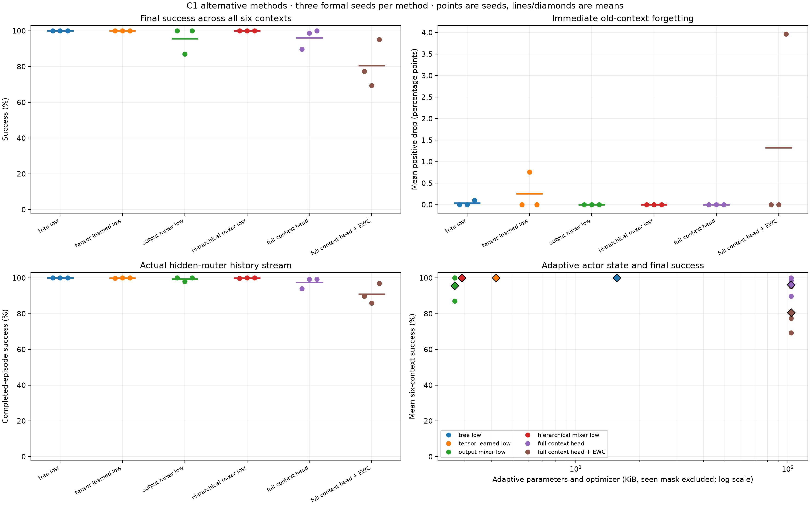

# C1 alternative methods: saved-data report

This report reads the saved tensor and context-head runs only. It starts no experiment and makes no benchmark-wide or causal claim. The original Step 3 seeds 131, 149, and 167 are not pooled with this separate formal cohort (181, 193, and 211).

## Scope and comparison conditions

The six formal methods use the same single trained source checkpoint W0; seeds 181, 193, and 211 vary deployment runs, not pretraining. The methods are the frozen Step 2 low-tier tree reference; a trainable W0 source-basis tensor; frozen-basis output and hierarchical output mixers; a full shared actor with compact context heads; and that same context-head policy with EWC. The full actor uses the protocol amendment's 3 × 64 visible-band input bias. The four low-tier representations use the original compressed adaptive/complete caps. Full context-head runs are measured Pareto references outside the original adaptive caps and must fit the 393,216-byte complete-agent cap.

During the seen, held-out, and revisit oracle phases, endpoint IDs and the phase schedule are supplied. Endpoint IDs and switch cues are hidden only during later history continuation; its router uses the transition bank calibrated during the declared oracle schedule, and that bank is frozen during the hidden stream. The fixed family structure is also supplied in this C1 setting. The source-retention probe forces root route 0 and tests neither router accuracy nor routing. The tensor basis is derived from W0's centered action head and spans action-row permutations; that inductive bias matches this synthetic action-remapping family. These runs do not establish transfer outside that source row space or from-zero latent-context discovery.

The comparisons keep all saved candidates, including low-scoring candidates and failed runs. Failed result rows count toward the declared 18 formal and 15 validation files, but are excluded from performance averages. The validation score is the frozen `0.50 × final six-context success + 0.25 × immediate old-context success + 0.25 × held-out success` rule. The stored score is checked against the saved result before reporting.

## Validation candidates and frozen selections

| Method / control | Candidate | LR | Entropy | EWC λ | Validation score | Status | Selected |
|---|---|---|---|---|---|---|---|
| tensor_learned | 0 | 0.003 | 0.06 | 0.0 | 0.9406 | complete | yes |
| tensor_learned | 1 | 0.01 | 0.06 | 0.0 | 0.8160 | complete | no |
| tensor_learned | 2 | 0.003 | 0.02 | 0.0 | 0.8486 | complete | no |
| output_mixer | 0 | 0.003 | 0.06 | 0.0 | 0.4927 | complete | no |
| output_mixer | 1 | 0.01 | 0.06 | 0.0 | 0.6634 | complete | yes |
| output_mixer | 2 | 0.003 | 0.02 | 0.0 | 0.4131 | complete | no |
| hierarchical_output_mixer | 0 | 0.003 | 0.06 | 0.0 | 1.0000 | complete | yes |
| hierarchical_output_mixer | 1 | 0.01 | 0.06 | 0.0 | 0.9952 | complete | no |
| hierarchical_output_mixer | 2 | 0.003 | 0.02 | 0.0 | 0.9625 | complete | no |
| full_context_head | 0 | 0.001 | 0.06 | 0.0 | 0.7316 | complete | no |
| full_context_head | 1 | 0.003 | 0.06 | 0.0 | 0.8838 | complete | yes |
| full_context_head | 2 | 0.01 | 0.06 | 0.0 | 0.6000 | complete | no |
| full_context_head + EWC | 0 | 0.003 | 0.06 | 10.0 | 0.6949 | complete | yes |
| full_context_head + EWC | 1 | 0.003 | 0.06 | 100.0 | 0.4393 | complete | no |
| full_context_head + EWC | 2 | 0.003 | 0.06 | 1000.0 | 0.4277 | complete | no |

The tree reference reuses the already-frozen Step 2 tree selection; it was not retuned in this supplement. Tensor candidates use seed 919. Context-head learning-rate and EWC candidates use seed 923; EWC candidates reuse the ordinary context-head learning rate selected on that same validation seed. Candidate data are retained in `outputs/c1_supplement/alternative_summary.csv`.

## Formal results

The saved inventory contains 18 formal rows (18 complete, 0 failed) and 15 validation rows (15 complete, 0 failed). Performance summaries below aggregate only complete formal rows.

### Per-seed final success

| Method | Seed | A0 | A1 | A2 | B0 | B1 | B2 | Mean | All six ≥ 80% |
|---|---|---|---|---|---|---|---|---|---|
| tensor_learned | 181 | 100.0% | 100.0% | 100.0% | 100.0% | 100.0% | 100.0% | 100.0% | yes |
| tensor_learned | 193 | 100.0% | 100.0% | 100.0% | 100.0% | 100.0% | 100.0% | 100.0% | yes |
| tensor_learned | 211 | 100.0% | 100.0% | 100.0% | 100.0% | 100.0% | 100.0% | 100.0% | yes |
| output_mixer | 181 | 100.0% | 100.0% | 100.0% | 100.0% | 100.0% | 100.0% | 100.0% | yes |
| output_mixer | 193 | 22.2% | 100.0% | 100.0% | 100.0% | 100.0% | 100.0% | 87.0% | no |
| output_mixer | 211 | 100.0% | 100.0% | 100.0% | 100.0% | 100.0% | 100.0% | 100.0% | yes |
| hierarchical_output_mixer | 181 | 100.0% | 100.0% | 100.0% | 100.0% | 100.0% | 100.0% | 100.0% | yes |
| hierarchical_output_mixer | 193 | 100.0% | 100.0% | 100.0% | 100.0% | 100.0% | 100.0% | 100.0% | yes |
| hierarchical_output_mixer | 211 | 100.0% | 100.0% | 100.0% | 100.0% | 100.0% | 100.0% | 100.0% | yes |
| tree_reference | 181 | 100.0% | 100.0% | 100.0% | 100.0% | 100.0% | 100.0% | 100.0% | yes |
| tree_reference | 193 | 100.0% | 100.0% | 100.0% | 100.0% | 100.0% | 100.0% | 100.0% | yes |
| tree_reference | 211 | 100.0% | 100.0% | 100.0% | 100.0% | 100.0% | 100.0% | 100.0% | yes |
| full_context_head | 181 | 88.2% | 100.0% | 50.0% | 100.0% | 100.0% | 100.0% | 89.7% | no |
| full_context_head + EWC | 181 | 33.3% | 73.7% | 97.0% | 64.3% | 100.0% | 96.2% | 77.4% | no |
| full_context_head | 193 | 95.0% | 96.9% | 100.0% | 100.0% | 100.0% | 100.0% | 98.6% | yes |
| full_context_head + EWC | 193 | 50.0% | 53.8% | 45.5% | 66.7% | 100.0% | 100.0% | 69.3% | no |
| full_context_head | 211 | 100.0% | 100.0% | 100.0% | 100.0% | 100.0% | 100.0% | 100.0% | yes |
| full_context_head + EWC | 211 | 94.7% | 78.9% | 100.0% | 100.0% | 100.0% | 96.9% | 95.1% | no |

### Across-seed summary

| Method | Complete / 3 | Mean final success ± sample SD | All six ≥ 80% | Immediate old success | Positive old drop (pp) | Retained old contexts |
|---|---|---|---|---|---|---|
| full_context_head | 3/3 | 96.1% ± 5.6 pp | 2/3 | 79.4% | 0.00 | 12/12 |
| full_context_head + EWC | 3/3 | 80.6% ± 13.2 pp | 0/3 | 70.4% | 1.32 | 11/12 |
| hierarchical_output_mixer | 3/3 | 100.0% ± 0.0 pp | 3/3 | 100.0% | 0.00 | 12/12 |
| output_mixer | 3/3 | 95.7% ± 7.5 pp | 2/3 | 92.1% | 0.00 | 12/12 |
| tensor_learned | 3/3 | 100.0% ± 0.0 pp | 3/3 | 99.5% | 0.25 | 12/12 |
| tree_reference | 3/3 | 100.0% ± 0.0 pp | 3/3 | 97.6% | 0.03 | 12/12 |

### Hidden-router continuation and deployment cost

| Method | Hidden return | Hidden success | Route exact / family | Adaptive actor + Adam (B) | Peak complete state + rollout / cap (B) | CPU (s) | Actual optimizer steps | Train / eval interactions |
|---|---|---|---|---|---|---|---|---|
| full_context_head | 1205.4 | 97.5% | 93.4% / 99.1% | 105968 | 236589 / 393216 | 61.0 | 3679 | 63488 / 17408 |
| full_context_head + EWC | 827.4 | 90.8% | 92.9% / 99.2% | 105968 | 316003 / 393216 | 64.2 | 3869 | 63488 / 17408 |
| hierarchical_output_mixer | 1731.8 | 99.9% | 93.5% / 99.2% | 2972 | 149408 / 188416 | 53.1 | 3968 | 63488 / 17408 |
| output_mixer | 1649.0 | 99.3% | 90.9% / 99.2% | 2748 | 146936 / 188416 | 52.7 | 3960 | 63488 / 17408 |
| tensor_learned | 1722.7 | 99.9% | 92.6% / 99.2% | 4312 | 149231 / 188416 | 52.1 | 3967 | 63488 / 17408 |
| tree_reference | 1664.8 | 100.0% | 91.5% / 99.2% | 15952 | 170822 / 188416 | 54.4 | 3963 | 63488 / 17408 |

Adaptive actor bytes exclude the endpoint seen mask; complete-state accounting keeps it and the 780-byte W0 source basis (frozen for the output mixers and trainable for `tensor_learned`), as well as optimizer state, router, continual state, and rollout buffer. Optimizer storage includes Adam moment tensors and scalar step state. The full context-head row includes all actor/critic, six heads, EWC/Fisher state when enabled, and rollout storage in the complete-agent cap. Per-run values and cap outcomes are in the CSV.

### Actual-path cold gain over pristine W0

| Method | A2 reward gain | B2 reward gain | Mean gain |
|---|---|---|---|
| full_context_head | 9.25 | 46.83 | 28.04 |
| full_context_head + EWC | 29.58 | 20.83 | 25.21 |
| hierarchical_output_mixer | 127.33 | 77.67 | 102.50 |
| output_mixer | 42.42 | 31.17 | 36.79 |
| tensor_learned | 76.08 | 29.58 | 52.83 |
| tree_reference | 112.50 | 122.92 | 117.71 |

### Source retention versus matched-seed W0

This post-training diagnostic forces root route 0 for 512 NavigationEnv steps, makes no policy updates, and compares each saved policy with the pristine W0 built for the same seed. The alternative cohort contains 18 trained checkpoints and 3 matched-seed W0 controls (10,752 evaluation interactions). Root routing is fixed, so these values measure source-task behavior and do not measure router accuracy or routing.

| Method | Matched probes | Return gain vs same-seed W0 | Success gain (pp) |
|---|---|---|---|
| full_context_head | 3/3 | -165.17 | -35.49 |
| full_context_head + EWC | 3/3 | -109.00 | -3.71 |
| hierarchical_output_mixer | 3/3 | 0.00 | 0.00 |
| output_mixer | 3/3 | 0.00 | 0.00 |
| tensor_learned | 3/3 | 0.00 | 0.00 |
| tree_reference | 3/3 | 0.00 | 0.00 |

### Failed runs

No saved formal or validation run failed.

## Interpretation

These are finite-seed C1 comparisons, not a ranking across unrelated budgets. The full actor is a higher-capacity reference, and the low-tier alternatives share a structured action-remapping prior. A strong tensor or mixer result would support this representation under the declared synthetic prior; it would not show that freezing a source basis helps general tasks. A weak or failed method remains visible and narrows the result to this protocol.

Unknown boundaries occur in history continuation, but that stage is supplied a calibrated transition bank and fixed family structure. This is not from-zero latent-context discovery or dynamic-structure learning. The six arms share one W0, so source-pretraining variability is untested; the three formal seeds vary deployment runs only. Capacity replacement after the cap is full is also untested. EWC is the declared task-free diagonal empirical-Fisher adaptation. The context-head comparison does not reproduce a published continual-learning benchmark method. No CLEAR reimplementation is included in this supplemental report.

## Protocol and source pointers

- Protocol and evaluation schedule: `docs/C1_SUPPLEMENT_PROTOCOL.md` and `docs/C1_SUPPLEMENT_AMENDMENTS.md`.
- Tensor architecture: `docs/C1_TENSOR_ALTERNATIVES.md`, `src/online_rl/c1_tensor_controls.py`, and `src/online_rl/c1_tensor_experiment.py`.
- Context-head and EWC controls: `docs/C1_CONTEXT_HEAD_ALTERNATIVE.md`, `src/online_rl/c1_context_head_controls.py`, and `src/online_rl/c1_context_head_experiment.py`.
- Shared runner and capacity accounting: `src/online_rl/c1_supplement_experiment.py`.
- Data products: `outputs/c1_supplement/alternative_analysis.json`, `alternative_summary.csv`, `alternative_comparisons.png`, and `alternative_comparisons.pdf`.

