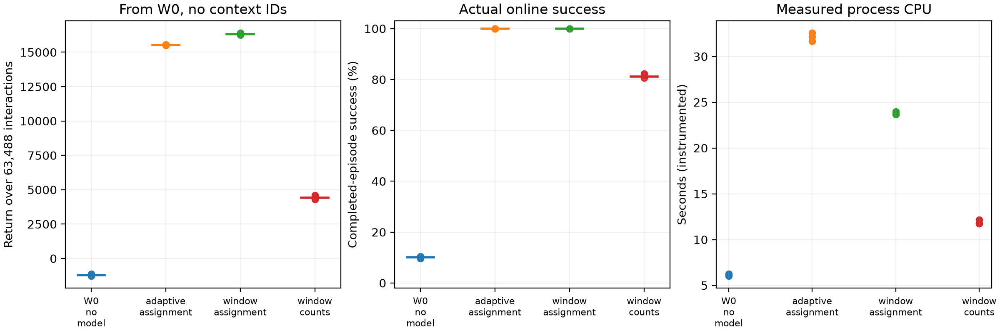
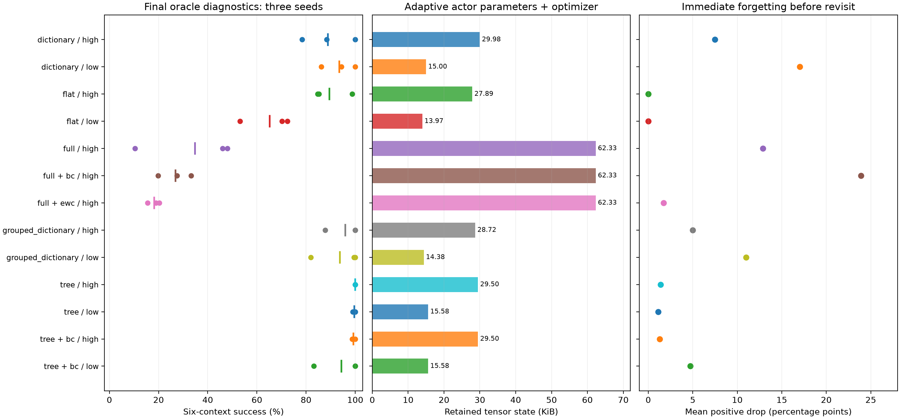

# C1 三项补齐与替代方案：结果报告

本报告只汇总保存的实验。完整协议见 `docs/C1_SUPPLEMENT_PROTOCOL.md` 和第三项前的 `docs/C1_SUPPLEMENT_AMENDMENTS.md`。原 A/B/C1 结果未覆盖，本轮没有进入 C2。

## 1. 无任务标签的状态相关在线动作模型

同一 W0，三个新种子，每次 63,488 步连续流；任务编号和切换时刻只供观察者记日志。模型获知可见 x 分区、四方向、边界和动作排列假设。以下是实际在线轨迹，不能与神经方法的 oracle 静态测试直接排名。

| 方法 | 全流回报均值 | 实际成功率 | CPU 秒均值 | 最大序列化状态 B |
|---|---|---|---|---|
| W0_no_model | -1206.89 | 10.10% | 6.17 | 35281 |
| adaptive_assignment | 15516.44 | 100.00% | 32.12 | 36369 |
| window_assignment | 16325.19 | 100.00% | 23.78 | 36369 |
| window_counts | 4417.44 | 81.16% | 11.89 | 36369 |

统计模型每个事件都更新信念/计数；神经梯度为零不表示没有在线学习。窗口模型清空近期历史后不保留在线学习知识。

### 清空近期历史后的匹配部署诊断

树保留已经学习的残差与此前带标签校准的模型库；窗口模型保留 W0 和源先验，清空其全部在线证据。相同新流和采样种子，每次 6,144 步；先前轨迹由各方法自行生成，因此不声称历史信息完全相同。

| 控制 | 回报均值 | 实际成功率 |
|---|---|---|
| adaptive_assignment_clear_history | 1502.18 | 100.00% |
| trained_tree_high | 1678.93 | 99.86% |
| trained_tree_low | 1675.93 | 99.80% |
| window_assignment_clear_history | 1562.26 | 100.00% |
| window_counts_clear_history | 432.10 | 81.89% |

## 2. 共享分解与树拓扑

两档容量各进行成对 1,024 步 PPO：树与扁平分组的动作、观测、logits、最终参数和 Adam 状态完全相同（最大 logits 差为 0）。原 C1 的固定树等价于分组加法修正；这里不能提出树拓扑本身的独特性能贡献。另一个分组字典将全局共享基拆成两组，测试减少无关情境共享的效果。

## 3. 独立调参与持续学习控制

每个压缩方法在独立验证种子 911 上试三个设置，选定后在 131/149/167 上复验；高档选定配置原样应用低档。全参数方法另试三个学习率/熵设置，再分别试三个 EWC/回放系数。全参数方法超出原两档适应参数预算，是更大容量的参考。所有评价只反映本次有限搜索，不代表全局最优或 SOTA。

| 方法 | 档 | 最终六任务均值 | 六任务≥80% | 立即旧任务成功率 | 相对 seen 保留 | 平均正向遗忘 pp | 冷迁移回报增益 |
|---|---|---|---|---|---|---|---|
| dictionary | high | 88.89% | 1/3 | 72.68% | 6/12 | 7.47 | 48.42 |
| dictionary | low | 93.51% | 1/3 | 71.19% | 5/12 | 17.02 | 59.21 |
| flat | high | 89.53% | 1/3 | 69.21% | 12/12 | 0.00 | 29.08 |
| flat | low | 65.26% | 0/3 | 52.12% | 12/12 | 0.00 | 55.46 |
| full | high | 34.80% | 0/3 | 21.03% | 8/12 | 12.88 | 3.75 |
| full + bc | high | 26.84% | 0/3 | 26.66% | 4/12 | 23.91 | 16.04 |
| full + ewc | high | 18.27% | 0/3 | 13.66% | 11/12 | 1.74 | 5.04 |
| grouped_dictionary | high | 95.93% | 2/3 | 89.17% | 10/12 | 5.00 | 56.96 |
| grouped_dictionary | low | 93.81% | 2/3 | 82.11% | 8/12 | 10.99 | 62.33 |
| tree | high | 100.00% | 3/3 | 98.33% | 11/12 | 1.40 | 79.46 |
| tree | low | 99.67% | 3/3 | 96.96% | 10/12 | 1.11 | 66.62 |
| tree + bc | high | 99.23% | 3/3 | 93.36% | 11/12 | 1.28 | 62.12 |
| tree + bc | low | 94.37% | 2/3 | 77.61% | 8/12 | 4.71 | 63.04 |

### 实际隐藏路由续训与成本

此流不向路由器提供编号或切换提示，但神经方法的六个原型来自其此前 oracle 阶段的真实带标签转移。其动态分支发现能力未被验证。

| 方法 | 档 | 隐藏流回报 | 隐藏流成功率 | 适应参数+优化器 B | 完整状态峰值 B | 实际优化器步数 | 在线 CPU 秒 |
|---|---|---|---|---|---|---|---|
| dictionary | high | 1309.43 | 96.58% | 30700 | 175791 | 3719 | 50.80 |
| dictionary | low | 1282.18 | 96.00% | 15364 | 160623 | 3806 | 50.23 |
| flat | high | 1377.10 | 97.65% | 28560 | 178931 | 3913 | 56.16 |
| flat | low | 641.60 | 83.50% | 14304 | 165043 | 3944 | 55.10 |
| full | high | 113.76 | 47.74% | 63824 | 188085 | 3729 | 52.15 |
| full + bc | high | 36.76 | 33.10% | 63824 | 198581 | 4063 | 71.14 |
| full + ewc | high | -64.40 | 19.97% | 63824 | 236229 | 3963 | 53.27 |
| grouped_dictionary | high | 1602.76 | 99.24% | 29408 | 175843 | 3837 | 53.34 |
| grouped_dictionary | low | 1493.43 | 98.60% | 14720 | 160483 | 3904 | 53.41 |
| tree | high | 1655.68 | 99.79% | 30208 | 184646 | 3919 | 54.51 |
| tree | low | 1578.51 | 99.54% | 15952 | 170758 | 3943 | 54.48 |
| tree + bc | high | 1651.43 | 99.52% | 30208 | 195142 | 4175 | 77.22 |
| tree + bc | low | 1410.26 | 97.59% | 15952 | 181318 | 4186 | 78.66 |

完整状态包含 W0、critic、Adam、路由原型/窗口、回放或 Fisher/锚点、随机状态、序列化开销和 rollout。日志档案不是智能体的回放库。CPU 包含实验计量开销；额外评价另计交互。优化器步数采用独立检查点审计：原 tree+BC 的 PyTorch 嵌套 step hook 曾对单次更新计数两次，原始 JSON 不改写，报告依据 LeafAdam 的单次递增计数修正，见 optimizer_step_audit.json；策略更新没有重复执行。EWC 的源 Fisher 初始化计入离线初始化 CPU，不增加部署交互。

## 源策略保留诊断

在隐藏流续训之后，强制根路由 0，在原 normal 环境各评估 512 步，不更新参数。压缩残差方法在根路由直接使用冻结 W0；全参数方法可能改变共享 actor 和 band bias。这测量源行为是否仍可调用，不测量路由器是否会正确回到根节点，也不是与 final_eval 同一时刻的比较。

| 方法 | 档 | 源成功率 | 相对同种子 W0 的回报差 |
|---|---|---|---|
| dictionary | high | 100.00% | 0.00 |
| dictionary | low | 100.00% | 0.00 |
| flat | high | 100.00% | 0.00 |
| flat | low | 100.00% | 0.00 |
| full | high | 54.29% | -177.33 |
| full + bc | high | 42.26% | -180.08 |
| full + ewc | high | 100.00% | -13.00 |
| grouped_dictionary | high | 100.00% | 0.00 |
| grouped_dictionary | low | 100.00% | 0.00 |
| tree | high | 100.00% | 0.00 |
| tree | low | 100.00% | 0.00 |
| tree + bc | high | 100.00% | 0.00 |
| tree + bc | low | 100.00% | 0.00 |

## 调参记录与失败

| 方法 | 选择配置 | 系数 | 验证分数 |
|---|---|---|---|
| dictionary | {'learning_rate': 0.01, 'ent_coef': 0.06} | — | 0.8145 |
| flat | {'learning_rate': 0.01, 'ent_coef': 0.06} | — | 0.6177 |
| full | {'learning_rate': 0.003, 'ent_coef': 0.02} | — | 0.2837 |
| full_bc | {'learning_rate': 0.003, 'ent_coef': 0.02} | 0.1 | 0.3812 |
| full_ewc | {'learning_rate': 0.003, 'ent_coef': 0.02} | 1000.0 | 0.2354 |
| grouped_dictionary | {'learning_rate': 0.01, 'ent_coef': 0.06} | — | 0.9202 |
| tree | {'learning_rate': 0.01, 'ent_coef': 0.06} | — | 0.9821 |
| tree_bc | {'learning_rate': 0.01, 'ent_coef': 0.06} | 0.1 | 0.7681 |

神经正式运行 39，验证运行 24；运行/容量失败 0。所有候选结果保留，较差候选不是删除的异常值。EWC 为实际对角经验 Fisher 惩罚在 task-free PPO 中的改编；行为回放为 CLEAR-inspired PPO+KL，并未复现 CLEAR 的 V-trace/离策略奖励回放。

## 交互账本

| 用途 | 步数 |
|---|---|
| neural_training_interactions | 2476032 |
| neural_evaluation_interactions | 678912 |
| neural_validation_training_interactions | 761856 |
| neural_validation_evaluation_interactions | 208896 |
| model_formal_interactions | 761856 |
| model_validation_interactions | 126976 |
| frozen_tree_diagnostic_interactions | 36864 |
| cleared_model_diagnostic_interactions | 55296 |
| equivalence_check_interactions | 4096 |
| source_probe_evaluation_interactions | 32256 |

## 解释边界

三次部署种子共用一个 W0，不能衡量预训练随机性。环境为确定性的分区动作重映射，固定的分组/树先验与生成机制匹配。回报较高并不提供可靠改进保证。没有动态树、容量满后的知识替换、未知任务发现或标准套件 SOTA 结论。具体下一步判断见 `docs/C1_SUPPLEMENT_CONCLUSIONS.md`。

