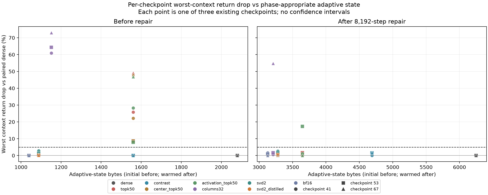
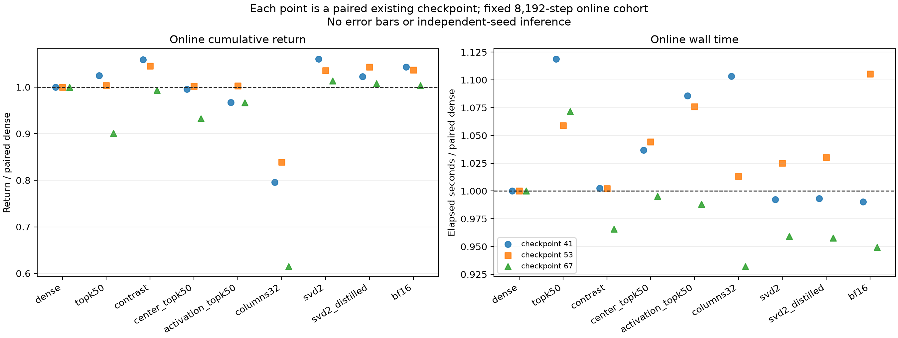

# 压缩替代方法对照：结果与解读

**数据状态：全部预声明记录完成。** 共 3 个已有 A/B checkpoint、9 种表示、5 个部署情境；每个 arm 在五情境各作 2,048 步修复前和修复后部署，每个 method×seed 只进行一次 8,192 步在线修复。这里报告实际运行的固定比较，不做新赢家选择或重跑。

## 1. 比较口径与方法

同一组 41、53、67 的 B-history_keep 终点 checkpoint 共用一个基础预训练权重。每种方法只改变两个活跃的 4×65 actor 残差；环境、路由、基础 actor、critic 和 PPO 超参数保持规程设定。全部方法（包括 dense 与原始 Top-K）都在修复前使用新 Adam，故这是新的冷优化器 cohort，不能与上一轮迁移 Adam 的 Top-K 直接作因果比较。

校准来自此前 CW/CCW 在线轨迹，改作表示构造数据；部署前后用新的 1,500,000 随机种子偏移，训练流为相同的 8,192 步 CW→CCW 日程。修复两家族已在源 B 中出现，不称为首次新任务学习。方法根据规程预先固定，失败臂和负结果也保留；不按压缩前测试表现淘汰或调参。

| 方法 | 表示选择与解释边界 |
|---|---|
| dense | 紧凑稠密参照；保留两个活跃叶的 FP32 残差，不删坐标。 |
| topk50 | 原幅值 Top-K，每叶保留 130 个输入坐标；作为既有 50% 稀疏方案参照。 |
| contrast | 固定正交动作对比基，移除四个动作共同加值的 softmax 冗余；代数上精确，概率探针阈值为 2e-5。完整 Adam 状态可能超过 3,648 B 同预算。 |
| center_topk50 | 先减去动作公共行均值，再按权重幅值做 50% Top-K；用于隔离中心化效果。 |
| activation_topk50 | 在相同中心化后按 \|w_ij\| × sqrt(E[φ_j²]) 剪枝；是受 Wanda 启发的改编，不是原论文完整复现。 |
| columns32 | 按中心化列范数与特征 RMS 保留 31 个特征列及必保偏置列，整列动作权重一起保存；使用紧凑稠密乘法。 |
| svd2 | 在动作对比坐标中作截断 rank-2 SVD，以平方根奇异值初始化两个可训练因子；每叶 136 个浮点坐标。 |
| svd2_distilled | 与 svd2 相同表示，再用过去在线校准观测作固定 500 步教师 KL 蒸馏；lr=0.005、梯度范数上限 1，不按测试回报调参。 |
| bf16 | 残差值和原生 Adam 两个动量用 BF16 持久保存，forward 临时转 FP32；基础 actor、critic 及其 Adam 仍是 FP32。状态精度变化属于方法本身，不代表硬件加速。 |

LoRA 提供低秩适配的概念参照 [Hu et al.](https://arxiv.org/abs/2106.09685)；Wanda 提供权重与激活感知剪枝的参照 [Sun et al.](https://arxiv.org/abs/2306.11695)；教师学生蒸馏参照 [Hinton et al.](https://arxiv.org/abs/1503.02531)。这些外部论文不构成本次强化学习结果的性能证据。

## 2. 持久状态和整体 bundle 字节

适应状态按实际存储的残差值/因子、坐标索引和残差 Adam 张量计算。表中初始值是在 Adam 尚未分配动量时的权重与索引；预测值按完整 Adam 状态估算；实际值来自 8,192 步修复后重新保存的优化器状态。整体 bundle 单独列出，不能把局部适应状态节省外推成整个智能体等比例节省。每格字节均为三 checkpoint 的均值；括号给出 41 / 53 / 67 的逐 checkpoint 实际暖状态。

| 方法 | 初始残差值/因子 B | 初始索引 B | 初始适应状态 B | 预测暖状态 B | 实际暖状态 B（逐 checkpoint） | 实际暖状态节省 vs dense | 实际暖状态节省 vs Top-K | 构造 bundle B | 修复后 bundle B | bundle 节省 vs dense |
|---|---:|---:|---:|---:|---:|---:|---:|---:|---:|---:|
| dense | 2,080 | 0 | 2,080 | 6,248 | 6,248 (6,248 / 6,248 / 6,248) | 0.00% | -71.27% | 61,452 | 111,636 | 0.00% |
| topk50 | 1,040 | 520 | 1,560 | 3,648 | 3,648 (3,648 / 3,648 / 3,648) | 41.61% | 0.00% | 61,613 | 109,685 | 1.75% |
| contrast | 1,560 | 0 | 1,560 | 4,688 | 4,688 (4,688 / 4,688 / 4,688) | 24.97% | -28.51% | 60,940 | 110,100 | 1.38% |
| center_topk50 | 1,040 | 520 | 1,560 | 3,648 | 3,648 (3,648 / 3,648 / 3,648) | 41.61% | 0.00% | 61,613 | 109,706 | 1.73% |
| activation_topk50 | 1,040 | 520 | 1,560 | 3,648 | 3,648 (3,648 / 3,648 / 3,648) | 41.61% | 0.00% | 61,613 | 109,749 | 1.69% |
| columns32 | 1,024 | 128 | 1,152 | 3,208 | 3,208 (3,208 / 3,208 / 3,208) | 48.66% | 12.06% | 60,973 | 108,810 | 2.53% |
| svd2 | 1,088 | 0 | 1,088 | 3,280 | 3,280 (3,280 / 3,280 / 3,280) | 47.50% | 10.09% | 61,058 | 110,743 | 0.80% |
| svd2_distilled | 1,088 | 0 | 1,088 | 3,280 | 3,280 (3,280 / 3,280 / 3,280) | 47.50% | 10.09% | 61,058 | 110,743 | 0.80% |
| bf16 | 1,040 | 0 | 1,040 | 3,128 | 3,128 (3,128 / 3,128 / 3,128) | 49.94% | 14.25% | 60,471 | 108,607 | 2.71% |

### 每 checkpoint 实际字节账本

| 方法 | Seed | 初始值/因子 B | 索引 B | 初始状态 B | 预测暖状态 B | 实际值/因子 B | 实际索引 B | 实际残差 Adam B | 实际暖状态 B | 构造 bundle B | 修复后 bundle B |
|---|---:|---:|---:|---:|---:|---:|---:|---:|---:|---:|---:|
| dense | 41 | 2,080 | 0 | 2,080 | 6,248 | 2,080 | 0 | 4,168 | 6,248 | 61,388 | 111,636 |
| dense | 53 | 2,080 | 0 | 2,080 | 6,248 | 2,080 | 0 | 4,168 | 6,248 | 61,516 | 111,636 |
| dense | 67 | 2,080 | 0 | 2,080 | 6,248 | 2,080 | 0 | 4,168 | 6,248 | 61,452 | 111,636 |
| topk50 | 41 | 1,040 | 520 | 1,560 | 3,648 | 1,040 | 520 | 2,088 | 3,648 | 61,570 | 109,642 |
| topk50 | 53 | 1,040 | 520 | 1,560 | 3,648 | 1,040 | 520 | 2,088 | 3,648 | 61,698 | 109,706 |
| topk50 | 67 | 1,040 | 520 | 1,560 | 3,648 | 1,040 | 520 | 2,088 | 3,648 | 61,570 | 109,706 |
| contrast | 41 | 1,560 | 0 | 1,560 | 4,688 | 1,560 | 0 | 3,128 | 4,688 | 60,876 | 110,100 |
| contrast | 53 | 1,560 | 0 | 1,560 | 4,688 | 1,560 | 0 | 3,128 | 4,688 | 61,004 | 110,100 |
| contrast | 67 | 1,560 | 0 | 1,560 | 4,688 | 1,560 | 0 | 3,128 | 4,688 | 60,940 | 110,100 |
| center_topk50 | 41 | 1,040 | 520 | 1,560 | 3,648 | 1,040 | 520 | 2,088 | 3,648 | 61,570 | 109,642 |
| center_topk50 | 53 | 1,040 | 520 | 1,560 | 3,648 | 1,040 | 520 | 2,088 | 3,648 | 61,698 | 109,706 |
| center_topk50 | 67 | 1,040 | 520 | 1,560 | 3,648 | 1,040 | 520 | 2,088 | 3,648 | 61,570 | 109,770 |
| activation_topk50 | 41 | 1,040 | 520 | 1,560 | 3,648 | 1,040 | 520 | 2,088 | 3,648 | 61,570 | 109,770 |
| activation_topk50 | 53 | 1,040 | 520 | 1,560 | 3,648 | 1,040 | 520 | 2,088 | 3,648 | 61,698 | 109,706 |
| activation_topk50 | 67 | 1,040 | 520 | 1,560 | 3,648 | 1,040 | 520 | 2,088 | 3,648 | 61,570 | 109,770 |
| columns32 | 41 | 1,024 | 128 | 1,152 | 3,208 | 1,024 | 128 | 2,056 | 3,208 | 60,930 | 108,746 |
| columns32 | 53 | 1,024 | 128 | 1,152 | 3,208 | 1,024 | 128 | 2,056 | 3,208 | 61,058 | 108,810 |
| columns32 | 67 | 1,024 | 128 | 1,152 | 3,208 | 1,024 | 128 | 2,056 | 3,208 | 60,930 | 108,874 |
| svd2 | 41 | 1,088 | 0 | 1,088 | 3,280 | 1,088 | 0 | 2,192 | 3,280 | 60,994 | 110,764 |
| svd2 | 53 | 1,088 | 0 | 1,088 | 3,280 | 1,088 | 0 | 2,192 | 3,280 | 61,122 | 110,700 |
| svd2 | 67 | 1,088 | 0 | 1,088 | 3,280 | 1,088 | 0 | 2,192 | 3,280 | 61,058 | 110,764 |
| svd2_distilled | 41 | 1,088 | 0 | 1,088 | 3,280 | 1,088 | 0 | 2,192 | 3,280 | 60,994 | 110,764 |
| svd2_distilled | 53 | 1,088 | 0 | 1,088 | 3,280 | 1,088 | 0 | 2,192 | 3,280 | 61,122 | 110,700 |
| svd2_distilled | 67 | 1,088 | 0 | 1,088 | 3,280 | 1,088 | 0 | 2,192 | 3,280 | 61,058 | 110,764 |
| bf16 | 41 | 1,040 | 0 | 1,040 | 3,128 | 1,040 | 0 | 2,088 | 3,128 | 60,428 | 108,628 |
| bf16 | 53 | 1,040 | 0 | 1,040 | 3,128 | 1,040 | 0 | 2,088 | 3,128 | 60,556 | 108,564 |
| bf16 | 67 | 1,040 | 0 | 1,040 | 3,128 | 1,040 | 0 | 2,088 | 3,128 | 60,428 | 108,628 |

适应状态节省按实际暖状态字节相对 dense 计算，而不是按参数数量估算。Top-K 是同预算参照的一行；所有其它表示都同时给出相对 dense 与 Top-K 的实际字节差。整体 bundle savings 使用修复后保存的完整 agent bundle。SVD 与蒸馏 SVD 的实际数值暖状态低于 Top-K，但完整序列化 bundle 更大；因子分解会保存更多张量记录，而当前账本不提供足以精确拆分各序列化开销的字段，因此不把整体差值归因到某个单一来源。

## 3. 同一 3,648 B 暖状态预算

资格以每个 checkpoint 修复后的实际适应状态都不超过 3,648 B 判定，不以参数数、压缩前空 Adam 或均值替代。

| 方法 | 实际暖状态均值 B | 41 / 53 / 67 实际 B | 每个 checkpoint 均在预算内 |
|---|---:|---:|---|
| dense | 6,248 | 6,248 / 6,248 / 6,248 | 否 |
| topk50 | 3,648 | 3,648 / 3,648 / 3,648 | 是 |
| contrast | 4,688 | 4,688 / 4,688 / 4,688 | 否 |
| center_topk50 | 3,648 | 3,648 / 3,648 / 3,648 | 是 |
| activation_topk50 | 3,648 | 3,648 / 3,648 / 3,648 | 是 |
| columns32 | 3,208 | 3,208 / 3,208 / 3,208 | 是 |
| svd2 | 3,280 | 3,280 / 3,280 / 3,280 | 是 |
| svd2_distilled | 3,280 | 3,280 / 3,280 / 3,280 | 是 |
| bf16 | 3,128 | 3,128 / 3,128 / 3,128 | 是 |

**contrast 精确诊断：**最大观测策略概率差为 0.00000209（阈值 2e-5）；实际暖状态为 4,688 B，超过 3,648 B 预算。它依靠四动作公共加值不影响 softmax 概率的正交对比变换，作为无损代数诊断保留；若超预算，不将其计作同预算胜者。

## 4. 修复前后各情境相对 dense 的回报和成功率

回报下降先对三个 checkpoint 的累计回报求均值，再计算 `1 − 方法均值 / dense 均值`。因此表中的均值比例不是三个 seed 比例的平均。逐 checkpoint 最坏回报下降和成功率百分点下降则用相同 seed、相同情境配对后计算。负回报下降表示该方法均值高于 dense，不代表统计优势。

### 修复前

| 情境 | 方法 | dense 均值回报 | 方法均值回报 | 均值回报下降 | 最坏配对 seed 回报下降 | 最坏 seed | 成功率下降百分点 | 最坏配对 seed 成功率下降 pp | 最坏 seed | 前 128 步均值奖励 | 策略推理秒 | 评估秒 | 完成回合数均值 |
|---|---|---:|---:|---:|---:|---:|---:|---:|---:|---:|---:|---:|---:|
| normal | dense | 790.06 | 790.06 | 0.00% | 0.00% | 41 | 0.00 | 0.00 | 41 | 49.16 | 0.483 | 0.722 | 340.0 |
| normal | topk50 | 790.06 | 790.06 | 0.00% | 0.00% | 41 | 0.00 | 0.00 | 41 | 49.16 | 0.527 | 0.786 | 340.0 |
| normal | contrast | 790.06 | 790.06 | 0.00% | 0.00% | 41 | 0.00 | 0.00 | 41 | 49.16 | 0.485 | 0.724 | 340.0 |
| normal | center_topk50 | 790.06 | 790.06 | 0.00% | 0.00% | 41 | 0.00 | 0.00 | 41 | 49.16 | 0.511 | 0.766 | 340.0 |
| normal | activation_topk50 | 790.06 | 790.06 | 0.00% | 0.00% | 41 | 0.00 | 0.00 | 41 | 49.16 | 0.500 | 0.748 | 340.0 |
| normal | columns32 | 790.06 | 790.06 | 0.00% | 0.00% | 41 | 0.00 | 0.00 | 41 | 49.16 | 0.565 | 0.839 | 340.0 |
| normal | svd2 | 790.06 | 790.06 | 0.00% | 0.00% | 41 | 0.00 | 0.00 | 41 | 49.16 | 0.503 | 0.751 | 340.0 |
| normal | svd2_distilled | 790.06 | 790.06 | 0.00% | 0.00% | 41 | 0.00 | 0.00 | 41 | 49.16 | 0.492 | 0.735 | 340.0 |
| normal | bf16 | 790.06 | 790.06 | 0.00% | 0.00% | 41 | 0.00 | 0.00 | 41 | 49.16 | 0.501 | 0.743 | 340.0 |
| cw | dense | 770.14 | 770.14 | 0.00% | 0.00% | 41 | 0.00 | 0.00 | 41 | 40.91 | 0.586 | 0.847 | 328.3 |
| cw | topk50 | 770.14 | 661.39 | 14.12% | 23.85% | 41 | 0.01 | 0.02 | 53 | 37.16 | 0.624 | 0.876 | 286.7 |
| cw | contrast | 770.14 | 770.14 | 0.00% | 0.00% | 41 | 0.00 | 0.00 | 41 | 40.91 | 0.547 | 0.790 | 328.3 |
| cw | center_topk50 | 770.14 | 656.56 | 14.75% | 22.09% | 41 | 0.01 | 0.02 | 53 | 36.49 | 0.638 | 0.897 | 285.0 |
| cw | activation_topk50 | 770.14 | 645.48 | 16.19% | 28.31% | 41 | 0.15 | 0.41 | 41 | 36.83 | 0.661 | 0.923 | 280.7 |
| cw | columns32 | 770.14 | 347.14 | 54.92% | 60.88% | 41 | 7.85 | 10.53 | 41 | 21.91 | 0.567 | 0.785 | 171.0 |
| cw | svd2 | 770.14 | 770.14 | 0.00% | 0.00% | 41 | 0.00 | 0.00 | 41 | 40.91 | 0.602 | 0.861 | 328.3 |
| cw | svd2_distilled | 770.14 | 770.14 | 0.00% | 0.00% | 41 | 0.00 | 0.00 | 41 | 40.91 | 0.566 | 0.816 | 328.3 |
| cw | bf16 | 770.14 | 770.14 | 0.00% | 0.00% | 41 | 0.00 | 0.00 | 41 | 40.91 | 0.563 | 0.810 | 328.3 |
| ccw | dense | 770.48 | 770.48 | 0.00% | 0.00% | 41 | 0.00 | 0.00 | 41 | 43.99 | 0.566 | 0.820 | 334.0 |
| ccw | topk50 | 770.48 | 613.56 | 20.37% | 49.09% | 67 | 2.54 | 7.61 | 67 | 34.99 | 0.632 | 0.879 | 274.7 |
| ccw | contrast | 770.48 | 770.48 | 0.00% | 0.00% | 41 | 0.00 | 0.00 | 41 | 43.99 | 0.546 | 0.791 | 334.0 |
| ccw | center_topk50 | 770.48 | 611.73 | 20.60% | 48.14% | 67 | 1.98 | 5.95 | 67 | 34.99 | 0.605 | 0.843 | 273.0 |
| ccw | activation_topk50 | 770.48 | 609.56 | 20.89% | 46.81% | 67 | 1.77 | 5.32 | 67 | 34.99 | 0.620 | 0.864 | 271.3 |
| ccw | columns32 | 770.48 | 267.89 | 65.23% | 73.03% | 67 | 10.26 | 12.93 | 67 | 17.58 | 0.558 | 0.771 | 144.3 |
| ccw | svd2 | 770.48 | 777.98 | -0.97% | 0.00% | 41 | 0.00 | 0.00 | 41 | 44.83 | 0.575 | 0.827 | 336.7 |
| ccw | svd2_distilled | 770.48 | 770.48 | 0.00% | 0.00% | 41 | 0.00 | 0.00 | 41 | 43.99 | 0.564 | 0.812 | 334.0 |
| ccw | bf16 | 770.48 | 770.48 | 0.00% | 0.00% | 41 | 0.00 | 0.00 | 41 | 43.99 | 0.566 | 0.814 | 334.0 |
| cw_slip | dense | 641.31 | 641.31 | 0.00% | 0.00% | 41 | 0.00 | 0.00 | 41 | 34.41 | 0.578 | 0.841 | 281.0 |
| cw_slip | topk50 | 641.31 | 549.31 | 14.35% | 25.81% | 41 | 0.00 | 0.00 | 41 | 29.99 | 0.772 | 1.074 | 242.3 |
| cw_slip | contrast | 641.31 | 641.31 | 0.00% | 0.00% | 41 | 0.00 | 0.00 | 41 | 34.41 | 0.572 | 0.829 | 281.0 |
| cw_slip | center_topk50 | 641.31 | 557.14 | 13.12% | 21.43% | 41 | 0.00 | 0.00 | 41 | 35.08 | 0.602 | 0.849 | 246.3 |
| cw_slip | activation_topk50 | 641.31 | 553.56 | 13.68% | 22.73% | 41 | 0.00 | 0.00 | 41 | 28.91 | 0.636 | 0.896 | 247.0 |
| cw_slip | columns32 | 641.31 | 333.56 | 47.99% | 50.51% | 53 | 5.29 | 5.52 | 41 | 31.41 | 0.557 | 0.785 | 163.7 |
| cw_slip | svd2 | 641.31 | 641.31 | -0.00% | 0.69% | 67 | 0.00 | 0.00 | 41 | 34.41 | 0.587 | 0.850 | 279.0 |
| cw_slip | svd2_distilled | 641.31 | 641.98 | -0.10% | 0.19% | 53 | 0.00 | 0.00 | 41 | 34.41 | 0.577 | 0.836 | 283.3 |
| cw_slip | bf16 | 641.31 | 641.31 | 0.00% | 0.00% | 41 | 0.00 | 0.00 | 41 | 34.41 | 0.568 | 0.820 | 281.0 |
| ccw_slip | dense | 642.48 | 642.48 | 0.00% | 0.00% | 41 | 0.00 | 0.00 | 41 | 39.58 | 0.538 | 0.784 | 281.0 |
| ccw_slip | topk50 | 642.48 | 551.23 | 14.20% | 26.42% | 67 | 0.82 | 2.45 | 67 | 37.49 | 0.657 | 0.925 | 249.0 |
| ccw_slip | contrast | 642.48 | 642.48 | 0.00% | 0.00% | 41 | 0.00 | 0.00 | 41 | 39.58 | 0.581 | 0.844 | 281.0 |
| ccw_slip | center_topk50 | 642.48 | 544.48 | 15.25% | 28.73% | 67 | 0.67 | 2.00 | 67 | 35.66 | 0.598 | 0.844 | 245.3 |
| ccw_slip | activation_topk50 | 642.48 | 548.39 | 14.64% | 28.60% | 67 | 0.69 | 2.07 | 67 | 33.99 | 0.637 | 0.897 | 246.7 |
| ccw_slip | columns32 | 642.48 | 283.81 | 55.83% | 59.94% | 67 | 5.87 | 6.35 | 67 | 13.83 | 0.572 | 0.806 | 143.0 |
| ccw_slip | svd2 | 642.48 | 639.06 | 0.53% | 2.82% | 41 | 0.00 | 0.00 | 41 | 39.91 | 0.565 | 0.819 | 276.0 |
| ccw_slip | svd2_distilled | 642.48 | 642.23 | 0.04% | 0.13% | 67 | 0.00 | 0.00 | 41 | 39.58 | 0.558 | 0.808 | 281.7 |
| ccw_slip | bf16 | 642.48 | 642.48 | 0.00% | 0.00% | 41 | 0.00 | 0.00 | 41 | 39.58 | 0.568 | 0.819 | 281.0 |

### 修复后

| 情境 | 方法 | dense 均值回报 | 方法均值回报 | 均值回报下降 | 最坏配对 seed 回报下降 | 最坏 seed | 成功率下降百分点 | 最坏配对 seed 成功率下降 pp | 最坏 seed | 前 128 步均值奖励 | 策略推理秒 | 评估秒 | 完成回合数均值 |
|---|---|---:|---:|---:|---:|---:|---:|---:|---:|---:|---:|---:|---:|
| normal | dense | 790.06 | 790.06 | 0.00% | 0.00% | 41 | 0.00 | 0.00 | 41 | 49.16 | 0.524 | 0.789 | 340.0 |
| normal | topk50 | 790.06 | 790.06 | 0.00% | 0.00% | 41 | 0.00 | 0.00 | 41 | 49.16 | 0.574 | 0.857 | 340.0 |
| normal | contrast | 790.06 | 790.06 | 0.00% | 0.00% | 41 | 0.00 | 0.00 | 41 | 49.16 | 0.494 | 0.744 | 340.0 |
| normal | center_topk50 | 790.06 | 790.06 | 0.00% | 0.00% | 41 | 0.00 | 0.00 | 41 | 49.16 | 0.478 | 0.720 | 340.0 |
| normal | activation_topk50 | 790.06 | 790.06 | 0.00% | 0.00% | 41 | 0.00 | 0.00 | 41 | 49.16 | 0.491 | 0.742 | 340.0 |
| normal | columns32 | 790.06 | 790.06 | 0.00% | 0.00% | 41 | 0.00 | 0.00 | 41 | 49.16 | 0.548 | 0.821 | 340.0 |
| normal | svd2 | 790.06 | 790.06 | 0.00% | 0.00% | 41 | 0.00 | 0.00 | 41 | 49.16 | 0.495 | 0.744 | 340.0 |
| normal | svd2_distilled | 790.06 | 790.06 | 0.00% | 0.00% | 41 | 0.00 | 0.00 | 41 | 49.16 | 0.485 | 0.734 | 340.0 |
| normal | bf16 | 790.06 | 790.06 | 0.00% | 0.00% | 41 | 0.00 | 0.00 | 41 | 49.16 | 0.500 | 0.746 | 340.0 |
| cw | dense | 761.39 | 761.39 | 0.00% | 0.00% | 41 | 0.00 | 0.00 | 41 | 40.24 | 0.572 | 0.835 | 325.3 |
| cw | topk50 | 761.39 | 771.39 | -1.31% | 0.10% | 67 | 0.00 | 0.00 | 41 | 41.08 | 0.619 | 0.877 | 329.0 |
| cw | contrast | 761.39 | 772.81 | -1.50% | -0.03% | 53 | 0.00 | 0.00 | 41 | 41.08 | 0.585 | 0.848 | 329.3 |
| cw | center_topk50 | 761.39 | 765.89 | -0.59% | 0.52% | 67 | 0.00 | 0.00 | 53 | 40.83 | 0.623 | 0.883 | 326.7 |
| cw | activation_topk50 | 761.39 | 727.64 | 4.43% | 17.32% | 53 | 0.14 | 0.41 | 53 | 39.99 | 0.619 | 0.877 | 311.3 |
| cw | columns32 | 761.39 | 767.39 | -0.79% | 1.13% | 67 | 0.00 | 0.00 | 41 | 40.24 | 0.585 | 0.845 | 327.0 |
| cw | svd2 | 761.39 | 774.06 | -1.66% | -0.03% | 53 | 0.00 | 0.00 | 41 | 40.99 | 0.571 | 0.826 | 330.0 |
| cw | svd2_distilled | 761.39 | 769.73 | -1.09% | 0.87% | 67 | 0.00 | 0.00 | 41 | 40.91 | 0.565 | 0.821 | 328.0 |
| cw | bf16 | 761.39 | 773.98 | -1.65% | 0.00% | 53 | 0.00 | 0.00 | 41 | 41.08 | 0.566 | 0.820 | 330.0 |
| ccw | dense | 785.81 | 785.81 | 0.00% | 0.00% | 41 | 0.00 | 0.00 | 41 | 45.74 | 0.569 | 0.831 | 340.0 |
| ccw | topk50 | 785.81 | 782.89 | 0.37% | 1.59% | 53 | 0.00 | 0.00 | 41 | 46.66 | 0.623 | 0.883 | 339.0 |
| ccw | contrast | 785.81 | 786.48 | -0.08% | 0.06% | 41 | 0.00 | 0.00 | 41 | 46.83 | 0.573 | 0.834 | 340.3 |
| ccw | center_topk50 | 785.81 | 789.81 | -0.51% | 0.00% | 53 | 0.00 | 0.00 | 41 | 46.83 | 0.635 | 0.901 | 341.7 |
| ccw | activation_topk50 | 785.81 | 787.64 | -0.23% | -0.22% | 53 | 0.00 | 0.00 | 41 | 46.83 | 0.620 | 0.881 | 341.0 |
| ccw | columns32 | 785.81 | 637.48 | 18.88% | 54.83% | 67 | 2.67 | 8.00 | 67 | 38.41 | 0.582 | 0.831 | 283.3 |
| ccw | svd2 | 785.81 | 787.64 | -0.23% | 0.00% | 41 | 0.00 | 0.00 | 41 | 45.74 | 0.574 | 0.833 | 341.0 |
| ccw | svd2_distilled | 785.81 | 788.56 | -0.35% | 0.19% | 41 | 0.00 | 0.00 | 41 | 46.83 | 0.562 | 0.816 | 341.3 |
| ccw | bf16 | 785.81 | 788.98 | -0.40% | 0.06% | 41 | 0.00 | 0.00 | 41 | 46.83 | 0.567 | 0.822 | 341.3 |
| cw_slip | dense | 636.31 | 636.31 | 0.00% | 0.00% | 41 | 0.00 | 0.00 | 41 | 30.83 | 0.579 | 0.848 | 277.3 |
| cw_slip | topk50 | 636.31 | 646.14 | -1.55% | -0.08% | 53 | 0.00 | 0.00 | 41 | 34.41 | 0.620 | 0.883 | 282.7 |
| cw_slip | contrast | 636.31 | 640.73 | -0.69% | 1.53% | 53 | 0.00 | 0.00 | 41 | 31.83 | 0.563 | 0.821 | 279.3 |
| cw_slip | center_topk50 | 636.31 | 642.31 | -0.94% | 0.27% | 67 | 0.00 | 0.00 | 41 | 34.33 | 0.629 | 0.894 | 279.3 |
| cw_slip | activation_topk50 | 636.31 | 630.98 | 0.84% | 5.95% | 53 | 0.00 | 0.00 | 41 | 32.08 | 0.634 | 0.904 | 278.3 |
| cw_slip | columns32 | 636.31 | 641.39 | -0.80% | 0.88% | 53 | 0.00 | 0.00 | 41 | 32.33 | 0.575 | 0.838 | 283.0 |
| cw_slip | svd2 | 636.31 | 659.39 | -3.63% | -1.76% | 53 | 0.00 | 0.00 | 41 | 32.83 | 0.580 | 0.842 | 290.3 |
| cw_slip | svd2_distilled | 636.31 | 644.64 | -1.31% | -0.78% | 67 | 0.00 | 0.00 | 41 | 31.16 | 0.556 | 0.812 | 280.3 |
| cw_slip | bf16 | 636.31 | 648.48 | -1.91% | 0.00% | 53 | 0.00 | 0.00 | 41 | 32.58 | 0.584 | 0.848 | 284.7 |
| ccw_slip | dense | 653.81 | 653.81 | 0.00% | 0.00% | 41 | 0.00 | 0.00 | 41 | 38.83 | 0.575 | 0.841 | 285.7 |
| ccw_slip | topk50 | 653.81 | 647.98 | 0.89% | 1.57% | 53 | 0.00 | 0.00 | 41 | 39.16 | 0.618 | 0.881 | 283.7 |
| ccw_slip | contrast | 653.81 | 654.23 | -0.06% | 1.65% | 67 | 0.00 | 0.00 | 41 | 40.83 | 0.567 | 0.828 | 285.3 |
| ccw_slip | center_topk50 | 653.81 | 656.23 | -0.37% | 0.49% | 41 | 0.00 | 0.00 | 41 | 39.16 | 0.623 | 0.889 | 289.3 |
| ccw_slip | activation_topk50 | 653.81 | 650.56 | 0.50% | 1.42% | 53 | 0.00 | 0.00 | 41 | 39.16 | 0.617 | 0.882 | 285.7 |
| ccw_slip | columns32 | 653.81 | 591.73 | 9.50% | 27.32% | 67 | 0.63 | 1.89 | 67 | 39.49 | 0.570 | 0.827 | 264.0 |
| ccw_slip | svd2 | 653.81 | 647.98 | 0.89% | 2.59% | 41 | 0.00 | 0.00 | 41 | 39.99 | 0.576 | 0.840 | 283.0 |
| ccw_slip | svd2_distilled | 653.81 | 657.89 | -0.62% | 0.41% | 53 | 0.00 | 0.00 | 41 | 39.74 | 0.563 | 0.822 | 290.7 |
| ccw_slip | bf16 | 653.81 | 649.98 | 0.59% | 1.67% | 41 | 0.00 | 0.00 | 41 | 40.66 | 0.571 | 0.830 | 282.0 |

**成功率天花板：**至少一组修复后完整回合成功率已达到 100%。达到天花板后，这个有限部署样本无法反映进一步改善；因此同时报告累计回报和配对百分点差，不将 100% 当作持续提升的证据。

## 5. 在线修复回报、时间和优化器更新

每一行都是固定 8,192 步训练的三 checkpoint 均值；所有方法交互预算相同。回报和时间的逐 checkpoint 数字列在末尾的逐 seed 单元，百分比差是三个成对差的算术均值。单次顺序 CPU 运行的时间包括日志与预算审计，时间差不能解释成稳定硬件加速。

| 方法 | 在线步 | 累计回报均值 | 回报差 vs paired dense | 时间均值 s | 时间差 vs paired dense | 新增优化器步均值 | 残差 Adam dtype | 基础 actor 每 checkpoint 不变 | Seed 41 / 53 / 67 回报 | Seed 41 / 53 / 67 时间 s | Seed 41 / 53 / 67 更新 |
|---|---:|---:|---:|---:|---:|---:|---|---|---|---|---|
| dense | 8,192 | 2,992.16 | 0.00% | 5.55 | 0.00% | 481.33 | torch.float32 | 是 | 2,905.49 / 3,010.74 / 3,060.24 | 5.51 / 5.31 / 5.81 | 488.0 / 473.0 / 483.0 |
| topk50 | 8,192 | 2,918.82 | -2.35% | 6.01 | 8.31% | 511.33 | torch.float32 | 是 | 2,977.24 / 3,021.49 / 2,757.74 | 6.17 / 5.62 / 6.23 | 512.0 / 510.0 / 512.0 |
| contrast | 8,192 | 3,087.91 | 3.25% | 5.49 | -0.98% | 490.67 | torch.float32 | 是 | 3,076.49 / 3,146.74 / 3,040.49 | 5.53 / 5.32 / 5.62 | 471.0 / 503.0 / 498.0 |
| center_topk50 | 8,192 | 2,920.66 | -2.34% | 5.68 | 2.55% | 507.33 | torch.float32 | 是 | 2,892.24 / 3,016.74 / 2,852.99 | 5.72 / 5.55 / 5.79 | 506.0 / 512.0 / 504.0 |
| activation_topk50 | 8,192 | 2,929.49 | -2.10% | 5.82 | 5.00% | 508.00 | torch.float32 | 是 | 2,809.49 / 3,020.24 / 2,958.74 | 5.99 / 5.71 / 5.75 | 503.0 / 509.0 / 512.0 |
| columns32 | 8,192 | 2,240.07 | -25.01% | 5.63 | 1.62% | 500.33 | torch.float32 | 是 | 2,311.24 / 2,527.24 / 1,881.74 | 6.08 / 5.38 / 5.42 | 500.0 / 501.0 / 500.0 |
| svd2 | 8,192 | 3,100.07 | 3.65% | 5.50 | -0.78% | 475.00 | torch.float32 | 是 | 3,080.49 / 3,117.99 / 3,101.74 | 5.47 / 5.44 / 5.58 | 493.0 / 440.0 / 492.0 |
| svd2_distilled | 8,192 | 3,065.66 | 2.46% | 5.51 | -0.63% | 492.33 | torch.float32 | 是 | 2,971.49 / 3,141.24 / 3,084.24 | 5.48 / 5.47 / 5.57 | 492.0 / 490.0 / 495.0 |
| bf16 | 8,192 | 3,075.16 | 2.81% | 5.62 | 1.50% | 485.67 | torch.bfloat16, torch.float32 | 是 | 3,031.49 / 3,122.49 / 3,071.49 | 5.46 / 5.87 / 5.52 | 492.0 / 484.0 / 481.0 |

全部方法都按 8,192 步报告；校准数据没有新增环境交互。不能声称某种方法用更少在线交互达成同一结果。

## 6. 构造、蒸馏和校准成本

构造时间与在线修复分开列示。当前运行 schema 将表示构造与蒸馏合在 `construction_elapsed_s`，没有单独的蒸馏墙钟计时；蒸馏步数、首末 batch 教师 KL、显式张量工作区另行列出。svd2_distilled 在每 seed 额外执行固定 500 步，蒸馏 optimizer 随后丢弃，在线 optimizer 重新初始化。

| 方法 | 构造均值时间 s | 蒸馏 optimizer 步均值 | 首 batch KL | 末 batch KL | 峰值显式张量下界 B |
|---|---:|---:|---:|---:|---:|
| dense | 0.00 | 0 | — | — | — |
| topk50 | 0.00 | 0 | — | — | — |
| contrast | 0.00 | 0 | — | — | — |
| center_topk50 | 0.00 | 0 | — | — | — |
| activation_topk50 | 0.00 | 0 | — | — | — |
| columns32 | 0.00 | 0 | — | — | — |
| svd2 | 0.00 | 0 | — | — | — |
| svd2_distilled | 0.65 | 500 | 0.004922 | 0.000133 | 127,832 |
| bf16 | 0.00 | 0 | — | — | — |

三份过去在线校准轨迹共重放 1,536 个校准状态，重放墙钟合计 0.10 秒；新增环境交互为 0。蒸馏只看这些过去在线校准观测的教师分布，不使用本轮测试目标、评估奖励或额外仿真交互。教师、校准张量和构造 optimizer 不保存在部署 bundle；没有持久稠密备份。显式工作区字节不含未测的 autograd / BLAS 临时区和序列化副本。

## 7. 方法相对 Top-K：实际状态字节和修复后表现

以下字节差来自修复后真实 warmed adaptive state；正的节省表示比 Top-K 实际字节少。参数/因子数量不代替实际索引和 Adam 状态核算。表现差按各情境的三 checkpoint 平均累计回报比 Top-K 均值计算。

| 方法 | 实际暖状态 B | 字节差 vs Top-K B | 暖状态节省 vs Top-K | 修复后各情境回报差 vs Top-K |
|---|---:|---:|---:|---|
| dense | 6,248 | 2,600 | -71.27% | normal 0.00%; cw -1.30%; ccw 0.37%; cw_slip -1.52%; ccw_slip 0.90% |
| topk50 | 3,648 | 0 | 0.00% | normal 0.00%; cw 0.00%; ccw 0.00%; cw_slip 0.00%; ccw_slip 0.00% |
| contrast | 4,688 | 1,040 | -28.51% | normal 0.00%; cw 0.18%; ccw 0.46%; cw_slip -0.84%; ccw_slip 0.96% |
| center_topk50 | 3,648 | 0 | 0.00% | normal 0.00%; cw -0.71%; ccw 0.88%; cw_slip -0.59%; ccw_slip 1.27% |
| activation_topk50 | 3,648 | 0 | 0.00% | normal 0.00%; cw -5.67%; ccw 0.61%; cw_slip -2.35%; ccw_slip 0.40% |
| columns32 | 3,208 | -440 | 12.06% | normal 0.00%; cw -0.52%; ccw -18.57%; cw_slip -0.74%; ccw_slip -8.68% |
| svd2 | 3,280 | -368 | 10.09% | normal 0.00%; cw 0.35%; ccw 0.61%; cw_slip 2.05%; ccw_slip 0.00% |
| svd2_distilled | 3,280 | -368 | 10.09% | normal 0.00%; cw -0.22%; ccw 0.72%; cw_slip -0.23%; ccw_slip 1.53% |
| bf16 | 3,128 | -520 | 14.25% | normal 0.00%; cw 0.33%; ccw 0.78%; cw_slip 0.36%; ccw_slip 0.31% |

## 8. 预声明经验筛选门槛

此处只逐项列出规程门槛，不从本次结果挑选新赢家或发起重跑。回报与成功率的最差均值取修复前、修复后两个阶段 × 五情境的十组均值中的最大下降；同时单列全部 3 seed × 2 阶段 × 5 情境配对是否也都在 5% 界内。它们是三 checkpoint 上的经验筛选，不是统计安全保证。

| 方法 | 最差阶段×情境均值回报下降 / 5% | 最差阶段×情境成功率下降 pp / 5 pp | 实际适应状态节省 / 10% | 每 checkpoint 修复后整体 bundle 更小 | 均值筛选四项全过 | 全部配对 seed×阶段×情境的回报及成功率均在界内 |
|---|---:|---:|---:|---|---|---|
| dense | 0.00% / 通过 | 0.00 / 通过 | 0.00% / 未通过 | 否 | 否 | 是 |
| topk50 | 20.37% / 未通过 | 2.54 / 通过 | 41.61% / 通过 | 是 | 否 | 否 |
| contrast | 0.00% / 通过 | 0.00 / 通过 | 24.97% / 通过 | 是 | 是 | 是 |
| center_topk50 | 20.60% / 未通过 | 1.98 / 通过 | 41.61% / 通过 | 是 | 否 | 否 |
| activation_topk50 | 20.89% / 未通过 | 1.77 / 通过 | 41.61% / 通过 | 是 | 否 | 否 |
| columns32 | 65.23% / 未通过 | 10.26 / 未通过 | 48.66% / 通过 | 是 | 否 | 否 |
| svd2 | 0.89% / 通过 | 0.00 / 通过 | 47.50% / 通过 | 是 | 是 | 是 |
| svd2_distilled | 0.04% / 通过 | 0.00 / 通过 | 47.50% / 通过 | 是 | 是 | 是 |
| bf16 | 0.59% / 通过 | 0.00 / 通过 | 49.94% / 通过 | 是 | 是 | 是 |

## 9. 解释边界

- 三个 checkpoint 来自同一基础预训练权重与同一任务家族阶段，不是三个独立基础模型训练种子；按 checkpoint 配对展示，不画置信区间，也不作总体统计保证。
- 每个 arm 在五情境各部署 2,048 步，修复前后各一轮；每个 method×seed 只进行一次 8,192 步 CW→CCW 在线修复。修复后轨迹因策略行为而各自分叉；随机种子安排相同不等于后续状态逐步配对。
- 完整回合成功率可能因有限完成回合数达到 100% 天花板；失败率下降空间因此被压缩。
- 所有表示固定支持，不测试删去的坐标重入、未知任务家族、共享父节点、容量耗尽后的知识整合或 Part C。没有搜索超参数，不能视作每个方法的最优调参比较。
- BF16 改变了残差与 Adam 状态的数值精度；本次单机顺序时间不是硬件加速基准。
- 状态字节是报告的持久适应状态和 bundle 口径；RSS 包含观察器审计副本，不等价于全部瞬时 RAM 上限。
- 过去在线校准轨迹现在用于校准；与本轮新测试随机流和评估奖励隔离。蒸馏没有把教师或校准数据写进最终 bundle。
- 新增环境交互总数为 774,144；失败记录数为 0。完整汇总状态为 `complete=true`。

## 图表

图中每个点代表 41、53 或 67 中的一个现有 checkpoint；没有把同一 checkpoint 的情境当独立样本，也不画误差线或置信区间。

## 软件与程序知识来源

图由 Matplotlib 生成（版本见项目 `requirements-lock.txt`）。Matplotlib skill 对脚本绘图和 PNG/PDF 导出有贡献；引用 Kassis, T., Agarwal, V., He, Y., Patel, D., & Brueckner, A. M. (2026), [Scientific Agent Skills: A Library of Procedural Knowledge for Research Agents](https://arxiv.org/abs/2609.00065)。该软件引用不构成外部性能验证。

[机器可读分析](analysis.json) / [原始运行汇总](summary.json) / [预注册规程](../../compression_alternatives_protocol.md) / [修复前后图 PDF](compression_alternatives_pareto.pdf) / [训练比较图 PDF](compression_alternatives_training.pdf)

