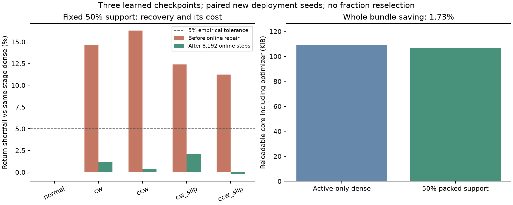

# 固定 50% 支持的压缩后在线修复

**直接 Top-k 主筛选没有合格候选。本节是之后单独声明并执行的固定比例诊断，不是重新挑选主候选。**

三个已有 checkpoint 各比较紧凑稠密与 50% 稀疏表示，修复前后采用同一组新的部署随机数安排，每个情境 2,048 步；中间在 CW→CCW 流中追加 8,192 步 PPO。修复训练没有用评估轨迹，不搜索比例或重调学习率。

## 1. 修复前后

表中为三个 checkpoint 等权平均；百分比差距以同阶段稠密累计回报为参照。负数表示稀疏均值略高，不说明统计优势。

| 情境 | 修复前稀疏回报差距 | 修复后稀疏回报差距 | 修复后稠密成功率 | 修复后稀疏成功率 |
|---|---:|---:|---:|---:|
| normal | 0.00% | 0.00% | 100.00% | 100.00% |
| cw | 14.62% | 1.13% | 100.00% | 100.00% |
| ccw | 16.28% | 0.39% | 100.00% | 100.00% |
| cw_slip | 12.40% | 2.08% | 100.00% | 100.00% |
| ccw_slip | 11.22% | -0.22% | 100.00% | 100.00% |

**已观察到：固定较少坐标仍能继续接收真实仿真反馈、更新参数，修复直接截断造成的大部分性能损失。**修复后，各情境平均成功率为 100%，累计回报与同样续训的稠密参照差距落入原先的 5% 经验容忍范围。这个结果包括追加学习的成本，不能表述为直接压缩无损。

## 2. 容量、修复损失与时间

| 表示 | 学习步/运行 | 学习期累计回报 | 学习时间 | 新增优化器步 | 核算状态最大值 | 修复后恢复 bundle |
|---|---:|---:|---:|---:|---:|---:|
| dense_compact | 8,192 | 3113.91 | 5.21 秒 | 498.0 | 133.295 KiB | 108.915 KiB |
| packed_0.5 | 8,192 | 2935.24 | 5.52 秒 | 509.3 | 131.539 KiB | 107.031 KiB |

适应模块含参数、索引及残差 Adam 状态的数值字节减少 **41.61%**，整个修复后 bundle 减少约 **1.73%**。训练期间稀疏版累计回报比稠密参照低约 **5.74%**，用时多约 **5.87%**；这些都是需要计入的压缩修复代价。

两个稀疏叶每个 130 个坐标均发生更新；稠密参照每叶 260 个坐标更新。全部基础 actor 保持逐张量不变，Adam 状态形状与保存坐标一致，没有隐含的持久稠密叶备份。

## 3. 解释边界

- 这是“较小持久修正＋更多在线修复经验”的具体可行性信号，不是最优容量—经验定理。
- 仅测试已经出现过的旋转家族及其滑移变体；不是未知新家族、共享父节点或满容量知识整合实验。
- 8,192 步是固定修复预算，尚未测出恢复所需最少步数。
- 筛选是三 checkpoint 均值，可能掩盖单个种子的短期退化；没有总体性能保证或统计确证。
- 基础模型和 critic 占主要状态容量。因此局部节省很大，整体节省较小；当前也没有算力优势。

本诊断总环境交互为 **172,032 步**，包含修复前评估、在线学习与修复后评估。主压缩筛选结果仍为无合格候选。

[实际汇总](summary.json) / [事先固定的修复配置](config.json) / [矢量图](repair_summary.pdf)

## 软件与程序知识来源

使用 [Stable-Baselines3 PPO](https://stable-baselines3.readthedocs.io/en/master/modules/ppo.html)、[PPO](https://arxiv.org/abs/1707.06347)、[Gymnasium](https://gymnasium.farama.org/) 和 Matplotlib；版本见项目 requirements-lock.txt。实验循环参考 [autoresearch](https://github.com/karpathy/autoresearch)，未执行原始语言模型训练器。

stable-baselines3 与 matplotlib 技能支持实现和报告；程序知识来源为 Kassis, Agarwal, He, Patel & Brueckner（2026），[Scientific Agent Skills: A Library of Procedural Knowledge for Research Agents](https://arxiv.org/abs/2609.00065)。这些引用不构成外部性能验证。
