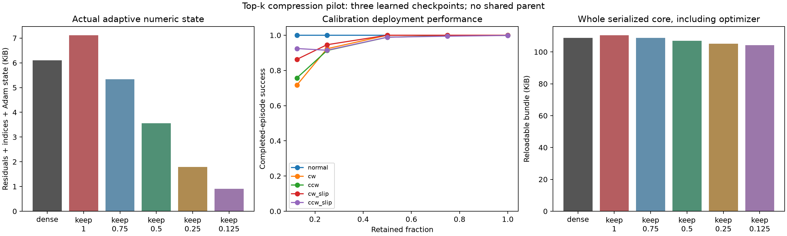

# 稀疏压缩尝试：结果与解释

本次只检验已学根加叶修正的 Top-k 稀疏表示、文件恢复及继续 PPO 更新，**没有检验共享父节点、自动整合或容量满后持续学习**。

## 1. 比较口径

主参照是仅保留两个已用叶的紧凑稠密表示。原八槽稠密表示另列，移除空槽的收益不算稀疏压缩贡献。索引使用 uint16，数值和 Adam 动量使用 float32；动量按保留坐标迁移。

| 表示 | 坐标数 | 参数＋索引＋残差优化器数值状态 | 平均实际恢复 bundle | 相对紧凑稠密的适应状态节省 | 校准筛选 |
|---|---:|---:|---:|---:|---|
| dense_compact | 520 | 6.102 KiB | 108.853 KiB | 0.00% | 参照 |
| packed_1 | 520 | 7.117 KiB | 110.468 KiB | -16.65% | 未通过 |
| packed_0.75 | 390 | 5.340 KiB | 108.718 KiB | 12.48% | 未通过 |
| packed_0.5 | 260 | 3.562 KiB | 106.968 KiB | 41.61% | 未通过 |
| packed_0.25 | 130 | 1.785 KiB | 105.093 KiB | 70.74% | 未通过 |
| packed_0.125 | 66 | 0.910 KiB | 104.218 KiB | 85.08% | 未通过 |

原八槽表示的政策张量为 46.645 KiB，紧凑稠密政策张量为 40.301 KiB。前者与后者的差异来自删除未用槽及稠密路径 mask。原八槽 bundle 与紧凑格式的元数据布局不同，不能将两者全部文件差值归因于参数压缩。

全保留稀疏格式有额外索引，因此可能比紧凑稠密更大。报告实际恢复 bundle 与纯数值状态，两者均不同于进程 RAM；不是用文件 ZIP 压缩率代替持久表示。

## 2. 校准选择与新部署随机数复验

候选比例在运行前固定；门槛为适应数值状态节省至少 10%、整体 bundle 更小、每个情境跨 checkpoint 平均成功率下降最多 5 个百分点、正累计回报下降最多 5%。该标准作用于三 checkpoint 等权平均，不保证每个种子或每段部署均满足上限。

校准选择：**没有候选满足全部条件**。所有候选和负结果保留在 validation 目录。

## 3. 压缩后继续在线更新

| 表示 | 在线步/运行 | 累计回报均值 | 时间均值 | 优化器步均值 | 核算状态最大值 |
|---|---:|---:|---:|---:|---:|

主筛选没有合格候选，未启动主试验选定候选续训；紧凑表示接入原 PPO 的能力已有独立定向检查。另做了固定 50% 比例的在线修复诊断，见 [修复结果](repair/结果解读.md)。它不改变主筛选失败的记录。

## 4. 能与不能得出的结论

- 这次给出小修正知识的实际压缩—性能曲线，并把空槽删除与稀疏收益分开。
- 剩余模型/critic、随机状态和打包开销占整体容量的大部分；适应模块的大百分比节省不等于整个智能体节省相同比例。
- 固定保留坐标限制了未来表达能力。压缩后能在已知家族继续更新，不等于对任意新环境继续变强。
- 参数稀疏不保证反向传播更快；索引转换、特征 gather 和 scatter 仍有开销，实际时间另列。
- 序列化容量在采样/训练边界检查，RSS 是检查点最大值；观察副本和打包工作区出现在实验进程中，不声称给出瞬时全部 RAM 上界。
- 三个已有 checkpoint、一个基础预训练种子。主校准未产生合格候选，因此没有主复验；后续修复采用新部署随机数流，checkpoint 仍是同一组，不是独立重新训练的三个新模型 cohort，也不是安全认证。

总实际环境交互：184,320 步。全保留和文件恢复的策略概率检查覆盖每 checkpoint 19,440 个网格/路由输入。

[完整汇总](summary.json) / [表示账本](representation.json) / [筛选记录](selection.json) / [矢量图](compression_summary.pdf)

## 软件与程序知识来源

使用 [Stable-Baselines3 PPO](https://stable-baselines3.readthedocs.io/en/master/modules/ppo.html)、[PPO](https://arxiv.org/abs/1707.06347)、[Gymnasium](https://gymnasium.farama.org/) 和 Matplotlib；版本见项目 requirements-lock.txt。实验循环参考 [autoresearch](https://github.com/karpathy/autoresearch)，未执行原始语言模型训练器。

stable-baselines3 与 matplotlib 技能支持实现和报告；程序知识来源为 Kassis, Agarwal, He, Patel & Brueckner（2026），[Scientific Agent Skills: A Library of Procedural Knowledge for Research Agents](https://arxiv.org/abs/2609.00065)。这些引用不构成外部性能验证。
