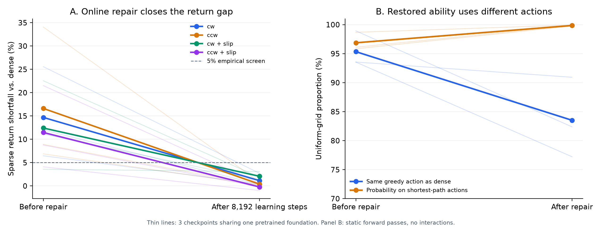

# 已有 A/B、对照补齐和压缩修复的深度分析

日期：2026-10-14。范围：读取已完成实验的日志、汇总和保存权重；新增环境交互为 0，新增优化器更新为 0。没有进入 Part C，没有改变主压缩筛选门槛或重新选择候选。

## 1. 总体判断

**研究方向仍有可行性，但现有证据集中于“在线学到的小修正可以持久复用”和“受限修正可以通过追加在线经验恢复能力”。共享父节点、自动知识整合、容量耗尽后的学习和整体成本优势尚未得到验证。**

对照补齐使判断更精确：当前旋转任务可以被非常小的在线系统辨识和解析动作变换有效解决。当前 PPO 的优势主要相对于冻结策略和丢弃已学修正的策略成立。不能把这些结果概括为部署后神经参数更新具有普遍必要性，也不能把修复后的回报恢复概括为完整研究框架已经成立。

| 待回答的主张 | 当前证据 | 判断 |
|---|---|---|
| 部署经验能形成持久策略修正 | 保留修正、清空近期历史、关闭梯度后仍有效 | 有明确的局部机制证据 |
| 近期历史能够识别当前情境 | 在动作全局旋转家族中识别快；存在过时历史陷阱 | 条件成立，可靠性不足 |
| 修正比整个策略独立存储更小 | 每叶只修改 260 个 actor 头部坐标，共享冻结特征 | 架构上成立；没有完整策略库的匹配实测对照 |
| 层级共享能优于扁平残差库 | 实际只有根和两个叶 | 未验证 |
| 树能自动提升、合并、拆分、删除 | 实际路由为追加式原型库 | 未验证 |
| 达到容量上限后仍能整合新经验 | 8 槽未填满，256 KiB 核算预算未逼近上限 | 未验证 |
| 直接稀疏压缩几乎无损 | 预声明主筛选没有合格候选 | 当前尝试未达标 |
| 较少残差坐标还能继续在线学习 | 50% 固定支持追加 8,192 步后恢复大部分损失 | 有正面可行性信号 |
| 减少整个智能体的持久容量 | 修复后恢复 bundle 减少约 1.73% | 实测有小幅收益 |
| 降低在线计算、交互和时间 | 修复需追加交互，稀疏训练时间更长 | 当前没有支持效率优势 |

三个在线种子/已有 checkpoint 共用一个基础预训练权重。后续部署随机数虽更换，模型来源仍是同一组。下述均值和逐运行检查都是探索性证据。

## 2. 当前实验真正提供了什么任务难度

基础策略用 normal 环境中的 20,000 条专家转移训练，已掌握 9×9 网格中位置到目标的运动关系。在线环境保持观测、目标、奖励和动作空间不变，变化主要是动作到移动的映射：normal、CW、CCW，另有两个 0.12 滑移概率的变体。

### 2.1 五个环境标签对应三个主要动作映射家族

路由器使用动作响应的 dot/cross 统计。CW 和 CW-slip 共用一个叶，CCW 和 CCW-slip 共用另一个叶，normal 使用基础策略。这能够检验一定噪声鲁棒性，但不能按“五类独立未知知识”计算问题复杂度。99% 左右的正确路由是旋转家族识别，不是五种情境的完整辨识。

全局旋转还把动作之间的未知性强耦合：只要看到一次不被墙阻挡的有效移动，就能获得关于所有动作映射的线索。连续 5 次有效移动主要用于稳健确认。它没有充分检验“不同状态、不同动作需要分别探索”的不确定性，也没有检验长时依赖历史。

### 2.2 所需新知识有极低维的精确表示

设基础 actor 的扩展特征为 φ̄(s)，输出 logits 为 ℓ₀(s)=W̄₀φ̄(s)。全局旋转为 k 时，命令动作 a 的实际方向是 a+k。因此一个直接校正的策略为：

πₖ(a|s)=π₀((a+k) mod 4|s)。

令 Πₖ 是对应的输出行置换，则 W̄ₖ=ΠₖW̄₀，ΔW̄ₖ=(Πₖ−I)W̄₀。该关系是当前环境动作映射的代数性质。这里用解析变换恢复基础策略的动作含义，并不证明它在所有滑移环境中具有随机控制最优性。

所以在预先知道该变换族时，新增知识可以表示为一个旋转编号和一个固定算子。当前方法让 PPO 把这一关系写入每叶 4×65=260 个数值。它的低容量表现部分来自这个任务本身容易压缩。

**研究含义：**需要分别判断环境是否存在共享结构，以及算法是否真的从在线经验中发现、表示和保留了这种结构。当前实验强烈利用了前者，对后者的检验仍有限。

### 2.3 当前历史表示的适用范围

历史特征使用位置变化、动作、dot/cross 均值/方差和动作计数；没有把奖励流作为情境识别依据。如果奖励规则改变、转移响应不变，当前路由器无法仅凭这些特征发现这种新情境。冻结根 actor 也不会在 normal 路由上形成新的通用 actor 修正。这里是当前实现的范围限制，不能外推为历史感知方法在一般潜在情境中已经有效。

## 3. 持久参数的作用：对照补齐后可以说得更强

无梯度部署比较了三种分支，每次 2,048 步：

- P+H+：保留已学残差和终点近期历史。
- P+H0：保留残差，清空近期历史。
- P0H0：清零残差，清空近期历史。

三者保留相同的已学路由原型、基础 actor 和其他控制条件。“P0”只表示清除残差，不表示清除智能体所有持久知识。

| 情境 | P+H0 完整回合成功率 | P0H0 完整回合成功率 |
|---|---:|---:|
| normal | 100% | 100% |
| CW | 100% | 1.04% |
| CCW | 100% | 1.04% |
| CW-slip | 100% | 25.71% |
| CCW-slip | 100% | 24.03% |

这个控制说明：在线阶段得到的残差具有部署后的持久价值。当前历史清空后，策略重新获得少量响应证据便能路由到已学残差；无需重新用梯度学出同一修正。无梯度条件还排除了测试期间 Adam 动量通过更新权重解释动作差异的可能。

这个结论是“同一架构中，已学残差的保留具有作用”。它没有排除别的表示能用更少持久状态或临时辨识解决相同任务。解析基线正提供了后一个事实。

### 3.1 近期历史与树知识没有简单的冗余关系

持久残差保存“某种情境下如何行动”；近期历史提供“现在属于哪种情境”的证据。清空历史后恢复能力，与这两类状态具有不同生命周期相符。树里保存多种修正并不能独立告诉智能体此刻应该调用哪一种。

### 3.2 优化器状态的证据较弱

保持相同策略、清空近期历史，保留/重置 Adam 后各追加 8,192 步。三个种子的保留减重置累计回报差为 +121.75、+90.00、−11.25，均值 +66.83（相对重置均值约 2.20%）。PPO 的 KL 提前停止使实际优化器步数不同。因此不能说保存 Adam 必然更好，也不能把它和保存策略知识的证据强度等同。Adam 应作为可计量的学习状态单独讨论。

## 4. 解析基线为何是重要负结果

解析控制器只用当前真实动作反馈辨识旋转，随后逆映射基础 actor 的动作。它没有隐藏情境标签，也没有策略梯度更新。它的优势来自已知低维变换族和直接动作校正。

| 阶段 | 解析法累计回报 | 匹配初始化 PPO 累计回报 | 解析法时间 | PPO 时间 |
|---|---:|---:|---:|---:|
| A：16,384 步 | 6,329.81 | 4,706.31 | 5.98 秒 | 10.18 秒 |
| B：32,768 步 | 11,875.88 | 8,736.96 | 12.10 秒 | 19.88 秒 |

解析法的样本累计回报比相应 PPO 均值高约 34.5% 和 35.9%。两类方法共享初始环境和动作随机种子、情境日程和交互预算；后续轨迹由各自行为生成。

它仍属于利用在线经验适应的系统。因而实验支持“线上反馈非常重要”，同时削弱“必须通过大量神经参数更新才能在这里有效适应”的论断。基于前面截图中的 history-dependent/adaptive 区分，权重冻结并不等价于没有在线适应。完整理论的具体必要性和容量条件仍应以原定理为准。

本任务中的基础策略已经会完成导航，在线主要需要辨识控制接口变化。解析法承担了辨识和动作变换；PPO 还要用奖励梯度重新拟合该关系。这是合理的机制解释，实验没有把全部差距进一步分解为每个因素的因果贡献。

原 A 中全参数微调和残差微调的差异也应谨慎解释：选择的较大学习率来自残差配置筛选；全参数版本受到 KL 提前停止，实际更新次数显著更少。因此其表现不能作为“充分调优的全参数方法必然不如残差”的证据。

## 5. 从现有日志发现的路由漏洞

终点历史来自 CCW。无梯度重新部署到 CW 时，保留旧历史比清空历史更差：

| 已有种子 | 保留历史首次正确识别 | 清空历史首次正确识别 | 保留历史、识别前不移动步数 | 其中错误 CCW 路由且置信度 ≥0.95 的步数 |
|---|---:|---:|---:|---:|
| 41 | 262 | 8 | 252 | 69 |
| 53 | 134 | 6 | 124 | 65 |
| 67 | 74 | 7 | 64 | 65 |

这是具体的反馈循环：旧历史支持旧节点 → 用旧修正选择动作 → 在新环境中反复撞墙 → 路由器把不移动事件排除 → 缺少有效新响应 → 旧判断或低信息状态持续存在。

当前窗口保存的是最近 16 条有效移动，而非最近 16 个真实时间步。连续碰撞可以让“近期历史”数百步都保留旧证据，这是时效性漏洞的来源之一。

种子 41 的首步中，位置位于右边界，动作 0 在旧 CCW 假设下应向左移动，在实际 CW 中向右撞墙。该观测对旧假设本来有反证价值。排除所有零位移事件使这种证据丢失。之后部分步骤已经降到较低置信度，但仍长期没有获得足够可用响应。因此问题包括过时的高置信判断和行为造成的辨识停滞。

这对原设计有三点启发：

1. 相似度分数不是校准的情境后验。置信度必须对新预测错误、证据年龄、缺少信息的持续时间作出反应。
2. 不能把所有零位移直接判为新情境；需要结合状态、动作和边界，区分本来应该被阻挡与模型预测失败。
3. 情境识别可靠性、修正收益可靠性之外，还要关注当前行为是否正在阻碍收集辨识证据。这不是额外要求增加复杂世界模型，而是反馈闭环中的基本问题。

已知部署开始时清空工作记忆是合法的对照操作；连续流中的任务切换时刻未知，不能把这项控制操作直接当成隐藏切换检测算法。实验没有实现独立的策略改进可靠性门控，也没有验证逐层回退或主动探测能解决上述停滞。

## 6. 当前树的实质与共享主张的边界

实际结构为：基础策略根节点 → CW 残差叶 / CCW 残差叶。根在线 actor 冻结，叶保存各自头部修正。代码支持多节点路径组合，压缩接口也支持父节点关系；实际实验没有学出具有共享在线修正的中间父节点。

因此，已观察到的共享主要是预训练基础特征共享。一个扁平残差库也可以共享同一个基础特征提取器，并使用相同路由。当前数据不能把该收益单独归因于多层树。

路由器遇到新模式时追加原型，到 max_nodes 后停止创建，没有实现容量满后的合并、提升、删除或替换。两个已用残差叶远未耗尽 8 槽。256 KiB 核算预算下，修复期峰值约 132–133 KiB，也没有形成容量压力。

还有一个可辨识性问题：父节点加 C、相关子节点各减 C，在适当路径上可以保持总修正相同。仅把若干权重搬到父节点不会自动产生更通用知识；需要其跨情境功能、复用效果或实际表示长度证据。当前实验没有给出这种证据。

## 7. 直接压缩失败说明了什么

主参照是仅保存两个活跃叶的紧凑稠密格式。移除未用槽和路径 mask 约 6.344 KiB 的政策张量，属于实现打包精简，不能记为学习到的知识整合。

主筛选预先规定：适应数值状态节省至少 10%，完整 bundle 更小，各情境三 checkpoint 均值的成功率下降 ≤5 个百分点、正累计回报下降 ≤5%。没有候选全部达标。

75% 保留仅在 CCW-slip 的均值回报下降约 5.45% 上越过门槛，但逐 checkpoint 已有 14.59% 的最大下降。50% 保留的某些成功率仍很高，累计回报下降却明显。按更宽的均值门槛重新描述“近似成功”，不能消除单个运行的损失。

### 7.1 成功率掩盖了动作效率

从修复评估 cohort 的逐步日志重新计算：

| 情境 | 修复前稠密平均完整回合长度 | 修复前 50% 稀疏长度 | 修复后稠密长度 | 修复后稀疏长度 |
|---|---:|---:|---:|---:|
| CW | 5.93 | 6.96 | 5.91 | 5.97 |
| CCW | 6.15 | 7.39 | 6.00 | 6.02 |
| CW-slip | 7.34 | 8.30 | 7.21 | 7.37 |
| CCW-slip | 7.20 | 7.98 | 7.00 | 7.01 |

这些是各 checkpoint 完整回合均值再等权平均，并非同一组 episode 的逐一配对。CW 修复前，两种方法成功率都为 100%，但稀疏版朝目标移动的步数占比只有 90.32%，稠密版是 99.54%；稀疏版停滞比例约 5.26%，稠密约 0.13%。CW 的成功回合路径长度/初始曼哈顿距离均值由约 1.012 升到 1.202，确认了绕行和停滞。

逐步奖励为 rₜ=.25(Dₜ−Dₜ₊₁)−.03+成功指示。完整回合的未折扣日志回报为：

G=.25(D_start−D_end)−.03L+成功指示。

成功时 G=1+.25D_start−.03L。因此成功率相同仍可能付出更多动作；固定 2,048 步内还会完成更少回合。总累计回报受完成回合数、初始目标距离和尾部未完成回合影响，不能直接把回报差换算成单一长度损失。该累计指标也不是已经建立反事实最优基准的正式累计遗憾。

### 7.2 绝对值 Top-k 不等于保留重要知识

残差影响通过 ΔW̄φ̄(s) 进入动作 logits。权重大小忽略特征激活、坐标共同作用、动作间差值和实际访问状态的后果。

还存在精确的 softmax 不变性：对任意 65 维向量 c，ΔW̄+1cᵀ 与 ΔW̄ 给四个 logits 加上相同标量，因此动作分布不变。每叶 260 个数值至少有 65 个这种公共行平移自由度。绝对值排名可能随等价重参数化改变，说明权重幅值不是内在的策略知识量。

所以这次失败首先针对“在当前表示上直接做幅值截断”，不能据此否定所有压缩、低秩修正或层级共享，也不能把直接截断称为无损经验整合。

## 8. 在线修复的正面证据及其限度

固定 50% 支持后，各叶只保留 130 个坐标。两个分支从对应终点恢复，稠密/稀疏各追加同样 8,192 环境步 CW→CCW PPO，没有把评估轨迹用来训练。

| 情境 | 修复前稀疏累计回报差距 | 修复后差距 |
|---|---:|---:|
| CW | 14.62% | 1.13% |
| CCW | 16.28% | 0.39% |
| CW-slip | 12.40% | 2.08% |
| CCW-slip | 11.22% | −0.22% |

normal 前后不变，所有修复后已测运行成功率为 100%。进一步逐运行核查，修复前最大回报下降为 34.07%，修复后最大为 3.08%。因此这次恢复并非完全由少数较好种子拉平；同一组已测运行都有改善后的低差距。但仍没有超出这三个 checkpoint 的总体保证。

**最强可支持表述：已学残差在固定较小支持集内，能够继续利用环境反馈更新，并在给定额外预算后恢复已知情境的大部分能力。**

### 8.1 还不能证明经验替代容量的完整关系

这是一个压缩比例、一个修复预算下的点。它没有测量最小恢复步数或容量—经验曲线。稀疏策略先继承了稠密策略 32,768 步在线训练的结果、被选中的坐标和对应 Adam 状态，再追加 8,192 步。坐标选择本身也来自更大表示的已学数值。

没有比较同样小的支持/参数化从部署起就学习会如何。因此当前数据不能区分：

- 追加在线经验在这里承担了必要的知识重新编码；
- 小模型原本就足够，直接截断只是把它放到了不好的参数位置，继续优化恢复了一个本来就能表示的解。

二者都与现有结果相容。第二种解释仍有工程价值，但不足以独立支持理论容量—经验下界或独特研究贡献。

稠密和稀疏修复都追加相同环境步，生命周期训练预算同为 40,960 步；这是公平的一个局部终点比较。实际优化器步和时间不同，且这些策略在修复前已经见过所有评估家族。滑移性能恢复可以来自旋转头部变好后对噪声更稳健，不能称为对新滑移知识的首次发现或新的跨任务迁移。

## 9. 新静态诊断：任务能力恢复与策略一致性可以分离

只读取保存权重，在 12,960 个合法状态/残差路由输入上做前向计算：9×9 所有不同起点与目标，两个已学旋转路由。近期历史特征置零，因为 actor 不使用这八个特征；critic 仍使用历史。没有模拟交互。

| 指标，三个 checkpoint 等权均值 | 修复前 | 修复后 |
|---|---:|---:|
| 稠密与稀疏贪心动作一致比例 | 95.34% | 83.51% |
| KL(稠密‖稀疏)，均匀网格平均，nats | 0.423 | 1.613 |
| 稀疏策略给最短路径动作的概率 | 96.87% | 99.86% |

修复后两个策略在所有检查状态的贪心动作均属于对应无滑移旋转环境的最短路径动作集合。全部贪心分歧都是“两者选择不同的最短路径动作”。例如目标在右下方，向右和向下都可以是正确选择；两个近乎确定的策略偏好不同顺序，会产生大 KL，却仍有相近能力。

所以在线修复没有复制回同一个动作分布，而是在更小的表示中找到具有近似任务能力的另一种策略。这强化了“策略知识应按任务功能理解”的见解，同时指出本任务的最优策略并不唯一，给压缩恢复留下了较大的解空间。

均匀网格 KL 不是部署占用分布的 KL，最短路径集合判定只针对无滑移 CW/CCW 和既定奖励/几何。它不构成滑移、新奖励、新情境或错误路由时的安全证据。KL 在学习稳定性和信赖域中仍有用途；这里发现的是它不能单独决定知识相似性或压缩质量。

可以用任务族上的性能损失来讨论知识失真，例如对指定情境分布计算 Σ_c w_c[J_c(π)−J_c(π̃)]₊，并额外检查最差情境和短期损失。这个表达用于明确评价含义，并不是已经实现的合并算法。新任务族改变后，原来的功能等价关系也可能改变。

图 A 细线为三个 checkpoint 在四种情境的逐运行回报差距，粗线为每情境逐运行差距均值。图 B 细线为各 checkpoint，粗线为三者均值。图 A 的均值口径是“先算每个运行比例，再平均”，与上面“先平均回报，再算比例”存在小的数值差别。没有把跨情境点当成独立训练种子。

## 10. 容量和成本需要分层解释

| 核算项目 | 紧凑稠密 | 50% 稀疏 | 稀疏节省 |
|---|---:|---:|---:|
| 残差权重坐标数 | 520 | 260 | 50% |
| 残差权重＋索引 | 2,080 B | 1,560 B | 25% |
| 加上残差 Adam 数值状态 | 6,248 B | 3,648 B | 41.61% |
| 修复后完整恢复 bundle | 108.915 KiB | 107.031 KiB | 约 1.73% |

每个保留坐标保存 4 字节值、2 字节索引和 8 字节 Adam 两个动量。稠密坐标无需索引，每坐标为 12 字节，另有少量 step 标量。因此“减半参数”“策略知识表示减小 25%”“可继续学习状态减小 41.61%”是不同口径。

当前基础 actor、critic 和 critic 优化器状态占数值状态的大部分，RNG、路由、打包及恢复元数据还有固定开销。以种子 41 的压缩前紧凑 bundle 为例，政策加优化器张量合计 85,916 B，整个文件为 111,508 B；不能把差值全看成策略权重。完整恢复文件也不等于进程 RAM。

修复时：

- 稠密平均累计回报 3,113.91，稀疏 2,935.24，相差 178.67 个日志奖励单位，稀疏低约 5.74%。
- 稠密平均训练时间 5.21 秒，稀疏 5.52 秒，稀疏多约 5.87%。
- 新增实际优化器步约 498.0 与 509.3。环境交互预算相同不表示梯度预算、有效计算相同。

用更小的数值支持换到接近的终点能力是已观察到的收益；修复期奖励、额外交互和运行时间是成本。当前稀疏坐标 gather/scatter 和临时索引转换没有带来计算加速。没有证据支持“更少在线交互”或“更快适应”相对于最佳解析控制器成立。

## 11. 学术贡献与理论联系

目前能够报告的结果是：

1. 在隐藏全局动作映射切换下，部署经验形成的小残差可以持久复用；通过无梯度、冷历史、残差清除控制能够定位其作用。
2. 固定支持压缩造成行为效率下降，追加在线学习能够恢复一组已知情境的能力，并给出局部/整体容量和修复成本账本。
3. 错误路由会通过动作选择阻碍后续辨识；纯响应相似度和忽略零位移可以造成明显延迟。
4. 同一任务族上，能力恢复可以伴随更大的动作分布差异；知识相似性应结合行为后果解释。

这些是有价值的原型结果与设计约束。现阶段的“头部残差、原型路由、幅值稀疏化、PPO 修复”组合，单靠当前结果还不足以支撑“自动层级知识整合使受限智能体持续变强”的完整贡献。结构表达接口不能代替结构学习证据。

与 persistent capacity 和 online experience 的理论思想相容，可以帮助定义实践问题；实验没有估计环境信息复杂度、必要保留信息下界或最优交互上界。预训练和代码中固有的先验也承担了知识容量。把同一知识写成不同参数数目，不能单独证明降低了其必要信息量。

此外，“固定容量持续变强”需要明确目标任务分布与可共享结构。如果新情境要求保存彼此独立的新决策，且重访时不允许重新辨认，有限比特无法无损记住任意多决策。允许重新在线辨认会产生容量、适应代价和旧知识保留之间的权衡。研究主题可以保持不变，但不应要求在任意流上每一步性能单调提升或永远无损保留所有知识。

## 12. 对既定方向的当前判断

**保留研究方向。把现阶段成果定位为机制原型与压缩修复的可行性证据。**

当前证据最支持两件事：线上经验能够写入可跨部署复用的小型修正；固定小表示仍有能力用追加经验重新找到有效策略。最有价值的新限制是：已有强结构可以使临时辨识更有效；历史与行为形成的闭环会使高置信错误持续；策略功能不能由参数距离或动作一致率完全代替；局部容量节省必须连同完整模型和学习成本核算。

主贡献仍应由既定的“潜在情境发现 → 共享与特化分解 → 周期性整合 → 固定容量下持续改善”链条承担。现有实验还没有覆盖这条链条中的共享与整合环节。因此当前可以说有希望，不能把“部分局部效果良好”升级为“总体方案已被验证”。

## 数据来源与复核

- [原 A/B 解读](../validated/结果解读.md)
- [补齐对照解读](../ab_plus/结果解读.md)
- [直接压缩筛选](../compression_attempt/selection.json)
- [在线修复原始汇总](../compression_attempt/repair/summary.json)
- [本次逐运行与静态诊断](diagnostics.json)
- [只读诊断脚本](analyze_existing.py)、[输入 SHA256](provenance.json)、[诊断图 PDF](mechanism_diagnostics.pdf)

新增分析使用 Python、PyTorch 和 Matplotlib；现有实验沿用项目中记录的 SB3 PPO、Gymnasium 和依赖版本。Matplotlib 技能用于静态科研图；工具来源不构成性能验证。原始训练和筛选结果保持原样。
