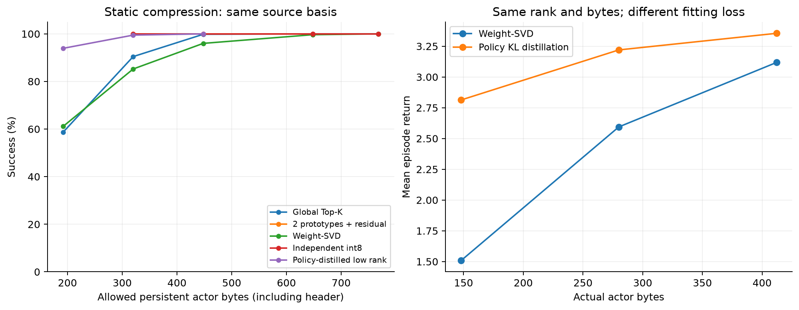
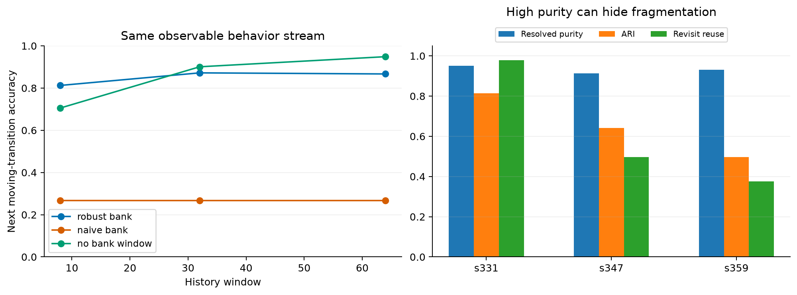
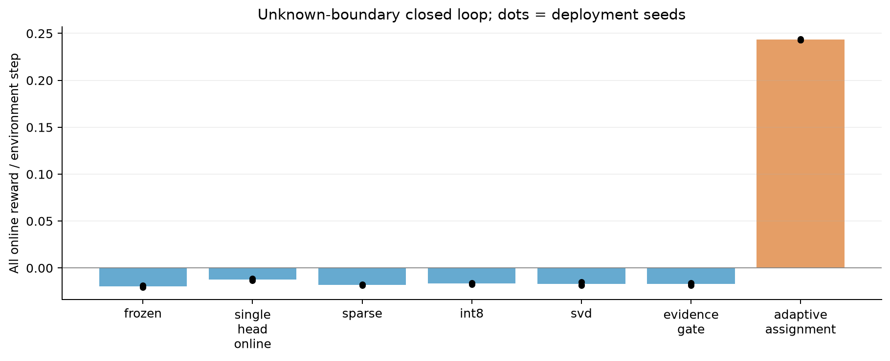

# 有界在线知识组织：三步机制实验

研究主线保持为预训练后的部署期持续参数学习。已经完成静态整合、从零无标签辨识和最小在线闭环。当前证据支持继续研究行为感知的整合目标，同时明确暴露了原型发现与持久知识绑定的不稳定性。当前整合方法尚未形成超过简单强对照的优势。

所有数字都是三个部署种子的描述性均值；它们共享一个预训练 W0 和有利于动作置换的源输出基。情境/episode 之间有依赖，不作独立样本显著性检验。这是 C1 受控机制实验，没有标准基准 SOTA 结论。

## 静态整合：压缩目标比层级容器更关键

从已学会六个情境的三个教师终点出发，将父子修正展开成相同的 6×27 有效矩阵。编码器不接收家族标签，评估者隔离目标环境。比较 dense、逐行稀疏、全局稀疏、FP16、int8、均值加残差、双原型加残差、SVD，以及同秩策略蒸馏。总计检查 129 组配置，其中 24 组无法装入预算；可行候选与参考共记录 21,312 个完整 episode。

预算包含实际二进制头、数值、索引、分配和尺度。六头 float32 的完整编码是 664 B，原始参数数组是 648 B；int8 是 202 B，FP16 是 340 B。不能把数值数组大小冒充可解码包大小。

| 方法 | 320 B 上限内实际字节 | 平均成功率 | 平均 episode 回报 |
|---|---:|---:|---:|
| 独立逐行 Top-K | 304 | 91.32% | 2.913 |
| 独立 int8 | 202 | 100.00% | 3.382 |
| 全局均值＋稀疏残差 | 316 | 70.83% | 1.928 |
| 无标签双原型＋稀疏残差 | 316 | 100.00% | 3.335 |
| 普通 SVD | 280 | 85.24% | 2.594 |
| 同秩策略 KL 蒸馏 | 280 | 99.48% | 3.220 |

双原型共享确实能压缩，但本次共享候选没有同时超过同预算下最佳独立编码的成功率和回报。增加全局 Top-K 后结论一致：共享残差的优势不能归因于它可以跨行分配预算，而基线被迫每行等额分配。

策略蒸馏是原静态结果后的预声明补充实验。保持 SVD 的秩、因子数量和字节不变，以固定 256 个源数据观测×六个教师路由优化动作分布 KL，Adam .01、256 次更新，不查询新的环境奖励，也不按测试表现选择迭代。结果如下。

| 实际因子字节 | 普通 SVD 成功率 | 策略蒸馏成功率 | 普通 SVD 回报 | 策略蒸馏回报 |
|---:|---:|---:|---:|---:|
| 148 | 61.11% | 93.92% | 1.509 | 2.813 |
| 280 | 85.24% | 99.48% | 2.594 | 3.220 |
| 412 | 96.01% | 100.00% | 3.118 | 3.355 |

148 B 的成功率明显改善，但三个种子都没有同时通过“成功率下降≤5百分点、回报下降≤0.25”的原保留门槛。280 B 和 412 B 的蒸馏都通过三个种子的门槛。不能只看成功率宣布最小编码已经保留原策略效果。

这验证了一个可用的设计原则：整合应度量它对动作分布和控制效果的影响，权重距离不足以代表知识损失。策略蒸馏本身已有研究，不能作为本项目独有创新。源观测覆盖、已知教师路由和静态评估仍是局限；静态结果没有证明无边界在线整合有效。

## 从零无标签辨识：高纯度会掩盖分支碎片化

路由库从空状态开始，只观察行动前状态和此前真实动作、奖励与下一状态。没有预校准任务 bank，没有任务编号或切换时钟。对未尝试动作、已有证据冲突、墙边删失响应分别处理。最多六原型，与只保留近期转移窗口、朴素新颖性分配作同流对照。三条实际行为流总计 18,644 步，各路由方法读取同一流，不把离线路由回放重复计为环境交互。

| W32 指标 | 支持度感知原型库 | 朴素原型库 | 仅近期窗口 |
|---|---:|---:|---:|
| 下一移动转移预测准确率 | 87.2% | 26.7% | 90.1% |
| 可解析路由覆盖 | 87.5% | 20.5% | 不提供情境路由 |
| 已解析路由纯度 | 93.2% | 99.8% | 不适用 |
| 整流 ARI，含未解析状态 | 0.650 | 约0 | 不适用 |
| 复现时复用原 generation 的比例 | 61.7% | 0 | 不适用 |
| 每流创建／驱逐次数 | 27／21 | 约1,090／1,084 | 不建库 |

支持度规则显著优于“低支持即新情境”，但仍没有可靠实现有限容量的持久情境辨识。三个种子的 W32 ARI 分别约 0.813、0.641、0.496；单看 93.2% 的已解析纯度会遗漏大量重复建库、驱逐及短时回退。

朴素方法甚至有99.8%的已解析纯度，同时ARI接近零、复用为零。极短寿命、只包含少量同类事件的原型天然容易纯，因此纯度不能单独作为情境发现成功的证据。

现有算法的新建与复用证据不对称：复用要求已有单元至少两次支持，新建冲突却可能建立在每单元一次旧响应上。这是一项有依据的修改候选。观测诊断还显示分支创建与 x 区域切换经常相邻；这提示局部覆盖变化可能被误当成全局情境变化。该相关性不能证明因果，日志缺少完整 observe 时刻冲突概率，不能直接归因全部误建。

窗口从 8 增至 32 有帮助，继续增到 64 没有消除碎片化。主动探索没有做独立公平对照，不能声称其效果已得到验证。

## 最小在线闭环：现有整合规则未带来优势

七臂×三个种子，每次 32,768 步，共 688,128 步真实训练流交互。隐藏情境在 episode 内也可切换。从 W0 和空原型库开始，PPO 用真实奖励更新修正；每 1,024 步中的 768 步用于学习，256 步保留为候选验证，所有神经学习臂遵守同一安排。

持久修正包上限 320 B，另限制原型数与有限回放。候选按旧 anchor 上的策略 KL 排序，再用当前留出轨迹估计局部收益并检查旧情境 KL；当前验证样本不参与候选拟合或排序。门控不使用研究者的跨环境迁移矩阵，也没有免费回到旧环境评估。它是经验规则，没有安全改进保证。

| 方法 | 在线奖励／步 | 在线完整 episode 成功率 | 修正包字节 | 平均训练墙钟秒 |
|---|---:|---:|---:|---:|
| 冻结初始策略 | −0.01975 | 9.72% | 0 | 59.2 |
| 单头直接在线更新 | **−0.01242** | **13.73%** | **47** | **44.5** |
| 逐情境稀疏压缩 | −0.01809 | 9.60% | 304 | 63.6 |
| 逐情境 int8 | −0.01662 | 12.03% | 202 | 64.7 |
| SVD 共享压缩 | −0.01707 | 11.78% | 280 | 61.4 |
| 证据门控整合 | −0.01722 | 11.93% | 202 | 63.1 |
| adaptive_assignment 统计控制器 | **+0.24325** | **100.00%** | 无神经修正包 | **31.9** |

单头直接在线更新在本轮神经方法中最好。门控平均每次运行接受 18.7、拒绝 13.3 次，没有提高累计表现；候选细节保留于每次整合日志。这个结果不支持“增加整合门控已经更好”，也不支持“树或模块库是当前收益的来源”。

强统计控制器使用源数据得到的动作映射先验、可见区域与动作置换假设，属于此环境的强结构先验。它仍进行了在线统计学习，只是不更新神经修正。本环境不能用来证明神经参数更新优于所有其他在线学习方式。另一方面，这个明确的强对照说明目前神经闭环离一个有竞争力的方法还很远。

墙钟是各运行实测值，包含其代码路径与资源状态；不作精确的硬件微基准结论。在线成功率的分母是各自行为产生的完整 episode，长度和数量不同，因此主指标使用全部奖励／固定交互步数。未获得动态最优策略，不把该回报称为严格累计 regret。

## 持久容量与可靠性：尚有两个必须正视的问题

修正包只有 47–304 B，但完整恢复文件约 130–155 KB，另有基础模型与运行开销。路由、critic/Adam 和有限 anchor 回放远大于修正本身。静态参数压缩率不能直接变成整个智能体的内存或计算收益；后续应报告完整持久状态的 Pareto 曲线。

当前原型槽的驱逐会丢失与其绑定的修正。即使局部策略可学习，反复误建情境也会破坏后续复用。情境识别置信度与“该修正有益”的证据已经分开记录，但这两种经验判据都还没有得到可靠校准。门控还可能拒绝有用的新知识，原型反复分配则使旧知识验证目标移动；本轮没有足够因果消融把损失精确分配给它们。

终点重访的原实现存在槽重用语义和跨 episode 随机流配对问题，训练流不受影响。原评估保留并排除于参数持久性的正式推断；修正程序从同一终点重做，按 episode 配对随机流，并在新原型占用旧槽时清除不再属于它的修正。修正版结果见 `../knowledge_loop_revisit_corrected/summary.json`，额外交互单独计费。

修正版重访共 1,728 个完整 episode、102,991 步，策略梯度更新为零。每个种子×方法评估六情境各八个 episode，两条件共用逐 episode reset/action 随机计划。

| 保留参数相对清除修正 | 平均配对回报增益 | 保留参数成功率 | 清除修正成功率 |
|---|---:|---:|---:|
| 冻结初始策略 | 0.000 | 9.03% | 9.03% |
| 单头在线更新 | **+1.022** | **22.92%** | 9.03% |
| 稀疏压缩 | +0.100 | 11.81% | 9.03% |
| int8 | +0.182 | 11.11% | 9.03% |
| SVD | +0.058 | 9.72% | 9.03% |
| 证据门控整合 | +0.127 | 11.81% | 9.03% |

单头在三个部署种子的配对回报增益均为正。此结果支持本设置下在线训练得到的参数具有跨短历史清空后的作用；复杂组织方法的额外价值仍未建立。每个情境只有八个 episode，且共享 W0，不给它超出本实验的保证。

本轮实施的是组件上限：320 B 修正、六原型和最多 384 个 anchor。完整状态有被计量，但尚未实现一个对整个恢复包统一执行的全局字节配额。因此还不能声称已经解决严格全智能体持久容量 B 的调度问题。Python 容器大小、工作区估计与边界采样 RSS 也不能冒充精确进程峰值。

## 对研究贡献的判断与下一轮假设

目前可以保留的研究问题是：有限在线证据如何决定某条知识应该局部保存、与已有知识共享、继续试用还是被替换。已有结果没有建立本方法的核心创新优势。将在线更新、小修正、共享、蒸馏和聚类组合起来，本身还不足以形成强贡献。

下一轮最值得检验的三项具体假设是：

1. **把全局情境身份与局部可复用知识分开。** 在某个状态区域出现预测冲突时，先局部修正或暂存，积累跨区域一致证据后才建立持久分支；不让每次覆盖变化驱逐整张情境修正。用未知情境流与已知路由的诊断上界分解辨识和优化损失。
2. **接受整合时度量控制相关失真。** 以有限真实回放上的策略损失、受影响知识的支持度和重学成本作预算决策；静态蒸馏给出了可行性线索，但还需在线闭环证明，并与独立量化、简单回放蒸馏比较。
3. **试用与永久保存采用不同证据门槛。** 新知识先占固定试用空间，证据不足时保持软归属和探索；晋升、共享或替换需要足以抵偿旧知识损失与验证成本的证据。必须同时计量误接受、误拒绝、重访恢复和整个持久包。

树、扁平模块池和 DAG 均可承载这些决策。应在写入规则稳定后比较结构；本轮证据没有要求把树固定为方法身份。后续需多个独立 W0、超出动作置换的动态、任务数大于持久容量、稀有复现与交叉因素，再评估创新能否成立。

## 已借鉴的论文与复现边界

- [Policy Distillation, 1511.06295](https://arxiv.org/abs/1511.06295)：实际实现同秩动作分布蒸馏补充实验；没有复刻完整 Atari 系统。
- [Progress & Compress, 1805.06370](https://arxiv.org/abs/1805.06370)：局部试用与周期整合；本轮没有完整复现其 active column/EWC。
- [Modular Lifelong RL, 2207.00429](https://arxiv.org/abs/2207.00429)：共享组合知识；本轮没有它的模块搜索与离线 RL 流程。
- [DaCoRL, 2209.00347](https://arxiv.org/abs/2209.00347)：从动力学流发现、复用情境；本轮是硬上限的计数原型，不是其无限混合模型和扩展多头网络。
- [R-BOCPD, CoLLAs 2023](https://proceedings.mlr.press/v232/alami23a.html)：变化证据思路；没有移植其理论保证。
- [SPIBB, 1712.06924](https://arxiv.org/abs/1712.06924)：将缺乏支持和已有证据冲突区分；本门控不继承其安全保证。

规程在各正式实验前提交；静态蒸馏是明确标注的后续实验。原七编码静态 cohort 缺少运行当时的完整源码快照，数值结果及输入 hash 保留，该来源限制见 serialization_audit/source_provenance.json；后续控制、辨识、闭环和修正重访均保存源码快照。一次重复静态重跑被中止，残留结果、原因及至少 85,781 步开销保存，不计入正式效果统计。不能把该部分未持久化的参考交互宣称为精确总量。

完成的正式实验共计 1,287,001 次环境交互：静态原组 277,327、全局稀疏控制 61,961、蒸馏控制 32,106、辨识流 18,644、闭环训练 688,128、保留的旧重访 105,844、修正重访 102,991。三个 pilot 另计 14,753 步；中止重跑另有至少 85,781 步。辨识算法对相同流的 27 次计算没有重复计入环境步。新增 42 项针对编码、因果时序、PPO、槽 generation 和配对重访的检查通过。
