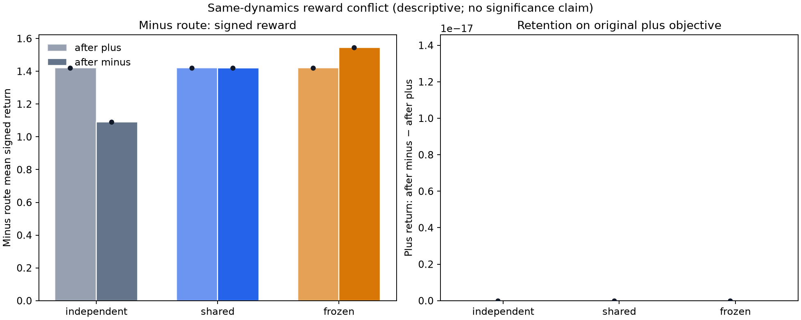

# Same-dynamics reward-conflict report

Phase: **pilot**. Seeds: 853.

Minus-route goal completion is environment termination metadata, not task success. Cold transfer (initial → after plus) is separate from adaptation during minus (after plus → after minus).

## Per-condition means

| Condition | Minus return after plus | Minus return after minus | Cold transfer | Minus adaptation gain | Plus return retention delta | Plus goal success after plus | Plus goal success after minus |
|---|---:|---:|---:|---:|---:|---:|---:|
| independent_conflict | 1.4200 | 1.0912 | 0.0000 | -0.3288 | 0.0000 | 0.1250 | 0.1250 |
| shared_conflict | 1.4200 | 1.4200 | 0.0000 | 0.0000 | 0.0000 | 0.0000 | 0.0000 |
| frozen_conflict | 1.4200 | 1.5450 | 0.0000 | 0.1250 | 0.0000 | 0.0000 | 0.0000 |

## Paired contrasts

Each value is shared active minus the named baseline, paired within seed. These are descriptive contrasts; no significance claim is made.

### shared_conflict_minus_independent_conflict

| Metric | Mean paired difference | Per-seed differences |
|---|---:|---|
| plus_after_plus_return | -0.2100 | 853: -0.2100 |
| plus_after_plus_goal_success | -0.1250 | 853: -0.1250 |
| plus_after_minus_return | -0.2100 | 853: -0.2100 |
| plus_after_minus_goal_success | -0.1250 | 853: -0.1250 |
| plus_return_retention_delta | 0.0000 | 853: 0.0000 |
| plus_goal_success_retention_delta | 0.0000 | 853: 0.0000 |
| minus_initial_signed_return | 0.0000 | 853: 0.0000 |
| minus_after_plus_signed_return | 0.0000 | 853: 0.0000 |
| minus_after_minus_signed_return | 0.3288 | 853: 0.3288 |
| minus_cold_transfer_signed_return | 0.0000 | 853: 0.0000 |
| minus_adaptation_gain_after_plus | 0.3288 | 853: 0.3288 |
| minus_training_signed_reward_per_step | 0.0000 | 853: 0.0000 |
| minus_goal_termination_rate_after_plus_metadata | 0.0000 | 853: 0.0000 |
| minus_goal_termination_rate_after_minus_metadata | -0.2500 | 853: -0.2500 |

### shared_conflict_minus_frozen_conflict

| Metric | Mean paired difference | Per-seed differences |
|---|---:|---|
| plus_after_plus_return | 0.0000 | 853: 0.0000 |
| plus_after_plus_goal_success | 0.0000 | 853: 0.0000 |
| plus_after_minus_return | 0.0000 | 853: 0.0000 |
| plus_after_minus_goal_success | 0.0000 | 853: 0.0000 |
| plus_return_retention_delta | 0.0000 | 853: 0.0000 |
| plus_goal_success_retention_delta | 0.0000 | 853: 0.0000 |
| minus_initial_signed_return | 0.0000 | 853: 0.0000 |
| minus_after_plus_signed_return | 0.0000 | 853: 0.0000 |
| minus_after_minus_signed_return | -0.1250 | 853: -0.1250 |
| minus_cold_transfer_signed_return | 0.0000 | 853: 0.0000 |
| minus_adaptation_gain_after_plus | -0.1250 | 853: -0.1250 |
| minus_training_signed_reward_per_step | 0.0002 | 853: 0.0002 |
| minus_goal_termination_rate_after_plus_metadata | 0.0000 | 853: 0.0000 |
| minus_goal_termination_rate_after_minus_metadata | 0.0000 | 853: 0.0000 |

## Audit

42/42 checks passed; 0 failed assertions.

Interaction totals: probe_steps=3072, training_steps=12288, evaluation_steps=9183, total_interactions=24543.

CPU, wall, and memory timings are retained per run in report.json as descriptive costs.

