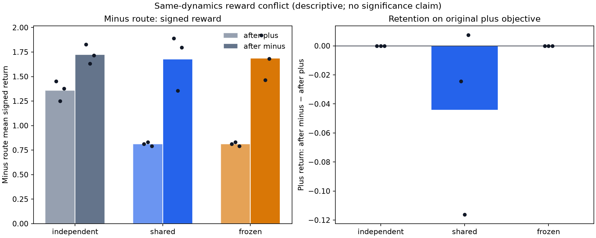

# Same-dynamics reward-conflict report

Phase: **formal**. Seeds: 773, 787, 797.

Minus-route goal completion is environment termination metadata, not task success. Cold transfer (initial → after plus) is separate from adaptation during minus (after plus → after minus).

## Per-condition means

| Condition | Minus return after plus | Minus return after minus | Cold transfer | Minus adaptation gain | Plus return retention delta | Plus goal success after plus | Plus goal success after minus |
|---|---:|---:|---:|---:|---:|---:|---:|
| independent_conflict | 1.3600 | 1.7252 | 0.0000 | 0.3652 | 0.0000 | 0.2292 | 0.2292 |
| shared_conflict | 0.8123 | 1.6794 | -0.5477 | 0.8671 | -0.0444 | 0.2708 | 0.2708 |
| frozen_conflict | 0.8123 | 1.6881 | -0.5477 | 0.8758 | 0.0000 | 0.2708 | 0.2708 |

## Paired contrasts

Each value is shared active minus the named baseline, paired within seed. These are descriptive contrasts; no significance claim is made.

### shared_conflict_minus_independent_conflict

| Metric | Mean paired difference | Per-seed differences |
|---|---:|---|
| plus_after_plus_return | 0.2223 | 773: 0.4100, 787: 0.2381, 797: 0.0188 |
| plus_after_plus_goal_success | 0.0417 | 773: 0.0625, 787: 0.0625, 797: 0.0000 |
| plus_after_minus_return | 0.1779 | 773: 0.3856, 787: 0.1219, 797: 0.0262 |
| plus_after_minus_goal_success | 0.0417 | 773: 0.0625, 787: 0.0625, 797: 0.0000 |
| plus_return_retention_delta | -0.0444 | 773: -0.0244, 787: -0.1163, 797: 0.0075 |
| plus_goal_success_retention_delta | 0.0000 | 773: 0.0000, 787: 0.0000, 797: 0.0000 |
| minus_initial_signed_return | 0.0000 | 773: 0.0000, 787: 0.0000, 797: 0.0000 |
| minus_after_plus_signed_return | -0.5477 | 773: -0.6375, 787: -0.4187, 797: -0.5869 |
| minus_after_minus_signed_return | -0.0458 | 773: 0.0625, 787: -0.2781, 797: 0.0781 |
| minus_cold_transfer_signed_return | -0.5477 | 773: -0.6375, 787: -0.4187, 797: -0.5869 |
| minus_adaptation_gain_after_plus | 0.5019 | 773: 0.7000, 787: 0.1406, 797: 0.6650 |
| minus_training_signed_reward_per_step | -0.0010 | 773: -0.0010, 787: -0.0002, 797: -0.0017 |
| minus_goal_termination_rate_after_plus_metadata | 0.1042 | 773: 0.1875, 787: 0.0000, 797: 0.1250 |
| minus_goal_termination_rate_after_minus_metadata | 0.0208 | 773: 0.0000, 787: 0.0625, 797: 0.0000 |

### shared_conflict_minus_frozen_conflict

| Metric | Mean paired difference | Per-seed differences |
|---|---:|---|
| plus_after_plus_return | 0.0000 | 773: 0.0000, 787: 0.0000, 797: 0.0000 |
| plus_after_plus_goal_success | 0.0000 | 773: 0.0000, 787: 0.0000, 797: 0.0000 |
| plus_after_minus_return | -0.0444 | 773: -0.0244, 787: -0.1163, 797: 0.0075 |
| plus_after_minus_goal_success | 0.0000 | 773: 0.0000, 787: 0.0000, 797: 0.0000 |
| plus_return_retention_delta | -0.0444 | 773: -0.0244, 787: -0.1163, 797: 0.0075 |
| plus_goal_success_retention_delta | 0.0000 | 773: 0.0000, 787: 0.0000, 797: 0.0000 |
| minus_initial_signed_return | 0.0000 | 773: 0.0000, 787: 0.0000, 797: 0.0000 |
| minus_after_plus_signed_return | 0.0000 | 773: 0.0000, 787: 0.0000, 797: 0.0000 |
| minus_after_minus_signed_return | -0.0088 | 773: -0.0313, 787: -0.1094, 797: 0.1144 |
| minus_cold_transfer_signed_return | 0.0000 | 773: 0.0000, 787: 0.0000, 797: 0.0000 |
| minus_adaptation_gain_after_plus | -0.0088 | 773: -0.0313, 787: -0.1094, 797: 0.1144 |
| minus_training_signed_reward_per_step | 0.0004 | 773: 0.0005, 787: 0.0001, 797: 0.0005 |
| minus_goal_termination_rate_after_plus_metadata | 0.0000 | 773: 0.0000, 787: 0.0000, 797: 0.0000 |
| minus_goal_termination_rate_after_minus_metadata | -0.0208 | 773: 0.0000, 787: 0.0000, 797: -0.0625 |

## Audit

120/120 checks passed; 0 failed assertions.

Interaction totals: probe_steps=9216, training_steps=147456, evaluation_steps=51176, total_interactions=207848.

CPU, wall, and memory timings are retained per run in report.json as descriptive costs.

