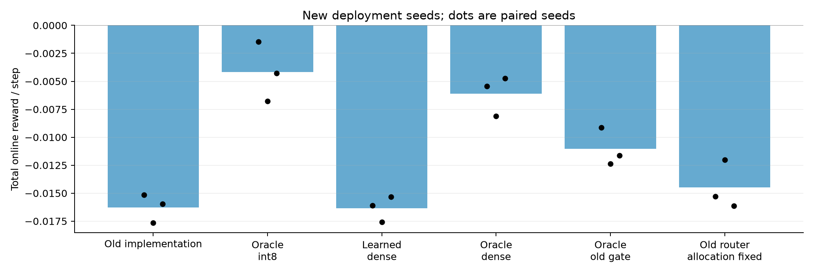
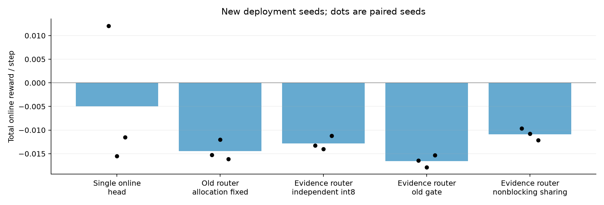

# V2：如何验证，以及哪些优化已经有效

2026-10-15。完成两个新种子在线 cohort：六组因果诊断×三个种子、五组优化方法×三个种子，均为32,768步；另完成已有数据流上的路由重放、评分诊断及15个终点的持久性评估。原V1数据保留，所有新结果使用独立目录。

结论是可以定向优化。情境管理、局部更新保留与整合门控已经被分开验证；终点复用效果有改善，但自动共享知识的核心贡献仍没有充分建立。不能把修bug、已有编码技术或真值路由诊断的收益算成新创新。

## 先做因果归因，而不是同时改全部模块

初始检查确认了一处实现缺陷：新建或替换一个情境槽时，V1会重新安装整个旧committed矩阵，抹掉其他槽尚未整合的在线更新。新实现只清除新槽，其他试用参数逐位保留。这个修复有独立对照，不与新路由捆绑解释。

另一个问题是旧门控的收益分数：数据由trial策略生成，分数却使用candidate/incumbent比值作为采样参考。专门的8,192步开发诊断保持原算法动作与奖励逐项不变，只同时记录两个分数；10次候选/回退评分有4次符号不同。两个分数都不是安全改进保证，这项结果不能直接证明任何门控阈值正确。

正式诊断使用新部署种子541、557、569，同一W0、PPO设置和外部切换安排。真值路由只作为机制诊断；它没有满足未知情境约束，其路由内存也不参与公平比较。

| 诊断条件 | 全部在线奖励／步 | 在线成功率 | 修正编码字节 |
|---|---:|---:|---:|
| 原路由＋原分配实现＋int8 | −0.016267 | 12.50% | 202 |
| 只修复分配回滚＋int8 | −0.014477 | 14.89% | 202 |
| 真值路由＋int8 | −0.004182 | 26.53% | 202 |
| 原路由＋dense | −0.016333 | 11.75% | 664 |
| 真值路由＋dense | −0.006097 | 24.13% | 664 |
| 真值路由＋原门控 | −0.011049 | 18.22% | 终点202 |

由此得到三个可复核判断：

1. 修复回滚后的平均收益提高，但三个种子中只有seed557有明显正增益，另外两个略差。因此实现缺陷需要修复，却不足以解释全部失败。
2. 真值路由相对修复后的旧路由，在三个种子中都提高累计奖励。这支持把情境辨识/知识绑定作为一个主要瓶颈。真值路由也只有26.53%成功，并不是最优策略上界，优化效率仍有限。
3. 去掉量化、使用更大的dense编码没有改善。压缩不是当前的主要瓶颈。即使路由正确，旧门控仍在三个种子都降低累计表现，说明它阻碍局部学习的问题独立存在。

## 针对原因修改算法

新EvidenceRouter保持空库起步、未知编号/边界、最多六原型和窗口32。近期证据先留在一个一致后缀中，比较所有共同支持单元；未知动作不算冲突，存在已支持冲突的原型不能复用。暂存证据与持久原型分离，避免一两个孤立事件立刻污染旧知识或创建永久分支。它使用本环境的确定性位移与可见区域，尚未验证噪声动力学的鲁棒性。

在三条保存的共同行为流上，没有新增环境交互：

| 指标 | 原支持度路由 | 新路由 |
|---|---:|---:|
| 可解析覆盖 | 87.5% | 93.6% |
| ARI，含未解析状态 | 0.650 | 约0.901 |
| 已解析generation纯度 | 93.2% | 约99.4% |
| 复现时复用比例 | 61.7% | 约93.1% |
| 每流分配／驱逐 | 27／21 | 6／0 |

这批数据是机制开发诊断，不是独立泛化测试。短段pilot的ARI从0.442降到0.397，即使分配减少也不能把所有辨识指标都说成改善。真正的在线检验使用下述新的三个种子。

整合方面，将两个决策分开：先用独立int8保留PPO局部学习，再判断共享编码是否值得采用。共享候选必须实际字节更少，且在有界旧anchor与当前留出观测上满足mean KL≤.002、max KL≤.02。没有通过的共享候选就保留独立int8，不回滚整个周期的局部学习。该规则约束的是观测支持上的压缩失真，不提供值函数或安全回报保证。

这受到 [Progress & Compress](https://arxiv.org/abs/1805.06370) 的学习/整合分离与 [DaCoRL](https://arxiv.org/abs/2209.00347) 的在线情境发现启发。本实现是有限计数原型和紧凑修正控制，没有完整复现这两篇算法；采样参考分布的区别也不应冒充 [TRPO](https://arxiv.org/abs/1502.05477) 的保证。

## 用新种子做闭环检验

五条件分别隔离单头基线、分配修复、新路由、旧门控和非阻塞整合。各自32,768步，768/1,024步用于PPO，其余256步留出；各条件使用相同外部情境顺序，但策略产生自己的真实访问轨迹。

| 新种子闭环 | 在线奖励／步 | 在线成功率 | 平均训练墙钟秒 |
|---|---:|---:|---:|
| 单头直接在线学习 | **−0.005001** | **23.36%** | 47.7 |
| 旧路由＋仅修复分配＋int8 | −0.014477 | 14.89% | 66.6 |
| 新路由＋独立int8 | −0.012829 | 17.54% | 39.1 |
| 新路由＋旧门控 | −0.016547 | 12.82% | 39.7 |
| 新路由＋非阻塞共享整合 | **−0.010876** | **19.69%** | 39.8 |

新路由降低分支抖动和运行开销，但累计奖励的提升出现在2/3种子。旧门控在相同新路由下仍在3/3种子造成下降。非阻塞整合相对同路由独立int8，在2/3种子提高累计奖励，一个种子下降；相对旧门控则3/3种子改善。

单头在线累计回报的均值仍最好，而且seed541明显较好、seed557很差，不能把三个重复当成充分统计证据。多情境修正有更多控制容量和历史路由信息；仅胜过不含历史的单头策略仍不足以证明共享组织创新。最关键的匹配在线对照是“新路由＋独立int8”：它具有相同历史/路由接口、种子、外部切换安排和交互预算，但各策略产生的实际观测轨迹不同，不能称为接收了完全相同的数据。

## 终点策略确实更容易复用，但增量来自哪里仍需区分

从15个保存终点还原，清空短历史，保留/清除修正两条件分别使用相同逐episode随机计划。路由库可以继续学习，新槽占用旧槽时清除不再归属于它的修正，策略梯度更新为零。六情境各八个episode，共1,440个episode、80,319步。

| 终点方法 | 保留参数成功率 | 清除修正成功率 | 平均配对回报增益 |
|---|---:|---:|---:|
| 单头在线学习 | 26.39% | 13.89% | +0.759 |
| 旧路由＋修复＋int8 | 13.89% | 13.89% | +0.040 |
| 新路由＋独立int8 | 30.56% | 13.89% | +0.888 |
| 新路由＋旧门控 | 19.44% | 13.89% | +0.397 |
| 新路由＋非阻塞共享整合 | **31.94%** | 13.89% | **+0.985** |

新路由＋非阻塞整合在三个种子的终点配对回报都高于单头，但累计在线回报的均值仍较差。这呈现了适应过程与终点复用的权衡，没有同时解决全部指标。

更重要的是，新路由＋独立int8已经达到30.56%，共享整合只再提高约1.39百分点，三个种子的回报增量仍是2正1负。由此不能把终点的全部改善归因于共享压缩。当前有力的增量证据主要是情境管理和避免错误门控；自动共享知识的独有作用仍弱。

## 容量检查也需要兑现

每次主V2持久化的代码都检查W0文件＋checkpoint≤256 KiB；审计另由各运行32条commits日志与终点文件复核保存字节。保存了actor/critic/optimizer/router/replay/RNG，并用记录的variant工厂还原。各新路由终点的恢复包平均约236,469 B，旧路由修复对照约202,571 B，单头约195,445 B。新路由更稳定，也保留了更多有限anchor，因此整个包没有更小。

非阻塞整合的96次提交只有4次采用148 B SVD，其余92次为202 B int8；全部容量采样的平均修正包199.75 B、最大202 B，终点仍为202 B。相对独立int8约1.1%的修正包平均节省很小，对整个恢复包的影响更小。不能宣布解决了显著持久容量压缩。

256 KiB是本轮实际持久化边界检查，不是任意运行时内存的理论保证。本轮只有六真实情境、六原型，没有验证真实情境数大于容量时仍能通过压缩/替换持续学习；超出恢复包边界时当前程序会报告不满足，而不是已经实现成熟的全局预算调度。

## 下一轮真正值得验证什么

当前已经排除了“只要换更大编码就能解决”以及“加一个改进置信门控就会更安全”的简单解释。接下来应把贡献目标落在共享怎样改变学习更新，而不只在训练后压缩上。

建议先隔离学习机制，比较同样历史/路由输入、同样完整预算的四种写入规则：只写局部修正、固定共享、在线提出共享写入、共享失败时回到局部写入。共享写入应让一组相关情境的数据共同改进可复用参数；整合或重分组时保存有效策略，避免任意重参数化造成隐含变化。固定共享的诊断参考仍需明确它使用的先验。

接受标准应同时要求：对比同路由独立模块有稳定增量；任务数超过容量仍能改善重访；总持久包真正节省或同包性能更好；验证/整合成本抵偿了重学成本。可先用共同保存流隔离参数共享/结构操作的作用，再用各自生成真实轨迹的闭环验证总效应；共同流的离策略更新需要适用算法，不能把PPO直接当作任意回放学习。加入跨因素共享、相似观测却冲突控制、稀有复现和超出动作置换的动力学，再补多个独立预训练W0。

若只修bug、换成更可靠路由就提升，属于必要工程与方法基础；若同信息同容量的自动共享写入仍没有增益，就应修改知识单位或共享规则，而不是继续加深树。树、DAG和模块池仍作为结构对照，不固定为研究身份。

## 证据和来源

本轮正式33次训练共1,081,344步；两个pilot共73,728步；评分诊断8,192步；终点重访80,319步，总计1,243,583次新增环境交互。保存流重放新增交互为零。本轮17项针对路由、保留更新、工厂还原、oracle隔离和scoped恢复的检查通过。

两个独立harness中的相同分配修复对照，在三个种子各32,768步的动作、奖励、路由逐项完全一致。正式规程在运行前提交；因果harness继承的快照列表最初不含V2规程，后来添加了明确标注的事后来源补充，原执行时manifest保留。V2新路由checkpoint须通过variant-aware工厂还原，相关复核记录见 `docs/KNOWLEDGE_V2_IMPLEMENTATION_NOTES.md`。所有效果均为三个新部署种子、同一个W0的描述性结果，没有标准基准SOTA声明。
