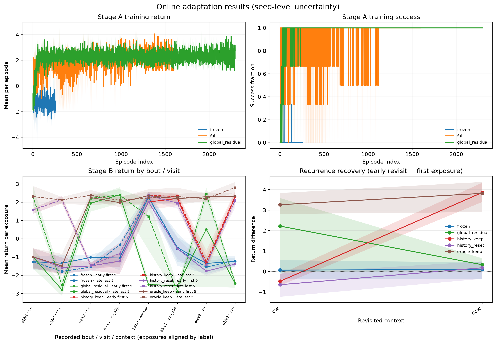

# Online adaptation report

Input directory: `D:\MovedFromC\ChatGPT\online\outputs\pilot`. This report was generated from logged run data.



Vector figure: [learning_summary.pdf](learning_summary.pdf)

## Data coverage

- Run directories: 24
- Episode records: 45262 (0 marked evaluation)
- Training records used in curves and outcome summaries: 45262
- Methods: frozen, full, global_residual, history_keep, history_reset, oracle_keep
- Seed identifiers: 3
- Mixed-context episode records retained in overall counts: 89
- Distinct seed/method/stage groups: 24
- Curves first average within each seed and then across seeds. Confidence bands are 95% percentile bootstrap intervals resampled over seeds; episode rows are not treated as independent samples.
- Stage A and Stage B are independent seed/method groups. Stage B per-context exposure metrics exclude rows marked `mixed_context=true`; overall run totals still use the runner's cumulative summary values.
- Stage B records are grouped by each seed/method's recorded bout, visit, and context. Within each exposure, early means use the first up to 5 episodes and late means use the last up to 5. For exposures shorter than 10 episodes, these windows can overlap.

## Initial source pretraining evaluation

### `pilot`

```json
{
  "bc_updates": 1500,
  "dataset_transitions": 20000,
  "elapsed_s": 6.983282100001816,
  "source": {
    "episodes": 64,
    "mean_return": 2.2512499999999998,
    "steps": 364,
    "success_rate": 1.0
  },
  "train_transitions": 17955,
  "unseen_ccw_before_online": {
    "episodes": 64,
    "mean_return": -2.111406249999999,
    "steps": 4096,
    "success_rate": 0.0
  },
  "unseen_cw_before_online": {
    "episodes": 64,
    "mean_return": -2.0645312499999995,
    "steps": 4096,
    "success_rate": 0.0
  },
  "validation_cross_entropy": 0.346333384513855,
  "validation_split": "whole trajectory: episode ID mod 10",
  "validation_transitions": 2045,
  "weights_sha256": "e6a22024a83aa5f1f8699d44702007f31e0d3132fd1cc6ed3a0f0fdc538c7222"
}
```

## Stage A deployment training

| Method | Seeds | Training return (mean ± seed SD) | Success fraction (mean ± seed SD) |
|---|---:|---:|---:|
| frozen | 3 | -1.336 ± 0.070 | 0.003 ± 0.002 |
| full | 3 | 1.787 ± 0.449 | 0.866 ± 0.127 |
| global_residual | 3 | 2.252 ± 0.011 | 0.984 ± 0.004 |
| history_keep | 0 | n/a | n/a |
| history_reset | 0 | n/a | n/a |
| oracle_keep | 0 | n/a | n/a |

### Baseline learning gate

| Run | Gate result | Evidence |
|---|---|---|
| `suite summary/config` | 達成 | stage_A_gate: {"interpretation": "pilot gate, not a statistical significance claim", "online_improvement": 1.0, "online_success_improvement_minimum": 0.2, "passed": true, "source_success": 1.0, "source_success_minimum": 0.9} |

### Evaluation episodes

| Stage | Method | Seed | Evaluation | Episodes | Steps | Mean return | Success fraction |
|---|---|---:|---|---:|---:|---:|---:|
| A | frozen | 11 | shift_cw | 64 | 4,096 | -2.154 | 0.000 |
| A | frozen | 11 | source_after_shift | 64 | 400 | 2.375 | 1.000 |
| A | frozen | 23 | shift_cw | 64 | 4,096 | -2.084 | 0.000 |
| A | frozen | 23 | source_after_shift | 64 | 377 | 2.296 | 1.000 |
| A | frozen | 37 | shift_cw | 64 | 4,096 | -2.127 | 0.000 |
| A | frozen | 37 | source_after_shift | 64 | 349 | 2.200 | 1.000 |
| A | full | 11 | shift_cw | 64 | 557 | 2.083 | 0.953 |
| A | full | 11 | source_after_shift | 64 | 2,136 | 0.635 | 0.562 |
| A | full | 23 | shift_cw | 64 | 1,139 | 1.782 | 0.812 |
| A | full | 23 | source_after_shift | 64 | 2,087 | 0.666 | 0.578 |
| A | full | 37 | shift_cw | 64 | 971 | 1.697 | 0.844 |
| A | full | 37 | source_after_shift | 64 | 1,080 | 1.486 | 0.828 |
| A | global_residual | 11 | shift_cw | 64 | 360 | 2.238 | 1.000 |
| A | global_residual | 11 | source_after_shift | 64 | 4,096 | -1.006 | 0.000 |
| A | global_residual | 23 | shift_cw | 64 | 409 | 2.406 | 1.000 |
| A | global_residual | 23 | source_after_shift | 64 | 4,096 | -0.897 | 0.000 |
| A | global_residual | 37 | shift_cw | 64 | 350 | 2.203 | 1.000 |
| A | global_residual | 37 | source_after_shift | 64 | 4,096 | -0.967 | 0.000 |

## Stage B unknown-route and revisit metrics

Operational definition: for each seed and method, the first chronological appearance of a recorded context in Stage B is an initial/unknown-route exposure; later exposures to that context are revisits. This is a logged-context proxy, not a claim about internal route knowledge.

| Method | Exposure type | Seed count | Early return | Late return | Early success | Late success | Early route confidence |
|---|---|---:|---:|---:|---:|---:|---:|
| frozen | Initial context exposure (unknown-route proxy) | 3 | -0.371 ± 0.276 | -0.333 ± 0.185 | 0.320 ± 0.080 | 0.347 ± 0.046 | 0.170 ± 0.015 |
| frozen | Context revisit | 3 | -1.202 ± 0.019 | -1.437 ± 0.208 | 0.022 ± 0.038 | 0.000 ± 0.000 | 0.000 ± 0.000 |
| global_residual | Initial context exposure (unknown-route proxy) | 3 | -1.288 ± 0.199 | 0.101 ± 0.480 | 0.213 ± 0.023 | 0.520 ± 0.139 | 0.164 ± 0.037 |
| global_residual | Context revisit | 3 | 0.005 ± 1.058 | 0.751 ± 0.077 | 0.533 ± 0.231 | 0.667 ± 0.000 | 0.000 ± 0.000 |
| history_keep | Initial context exposure (unknown-route proxy) | 3 | 0.088 ± 0.205 | 1.521 ± 0.162 | 0.440 ± 0.069 | 0.787 ± 0.023 | 0.725 ± 0.041 |
| history_keep | Context revisit | 3 | -0.211 ± 0.237 | -0.131 ± 0.181 | 0.333 ± 0.000 | 0.333 ± 0.000 | 0.349 ± 0.024 |
| history_reset | Initial context exposure (unknown-route proxy) | 3 | -0.461 ± 0.187 | 1.447 ± 0.194 | 0.293 ± 0.061 | 0.787 ± 0.023 | 0.718 ± 0.042 |
| history_reset | Context revisit | 3 | -1.548 ± 0.082 | -0.264 ± 0.093 | 0.000 ± 0.000 | 0.311 ± 0.038 | 0.437 ± 0.044 |
| oracle_keep | Initial context exposure (unknown-route proxy) | 3 | 0.813 ± 0.066 | 2.217 ± 0.221 | 0.613 ± 0.023 | 0.987 ± 0.023 | 0.162 ± 0.025 |
| oracle_keep | Context revisit | 3 | 2.296 ± 0.106 | 2.459 ± 0.123 | 1.000 ± 0.000 | 1.000 ± 0.000 | 0.000 ± 0.000 |

### Paired history retention comparison

| Outcome (history_keep − history_reset) | Paired seeds | Estimate | 95% paired seed-bootstrap interval | Reading |
|---|---:|---:|---:|---|
| Initial exposure early return | 3 | 0.549 | [0.483, 0.588] | Exploratory (< 5 pairs) |
| Recurrence early-return recovery | 3 | 1.922 | [1.704, 2.197] | Exploratory (< 5 pairs) |

Paired intervals resample matched seed clusters; they do not resample episode rows. An interval crossing zero is not a significance test, and with fewer than 5 pairs these contrasts are exploratory.

## Runtime, interaction, and capacity

| Stage | Method | Seeds | Online steps (mean ± seed SD) | Online time s (mean ± seed SD) | Updates (mean ± seed SD) | Online cumulative return (mean ± seed SD) | Evaluation steps (mean ± seed SD) | Evaluation time s (mean ± seed SD) | Peak agent state bytes | Peak process RSS bytes |
|---|---|---:|---:|---:|---:|---:|---:|---:|---:|---:|
| A | frozen | 3 | 16384.000 ± 0.000 | 6.971 ± 0.226 | 0.000 ± 0.000 | -342.353 ± 18.135 | 4471.333 ± 25.541 | 1.060 ± 0.042 | 77,732 | 320,323,584 |
| A | full | 3 | 16384.000 ± 0.000 | 8.687 ± 0.381 | 271.333 ± 29.023 | 2233.563 ± 1270.579 | 2656.667 ± 588.342 | 0.626 ± 0.093 | 165,560 | 320,610,304 |
| A | global_residual | 3 | 16384.000 ± 0.000 | 9.816 ± 0.627 | 979.000 ± 19.053 | 4954.980 ± 214.469 | 4469.000 ± 31.575 | 1.064 ± 0.050 | 125,797 | 320,724,992 |
| B | frozen | 3 | 32768.000 ± 0.000 | 14.555 ± 0.376 | 0.000 ± 0.000 | 1041.377 ± 40.240 | 0.000 ± 0.000 | 0.003 ± 0.000 | 77,732 | 321,527,808 |
| B | global_residual | 3 | 32768.000 ± 0.000 | 20.920 ± 3.198 | 1939.000 ± 18.520 | 3801.627 ± 640.123 | 0.000 ± 0.000 | 0.005 ± 0.000 | 125,797 | 321,150,976 |
| B | history_keep | 3 | 32768.000 ± 0.000 | 20.804 ± 1.711 | 1998.000 ± 18.083 | 4335.210 ± 521.616 | 0.000 ± 0.000 | 0.005 ± 0.001 | 134,474 | 321,544,192 |
| B | history_reset | 3 | 32768.000 ± 0.000 | 20.664 ± 1.037 | 1982.333 ± 15.011 | 2293.710 ± 208.445 | 0.000 ± 0.000 | 0.006 ± 0.000 | 134,474 | 321,720,320 |
| B | oracle_keep | 3 | 32768.000 ± 0.000 | 21.415 ± 0.814 | 1970.667 ± 31.786 | 9339.877 ± 319.924 | 0.000 ± 0.000 | 0.004 ± 0.000 | 128,668 | 321,671,168 |

Runtime, interaction, updates, and evaluation costs come from each run's `summary.json`; per-episode cumulative `elapsed_s` values are not summed into a runtime estimate. `peak_agent_state_bytes` is reported as recorded and is not added to `rollout_bytes`, because the agent-state total already includes the rollout buffer. Process RSS is reported separately. The maximum recorded payload/RSS is not proof of all memory usage.

## Protocol and limitations

- Autoresearch trials select settings using validation seeds; the main seed is kept separate for the final evaluation. Evaluation results are not selected after inspecting test outcomes and then used for further tuning.
- The environment is a small synthetic navigation task. A small number of seeds and rotation/slip context shifts do not establish generalization to other worlds or shift families.
- There is no Phase C result here, so these data do not establish a shared-capacity conclusion.
- `oracle_keep` is diagnostic only and is excluded from formal method claims.
- The evaluated scope is a root plus leaf persistent residual bank with history routing. These runs do not establish parent-level sharing, compression efficiency, or a safe policy-improvement gate. The runner's `gain_gate` field describes experimental online trials; it is not the Stage A baseline gate.
- When fewer than 5 paired seeds are available, the seed-bootstrap intervals and paired contrasts are exploratory. No statistical-significance claim is made.
- Raw `episodes.csv` and `capacity.csv` files are retained in their run directories for review; this report does not replace them.

## Runner-supplied summaries

### Suite summary `pilot/summary.json`

```json
{
  "config": {
    "a_steps": 16384,
    "agent_budget_bytes": 262144,
    "bc_updates": 1500,
    "bout_steps": 4096,
    "ent_coef": 0.06,
    "learning_rate": 0.01,
    "novelty_threshold": 0.3,
    "pretrain_transitions": 20000,
    "route_window": 16
  },
  "pretrain": {
    "bc_updates": 1500,
    "dataset_transitions": 20000,
    "elapsed_s": 6.983282100001816,
    "source": {
      "episodes": 64,
      "mean_return": 2.2512499999999998,
      "steps": 364,
      "success_rate": 1.0
    },
    "train_transitions": 17955,
    "unseen_ccw_before_online": {
      "episodes": 64,
      "mean_return": -2.111406249999999,
      "steps": 4096,
      "success_rate": 0.0
    },
    "unseen_cw_before_online": {
      "episodes": 64,
      "mean_return": -2.0645312499999995,
      "steps": 4096,
      "success_rate": 0.0
    },
    "validation_cross_entropy": 0.346333384513855,
    "validation_split": "whole trajectory: episode ID mod 10",
    "validation_transitions": 2045,
    "weights_sha256": "e6a22024a83aa5f1f8699d44702007f31e0d3132fd1cc6ed3a0f0fdc538c7222"
  },
  "runs": [
    {
      "budget_bytes": 262144,
      "created_nodes": 0,
      "evaluation": {
        "shift_cw": {
          "episodes": 64,
          "mean_return": -2.154374999999999,
          "steps": 4096,
          "success_rate": 0.0
        },
        "source_after_shift": {
          "episodes": 64,
          "mean_return": 2.375,
          "steps": 400,
          "success_rate": 1.0
        }
      },
      "evaluation_elapsed_s": 1.0897485000023153,
      "evaluation_steps": 4496,
      "limitations": [
        "synthetic globally rotated actuators and slip",
        "response dot/cross summary assumes planar action-response structure",
        "no shared parent promotion/compression evaluated in AB",
        "no calibrated policy-improvement safety gate",
        "payload+rollout hard bound; process RSS reported separately",
        "oracle_keep is diagnostic only"
      ],
      "method": "frozen",
      "node_count": 1,
      "online_cumulative_return": -331.01999999990943,
      "online_elapsed_s": 7.113885700004175,
      "online_reward_per_step": -0.020203857421869472,
      "online_steps": 16384,
      "peak_agent_state_bytes": 77732,
      "peak_process_rss_bytes": 317120512,
      "policy_resets": 0,
      "ppo_epochs": 0,
      "route_accuracy": 0.0,
      "route_coverage": 0.0,
      "seed": 11,
      "stage": "A",
      "updates": 0
    },
    {
      "budget_bytes": 262144,
      "created_nodes": 0,
      "evaluation": {
        "shift_cw": {
          "episodes": 64,
          "mean_return": 2.0826562500000003,
          "steps": 557,
          "success_rate": 0.953125
        },
        "source_after_shift": {
          "episodes": 64,
          "mean_return": 0.6354687499999995,
          "steps": 2136,
          "success_rate": 0.5625
        }
      },
      "evaluation_elapsed_s": 0.6216725999984192,
      "evaluation_steps": 2693,
      "limitations": [
        "synthetic globally rotated actuators and slip",
        "response dot/cross summary assumes planar action-response structure",
        "no shared parent promotion/compression evaluated in AB",
        "no calibrated policy-improvement safety gate",
        "payload+rollout hard bound; process RSS reported separately",
        "oracle_keep is diagnostic only"
      ],
      "method": "full",
      "node_count": 1,
      "online_cumulative_return": 3349.4799999994957,
      "online_elapsed_s": 9.06049270000949,
      "online_reward_per_step": 0.20443603515621922,
      "online_steps": 16384,
      "peak_agent_state_bytes": 165560,
      "peak_process_rss_bytes": 320479232,
      "policy_resets": 0,
      "ppo_epochs": 108,
      "route_accuracy": 0.0,
      "route_coverage": 0.0,
      "seed": 11,
      "stage": "A",
      "updates": 303
    },
    {
      "budget_bytes": 262144,
      "created_nodes": 0,
      "evaluation": {
        "shift_cw": {
          "episodes": 64,
          "mean_return": 2.2375000000000003,
          "steps": 360,
          "success_rate": 1.0
        },
        "source_after_shift": {
          "episodes": 64,
          "mean_return": -1.0059375000000013,
          "steps": 4096,
          "success_rate": 0.0
        }
      },
      "evaluation_elapsed_s": 1.0073607999947853,
      "evaluation_steps": 4456,
      "limitations": [
        "synthetic globally rotated actuators and slip",
        "response dot/cross summary assumes planar action-response structure",
        "no shared parent promotion/compression evaluated in AB",
        "no calibrated policy-improvement safety gate",
        "payload+rollout hard bound; process RSS reported separately",
        "oracle_keep is diagnostic only"
      ],
      "method": "global_residual",
      "node_count": 1,
      "online_cumulative_return": 4779.979999999535,
      "online_elapsed_s": 9.44114750000881,
      "online_reward_per_step": 0.2917468261718466,
      "online_steps": 16384,
      "peak_agent_state_bytes": 125797,
      "peak_process_rss_bytes": 320663552,
      "policy_resets": 0,
      "ppo_epochs": 246,
      "route_accuracy": 0.0,
      "route_coverage": 0.0,
      "seed": 11,
      "stage": "A",
      "updates": 968
    },
    {
      "budget_bytes": 262144,
      "created_nodes": 0,
      "evaluation": {
        "shift_cw": {
          "episodes": 64,
          "mean_return": -2.0840624999999995,
          "steps": 4096,
          "success_rate": 0.0
        },
        "source_after_shift": {
          "episodes": 64,
          "mean_return": 2.2959375,
          "steps": 377,
          "success_rate": 1.0
        }
      },
      "evaluation_elapsed_s": 1.0115242000028957,
      "evaluation_steps": 4473,
      "limitations": [
        "synthetic globally rotated actuators and slip",
        "response dot/cross summary assumes planar action-response structure",
        "no shared parent promotion/compression evaluated in AB",
        "no calibrated policy-improvement safety gate",
        "payload+rollout hard bound; process RSS reported separately",
        "oracle_keep is diagnostic only"
      ],
      "method": "frozen",
      "node_count": 1,
      "online_cumulative_return": -363.2699999998794,
      "online_elapsed_s": 6.710366699990118,
      "online_reward_per_step": -0.02217224121093014,
      "online_steps": 16384,
      "peak_agent_state_bytes": 77732,
      "peak_process_rss_bytes": 320323584,
      "policy_resets": 0,
      "ppo_epochs": 0,
      "route_accuracy": 0.0,
      "route_coverage": 0.0,
      "seed": 23,
      "stage": "A",
      "updates": 0
    },
    {
      "budget_bytes": 262144,
      "created_nodes": 0,
      "evaluation": {
        "shift_cw": {
          "episodes": 64,
          "mean_return": 1.7824999999999995,
          "steps": 1139,
          "success_rate": 0.8125
        },
        "source_after_shift": {
          "episodes": 64,
          "mean_return": 0.6662499999999995,
          "steps": 2087,
          "success_rate": 0.578125
        }
      },
      "evaluation_elapsed_s": 0.721846500004176,
      "evaluation_steps": 3226,
      "limitations": [
        "synthetic globally rotated actuators and slip",
        "response dot/cross summary assumes planar action-response structure",
        "no shared parent promotion/compression evaluated in AB",
        "no calibrated policy-improvement safety gate",
        "payload+rollout hard bound; process RSS reported separately",
        "oracle_keep is diagnostic only"
      ],
      "method": "full",
      "node_count": 1,
      "online_cumulative_return": 850.7300000003232,
      "online_elapsed_s": 8.298757900003693,
      "online_reward_per_step": 0.05192443847658223,
      "online_steps": 16384,
      "peak_agent_state_bytes": 165560,
      "peak_process_rss_bytes": 320528384,
      "policy_resets": 0,
      "ppo_epochs": 102,
      "route_accuracy": 0.0,
      "route_coverage": 0.0,
      "seed": 23,
      "stage": "A",
      "updates": 246
    },
    {
      "budget_bytes": 262144,
      "created_nodes": 0,
      "evaluation": {
        "shift_cw": {
          "episodes": 64,
          "mean_return": 2.4059375000000003,
          "steps": 409,
          "success_rate": 1.0
        },
        "source_after_shift": {
          "episodes": 64,
          "mean_return": -0.8965625000000013,
          "steps": 4096,
          "success_rate": 0.0
        }
      },
      "evaluation_elapsed_s": 1.0821547999948962,
      "evaluation_steps": 4505,
      "limitations": [
        "synthetic globally rotated actuators and slip",
        "response dot/cross summary assumes planar action-response structure",
        "no shared parent promotion/compression evaluated in AB",
        "no calibrated policy-improvement safety gate",
        "payload+rollout hard bound; process RSS reported separately",
        "oracle_keep is diagnostic only"
      ],
      "method": "global_residual",
      "node_count": 1,
      "online_cumulative_return": 5194.229999999781,
      "online_elapsed_s": 9.467868299994734,
      "online_reward_per_step": 0.31703063964842415,
      "online_steps": 16384,
      "peak_agent_state_bytes": 125797,
      "peak_process_rss_bytes": 320712704,
      "policy_resets": 0,
      "ppo_epochs": 246,
      "route_accuracy": 0.0,
      "route_coverage": 0.0,
      "seed": 23,
      "stage": "A",
      "updates": 968
    },
    {
      "budget_bytes": 262144,
      "created_nodes": 0,
      "evaluation": {
        "shift_cw": {
          "episodes": 64,
          "mean_return": -2.127031249999998,
          "steps": 4096,
          "success_rate": 0.0
        },
        "source_after_shift": {
          "episodes": 64,
          "mean_return": 2.1996875,
          "steps": 349,
          "success_rate": 1.0
        }
      },
      "evaluation_elapsed_s": 1.0781187999964459,
      "evaluation_steps": 4445,
      "limitations": [
        "synthetic globally rotated actuators and slip",
        "response dot/cross summary assumes planar action-response structure",
        "no shared parent promotion/compression evaluated in AB",
        "no calibrated policy-improvement safety gate",
        "payload+rollout hard bound; process RSS reported separately",
        "oracle_keep is diagnostic only"
      ],
      "method": "frozen",
      "node_count": 1,
      "online_cumulative_return": -332.76999999991546,
      "online_elapsed_s": 7.088073999999324,
      "online_reward_per_step": -0.02031066894530734,
      "online_steps": 16384,
      "peak_agent_state_bytes": 77732,
      "peak_process_rss_bytes": 320278528,
      "policy_resets": 0,
      "ppo_epochs": 0,
      "route_accuracy": 0.0,
      "route_coverage": 0.0,
      "seed": 37,
      "stage": "A",
      "updates": 0
    },
    {
      "budget_bytes": 262144,
      "created_nodes": 0,
      "evaluation": {
        "shift_cw": {
          "episodes": 64,
          "mean_return": 1.6971874999999998,
          "steps": 971,
          "success_rate": 0.84375
        },
        "source_after_shift": {
          "episodes": 64,
          "mean_return": 1.4859374999999997,
          "steps": 1080,
          "success_rate": 0.828125
        }
      },
      "evaluation_elapsed_s": 0.5352856999961659,
      "evaluation_steps": 2051,
      "limitations": [
        "synthetic globally rotated actuators and slip",
        "response dot/cross summary assumes planar action-response structure",
        "no shared parent promotion/compression evaluated in AB",
        "no calibrated policy-improvement safety gate",
        "payload+rollout hard bound; process RSS reported separately",
        "oracle_keep is diagnostic only"
      ],
      "method": "full",
      "node_count": 1,
      "online_cumulative_return": 2500.4799999999436,
      "online_elapsed_s": 8.703241600000183,
      "online_reward_per_step": 0.15261718749999656,
      "online_steps": 16384,
      "peak_agent_state_bytes": 165560,
      "peak_process_rss_bytes": 320610304,
      "policy_resets": 0,
      "ppo_epochs": 105,
      "route_accuracy": 0.0,
      "route_coverage": 0.0,
      "seed": 37,
      "stage": "A",
      "updates": 265
    },
    {
      "budget_bytes": 262144,
      "created_nodes": 0,
      "evaluation": {
        "shift_cw": {
          "episodes": 64,
          "mean_return": 2.203125,
          "steps": 350,
          "success_rate": 1.0
        },
        "source_after_shift": {
          "episodes": 64,
          "mean_return": -0.9668750000000013,
          "steps": 4096,
          "success_rate": 0.0
        }
      },
      "evaluation_elapsed_s": 1.1030429000093136,
      "evaluation_steps": 4446,
      "limitations": [
        "synthetic globally rotated actuators and slip",
        "response dot/cross summary assumes planar action-response structure",
        "no shared parent promotion/compression evaluated in AB",
        "no calibrated policy-improvement safety gate",
        "payload+rollout hard bound; process RSS reported separately",
        "oracle_keep is diagnostic only"
      ],
      "method": "global_residual",
      "node_count": 1,
      "online_cumulative_return": 4890.729999999582,
      "online_elapsed_s": 10.540459400013788,
      "online_reward_per_step": 0.298506469726537,
      "online_steps": 16384,
      "peak_agent_state_bytes": 125797,
      "peak_process_rss_bytes": 320724992,
      "policy_resets": 0,
      "ppo_epochs": 253,
      "route_accuracy": 0.0,
      "route_coverage": 0.0,
      "seed": 37,
      "stage": "A",
      "updates": 1001
    },
    {
      "budget_bytes": 262144,
      "created_nodes": 0,
      "evaluation": {},
      "evaluation_elapsed_s": 0.0029034000035608187,
      "evaluation_steps": 0,
      "limitations": [
        "synthetic globally rotated actuators and slip",
        "response dot/cross summary assumes planar action-response structure",
        "no shared parent promotion/compression evaluated in AB",
        "no calibrated policy-improvement safety gate",
        "payload+rollout hard bound; process RSS reported separately",
        "oracle_keep is diagnostic only"
      ],
      "method": "frozen",
      "node_count": 1,
      "online_cumulative_return": 1075.9600000005175,
      "online_elapsed_s": 14.153077099996153,
      "online_reward_per_step": 0.032835693359390794,
      "online_steps": 32768,
      "peak_agent_state_bytes": 77732,
      "peak_process_rss_bytes": 320528384,
      "policy_resets": 0,
      "ppo_epochs": 0,
      "route_accuracy": 0.0,
      "route_coverage": 0.0,
      "seed": 11,
      "stage": "B",
      "updates": 0
    },
    {
      "budget_bytes": 262144,
      "created_nodes": 0,
      "evaluation": {},
      "evaluation_elapsed_s": 0.005045400001108646,
      "evaluation_steps": 0,
      "limitations": [
        "synthetic globally rotated actuators and slip",
        "response dot/cross summary assumes planar action-response structure",
        "no shared parent promotion/compression evaluated in AB",
        "no calibrated policy-improvement safety gate",
        "payload+rollout hard bound; process RSS reported separately",
        "oracle_keep is diagnostic only"
      ],
      "method": "global_residual",
      "node_count": 1,
      "online_cumulative_return": 3822.209999996501,
      "online_elapsed_s": 19.20236739999382,
      "online_reward_per_step": 0.11664459228504948,
      "online_steps": 32768,
      "peak_agent_state_bytes": 125797,
      "peak_process_rss_bytes": 320585728,
      "policy_resets": 0,
      "ppo_epochs": 496,
      "route_accuracy": 0.0,
      "route_coverage": 0.0,
      "seed": 11,
      "stage": "B",
      "updates": 1960
    },
    {
      "budget_bytes": 262144,
      "created_nodes": 4,
      "evaluation": {},
      "evaluation_elapsed_s": 0.005564500010223128,
      "evaluation_steps": 0,
      "limitations": [
        "synthetic globally rotated actuators and slip",
        "response dot/cross summary assumes planar action-response structure",
        "no shared parent promotion/compression evaluated in AB",
        "no calibrated policy-improvement safety gate",
        "payload+rollout hard bound; process RSS reported separately",
        "oracle_keep is diagnostic only"
      ],
      "method": "history_keep",
      "node_count": 5,
      "online_cumulative_return": 3753.4599999980856,
      "online_elapsed_s": 19.94117879999976,
      "online_reward_per_step": 0.11454650878900408,
      "online_steps": 32768,
      "peak_agent_state_bytes": 134474,
      "peak_process_rss_bytes": 320933888,
      "policy_resets": 0,
      "ppo_epochs": 508,
      "route_accuracy": 0.622222900390625,
      "route_coverage": 0.626983642578125,
      "seed": 11,
      "stage": "B",
      "updates": 2017
    },
    {
      "budget_bytes": 262144,
      "created_nodes": 4,
      "evaluation": {},
      "evaluation_elapsed_s": 0.005401799993705936,
      "evaluation_steps": 0,
      "limitations": [
        "synthetic globally rotated actuators and slip",
        "response dot/cross summary assumes planar action-response structure",
        "no shared parent promotion/compression evaluated in AB",
        "no calibrated policy-improvement safety gate",
        "payload+rollout hard bound; process RSS reported separately",
        "oracle_keep is diagnostic only"
      ],
      "method": "history_reset",
      "node_count": 5,
      "online_cumulative_return": 2065.2099999996262,
      "online_elapsed_s": 20.364009500000975,
      "online_reward_per_step": 0.06302520751951984,
      "online_steps": 32768,
      "peak_agent_state_bytes": 134474,
      "peak_process_rss_bytes": 321003520,
      "policy_resets": 2,
      "ppo_epochs": 506,
      "route_accuracy": 0.623138427734375,
      "route_coverage": 0.627899169921875,
      "seed": 11,
      "stage": "B",
      "updates": 1997
    },
    {
      "budget_bytes": 262144,
      "created_nodes": 0,
      "evaluation": {},
      "evaluation_elapsed_s": 0.0041683999879751354,
      "evaluation_steps": 0,
      "limitations": [
        "synthetic globally rotated actuators and slip",
        "response dot/cross summary assumes planar action-response structure",
        "no shared parent promotion/compression evaluated in AB",
        "no calibrated policy-improvement safety gate",
        "payload+rollout hard bound; process RSS reported separately",
        "oracle_keep is diagnostic only"
      ],
      "method": "oracle_keep",
      "node_count": 1,
      "online_cumulative_return": 9058.210000000536,
      "online_elapsed_s": 20.506474000008893,
      "online_reward_per_step": 0.2764346313476726,
      "online_steps": 32768,
      "peak_agent_state_bytes": 128668,
      "peak_process_rss_bytes": 320999424,
      "policy_resets": 0,
      "ppo_epochs": 503,
      "route_accuracy": 0.0,
      "route_coverage": 0.0,
      "seed": 11,
      "stage": "B",
      "updates": 1981
    },
    {
      "budget_bytes": 262144,
      "created_nodes": 0,
      "evaluation": {},
      "evaluation_elapsed_s": 0.0031005000055301934,
      "evaluation_steps": 0,
      "limitations": [
        "synthetic globally rotated actuators and slip",
        "response dot/cross summary assumes planar action-response structure",
        "no shared parent promotion/compression evaluated in AB",
        "no calibrated policy-improvement safety gate",
        "payload+rollout hard bound; process RSS reported separately",
        "oracle_keep is diagnostic only"
      ],
      "method": "frozen",
      "node_count": 1,
      "online_cumulative_return": 997.2100000005262,
      "online_elapsed_s": 14.612935600001947,
      "online_reward_per_step": 0.030432434082047308,
      "online_steps": 32768,
      "peak_agent_state_bytes": 77732,
      "peak_process_rss_bytes": 321011712,
      "policy_resets": 0,
      "ppo_epochs": 0,
      "route_accuracy": 0.0,
      "route_coverage": 0.0,
      "seed": 23,
      "stage": "B",
      "updates": 0
    },
    {
      "budget_bytes": 262144,
      "created_nodes": 0,
      "evaluation": {},
      "evaluation_elapsed_s": 0.004403500002808869,
      "evaluation_steps": 0,
      "limitations": [
        "synthetic globally rotated actuators and slip",
        "response dot/cross summary assumes planar action-response structure",
        "no shared parent promotion/compression evaluated in AB",
        "no calibrated policy-improvement safety gate",
        "payload+rollout hard bound; process RSS reported separately",
        "oracle_keep is diagnostic only"
      ],
      "method": "global_residual",
      "node_count": 1,
      "online_cumulative_return": 4431.209999998823,
      "online_elapsed_s": 24.610009900003206,
      "online_reward_per_step": 0.13522979736324534,
      "online_steps": 32768,
      "peak_agent_state_bytes": 125797,
      "peak_process_rss_bytes": 320868352,
      "policy_resets": 0,
      "ppo_epochs": 491,
      "route_accuracy": 0.0,
      "route_coverage": 0.0,
      "seed": 23,
      "stage": "B",
      "updates": 1925
    },
    {
      "budget_bytes": 262144,
      "created_nodes": 4,
      "evaluation": {},
      "evaluation_elapsed_s": 0.004167299994151108,
      "evaluation_steps": 0,
      "limitations": [
        "synthetic globally rotated actuators and slip",
        "response dot/cross summary assumes planar action-response structure",
        "no shared parent promotion/compression evaluated in AB",
        "no calibrated policy-improvement safety gate",
        "payload+rollout hard bound; process RSS reported separately",
        "oracle_keep is diagnostic only"
      ],
      "method": "history_keep",
      "node_count": 5,
      "online_cumulative_return": 4490.95999999855,
      "online_elapsed_s": 22.77485929999966,
      "online_reward_per_step": 0.13705322265620576,
      "online_steps": 32768,
      "peak_agent_state_bytes": 134474,
      "peak_process_rss_bytes": 321093632,
      "policy_resets": 0,
      "ppo_epochs": 504,
      "route_accuracy": 0.623504638671875,
      "route_coverage": 0.62799072265625,
      "seed": 23,
      "stage": "B",
      "updates": 1996
    },
    {
      "budget_bytes": 262144,
      "created_nodes": 4,
      "evaluation": {},
      "evaluation_elapsed_s": 0.00564940000185743,
      "evaluation_steps": 0,
      "limitations": [
        "synthetic globally rotated actuators and slip",
        "response dot/cross summary assumes planar action-response structure",
        "no shared parent promotion/compression evaluated in AB",
        "no calibrated policy-improvement safety gate",
        "payload+rollout hard bound; process RSS reported separately",
        "oracle_keep is diagnostic only"
      ],
      "method": "history_reset",
      "node_count": 5,
      "online_cumulative_return": 2342.4599999994266,
      "online_elapsed_s": 21.817771999994875,
      "online_reward_per_step": 0.07148620605467,
      "online_steps": 32768,
      "peak_agent_state_bytes": 134474,
      "peak_process_rss_bytes": 321282048,
      "policy_resets": 2,
      "ppo_epochs": 499,
      "route_accuracy": 0.622711181640625,
      "route_coverage": 0.62750244140625,
      "seed": 23,
      "stage": "B",
      "updates": 1967
    },
    {
      "budget_bytes": 262144,
      "created_nodes": 0,
      "evaluation": {},
      "evaluation_elapsed_s": 0.00415150000480935,
      "evaluation_steps": 0,
      "limitations": [
        "synthetic globally rotated actuators and slip",
        "response dot/cross summary assumes planar action-response structure",
        "no shared parent promotion/compression evaluated in AB",
        "no calibrated policy-improvement safety gate",
        "payload+rollout hard bound; process RSS reported separately",
        "oracle_keep is diagnostic only"
      ],
      "method": "oracle_keep",
      "node_count": 1,
      "online_cumulative_return": 9687.709999999395,
      "online_elapsed_s": 22.079168800002662,
      "online_reward_per_step": 0.2956454467773253,
      "online_steps": 32768,
      "peak_agent_state_bytes": 128668,
      "peak_process_rss_bytes": 321507328,
      "policy_resets": 0,
      "ppo_epochs": 494,
      "route_accuracy": 0.0,
      "route_coverage": 0.0,
      "seed": 23,
      "stage": "B",
      "updates": 1935
    },
    {
      "budget_bytes": 262144,
      "created_nodes": 0,
      "evaluation": {},
      "evaluation_elapsed_s": 0.003097599998000078,
      "evaluation_steps": 0,
      "limitations": [
        "synthetic globally rotated actuators and slip",
        "response dot/cross summary assumes planar action-response structure",
        "no shared parent promotion/compression evaluated in AB",
        "no calibrated policy-improvement safety gate",
        "payload+rollout hard bound; process RSS reported separately",
        "oracle_keep is diagnostic only"
      ],
      "method": "frozen",
      "node_count": 1,
      "online_cumulative_return": 1050.9600000005037,
      "online_elapsed_s": 14.897876799994265,
      "online_reward_per_step": 0.03207275390626537,
      "online_steps": 32768,
      "peak_agent_state_bytes": 77732,
      "peak_process_rss_bytes": 321527808,
      "policy_resets": 0,
      "ppo_epochs": 0,
      "route_accuracy": 0.0,
      "route_coverage": 0.0,
      "seed": 37,
      "stage": "B",
      "updates": 0
    },
    {
      "budget_bytes": 262144,
      "created_nodes": 0,
      "evaluation": {},
      "evaluation_elapsed_s": 0.004063699991093017,
      "evaluation_steps": 0,
      "limitations": [
        "synthetic globally rotated actuators and slip",
        "response dot/cross summary assumes planar action-response structure",
        "no shared parent promotion/compression evaluated in AB",
        "no calibrated policy-improvement safety gate",
        "payload+rollout hard bound; process RSS reported separately",
        "oracle_keep is diagnostic only"
      ],
      "method": "global_residual",
      "node_count": 1,
      "online_cumulative_return": 3151.459999996504,
      "online_elapsed_s": 18.94715069999802,
      "online_reward_per_step": 0.09617492675770581,
      "online_steps": 32768,
      "peak_agent_state_bytes": 125797,
      "peak_process_rss_bytes": 321150976,
      "policy_resets": 0,
      "ppo_epochs": 491,
      "route_accuracy": 0.0,
      "route_coverage": 0.0,
      "seed": 37,
      "stage": "B",
      "updates": 1932
    },
    {
      "budget_bytes": 262144,
      "created_nodes": 3,
      "evaluation": {},
      "evaluation_elapsed_s": 0.0037878000002820045,
      "evaluation_steps": 0,
      "limitations": [
        "synthetic globally rotated actuators and slip",
        "response dot/cross summary assumes planar action-response structure",
        "no shared parent promotion/compression evaluated in AB",
        "no calibrated policy-improvement safety gate",
        "payload+rollout hard bound; process RSS reported separately",
        "oracle_keep is diagnostic only"
      ],
      "method": "history_keep",
      "node_count": 4,
      "online_cumulative_return": 4761.209999998739,
      "online_elapsed_s": 19.69654889999947,
      "online_reward_per_step": 0.14530059814449275,
      "online_steps": 32768,
      "peak_agent_state_bytes": 131603,
      "peak_process_rss_bytes": 321544192,
      "policy_resets": 0,
      "ppo_epochs": 500,
      "route_accuracy": 0.618499755859375,
      "route_coverage": 0.624969482421875,
      "seed": 37,
      "stage": "B",
      "updates": 1981
    },
    {
      "budget_bytes": 262144,
      "created_nodes": 4,
      "evaluation": {},
      "evaluation_elapsed_s": 0.005770000003394671,
      "evaluation_steps": 0,
      "limitations": [
        "synthetic globally rotated actuators and slip",
        "response dot/cross summary assumes planar action-response structure",
        "no shared parent promotion/compression evaluated in AB",
        "no calibrated policy-improvement safety gate",
        "payload+rollout hard bound; process RSS reported separately",
        "oracle_keep is diagnostic only"
      ],
      "method": "history_reset",
      "node_count": 5,
      "online_cumulative_return": 2473.459999997932,
      "online_elapsed_s": 19.81046829999832,
      "online_reward_per_step": 0.07548400878899938,
      "online_steps": 32768,
      "peak_agent_state_bytes": 134474,
      "peak_process_rss_bytes": 321720320,
      "policy_resets": 2,
      "ppo_epochs": 500,
      "route_accuracy": 0.618011474609375,
      "route_coverage": 0.631988525390625,
      "seed": 37,
      "stage": "B",
      "updates": 1983
    },
    {
      "budget_bytes": 262144,
      "created_nodes": 0,
      "evaluation": {},
      "evaluation_elapsed_s": 0.004637700010789558,
      "evaluation_steps": 0,
      "limitations": [
        "synthetic globally rotated actuators and slip",
        "response dot/cross summary assumes planar action-response structure",
        "no shared parent promotion/compression evaluated in AB",
        "no calibrated policy-improvement safety gate",
        "payload+rollout hard bound; process RSS reported separately",
        "oracle_keep is diagnostic only"
      ],
      "method": "oracle_keep",
      "node_count": 1,
      "online_cumulative_return": 9273.710000000134,
      "online_elapsed_s": 21.659973500005435,
      "online_reward_per_step": 0.28301116943359783,
      "online_steps": 32768,
      "peak_agent_state_bytes": 128668,
      "peak_process_rss_bytes": 321671168,
      "policy_resets": 0,
      "ppo_epochs": 505,
      "route_accuracy": 0.0,
      "route_coverage": 0.0,
      "seed": 37,
      "stage": "B",
      "updates": 1996
    }
  ],
  "scope": "stage A/B mechanism pilot",
  "seeds": [
    11,
    23,
    37
  ],
  "stage_A_gate": {
    "interpretation": "pilot gate, not a statistical significance claim",
    "online_improvement": 1.0,
    "online_success_improvement_minimum": 0.2,
    "passed": true,
    "source_success": 1.0,
    "source_success_minimum": 0.9
  }
}
```

### Suite config `pilot/config.json`

```json
{
  "a_steps": 16384,
  "agent_budget_bytes": 262144,
  "bc_updates": 1500,
  "bout_steps": 4096,
  "ent_coef": 0.06,
  "learning_rate": 0.01,
  "novelty_threshold": 0.3,
  "pretrain_transitions": 20000,
  "route_window": 16
}
```

### `A_frozen_s11`

```json
{
  "budget_bytes": 262144,
  "created_nodes": 0,
  "evaluation": {
    "shift_cw": {
      "episodes": 64,
      "mean_return": -2.154374999999999,
      "steps": 4096,
      "success_rate": 0.0
    },
    "source_after_shift": {
      "episodes": 64,
      "mean_return": 2.375,
      "steps": 400,
      "success_rate": 1.0
    }
  },
  "evaluation_elapsed_s": 1.0897485000023153,
  "evaluation_steps": 4496,
  "limitations": [
    "synthetic globally rotated actuators and slip",
    "response dot/cross summary assumes planar action-response structure",
    "no shared parent promotion/compression evaluated in AB",
    "no calibrated policy-improvement safety gate",
    "payload+rollout hard bound; process RSS reported separately",
    "oracle_keep is diagnostic only"
  ],
  "method": "frozen",
  "node_count": 1,
  "online_cumulative_return": -331.01999999990943,
  "online_elapsed_s": 7.113885700004175,
  "online_reward_per_step": -0.020203857421869472,
  "online_steps": 16384,
  "peak_agent_state_bytes": 77732,
  "peak_process_rss_bytes": 317120512,
  "policy_resets": 0,
  "ppo_epochs": 0,
  "route_accuracy": 0.0,
  "route_coverage": 0.0,
  "seed": 11,
  "stage": "A",
  "updates": 0
}
```

### `A_frozen_s23`

```json
{
  "budget_bytes": 262144,
  "created_nodes": 0,
  "evaluation": {
    "shift_cw": {
      "episodes": 64,
      "mean_return": -2.0840624999999995,
      "steps": 4096,
      "success_rate": 0.0
    },
    "source_after_shift": {
      "episodes": 64,
      "mean_return": 2.2959375,
      "steps": 377,
      "success_rate": 1.0
    }
  },
  "evaluation_elapsed_s": 1.0115242000028957,
  "evaluation_steps": 4473,
  "limitations": [
    "synthetic globally rotated actuators and slip",
    "response dot/cross summary assumes planar action-response structure",
    "no shared parent promotion/compression evaluated in AB",
    "no calibrated policy-improvement safety gate",
    "payload+rollout hard bound; process RSS reported separately",
    "oracle_keep is diagnostic only"
  ],
  "method": "frozen",
  "node_count": 1,
  "online_cumulative_return": -363.2699999998794,
  "online_elapsed_s": 6.710366699990118,
  "online_reward_per_step": -0.02217224121093014,
  "online_steps": 16384,
  "peak_agent_state_bytes": 77732,
  "peak_process_rss_bytes": 320323584,
  "policy_resets": 0,
  "ppo_epochs": 0,
  "route_accuracy": 0.0,
  "route_coverage": 0.0,
  "seed": 23,
  "stage": "A",
  "updates": 0
}
```

### `A_frozen_s37`

```json
{
  "budget_bytes": 262144,
  "created_nodes": 0,
  "evaluation": {
    "shift_cw": {
      "episodes": 64,
      "mean_return": -2.127031249999998,
      "steps": 4096,
      "success_rate": 0.0
    },
    "source_after_shift": {
      "episodes": 64,
      "mean_return": 2.1996875,
      "steps": 349,
      "success_rate": 1.0
    }
  },
  "evaluation_elapsed_s": 1.0781187999964459,
  "evaluation_steps": 4445,
  "limitations": [
    "synthetic globally rotated actuators and slip",
    "response dot/cross summary assumes planar action-response structure",
    "no shared parent promotion/compression evaluated in AB",
    "no calibrated policy-improvement safety gate",
    "payload+rollout hard bound; process RSS reported separately",
    "oracle_keep is diagnostic only"
  ],
  "method": "frozen",
  "node_count": 1,
  "online_cumulative_return": -332.76999999991546,
  "online_elapsed_s": 7.088073999999324,
  "online_reward_per_step": -0.02031066894530734,
  "online_steps": 16384,
  "peak_agent_state_bytes": 77732,
  "peak_process_rss_bytes": 320278528,
  "policy_resets": 0,
  "ppo_epochs": 0,
  "route_accuracy": 0.0,
  "route_coverage": 0.0,
  "seed": 37,
  "stage": "A",
  "updates": 0
}
```

### `A_full_s11`

```json
{
  "budget_bytes": 262144,
  "created_nodes": 0,
  "evaluation": {
    "shift_cw": {
      "episodes": 64,
      "mean_return": 2.0826562500000003,
      "steps": 557,
      "success_rate": 0.953125
    },
    "source_after_shift": {
      "episodes": 64,
      "mean_return": 0.6354687499999995,
      "steps": 2136,
      "success_rate": 0.5625
    }
  },
  "evaluation_elapsed_s": 0.6216725999984192,
  "evaluation_steps": 2693,
  "limitations": [
    "synthetic globally rotated actuators and slip",
    "response dot/cross summary assumes planar action-response structure",
    "no shared parent promotion/compression evaluated in AB",
    "no calibrated policy-improvement safety gate",
    "payload+rollout hard bound; process RSS reported separately",
    "oracle_keep is diagnostic only"
  ],
  "method": "full",
  "node_count": 1,
  "online_cumulative_return": 3349.4799999994957,
  "online_elapsed_s": 9.06049270000949,
  "online_reward_per_step": 0.20443603515621922,
  "online_steps": 16384,
  "peak_agent_state_bytes": 165560,
  "peak_process_rss_bytes": 320479232,
  "policy_resets": 0,
  "ppo_epochs": 108,
  "route_accuracy": 0.0,
  "route_coverage": 0.0,
  "seed": 11,
  "stage": "A",
  "updates": 303
}
```

### `A_full_s23`

```json
{
  "budget_bytes": 262144,
  "created_nodes": 0,
  "evaluation": {
    "shift_cw": {
      "episodes": 64,
      "mean_return": 1.7824999999999995,
      "steps": 1139,
      "success_rate": 0.8125
    },
    "source_after_shift": {
      "episodes": 64,
      "mean_return": 0.6662499999999995,
      "steps": 2087,
      "success_rate": 0.578125
    }
  },
  "evaluation_elapsed_s": 0.721846500004176,
  "evaluation_steps": 3226,
  "limitations": [
    "synthetic globally rotated actuators and slip",
    "response dot/cross summary assumes planar action-response structure",
    "no shared parent promotion/compression evaluated in AB",
    "no calibrated policy-improvement safety gate",
    "payload+rollout hard bound; process RSS reported separately",
    "oracle_keep is diagnostic only"
  ],
  "method": "full",
  "node_count": 1,
  "online_cumulative_return": 850.7300000003232,
  "online_elapsed_s": 8.298757900003693,
  "online_reward_per_step": 0.05192443847658223,
  "online_steps": 16384,
  "peak_agent_state_bytes": 165560,
  "peak_process_rss_bytes": 320528384,
  "policy_resets": 0,
  "ppo_epochs": 102,
  "route_accuracy": 0.0,
  "route_coverage": 0.0,
  "seed": 23,
  "stage": "A",
  "updates": 246
}
```

### `A_full_s37`

```json
{
  "budget_bytes": 262144,
  "created_nodes": 0,
  "evaluation": {
    "shift_cw": {
      "episodes": 64,
      "mean_return": 1.6971874999999998,
      "steps": 971,
      "success_rate": 0.84375
    },
    "source_after_shift": {
      "episodes": 64,
      "mean_return": 1.4859374999999997,
      "steps": 1080,
      "success_rate": 0.828125
    }
  },
  "evaluation_elapsed_s": 0.5352856999961659,
  "evaluation_steps": 2051,
  "limitations": [
    "synthetic globally rotated actuators and slip",
    "response dot/cross summary assumes planar action-response structure",
    "no shared parent promotion/compression evaluated in AB",
    "no calibrated policy-improvement safety gate",
    "payload+rollout hard bound; process RSS reported separately",
    "oracle_keep is diagnostic only"
  ],
  "method": "full",
  "node_count": 1,
  "online_cumulative_return": 2500.4799999999436,
  "online_elapsed_s": 8.703241600000183,
  "online_reward_per_step": 0.15261718749999656,
  "online_steps": 16384,
  "peak_agent_state_bytes": 165560,
  "peak_process_rss_bytes": 320610304,
  "policy_resets": 0,
  "ppo_epochs": 105,
  "route_accuracy": 0.0,
  "route_coverage": 0.0,
  "seed": 37,
  "stage": "A",
  "updates": 265
}
```

### `A_global_residual_s11`

```json
{
  "budget_bytes": 262144,
  "created_nodes": 0,
  "evaluation": {
    "shift_cw": {
      "episodes": 64,
      "mean_return": 2.2375000000000003,
      "steps": 360,
      "success_rate": 1.0
    },
    "source_after_shift": {
      "episodes": 64,
      "mean_return": -1.0059375000000013,
      "steps": 4096,
      "success_rate": 0.0
    }
  },
  "evaluation_elapsed_s": 1.0073607999947853,
  "evaluation_steps": 4456,
  "limitations": [
    "synthetic globally rotated actuators and slip",
    "response dot/cross summary assumes planar action-response structure",
    "no shared parent promotion/compression evaluated in AB",
    "no calibrated policy-improvement safety gate",
    "payload+rollout hard bound; process RSS reported separately",
    "oracle_keep is diagnostic only"
  ],
  "method": "global_residual",
  "node_count": 1,
  "online_cumulative_return": 4779.979999999535,
  "online_elapsed_s": 9.44114750000881,
  "online_reward_per_step": 0.2917468261718466,
  "online_steps": 16384,
  "peak_agent_state_bytes": 125797,
  "peak_process_rss_bytes": 320663552,
  "policy_resets": 0,
  "ppo_epochs": 246,
  "route_accuracy": 0.0,
  "route_coverage": 0.0,
  "seed": 11,
  "stage": "A",
  "updates": 968
}
```

### `A_global_residual_s23`

```json
{
  "budget_bytes": 262144,
  "created_nodes": 0,
  "evaluation": {
    "shift_cw": {
      "episodes": 64,
      "mean_return": 2.4059375000000003,
      "steps": 409,
      "success_rate": 1.0
    },
    "source_after_shift": {
      "episodes": 64,
      "mean_return": -0.8965625000000013,
      "steps": 4096,
      "success_rate": 0.0
    }
  },
  "evaluation_elapsed_s": 1.0821547999948962,
  "evaluation_steps": 4505,
  "limitations": [
    "synthetic globally rotated actuators and slip",
    "response dot/cross summary assumes planar action-response structure",
    "no shared parent promotion/compression evaluated in AB",
    "no calibrated policy-improvement safety gate",
    "payload+rollout hard bound; process RSS reported separately",
    "oracle_keep is diagnostic only"
  ],
  "method": "global_residual",
  "node_count": 1,
  "online_cumulative_return": 5194.229999999781,
  "online_elapsed_s": 9.467868299994734,
  "online_reward_per_step": 0.31703063964842415,
  "online_steps": 16384,
  "peak_agent_state_bytes": 125797,
  "peak_process_rss_bytes": 320712704,
  "policy_resets": 0,
  "ppo_epochs": 246,
  "route_accuracy": 0.0,
  "route_coverage": 0.0,
  "seed": 23,
  "stage": "A",
  "updates": 968
}
```

### `A_global_residual_s37`

```json
{
  "budget_bytes": 262144,
  "created_nodes": 0,
  "evaluation": {
    "shift_cw": {
      "episodes": 64,
      "mean_return": 2.203125,
      "steps": 350,
      "success_rate": 1.0
    },
    "source_after_shift": {
      "episodes": 64,
      "mean_return": -0.9668750000000013,
      "steps": 4096,
      "success_rate": 0.0
    }
  },
  "evaluation_elapsed_s": 1.1030429000093136,
  "evaluation_steps": 4446,
  "limitations": [
    "synthetic globally rotated actuators and slip",
    "response dot/cross summary assumes planar action-response structure",
    "no shared parent promotion/compression evaluated in AB",
    "no calibrated policy-improvement safety gate",
    "payload+rollout hard bound; process RSS reported separately",
    "oracle_keep is diagnostic only"
  ],
  "method": "global_residual",
  "node_count": 1,
  "online_cumulative_return": 4890.729999999582,
  "online_elapsed_s": 10.540459400013788,
  "online_reward_per_step": 0.298506469726537,
  "online_steps": 16384,
  "peak_agent_state_bytes": 125797,
  "peak_process_rss_bytes": 320724992,
  "policy_resets": 0,
  "ppo_epochs": 253,
  "route_accuracy": 0.0,
  "route_coverage": 0.0,
  "seed": 37,
  "stage": "A",
  "updates": 1001
}
```

### `B_frozen_s11`

```json
{
  "budget_bytes": 262144,
  "created_nodes": 0,
  "evaluation": {},
  "evaluation_elapsed_s": 0.0029034000035608187,
  "evaluation_steps": 0,
  "limitations": [
    "synthetic globally rotated actuators and slip",
    "response dot/cross summary assumes planar action-response structure",
    "no shared parent promotion/compression evaluated in AB",
    "no calibrated policy-improvement safety gate",
    "payload+rollout hard bound; process RSS reported separately",
    "oracle_keep is diagnostic only"
  ],
  "method": "frozen",
  "node_count": 1,
  "online_cumulative_return": 1075.9600000005175,
  "online_elapsed_s": 14.153077099996153,
  "online_reward_per_step": 0.032835693359390794,
  "online_steps": 32768,
  "peak_agent_state_bytes": 77732,
  "peak_process_rss_bytes": 320528384,
  "policy_resets": 0,
  "ppo_epochs": 0,
  "route_accuracy": 0.0,
  "route_coverage": 0.0,
  "seed": 11,
  "stage": "B",
  "updates": 0
}
```

### `B_frozen_s23`

```json
{
  "budget_bytes": 262144,
  "created_nodes": 0,
  "evaluation": {},
  "evaluation_elapsed_s": 0.0031005000055301934,
  "evaluation_steps": 0,
  "limitations": [
    "synthetic globally rotated actuators and slip",
    "response dot/cross summary assumes planar action-response structure",
    "no shared parent promotion/compression evaluated in AB",
    "no calibrated policy-improvement safety gate",
    "payload+rollout hard bound; process RSS reported separately",
    "oracle_keep is diagnostic only"
  ],
  "method": "frozen",
  "node_count": 1,
  "online_cumulative_return": 997.2100000005262,
  "online_elapsed_s": 14.612935600001947,
  "online_reward_per_step": 0.030432434082047308,
  "online_steps": 32768,
  "peak_agent_state_bytes": 77732,
  "peak_process_rss_bytes": 321011712,
  "policy_resets": 0,
  "ppo_epochs": 0,
  "route_accuracy": 0.0,
  "route_coverage": 0.0,
  "seed": 23,
  "stage": "B",
  "updates": 0
}
```

### `B_frozen_s37`

```json
{
  "budget_bytes": 262144,
  "created_nodes": 0,
  "evaluation": {},
  "evaluation_elapsed_s": 0.003097599998000078,
  "evaluation_steps": 0,
  "limitations": [
    "synthetic globally rotated actuators and slip",
    "response dot/cross summary assumes planar action-response structure",
    "no shared parent promotion/compression evaluated in AB",
    "no calibrated policy-improvement safety gate",
    "payload+rollout hard bound; process RSS reported separately",
    "oracle_keep is diagnostic only"
  ],
  "method": "frozen",
  "node_count": 1,
  "online_cumulative_return": 1050.9600000005037,
  "online_elapsed_s": 14.897876799994265,
  "online_reward_per_step": 0.03207275390626537,
  "online_steps": 32768,
  "peak_agent_state_bytes": 77732,
  "peak_process_rss_bytes": 321527808,
  "policy_resets": 0,
  "ppo_epochs": 0,
  "route_accuracy": 0.0,
  "route_coverage": 0.0,
  "seed": 37,
  "stage": "B",
  "updates": 0
}
```

### `B_global_residual_s11`

```json
{
  "budget_bytes": 262144,
  "created_nodes": 0,
  "evaluation": {},
  "evaluation_elapsed_s": 0.005045400001108646,
  "evaluation_steps": 0,
  "limitations": [
    "synthetic globally rotated actuators and slip",
    "response dot/cross summary assumes planar action-response structure",
    "no shared parent promotion/compression evaluated in AB",
    "no calibrated policy-improvement safety gate",
    "payload+rollout hard bound; process RSS reported separately",
    "oracle_keep is diagnostic only"
  ],
  "method": "global_residual",
  "node_count": 1,
  "online_cumulative_return": 3822.209999996501,
  "online_elapsed_s": 19.20236739999382,
  "online_reward_per_step": 0.11664459228504948,
  "online_steps": 32768,
  "peak_agent_state_bytes": 125797,
  "peak_process_rss_bytes": 320585728,
  "policy_resets": 0,
  "ppo_epochs": 496,
  "route_accuracy": 0.0,
  "route_coverage": 0.0,
  "seed": 11,
  "stage": "B",
  "updates": 1960
}
```

### `B_global_residual_s23`

```json
{
  "budget_bytes": 262144,
  "created_nodes": 0,
  "evaluation": {},
  "evaluation_elapsed_s": 0.004403500002808869,
  "evaluation_steps": 0,
  "limitations": [
    "synthetic globally rotated actuators and slip",
    "response dot/cross summary assumes planar action-response structure",
    "no shared parent promotion/compression evaluated in AB",
    "no calibrated policy-improvement safety gate",
    "payload+rollout hard bound; process RSS reported separately",
    "oracle_keep is diagnostic only"
  ],
  "method": "global_residual",
  "node_count": 1,
  "online_cumulative_return": 4431.209999998823,
  "online_elapsed_s": 24.610009900003206,
  "online_reward_per_step": 0.13522979736324534,
  "online_steps": 32768,
  "peak_agent_state_bytes": 125797,
  "peak_process_rss_bytes": 320868352,
  "policy_resets": 0,
  "ppo_epochs": 491,
  "route_accuracy": 0.0,
  "route_coverage": 0.0,
  "seed": 23,
  "stage": "B",
  "updates": 1925
}
```

### `B_global_residual_s37`

```json
{
  "budget_bytes": 262144,
  "created_nodes": 0,
  "evaluation": {},
  "evaluation_elapsed_s": 0.004063699991093017,
  "evaluation_steps": 0,
  "limitations": [
    "synthetic globally rotated actuators and slip",
    "response dot/cross summary assumes planar action-response structure",
    "no shared parent promotion/compression evaluated in AB",
    "no calibrated policy-improvement safety gate",
    "payload+rollout hard bound; process RSS reported separately",
    "oracle_keep is diagnostic only"
  ],
  "method": "global_residual",
  "node_count": 1,
  "online_cumulative_return": 3151.459999996504,
  "online_elapsed_s": 18.94715069999802,
  "online_reward_per_step": 0.09617492675770581,
  "online_steps": 32768,
  "peak_agent_state_bytes": 125797,
  "peak_process_rss_bytes": 321150976,
  "policy_resets": 0,
  "ppo_epochs": 491,
  "route_accuracy": 0.0,
  "route_coverage": 0.0,
  "seed": 37,
  "stage": "B",
  "updates": 1932
}
```

### `B_history_keep_s11`

```json
{
  "budget_bytes": 262144,
  "created_nodes": 4,
  "evaluation": {},
  "evaluation_elapsed_s": 0.005564500010223128,
  "evaluation_steps": 0,
  "limitations": [
    "synthetic globally rotated actuators and slip",
    "response dot/cross summary assumes planar action-response structure",
    "no shared parent promotion/compression evaluated in AB",
    "no calibrated policy-improvement safety gate",
    "payload+rollout hard bound; process RSS reported separately",
    "oracle_keep is diagnostic only"
  ],
  "method": "history_keep",
  "node_count": 5,
  "online_cumulative_return": 3753.4599999980856,
  "online_elapsed_s": 19.94117879999976,
  "online_reward_per_step": 0.11454650878900408,
  "online_steps": 32768,
  "peak_agent_state_bytes": 134474,
  "peak_process_rss_bytes": 320933888,
  "policy_resets": 0,
  "ppo_epochs": 508,
  "route_accuracy": 0.622222900390625,
  "route_coverage": 0.626983642578125,
  "seed": 11,
  "stage": "B",
  "updates": 2017
}
```

### `B_history_keep_s23`

```json
{
  "budget_bytes": 262144,
  "created_nodes": 4,
  "evaluation": {},
  "evaluation_elapsed_s": 0.004167299994151108,
  "evaluation_steps": 0,
  "limitations": [
    "synthetic globally rotated actuators and slip",
    "response dot/cross summary assumes planar action-response structure",
    "no shared parent promotion/compression evaluated in AB",
    "no calibrated policy-improvement safety gate",
    "payload+rollout hard bound; process RSS reported separately",
    "oracle_keep is diagnostic only"
  ],
  "method": "history_keep",
  "node_count": 5,
  "online_cumulative_return": 4490.95999999855,
  "online_elapsed_s": 22.77485929999966,
  "online_reward_per_step": 0.13705322265620576,
  "online_steps": 32768,
  "peak_agent_state_bytes": 134474,
  "peak_process_rss_bytes": 321093632,
  "policy_resets": 0,
  "ppo_epochs": 504,
  "route_accuracy": 0.623504638671875,
  "route_coverage": 0.62799072265625,
  "seed": 23,
  "stage": "B",
  "updates": 1996
}
```

### `B_history_keep_s37`

```json
{
  "budget_bytes": 262144,
  "created_nodes": 3,
  "evaluation": {},
  "evaluation_elapsed_s": 0.0037878000002820045,
  "evaluation_steps": 0,
  "limitations": [
    "synthetic globally rotated actuators and slip",
    "response dot/cross summary assumes planar action-response structure",
    "no shared parent promotion/compression evaluated in AB",
    "no calibrated policy-improvement safety gate",
    "payload+rollout hard bound; process RSS reported separately",
    "oracle_keep is diagnostic only"
  ],
  "method": "history_keep",
  "node_count": 4,
  "online_cumulative_return": 4761.209999998739,
  "online_elapsed_s": 19.69654889999947,
  "online_reward_per_step": 0.14530059814449275,
  "online_steps": 32768,
  "peak_agent_state_bytes": 131603,
  "peak_process_rss_bytes": 321544192,
  "policy_resets": 0,
  "ppo_epochs": 500,
  "route_accuracy": 0.618499755859375,
  "route_coverage": 0.624969482421875,
  "seed": 37,
  "stage": "B",
  "updates": 1981
}
```

### `B_history_reset_s11`

```json
{
  "budget_bytes": 262144,
  "created_nodes": 4,
  "evaluation": {},
  "evaluation_elapsed_s": 0.005401799993705936,
  "evaluation_steps": 0,
  "limitations": [
    "synthetic globally rotated actuators and slip",
    "response dot/cross summary assumes planar action-response structure",
    "no shared parent promotion/compression evaluated in AB",
    "no calibrated policy-improvement safety gate",
    "payload+rollout hard bound; process RSS reported separately",
    "oracle_keep is diagnostic only"
  ],
  "method": "history_reset",
  "node_count": 5,
  "online_cumulative_return": 2065.2099999996262,
  "online_elapsed_s": 20.364009500000975,
  "online_reward_per_step": 0.06302520751951984,
  "online_steps": 32768,
  "peak_agent_state_bytes": 134474,
  "peak_process_rss_bytes": 321003520,
  "policy_resets": 2,
  "ppo_epochs": 506,
  "route_accuracy": 0.623138427734375,
  "route_coverage": 0.627899169921875,
  "seed": 11,
  "stage": "B",
  "updates": 1997
}
```

### `B_history_reset_s23`

```json
{
  "budget_bytes": 262144,
  "created_nodes": 4,
  "evaluation": {},
  "evaluation_elapsed_s": 0.00564940000185743,
  "evaluation_steps": 0,
  "limitations": [
    "synthetic globally rotated actuators and slip",
    "response dot/cross summary assumes planar action-response structure",
    "no shared parent promotion/compression evaluated in AB",
    "no calibrated policy-improvement safety gate",
    "payload+rollout hard bound; process RSS reported separately",
    "oracle_keep is diagnostic only"
  ],
  "method": "history_reset",
  "node_count": 5,
  "online_cumulative_return": 2342.4599999994266,
  "online_elapsed_s": 21.817771999994875,
  "online_reward_per_step": 0.07148620605467,
  "online_steps": 32768,
  "peak_agent_state_bytes": 134474,
  "peak_process_rss_bytes": 321282048,
  "policy_resets": 2,
  "ppo_epochs": 499,
  "route_accuracy": 0.622711181640625,
  "route_coverage": 0.62750244140625,
  "seed": 23,
  "stage": "B",
  "updates": 1967
}
```

### `B_history_reset_s37`

```json
{
  "budget_bytes": 262144,
  "created_nodes": 4,
  "evaluation": {},
  "evaluation_elapsed_s": 0.005770000003394671,
  "evaluation_steps": 0,
  "limitations": [
    "synthetic globally rotated actuators and slip",
    "response dot/cross summary assumes planar action-response structure",
    "no shared parent promotion/compression evaluated in AB",
    "no calibrated policy-improvement safety gate",
    "payload+rollout hard bound; process RSS reported separately",
    "oracle_keep is diagnostic only"
  ],
  "method": "history_reset",
  "node_count": 5,
  "online_cumulative_return": 2473.459999997932,
  "online_elapsed_s": 19.81046829999832,
  "online_reward_per_step": 0.07548400878899938,
  "online_steps": 32768,
  "peak_agent_state_bytes": 134474,
  "peak_process_rss_bytes": 321720320,
  "policy_resets": 2,
  "ppo_epochs": 500,
  "route_accuracy": 0.618011474609375,
  "route_coverage": 0.631988525390625,
  "seed": 37,
  "stage": "B",
  "updates": 1983
}
```

### `B_oracle_keep_s11`

```json
{
  "budget_bytes": 262144,
  "created_nodes": 0,
  "evaluation": {},
  "evaluation_elapsed_s": 0.0041683999879751354,
  "evaluation_steps": 0,
  "limitations": [
    "synthetic globally rotated actuators and slip",
    "response dot/cross summary assumes planar action-response structure",
    "no shared parent promotion/compression evaluated in AB",
    "no calibrated policy-improvement safety gate",
    "payload+rollout hard bound; process RSS reported separately",
    "oracle_keep is diagnostic only"
  ],
  "method": "oracle_keep",
  "node_count": 1,
  "online_cumulative_return": 9058.210000000536,
  "online_elapsed_s": 20.506474000008893,
  "online_reward_per_step": 0.2764346313476726,
  "online_steps": 32768,
  "peak_agent_state_bytes": 128668,
  "peak_process_rss_bytes": 320999424,
  "policy_resets": 0,
  "ppo_epochs": 503,
  "route_accuracy": 0.0,
  "route_coverage": 0.0,
  "seed": 11,
  "stage": "B",
  "updates": 1981
}
```

### `B_oracle_keep_s23`

```json
{
  "budget_bytes": 262144,
  "created_nodes": 0,
  "evaluation": {},
  "evaluation_elapsed_s": 0.00415150000480935,
  "evaluation_steps": 0,
  "limitations": [
    "synthetic globally rotated actuators and slip",
    "response dot/cross summary assumes planar action-response structure",
    "no shared parent promotion/compression evaluated in AB",
    "no calibrated policy-improvement safety gate",
    "payload+rollout hard bound; process RSS reported separately",
    "oracle_keep is diagnostic only"
  ],
  "method": "oracle_keep",
  "node_count": 1,
  "online_cumulative_return": 9687.709999999395,
  "online_elapsed_s": 22.079168800002662,
  "online_reward_per_step": 0.2956454467773253,
  "online_steps": 32768,
  "peak_agent_state_bytes": 128668,
  "peak_process_rss_bytes": 321507328,
  "policy_resets": 0,
  "ppo_epochs": 494,
  "route_accuracy": 0.0,
  "route_coverage": 0.0,
  "seed": 23,
  "stage": "B",
  "updates": 1935
}
```

### `B_oracle_keep_s37`

```json
{
  "budget_bytes": 262144,
  "created_nodes": 0,
  "evaluation": {},
  "evaluation_elapsed_s": 0.004637700010789558,
  "evaluation_steps": 0,
  "limitations": [
    "synthetic globally rotated actuators and slip",
    "response dot/cross summary assumes planar action-response structure",
    "no shared parent promotion/compression evaluated in AB",
    "no calibrated policy-improvement safety gate",
    "payload+rollout hard bound; process RSS reported separately",
    "oracle_keep is diagnostic only"
  ],
  "method": "oracle_keep",
  "node_count": 1,
  "online_cumulative_return": 9273.710000000134,
  "online_elapsed_s": 21.659973500005435,
  "online_reward_per_step": 0.28301116943359783,
  "online_steps": 32768,
  "peak_agent_state_bytes": 128668,
  "peak_process_rss_bytes": 321671168,
  "policy_resets": 0,
  "ppo_epochs": 505,
  "route_accuracy": 0.0,
  "route_coverage": 0.0,
  "seed": 37,
  "stage": "B",
  "updates": 1996
}
```
