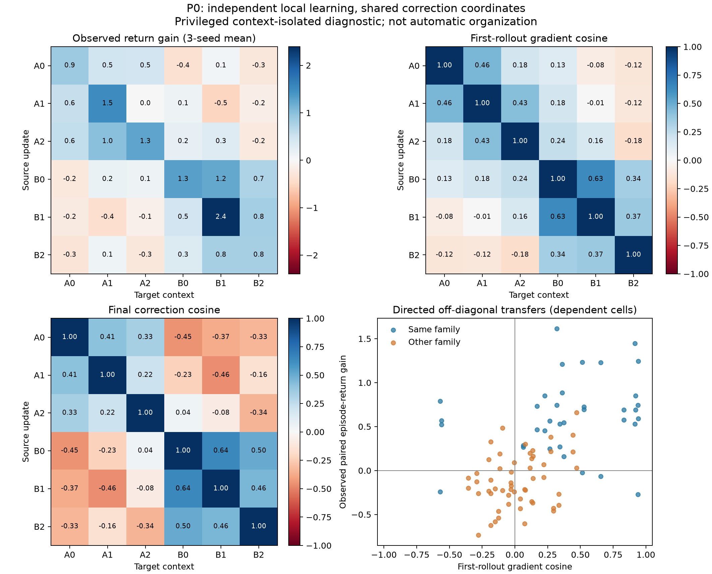

# P0：局部在线修正与跨情境迁移诊断

这是外部实验者隔离情境的机制诊断。统一 route=1，算法没有发现情境或共享结构。全部运行共享一个 W0；源输出基适合本动作置换任务。基线与候选采用相同温度/探索设置。

## 固定规程与实际开销

3 部署种子×6 独立训练×4,096 PPO 步；每个目标配对32个完整回合。训练 73,728 步，基线评估 34,712 步，候选评估 200,911 步，总计 309,351 实际仿真步。运行墙钟 129.90 秒，进程 CPU 126.52 秒（不含 Python 导入）。

## 观测结果

| 部署种子 | 自身改善 | 自身回报增益 | 同家族迁移 | 跨家族迁移 | 梯度相关 | 修正相关 |
| --- | ---: | ---: | ---: | ---: | ---: | ---: |
| 271 | 6/6 | 1.35 | 0.51 | -0.09 | 0.582 | 0.811 |
| 283 | 6/6 | 1.58 | 0.86 | -0.09 | 0.686 | 0.838 |
| 307 | 6/6 | 1.13 | 0.49 | -0.16 | 0.096 | 0.698 |

自身改善 18/18；90个非对角单元中，正观测迁移 51，负观测迁移 39。同家族/跨家族由分析者在运行后按事先固定的标签汇总，不进入训练。梯度/修正相关是每个种子30个依赖单元的 Pearson 描述性相关，不提供独立样本显著性。

**绝对表现仍有限**：匹配温度/探索的零修正基线成功率均值 9.03%，自身更新后 34.38%，逐运行范围 12.5%–75.0%。这说明4,096步内有改善，不代表已经学会任务；所有运行仍低于原C1的80%参考目标（该目标不是本P0事后追加的通过门槛）。

### 正 cosine 仍对应负观测迁移的单元

- seed 271：梯度 3/16；最终修正 4/18。
- seed 283：梯度 3/20；最终修正 0/14。
- seed 307：梯度 10/22；最终修正 3/14。

这些是有限 PPO 更新下的观测关联；不能将观测负差直接当作经校准的伤害概率，也不能用它否定无穷小步长的一阶梯度关系。交叉评估是研究者的诊断交互，部署算法不可免费调用。

## 数据与限制

summary.json 为实际交互与训练账本；baseline_episodes.csv / transfer_episodes.csv 保存全部配对回合；branches/ 保存全部18个候选 checkpoint、梯度、参数与训练回合；analysis.json 保存逐种子矩阵。未验证真实压缩、满容量替换、无标签识别、独立 W0 或超出当前环境先验的泛化。
