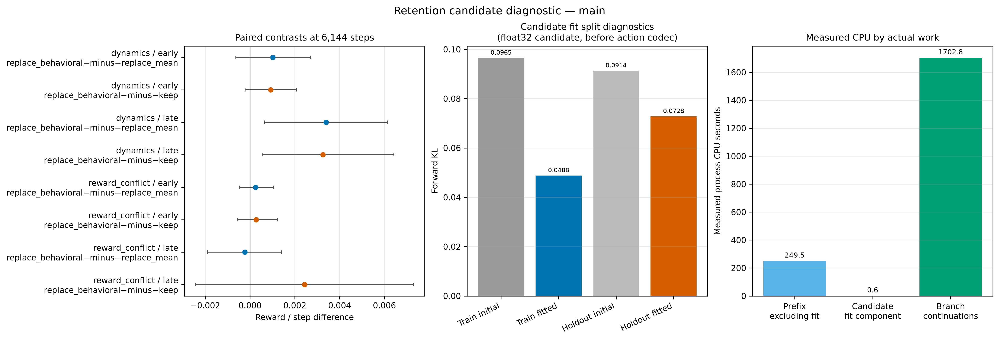

# Retention candidate report

Phase: **main**. Role: **exploratory_candidate_content_and_state_coverage**. This is an exploratory fixed-candidate, one-write diagnostic.

The reporter reads saved summaries and hashed ledgers only. It makes no environment calls, does not adapt candidates or analysis choices from reward outcomes, and does not send results back to a learner.

## Design and audit

- Prefixes: 24; branches: 480; actual environment steps: 3,391,488.
- Common prefix steps: 442,368; branch continuation steps: 2,949,120.
- Recounted training: 13,248 rollouts and 211,968 minibatch updates.
- SHA-256 checked raw CSV ledgers: 1512; complete grid, restore, pairing, reward, cost, and capacity checks passed: **True**.
- Actor container: 89 bytes; complete package cap: 262,144 bytes.
- Early and late are joint state-coverage conditions. They do not identify a causal effect of age, fit volume, or maturity alone.
- Six deployment seeds are the independent units. Future regimes and replicas were paired within each seed, then averaged before the old-family-stratified bootstrap.
- All five arms, including keep, remain in the report. A lower fit KL by itself is not evidence of improved return.

## Primary reward contrasts at 6,144 steps

Every arm contrast is paired within prefix, future regime, and replicate. Future regimes and replicates are averaged within seed before the descriptive bootstrap.

| relation | state | contrast | seeds | reward / step difference | 95% descriptive interval |
|---|---|---|---:|---:|---|
| dynamics | early | replace_behavioral-minus-replace_mean | 6 | 0.001017 | [-0.000631, 0.002711] |
| dynamics | early | replace_behavioral-minus-keep | 6 | 0.000921 | [-0.000219, 0.002060] |
| dynamics | early | replace_mean-minus-keep | 6 | -0.000097 | [-0.001290, 0.001097] |
| dynamics | early | merge_behavioral-minus-merge_mean | 6 | 0.000073 | [-0.000480, 0.000654] |
| dynamics | early | merge_behavioral-minus-keep | 6 | -0.000298 | [-0.001662, 0.001443] |
| dynamics | early | merge_mean-minus-keep | 6 | -0.000371 | [-0.001712, 0.000994] |
| dynamics | late | replace_behavioral-minus-replace_mean | 6 | 0.003394 | [0.000634, 0.006151] |
| dynamics | late | replace_behavioral-minus-keep | 6 | 0.003254 | [0.000541, 0.006429] |
| dynamics | late | replace_mean-minus-keep | 6 | -0.000141 | [-0.001441, 0.000858] |
| dynamics | late | merge_behavioral-minus-merge_mean | 6 | 0.000578 | [-0.000268, 0.001304] |
| dynamics | late | merge_behavioral-minus-keep | 6 | -0.000639 | [-0.001336, 0.000105] |
| dynamics | late | merge_mean-minus-keep | 6 | -0.001217 | [-0.002494, 0.000059] |
| reward_conflict | early | replace_behavioral-minus-replace_mean | 6 | 0.000248 | [-0.000480, 0.001044] |
| reward_conflict | early | replace_behavioral-minus-keep | 6 | 0.000273 | [-0.000554, 0.001238] |
| reward_conflict | early | replace_mean-minus-keep | 6 | 0.000025 | [-0.001087, 0.001246] |
| reward_conflict | early | merge_behavioral-minus-merge_mean | 6 | -0.000612 | [-0.001058, -0.000161] |
| reward_conflict | early | merge_behavioral-minus-keep | 6 | -0.001412 | [-0.002015, -0.000916] |
| reward_conflict | early | merge_mean-minus-keep | 6 | -0.000800 | [-0.001058, -0.000563] |
| reward_conflict | late | replace_behavioral-minus-replace_mean | 6 | -0.000236 | [-0.001909, 0.001399] |
| reward_conflict | late | replace_behavioral-minus-keep | 6 | 0.002435 | [-0.002443, 0.007312] |
| reward_conflict | late | replace_mean-minus-keep | 6 | 0.002670 | [-0.002148, 0.006968] |
| reward_conflict | late | merge_behavioral-minus-merge_mean | 6 | -0.000193 | [-0.000953, 0.000546] |
| reward_conflict | late | merge_behavioral-minus-keep | 6 | -0.002992 | [-0.005705, -0.000280] |
| reward_conflict | late | merge_mean-minus-keep | 6 | -0.002799 | [-0.005437, -0.000271] |

## Future-scoped contrasts

These estimates keep the future regime fixed and average the 2 configured replicas within seed.

| relation | state | future | contrast | reward / step difference | 95% descriptive interval | seeds |
|---|---|---|---|---:|---|---:|
| dynamics | early | old_major | replace_behavioral-minus-replace_mean | 0.000522 | [-0.001139, 0.002184] | 6 |
| dynamics | early | new_major | replace_behavioral-minus-replace_mean | 0.001512 | [-0.000281, 0.003306] | 6 |
| dynamics | early | old_major | replace_behavioral-minus-keep | -0.001414 | [-0.002563, -0.000271] | 6 |
| dynamics | early | new_major | replace_behavioral-minus-keep | 0.003255 | [0.002075, 0.004435] | 6 |
| dynamics | early | old_major | replace_mean-minus-keep | -0.001936 | [-0.002611, -0.001298] | 6 |
| dynamics | early | new_major | replace_mean-minus-keep | 0.001743 | [-0.000044, 0.003591] | 6 |
| dynamics | early | old_major | merge_behavioral-minus-merge_mean | 0.000397 | [-0.000420, 0.001065] | 6 |
| dynamics | early | new_major | merge_behavioral-minus-merge_mean | -0.000251 | [-0.001160, 0.000658] | 6 |
| dynamics | early | old_major | merge_behavioral-minus-keep | -0.001600 | [-0.003021, -0.000173] | 6 |
| dynamics | early | new_major | merge_behavioral-minus-keep | 0.001004 | [-0.000770, 0.003448] | 6 |
| dynamics | early | old_major | merge_mean-minus-keep | -0.001997 | [-0.003174, -0.000916] | 6 |
| dynamics | early | new_major | merge_mean-minus-keep | 0.001255 | [-0.000434, 0.003113] | 6 |
| dynamics | early | old_major | candidate_by_operation_interaction | -0.000125 | [-0.001326, 0.000994] | 6 |
| dynamics | early | new_major | candidate_by_operation_interaction | -0.001763 | [-0.004167, 0.000641] | 6 |
| dynamics | late | old_major | replace_behavioral-minus-replace_mean | 0.001838 | [-0.000414, 0.003842] | 6 |
| dynamics | late | new_major | replace_behavioral-minus-replace_mean | 0.004951 | [0.000902, 0.010532] | 6 |
| dynamics | late | old_major | replace_behavioral-minus-keep | -0.004757 | [-0.007267, -0.002248] | 6 |
| dynamics | late | new_major | replace_behavioral-minus-keep | 0.011264 | [0.007562, 0.016364] | 6 |
| dynamics | late | old_major | replace_mean-minus-keep | -0.006595 | [-0.009009, -0.004517] | 6 |
| dynamics | late | new_major | replace_mean-minus-keep | 0.006314 | [0.005764, 0.006863] | 6 |
| dynamics | late | old_major | merge_behavioral-minus-merge_mean | 0.001295 | [-0.000034, 0.002492] | 6 |
| dynamics | late | new_major | merge_behavioral-minus-merge_mean | -0.000139 | [-0.002041, 0.001848] | 6 |
| dynamics | late | old_major | merge_behavioral-minus-keep | -0.002974 | [-0.004812, -0.001390] | 6 |
| dynamics | late | new_major | merge_behavioral-minus-keep | 0.001695 | [-0.000271, 0.003455] | 6 |
| dynamics | late | old_major | merge_mean-minus-keep | -0.004269 | [-0.005900, -0.002818] | 6 |
| dynamics | late | new_major | merge_mean-minus-keep | 0.001834 | [0.000268, 0.003462] | 6 |
| dynamics | late | old_major | candidate_by_operation_interaction | -0.000543 | [-0.003815, 0.002323] | 6 |
| dynamics | late | new_major | candidate_by_operation_interaction | -0.005090 | [-0.011970, -0.000590] | 6 |
| reward_conflict | early | old_major | replace_behavioral-minus-replace_mean | 0.000671 | [0.000054, 0.001289] | 6 |
| reward_conflict | early | new_major | replace_behavioral-minus-replace_mean | -0.000176 | [-0.001014, 0.000970] | 6 |
| reward_conflict | early | old_major | replace_behavioral-minus-keep | -0.000271 | [-0.001448, 0.000905] | 6 |
| reward_conflict | early | new_major | replace_behavioral-minus-keep | 0.000817 | [-0.000481, 0.001848] | 6 |
| reward_conflict | early | old_major | replace_mean-minus-keep | -0.000943 | [-0.002563, 0.000410] | 6 |
| reward_conflict | early | new_major | replace_mean-minus-keep | 0.000994 | [0.000186, 0.002055] | 6 |
| reward_conflict | early | old_major | merge_behavioral-minus-merge_mean | -0.001319 | [-0.002241, -0.000000] | 6 |
| reward_conflict | early | new_major | merge_behavioral-minus-merge_mean | 0.000095 | [-0.000932, 0.001156] | 6 |
| reward_conflict | early | old_major | merge_behavioral-minus-keep | -0.002353 | [-0.003313, -0.001068] | 6 |
| reward_conflict | early | new_major | merge_behavioral-minus-keep | -0.000471 | [-0.001116, 0.000261] | 6 |
| reward_conflict | early | old_major | merge_mean-minus-keep | -0.001034 | [-0.001506, -0.000563] | 6 |
| reward_conflict | early | new_major | merge_mean-minus-keep | -0.000566 | [-0.001065, -0.000068] | 6 |
| reward_conflict | early | old_major | candidate_by_operation_interaction | -0.001990 | [-0.003099, -0.000322] | 6 |
| reward_conflict | early | new_major | candidate_by_operation_interaction | 0.000271 | [-0.001014, 0.001614] | 6 |
| reward_conflict | late | old_major | replace_behavioral-minus-replace_mean | -0.000878 | [-0.001889, 0.000146] | 6 |
| reward_conflict | late | new_major | replace_behavioral-minus-replace_mean | 0.000407 | [-0.002316, 0.003703] | 6 |
| reward_conflict | late | old_major | replace_behavioral-minus-keep | -0.001512 | [-0.006232, 0.003198] | 6 |
| reward_conflict | late | new_major | replace_behavioral-minus-keep | 0.006382 | [0.000702, 0.012061] | 6 |
| reward_conflict | late | old_major | replace_mean-minus-keep | -0.000634 | [-0.006093, 0.003893] | 6 |
| reward_conflict | late | new_major | replace_mean-minus-keep | 0.005975 | [0.001251, 0.010586] | 6 |
| reward_conflict | late | old_major | merge_behavioral-minus-merge_mean | -0.000973 | [-0.002753, 0.000736] | 6 |
| reward_conflict | late | new_major | merge_behavioral-minus-merge_mean | 0.000587 | [-0.000295, 0.001339] | 6 |
| reward_conflict | late | old_major | merge_behavioral-minus-keep | -0.003686 | [-0.006948, -0.000424] | 6 |
| reward_conflict | late | new_major | merge_behavioral-minus-keep | -0.002299 | [-0.004730, 0.000064] | 6 |
| reward_conflict | late | old_major | merge_mean-minus-keep | -0.002713 | [-0.005595, 0.000027] | 6 |
| reward_conflict | late | new_major | merge_mean-minus-keep | -0.002886 | [-0.005486, -0.000600] | 6 |
| reward_conflict | late | old_major | candidate_by_operation_interaction | -0.000095 | [-0.002072, 0.002238] | 6 |
| reward_conflict | late | new_major | candidate_by_operation_interaction | 0.000180 | [-0.002899, 0.002506] | 6 |

## Candidate by operation interaction

The interaction is (merge behavioral − merge mean) − (replace behavioral − replace mean). It is computed within each seed after averaging paired futures and replicas.

| relation | state | horizon | interaction / step | 95% descriptive interval | seeds |
|---|---|---:|---:|---|---:|
| dynamics | early | 6,144 | -0.000944 | [-0.002602, 0.000714] | 6 |
| dynamics | late | 6,144 | -0.002816 | [-0.006078, -0.000097] | 6 |
| reward_conflict | early | 6,144 | -0.000860 | [-0.002029, 0.000070] | 6 |
| reward_conflict | late | 6,144 | 0.000042 | [-0.002333, 0.002162] | 6 |

## First-256-step recovery

Recovery is reported as mean return per 256-step bout, converted to reward per step. The allocated-only view includes bouts that allocated a slot; the all-bouts view includes every future bout. The same within-seed pairing is used.

| population | relation | state | contrast | reward / step difference | 95% descriptive interval | seeds |
|---|---|---|---|---:|---|---:|
| allocated_only | dynamics | early | replace_behavioral-minus-replace_mean | -0.000455 | [-0.001671, 0.000761] | 6 |
| allocated_only | dynamics | early | replace_behavioral-minus-keep | -0.000138 | [-0.001832, 0.001663] | 6 |
| allocated_only | dynamics | early | replace_mean-minus-keep | 0.000317 | [-0.001442, 0.002075] | 6 |
| allocated_only | dynamics | early | merge_behavioral-minus-merge_mean | -0.000318 | [-0.001344, 0.000935] | 6 |
| allocated_only | dynamics | early | merge_behavioral-minus-keep | -0.000415 | [-0.002035, 0.001334] | 6 |
| allocated_only | dynamics | early | merge_mean-minus-keep | -0.000098 | [-0.002845, 0.001993] | 6 |
| allocated_only | dynamics | early | candidate_by_operation_interaction | 0.000137 | [-0.000514, 0.000763] | 6 |
| allocated_only | dynamics | late | replace_behavioral-minus-replace_mean | 0.000767 | [-0.002830, 0.003509] | 6 |
| allocated_only | dynamics | late | replace_behavioral-minus-keep | 0.000275 | [-0.002267, 0.003056] | 6 |
| allocated_only | dynamics | late | replace_mean-minus-keep | -0.000493 | [-0.002249, 0.001263] | 6 |
| allocated_only | dynamics | late | merge_behavioral-minus-merge_mean | -0.000511 | [-0.002705, 0.002016] | 6 |
| allocated_only | dynamics | late | merge_behavioral-minus-keep | -0.002209 | [-0.004761, 0.000625] | 6 |
| allocated_only | dynamics | late | merge_mean-minus-keep | -0.001698 | [-0.003210, -0.000095] | 6 |
| allocated_only | dynamics | late | candidate_by_operation_interaction | -0.001278 | [-0.004309, 0.002315] | 6 |
| allocated_only | reward_conflict | early | replace_behavioral-minus-replace_mean | 0.000803 | [-0.000791, 0.002207] | 6 |
| allocated_only | reward_conflict | early | replace_behavioral-minus-keep | 0.001021 | [-0.000267, 0.002308] | 6 |
| allocated_only | reward_conflict | early | replace_mean-minus-keep | 0.000218 | [-0.000619, 0.001140] | 6 |
| allocated_only | reward_conflict | early | merge_behavioral-minus-merge_mean | -0.000359 | [-0.001200, 0.000587] | 6 |
| allocated_only | reward_conflict | early | merge_behavioral-minus-keep | -0.001608 | [-0.001864, -0.001344] | 6 |
| allocated_only | reward_conflict | early | merge_mean-minus-keep | -0.001250 | [-0.002336, -0.000506] | 6 |
| allocated_only | reward_conflict | early | candidate_by_operation_interaction | -0.001162 | [-0.003263, 0.001417] | 6 |
| allocated_only | reward_conflict | late | replace_behavioral-minus-replace_mean | -0.000267 | [-0.001823, 0.001289] | 6 |
| allocated_only | reward_conflict | late | replace_behavioral-minus-keep | 0.001643 | [-0.002901, 0.006188] | 6 |
| allocated_only | reward_conflict | late | replace_mean-minus-keep | 0.001910 | [-0.002407, 0.006227] | 6 |
| allocated_only | reward_conflict | late | merge_behavioral-minus-merge_mean | 0.000064 | [-0.001601, 0.001778] | 6 |
| allocated_only | reward_conflict | late | merge_behavioral-minus-keep | -0.004550 | [-0.006545, -0.002561] | 6 |
| allocated_only | reward_conflict | late | merge_mean-minus-keep | -0.004614 | [-0.007872, -0.001357] | 6 |
| allocated_only | reward_conflict | late | candidate_by_operation_interaction | 0.000331 | [-0.002433, 0.002660] | 6 |
| all_bouts | dynamics | early | replace_behavioral-minus-replace_mean | 0.001139 | [0.000197, 0.002082] | 6 |
| all_bouts | dynamics | early | replace_behavioral-minus-keep | 0.000807 | [-0.000576, 0.002190] | 6 |
| all_bouts | dynamics | early | replace_mean-minus-keep | -0.000332 | [-0.000956, 0.000654] | 6 |
| all_bouts | dynamics | early | merge_behavioral-minus-merge_mean | 0.000502 | [-0.000244, 0.001478] | 6 |
| all_bouts | dynamics | early | merge_behavioral-minus-keep | 0.000031 | [-0.000861, 0.000966] | 6 |
| all_bouts | dynamics | early | merge_mean-minus-keep | -0.000471 | [-0.002065, 0.001031] | 6 |
| all_bouts | dynamics | early | candidate_by_operation_interaction | -0.000637 | [-0.001550, 0.000102] | 6 |
| all_bouts | dynamics | late | replace_behavioral-minus-replace_mean | 0.000746 | [-0.002024, 0.004052] | 6 |
| all_bouts | dynamics | late | replace_behavioral-minus-keep | 0.000136 | [-0.003038, 0.003445] | 6 |
| all_bouts | dynamics | late | replace_mean-minus-keep | -0.000610 | [-0.002452, 0.000526] | 6 |
| all_bouts | dynamics | late | merge_behavioral-minus-merge_mean | 0.001407 | [-0.000563, 0.003472] | 6 |
| all_bouts | dynamics | late | merge_behavioral-minus-keep | -0.001055 | [-0.002306, 0.000556] | 6 |
| all_bouts | dynamics | late | merge_mean-minus-keep | -0.002462 | [-0.004557, -0.000275] | 6 |
| all_bouts | dynamics | late | candidate_by_operation_interaction | 0.000661 | [-0.002869, 0.004181] | 6 |
| all_bouts | reward_conflict | early | replace_behavioral-minus-replace_mean | 0.000397 | [-0.000777, 0.001702] | 6 |
| all_bouts | reward_conflict | early | replace_behavioral-minus-keep | 0.001133 | [-0.000064, 0.002330] | 6 |
| all_bouts | reward_conflict | early | replace_mean-minus-keep | 0.000736 | [0.000078, 0.001675] | 6 |
| all_bouts | reward_conflict | early | merge_behavioral-minus-merge_mean | -0.000987 | [-0.001387, -0.000587] | 6 |
| all_bouts | reward_conflict | early | merge_behavioral-minus-keep | -0.001241 | [-0.001658, -0.000793] | 6 |
| all_bouts | reward_conflict | early | merge_mean-minus-keep | -0.000254 | [-0.000888, 0.000353] | 6 |
| all_bouts | reward_conflict | early | candidate_by_operation_interaction | -0.001383 | [-0.002930, 0.000075] | 6 |
| all_bouts | reward_conflict | late | replace_behavioral-minus-replace_mean | -0.000519 | [-0.002143, 0.000946] | 6 |
| all_bouts | reward_conflict | late | replace_behavioral-minus-keep | 0.001556 | [-0.003374, 0.006487] | 6 |
| all_bouts | reward_conflict | late | replace_mean-minus-keep | 0.002075 | [-0.002648, 0.006788] | 6 |
| all_bouts | reward_conflict | late | merge_behavioral-minus-merge_mean | -0.000068 | [-0.000892, 0.000756] | 6 |
| all_bouts | reward_conflict | late | merge_behavioral-minus-keep | -0.003828 | [-0.006683, -0.001010] | 6 |
| all_bouts | reward_conflict | late | merge_mean-minus-keep | -0.003760 | [-0.007128, -0.000393] | 6 |
| all_bouts | reward_conflict | late | candidate_by_operation_interaction | 0.000451 | [-0.001485, 0.001984] | 6 |

## Candidate fit and codec diagnostics

The behavioral candidate was fit once per prefix from the bounded source buffer. Training KL drove candidate selection; holdout KL is diagnostic only. Branch-specific KL after the action is listed separately from the fit-split KL.

| relation | state | seed | train KL initial | train KL fitted | holdout KL initial | holdout KL fitted | band counts owner 0 / 1 | mean norm | behavioral norm | fit CPU s | buffer bytes |
|---|---|---:|---:|---:|---:|---:|---|---:|---:|---:|---:|
| dynamics | early | 25201 | 0.050906 | 0.016029 | 0.080573 | 0.012656 | `[[48,63,17],[71,25,32]]` | 0.082220 | 16.235939 | 0.031250 | 2,101 |
| dynamics | late | 25201 | 0.267597 | 0.083113 | 0.211775 | 0.141538 | `[[104,20,4],[17,65,46]]` | 0.316826 | 16.821365 | 0.031250 | 2,025 |
| reward_conflict | early | 25201 | 0.030280 | 0.014564 | 0.008861 | 0.008943 | `[[38,72,18],[41,26,61]]` | 0.107944 | 3.769786 | 0.031250 | 2,073 |
| reward_conflict | late | 25201 | 0.178385 | 0.152238 | 0.203254 | 0.209779 | `[[128,0,0],[58,56,14]]` | 0.363535 | 10.449610 | 0.031250 | 2,008 |
| dynamics | early | 25202 | 0.030710 | 0.022409 | 0.037518 | 0.017306 | `[[63,20,45],[41,31,56]]` | 0.070442 | 8.704001 | 0.015625 | 2,066 |
| dynamics | late | 25202 | 0.136741 | 0.049857 | 0.125795 | 0.071696 | `[[121,5,2],[28,43,57]]` | 0.423535 | 14.093675 | 0.031250 | 2,029 |
| reward_conflict | early | 25202 | 0.054048 | 0.019935 | 0.075295 | 0.033969 | `[[60,56,12],[100,16,12]]` | 0.078842 | 17.751743 | 0.031250 | 2,062 |
| reward_conflict | late | 25202 | 0.142540 | 0.105188 | 0.198281 | 0.165274 | `[[36,85,7],[37,33,58]]` | 0.277228 | 13.499679 | 0.015625 | 2,167 |
| dynamics | early | 25203 | 0.034004 | 0.023064 | 0.030546 | 0.024057 | `[[59,28,41],[79,41,8]]` | 0.088063 | 14.496571 | 0.015625 | 2,083 |
| dynamics | late | 25203 | 0.227837 | 0.055026 | 0.239096 | 0.121982 | `[[112,7,9],[77,43,8]]` | 0.527598 | 5.809621 | 0.031250 | 2,035 |
| reward_conflict | early | 25203 | 0.057958 | 0.038775 | 0.063750 | 0.112341 | `[[30,12,86],[64,22,42]]` | 0.074116 | 6.960944 | 0.015625 | 2,084 |
| reward_conflict | late | 25203 | 0.053057 | 0.010912 | 0.115582 | 0.156428 | `[[16,11,101],[96,2,30]]` | 0.261832 | 3.676775 | 0.031250 | 2,005 |
| dynamics | early | 25204 | 0.042474 | 0.028909 | 0.021389 | 0.040346 | `[[50,69,9],[57,38,33]]` | 0.108001 | 2.382202 | 0.015625 | 2,059 |
| dynamics | late | 25204 | 0.076066 | 0.054595 | 0.118028 | 0.080458 | `[[80,22,26],[38,75,15]]` | 0.402852 | 8.079882 | 0.015625 | 2,091 |
| reward_conflict | early | 25204 | 0.053509 | 0.013381 | 0.056158 | 0.073370 | `[[39,49,40],[101,14,13]]` | 0.073463 | 18.952599 | 0.015625 | 2,084 |
| reward_conflict | late | 25204 | 0.178273 | 0.113927 | 0.182809 | 0.072735 | `[[81,43,4],[30,16,82]]` | 0.350905 | 17.986486 | 0.031250 | 2,084 |
| dynamics | early | 25205 | 0.147758 | 0.040775 | 0.018155 | 0.140915 | `[[68,54,6],[93,11,24]]` | 0.075394 | 38.866207 | 0.031250 | 2,013 |
| dynamics | late | 25205 | 0.038116 | 0.015414 | 0.037125 | 0.024411 | `[[70,46,12],[10,7,111]]` | 0.293068 | 12.176461 | 0.031250 | 2,045 |
| reward_conflict | early | 25205 | 0.047061 | 0.044272 | 0.018211 | 0.013523 | `[[86,15,27],[83,41,4]]` | 0.099432 | 3.851178 | 0.031250 | 2,049 |
| reward_conflict | late | 25205 | 0.114660 | 0.063556 | 0.050873 | 0.047825 | `[[32,72,24],[107,15,6]]` | 0.400539 | 17.911699 | 0.031250 | 2,043 |
| dynamics | early | 25206 | 0.032386 | 0.018304 | 0.084909 | 0.084772 | `[[87,23,18],[52,39,37]]` | 0.091745 | 2.855691 | 0.031250 | 2,015 |
| dynamics | late | 25206 | 0.216127 | 0.176018 | 0.074568 | 0.073213 | `[[39,85,4],[33,46,49]]` | 0.265953 | 24.166058 | 0.031250 | 2,081 |
| reward_conflict | early | 25206 | 0.046907 | 0.011568 | 0.070787 | 0.019739 | `[[67,56,5],[19,17,92]]` | 0.050058 | 0.617502 | 0.031250 | 2,064 |
| reward_conflict | late | 25206 | 0.059147 | 0.000175 | 0.069242 | 0.000594 | `[[24,0,104],[0,0,128]]` | 0.146603 | 2.141978 | 0.015625 | 1,955 |

Branch-level before/after int8-codec source-teacher KL, owner-specific counts, action norms, and behavior drift are preserved in `analysis.json`.

## Actual costs and capacity

The common prefix cost was 250.156 CPU seconds including fit; the candidate fit component was 0.625 seconds and is not added twice. Branch setup, action install, continuation, and serialization used 1702.750 CPU seconds. Unique measured prefix plus branch time was 1952.906 seconds.

| cost component | CPU seconds |
|---|---:|
| Prefix including fit | 250.156 |
| Candidate fit component of prefix | 0.625 |
| Prefix excluding fit estimate | 249.531 |
| Branch continuations | 1702.750 |
| Unique prefix plus branch | 1952.906 |

Every checked prefix and branch package used the 89-byte actor container and stayed within the 262,144-byte complete-package cap. Source-buffer, transient-candidate, package, and branch CPU records are retained in `analysis.json`.
Evidence sidecars used 49,321 bytes in prefixes, 986,420 bytes in final branch packages, and 986,420 bytes in post-action packages. Those measured copies are included in the corresponding full-package caps.

## Figure

## Interpretation limits

This is a known-identity, fixed-candidate, one-write comparison. It does not test a deployed selector, repeated learned organizer, unknown-context discovery, tree or DAG comparisons, or C2. The late state changes online history and state coverage jointly. Lower fitted KL does not establish a reward gain. These results do not support claims of SOTA performance or organizer success.

## Provenance

Summary SHA-256: 3dc76c489c4a18480d402351c2ec46ec18fe0e3f7fa26e226931f3fe750287d3  
Frozen config canonical SHA-256: 77783f52c9d7b1b1fb5e7d7a91f49609710bdbbe5a57f70753a60bed26d453b7  
Source manifest canonical SHA-256: 1d9887a3ac68750a2fc2f29b8b3cd1503ca75e855c58bb2dda1f4540c29c3ab7  
Runner SHA-256: fe6e3a711cebb85ff811c3641cbc2d8da71762c14c599d569a04c10b4302b33e  
Behavioral fit module SHA-256: 5c57f2913e33e8fd7553550c0c98eeff2a000c4ce67193d5d7535e842daf1d71  
Reporter SHA-256: 1bf93ec45a314e5b31a77e2d01e8d43ce69c404ba004f35d03fce95b95c517b5

## External audit history

Audit files are preserved by SHA-256, including superseded records. Their declared statuses and raw counts are shown verbatim; the report's own ledger checks are recorded separately.

| file | declared status | cases / branches | raw steps | superseded | SHA-256 |
|---|---|---:|---:|---|---|
| `retention_candidate_audit/main_completed.json` | passed | 24 / 480 | 3,391,488 | no | `25c02e7366a28938ad7eb663b25de878b1146468adb8f7e79427ef2320c4e3b6` |

## Software

Static figures use Matplotlib's object-oriented interface and export PNG, PDF, and SVG. The report preserves the exact reporter source beside its hash.
