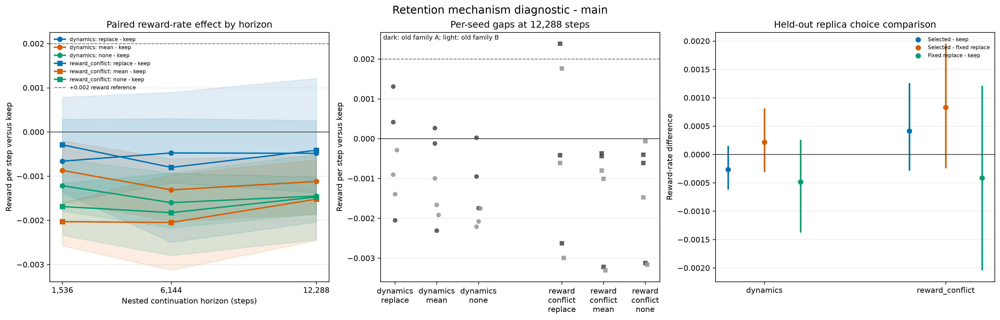

# Retention mechanism report

Phase: **main**. Role: exploratory_candidate_and_horizon_diagnostic. This is an observer-only action and horizon diagnosis.

The report reads frozen summaries and raw ledgers, makes no environment calls, and never feeds results to a learner.

## Design and audit

- Cases: 24; branches: 384; audited environment steps: 4,890,624.
- Prefix steps: 172,032; branch continuation steps: 4,718,592.
- SHA-256 checked raw ledger files: 1224.
- Recounted PPO training: 19,104 completed rollouts and 305,664 minibatch updates.
- Restore, grid, horizon reward, rollout and optimizer-update audits passed: **True**.
- Horizons are nested checkpoints within one continuation. They are not independent runs.
- Main intervals resample the six independent seeds within old-family A/B strata (three each). Histories, futures and replicas are averaged within each seed.
- Reward per step is primary. CPU seconds per 1,000 environment steps and utility rate remain separate outcomes.

## Paired action effects

Each operation is paired with keep from the same prefix, future and stochastic replica. The +0.002 reference is for reward per step only.

| relation | horizon | contrast | seeds | reward / step difference | 95% descriptive interval | interval interpretation | CPU seconds / 1,000 step difference | utility-rate difference |
|---|---:|---|---:|---:|---|---|---:|---:|
| dynamics | 1,536 | replace - keep | 6 | -0.000661 | [-0.001611, 0.000288] | interval is below the practical reference | -0.007417 | -0.000653 |
| dynamics | 1,536 | mean - keep | 6 | -0.000871 | [-0.001590, -0.000200] | interval is below the practical reference | 0.005934 | -0.000878 |
| dynamics | 1,536 | none - keep | 6 | -0.001217 | [-0.001794, -0.000614] | interval is below the practical reference | -0.014199 | -0.001204 |
| reward_conflict | 1,536 | replace - keep | 6 | -0.000292 | [-0.001370, 0.000787] | interval is below the practical reference | 0.002331 | -0.000296 |
| reward_conflict | 1,536 | mean - keep | 6 | -0.002031 | [-0.002580, -0.001607] | interval is below the practical reference | 0.007417 | -0.002040 |
| reward_conflict | 1,536 | none - keep | 6 | -0.001689 | [-0.002340, -0.001156] | interval is below the practical reference | -0.003391 | -0.001686 |
| dynamics | 6,144 | replace - keep | 6 | -0.000476 | [-0.001158, 0.000303] | interval is below the practical reference | -0.003020 | -0.000472 |
| dynamics | 6,144 | mean - keep | 6 | -0.001311 | [-0.002020, -0.000603] | interval is below the practical reference | 0.002596 | -0.001314 |
| dynamics | 6,144 | none - keep | 6 | -0.001600 | [-0.002171, -0.000937] | interval is below the practical reference | -0.008159 | -0.001593 |
| reward_conflict | 6,144 | replace - keep | 6 | -0.000803 | [-0.002501, 0.000895] | interval is below the practical reference | -0.000424 | -0.000803 |
| reward_conflict | 6,144 | mean - keep | 6 | -0.002050 | [-0.003131, -0.000968] | interval is below the practical reference | 0.006782 | -0.002057 |
| reward_conflict | 6,144 | none - keep | 6 | -0.001827 | [-0.002798, -0.000930] | interval is below the practical reference | -0.004662 | -0.001822 |
| dynamics | 12,288 | replace - keep | 6 | -0.000484 | [-0.001373, 0.000260] | interval is below the practical reference | -0.000795 | -0.000484 |
| dynamics | 12,288 | mean - keep | 6 | -0.001122 | [-0.001873, -0.000540] | interval is below the practical reference | -0.001722 | -0.001120 |
| dynamics | 12,288 | none - keep | 6 | -0.001451 | [-0.001856, -0.001015] | interval is below the practical reference | -0.011020 | -0.001440 |
| reward_conflict | 12,288 | replace - keep | 6 | -0.000415 | [-0.002043, 0.001213] | interval is below the practical reference | 0.000053 | -0.000415 |
| reward_conflict | 12,288 | mean - keep | 6 | -0.001523 | [-0.002462, -0.000630] | interval is below the practical reference | 0.007153 | -0.001530 |
| reward_conflict | 12,288 | none - keep | 6 | -0.001472 | [-0.002441, -0.000503] | interval is below the practical reference | -0.001695 | -0.001470 |

## Future-prevalence interaction

For replace versus keep, this is the new-major future contrast minus the old-major future contrast, averaged across history within seed.

| relation | horizon | reward / step interaction | 95% descriptive interval | interval interpretation | seeds |
|---|---:|---:|---|---|---:|
| dynamics | 1,536 | 0.002936 | [0.001153, 0.004374] | inconclusive: interval spans effects below and at or above the practical reference | 6 |
| reward_conflict | 1,536 | 0.004232 | [0.003099, 0.005419] | interval is at or above the practical reference | 6 |
| dynamics | 6,144 | 0.002223 | [0.001870, 0.002575] | inconclusive: interval spans effects below and at or above the practical reference | 6 |
| reward_conflict | 6,144 | 0.001751 | [0.000817, 0.002628] | inconclusive: interval spans effects below and at or above the practical reference | 6 |
| dynamics | 12,288 | 0.002541 | [0.001891, 0.003190] | inconclusive: interval spans effects below and at or above the practical reference | 6 |
| reward_conflict | 12,288 | 0.001599 | [0.000750, 0.002513] | inconclusive: interval spans effects below and at or above the practical reference | 6 |

## All condition subgroups

Every relation, history, future, horizon and action contrast is retained below and in analysis.json.

| relation | history | future | horizon | contrast | seeds | reward / step difference | interval | interval interpretation |
|---|---|---|---:|---|---:|---:|---|---|
| dynamics | old_major | old_major | 1,536 | replace - keep | 6 | -0.001804 | [-0.003526, 0.000014] | interval is below the practical reference |
| dynamics | old_major | old_major | 1,536 | mean - keep | 6 | -0.001411 | [-0.002265, -0.000502] | interval is below the practical reference |
| dynamics | old_major | old_major | 1,536 | none - keep | 6 | -0.001804 | [-0.003526, 0.000014] | interval is below the practical reference |
| dynamics | old_major | new_major | 1,536 | replace - keep | 6 | -0.000732 | [-0.002374, 0.001411] | interval is below the practical reference |
| dynamics | old_major | new_major | 1,536 | mean - keep | 6 | -0.003052 | [-0.004679, -0.001424] | interval is below the practical reference |
| dynamics | old_major | new_major | 1,536 | none - keep | 6 | -0.001261 | [-0.002808, 0.000285] | interval is below the practical reference |
| dynamics | new_major | old_major | 1,536 | replace - keep | 6 | -0.002455 | [-0.003933, -0.001139] | interval is below the practical reference |
| dynamics | new_major | old_major | 1,536 | mean - keep | 6 | -0.000922 | [-0.002089, 0.000122] | interval is below the practical reference |
| dynamics | new_major | old_major | 1,536 | none - keep | 6 | -0.002455 | [-0.003933, -0.001139] | interval is below the practical reference |
| dynamics | new_major | new_major | 1,536 | replace - keep | 6 | 0.002346 | [-0.000895, 0.005588] | inconclusive: interval spans effects below and at or above the practical reference |
| dynamics | new_major | new_major | 1,536 | mean - keep | 6 | 0.001899 | [-0.000461, 0.004313] | inconclusive: interval spans effects below and at or above the practical reference |
| dynamics | new_major | new_major | 1,536 | none - keep | 6 | 0.000651 | [-0.001546, 0.002848] | inconclusive: interval spans effects below and at or above the practical reference |
| reward_conflict | old_major | old_major | 1,536 | replace - keep | 6 | -0.002157 | [-0.004069, -0.000244] | interval is below the practical reference |
| reward_conflict | old_major | old_major | 1,536 | mean - keep | 6 | -0.002075 | [-0.003499, -0.000678] | interval is below the practical reference |
| reward_conflict | old_major | old_major | 1,536 | none - keep | 6 | -0.002211 | [-0.004069, -0.000353] | interval is below the practical reference |
| reward_conflict | old_major | new_major | 1,536 | replace - keep | 6 | 0.001207 | [0.000244, 0.001858] | interval is below the practical reference |
| reward_conflict | old_major | new_major | 1,536 | mean - keep | 6 | -0.001831 | [-0.003364, -0.000298] | interval is below the practical reference |
| reward_conflict | old_major | new_major | 1,536 | none - keep | 6 | -0.001383 | [-0.003242, -0.000136] | interval is below the practical reference |
| reward_conflict | new_major | old_major | 1,536 | replace - keep | 6 | -0.002658 | [-0.003961, -0.001356] | interval is below the practical reference |
| reward_conflict | new_major | old_major | 1,536 | mean - keep | 6 | -0.003499 | [-0.004815, -0.002197] | interval is below the practical reference |
| reward_conflict | new_major | old_major | 1,536 | none - keep | 6 | -0.002699 | [-0.003961, -0.001438] | interval is below the practical reference |
| reward_conflict | new_major | new_major | 1,536 | replace - keep | 6 | 0.002441 | [0.000827, 0.003879] | inconclusive: interval spans effects below and at or above the practical reference |
| reward_conflict | new_major | new_major | 1,536 | mean - keep | 6 | -0.000719 | [-0.001438, -0.000041] | interval is below the practical reference |
| reward_conflict | new_major | new_major | 1,536 | none - keep | 6 | -0.000461 | [-0.001790, 0.001234] | interval is below the practical reference |
| dynamics | old_major | old_major | 6,144 | replace - keep | 6 | -0.000997 | [-0.001773, -0.000220] | interval is below the practical reference |
| dynamics | old_major | old_major | 6,144 | mean - keep | 6 | -0.002190 | [-0.003730, -0.000509] | interval is below the practical reference |
| dynamics | old_major | old_major | 6,144 | none - keep | 6 | -0.002079 | [-0.003503, -0.000641] | interval is below the practical reference |
| dynamics | old_major | new_major | 6,144 | replace - keep | 6 | 0.000383 | [-0.000553, 0.001214] | interval is below the practical reference |
| dynamics | old_major | new_major | 6,144 | mean - keep | 6 | -0.001872 | [-0.003567, -0.000176] | interval is below the practical reference |
| dynamics | old_major | new_major | 6,144 | none - keep | 6 | -0.000946 | [-0.002252, 0.000505] | interval is below the practical reference |
| dynamics | new_major | old_major | 6,144 | replace - keep | 6 | -0.002177 | [-0.003805, -0.000261] | interval is below the practical reference |
| dynamics | new_major | old_major | 6,144 | mean - keep | 6 | -0.001567 | [-0.002140, -0.000668] | interval is below the practical reference |
| dynamics | new_major | old_major | 6,144 | none - keep | 6 | -0.002184 | [-0.003906, -0.000383] | interval is below the practical reference |
| dynamics | new_major | new_major | 6,144 | replace - keep | 6 | 0.000888 | [-0.000980, 0.002258] | inconclusive: interval spans effects below and at or above the practical reference |
| dynamics | new_major | new_major | 6,144 | mean - keep | 6 | 0.000383 | [-0.001529, 0.002207] | inconclusive: interval spans effects below and at or above the practical reference |
| dynamics | new_major | new_major | 6,144 | none - keep | 6 | -0.001194 | [-0.002625, -0.000193] | interval is below the practical reference |
| reward_conflict | old_major | old_major | 6,144 | replace - keep | 6 | -0.001502 | [-0.003601, 0.000597] | interval is below the practical reference |
| reward_conflict | old_major | old_major | 6,144 | mean - keep | 6 | -0.002513 | [-0.004625, -0.000949] | interval is below the practical reference |
| reward_conflict | old_major | old_major | 6,144 | none - keep | 6 | -0.002370 | [-0.004350, -0.000288] | interval is below the practical reference |
| reward_conflict | old_major | new_major | 6,144 | replace - keep | 6 | -0.000373 | [-0.001973, 0.001227] | interval is below the practical reference |
| reward_conflict | old_major | new_major | 6,144 | mean - keep | 6 | -0.001428 | [-0.001970, -0.000885] | interval is below the practical reference |
| reward_conflict | old_major | new_major | 6,144 | none - keep | 6 | -0.001441 | [-0.001967, -0.000977] | interval is below the practical reference |
| reward_conflict | new_major | old_major | 6,144 | replace - keep | 6 | -0.001855 | [-0.004266, 0.000556] | interval is below the practical reference |
| reward_conflict | new_major | old_major | 6,144 | mean - keep | 6 | -0.002916 | [-0.005276, -0.000960] | interval is below the practical reference |
| reward_conflict | new_major | old_major | 6,144 | none - keep | 6 | -0.001841 | [-0.003730, 0.000047] | interval is below the practical reference |
| reward_conflict | new_major | new_major | 6,144 | replace - keep | 6 | 0.000519 | [-0.000719, 0.001756] | interval is below the practical reference |
| reward_conflict | new_major | new_major | 6,144 | mean - keep | 6 | -0.001343 | [-0.002485, -0.000468] | interval is below the practical reference |
| reward_conflict | new_major | new_major | 6,144 | none - keep | 6 | -0.001655 | [-0.002533, -0.000756] | interval is below the practical reference |
| dynamics | old_major | old_major | 12,288 | replace - keep | 6 | -0.001350 | [-0.001926, -0.000780] | interval is below the practical reference |
| dynamics | old_major | old_major | 12,288 | mean - keep | 6 | -0.001716 | [-0.002674, -0.000758] | interval is below the practical reference |
| dynamics | old_major | old_major | 12,288 | none - keep | 6 | -0.002469 | [-0.003242, -0.001890] | interval is below the practical reference |
| dynamics | old_major | new_major | 12,288 | replace - keep | 6 | 0.000565 | [-0.000359, 0.001489] | interval is below the practical reference |
| dynamics | old_major | new_major | 12,288 | mean - keep | 6 | -0.001536 | [-0.003352, 0.000161] | interval is below the practical reference |
| dynamics | old_major | new_major | 12,288 | none - keep | 6 | -0.000644 | [-0.001195, 0.000263] | interval is below the practical reference |
| dynamics | new_major | old_major | 12,288 | replace - keep | 6 | -0.002160 | [-0.002931, -0.001358] | interval is below the practical reference |
| dynamics | new_major | old_major | 12,288 | mean - keep | 6 | -0.001360 | [-0.002285, -0.000434] | interval is below the practical reference |
| dynamics | new_major | old_major | 12,288 | none - keep | 6 | -0.002231 | [-0.003148, -0.000863] | interval is below the practical reference |
| dynamics | new_major | new_major | 12,288 | replace - keep | 6 | 0.001007 | [-0.001033, 0.002333] | inconclusive: interval spans effects below and at or above the practical reference |
| dynamics | new_major | new_major | 12,288 | mean - keep | 6 | 0.000124 | [-0.001500, 0.001094] | interval is below the practical reference |
| dynamics | new_major | new_major | 12,288 | none - keep | 6 | -0.000459 | [-0.001102, 0.000049] | interval is below the practical reference |
| reward_conflict | old_major | old_major | 12,288 | replace - keep | 6 | -0.001073 | [-0.003345, 0.001300] | interval is below the practical reference |
| reward_conflict | old_major | old_major | 12,288 | mean - keep | 6 | -0.001972 | [-0.004191, -0.000390] | interval is below the practical reference |
| reward_conflict | old_major | old_major | 12,288 | none - keep | 6 | -0.002223 | [-0.004493, 0.000047] | interval is below the practical reference |
| reward_conflict | old_major | new_major | 12,288 | replace - keep | 6 | 0.000119 | [-0.000934, 0.001172] | interval is below the practical reference |
| reward_conflict | old_major | new_major | 12,288 | mean - keep | 6 | -0.000882 | [-0.001480, -0.000495] | interval is below the practical reference |
| reward_conflict | old_major | new_major | 12,288 | none - keep | 6 | -0.000727 | [-0.001055, -0.000388] | interval is below the practical reference |
| reward_conflict | new_major | old_major | 12,288 | replace - keep | 6 | -0.001355 | [-0.002920, 0.000210] | interval is below the practical reference |
| reward_conflict | new_major | old_major | 12,288 | mean - keep | 6 | -0.001836 | [-0.002875, -0.000973] | interval is below the practical reference |
| reward_conflict | new_major | old_major | 12,288 | none - keep | 6 | -0.001745 | [-0.002786, -0.000704] | interval is below the practical reference |
| reward_conflict | new_major | new_major | 12,288 | replace - keep | 6 | 0.000651 | [-0.000971, 0.002291] | inconclusive: interval spans effects below and at or above the practical reference |
| reward_conflict | new_major | new_major | 12,288 | mean - keep | 6 | -0.001402 | [-0.002379, -0.000465] | interval is below the practical reference |
| reward_conflict | new_major | new_major | 12,288 | none - keep | 6 | -0.001194 | [-0.002150, -0.000348] | interval is below the practical reference |

## Cross-replica selection diagnostic

The best action is selected using reward on one stochastic continuation and scored on the other continuation from the same prefix. The direction is swapped. The fixed comparator is replace, frozen before this run. The choice is future-aware and diagnostic; it does not estimate a deployed past-only selector or policy value. No same-replica maximum or global oracle bound is reported.
This ranking should not be treated as a stable past-only action ranking. Ties within 1e-12 prefer keep, then config action order. Selection margins and replica argmax agreement describe repeatability; six seeds do not support a formal negative conclusion.

| relation | horizon | future | chosen - keep | interval | interval interpretation | chosen - fixed replace | interval | fixed replace - keep | interval | argmax agreement |
|---|---:|---|---:|---|---|---:|---|---:|---|---:|
| dynamics | 1,536 | old_major | -0.000190 | [-0.000875, 0.000481] | interval is below the practical reference | 0.001940 | [0.001126, 0.002753] | -0.002129 | [-0.002909, -0.001350] | 0.583333 |
| dynamics | 1,536 | new_major | 0.000536 | [-0.001119, 0.002157] | inconclusive: interval spans effects below and at or above the practical reference | -0.000271 | [-0.000990, 0.000427] | 0.000807 | [-0.000793, 0.002245] | 0.333333 |
| dynamics | 6,144 | old_major | -0.000488 | [-0.001087, -0.000007] | interval is below the practical reference | 0.001099 | [0.000546, 0.001736] | -0.001587 | [-0.002165, -0.000927] | 0.500000 |
| dynamics | 6,144 | new_major | -0.000314 | [-0.000868, 0.000273] | interval is below the practical reference | -0.000949 | [-0.001536, -0.000420] | 0.000636 | [-0.000215, 0.001414] | 0.166667 |
| dynamics | 12,288 | old_major | -0.000555 | [-0.000654, -0.000452] | interval is below the practical reference | 0.001200 | [0.000716, 0.001856] | -0.001755 | [-0.002429, -0.001270] | 0.500000 |
| dynamics | 12,288 | new_major | 0.000019 | [-0.000677, 0.000791] | interval is below the practical reference | -0.000766 | [-0.001667, 0.000038] | 0.000786 | [-0.000379, 0.001851] | 0.250000 |
| reward_conflict | 1,536 | old_major | -0.000129 | [-0.000387, 0.000000] | interval is below the practical reference | 0.002279 | [0.000712, 0.003906] | -0.002407 | [-0.003961, -0.000854] | 0.750000 |
| reward_conflict | 1,536 | new_major | 0.001024 | [-0.000183, 0.001824] | interval is below the practical reference | -0.000800 | [-0.001336, -0.000264] | 0.001824 | [0.000929, 0.002719] | 0.500000 |
| reward_conflict | 6,144 | old_major | 0.000110 | [-0.000293, 0.000514] | interval is below the practical reference | 0.001789 | [-0.000097, 0.003674] | -0.001678 | [-0.003676, 0.000298] | 0.583333 |
| reward_conflict | 6,144 | new_major | -0.000205 | [-0.001455, 0.001044] | interval is below the practical reference | -0.000278 | [-0.000975, 0.000656] | 0.000073 | [-0.001346, 0.001492] | 0.416667 |
| reward_conflict | 12,288 | old_major | 0.000364 | [-0.000254, 0.001241] | interval is below the practical reference | 0.001578 | [0.000150, 0.003005] | -0.001214 | [-0.003132, 0.000704] | 0.666667 |
| reward_conflict | 12,288 | new_major | 0.000465 | [-0.000319, 0.001250] | interval is below the practical reference | 0.000081 | [-0.000722, 0.000936] | 0.000385 | [-0.000953, 0.001723] | 0.583333 |

## Per-seed cross-replica comparisons

Each seed contributes after averaging the two selection/evaluation directions and histories within its condition. Family labels are shown to make the six-seed distribution inspectable.

| relation | future | horizon | seed | old family | selected - keep | selected - fixed replace | fixed replace - keep | argmax agreement |
|---|---|---:|---:|---|---:|---:|---:|---:|
| dynamics | old_major | 1,536 | 25101 | B | -0.000732 | 0.000977 | -0.001709 | 0.500000 |
| dynamics | old_major | 1,536 | 25102 | A | 0.001424 | 0.002523 | -0.001099 | 1.000000 |
| dynamics | old_major | 1,536 | 25103 | B | -0.000366 | 0.002157 | -0.002523 | 0.500000 |
| dynamics | old_major | 1,536 | 25104 | A | -0.001506 | 0.001506 | -0.003011 | 0.000000 |
| dynamics | old_major | 1,536 | 25107 | A | 0.000041 | 0.000570 | -0.000529 | 0.500000 |
| dynamics | old_major | 1,536 | 25108 | B | 0.000000 | 0.003906 | -0.003906 | 1.000000 |
| dynamics | new_major | 1,536 | 25101 | B | 0.002401 | -0.000936 | 0.003337 | 0.500000 |
| dynamics | new_major | 1,536 | 25102 | A | -0.002523 | 0.000610 | -0.003133 | 0.000000 |
| dynamics | new_major | 1,536 | 25103 | B | -0.001546 | -0.002197 | 0.000651 | 0.000000 |
| dynamics | new_major | 1,536 | 25104 | A | 0.003255 | 0.001587 | 0.001668 | 0.500000 |
| dynamics | new_major | 1,536 | 25107 | A | 0.001628 | -0.000610 | 0.002238 | 0.500000 |
| dynamics | new_major | 1,536 | 25108 | B | 0.000000 | -0.000081 | 0.000081 | 0.500000 |
| dynamics | old_major | 6,144 | 25101 | B | -0.001109 | 0.000549 | -0.001658 | 0.500000 |
| dynamics | old_major | 6,144 | 25102 | A | 0.000193 | 0.002268 | -0.002075 | 0.500000 |
| dynamics | old_major | 6,144 | 25103 | B | -0.000885 | 0.001261 | -0.002146 | 0.500000 |
| dynamics | old_major | 6,144 | 25104 | A | -0.001261 | 0.000203 | -0.001465 | 0.000000 |
| dynamics | old_major | 6,144 | 25107 | A | 0.000946 | 0.000509 | 0.000437 | 1.000000 |
| dynamics | old_major | 6,144 | 25108 | B | -0.000814 | 0.001801 | -0.002614 | 0.500000 |
| dynamics | new_major | 6,144 | 25101 | B | 0.000234 | -0.000661 | 0.000895 | 0.000000 |
| dynamics | new_major | 6,144 | 25102 | A | -0.000366 | 0.000254 | -0.000621 | 0.500000 |
| dynamics | new_major | 6,144 | 25103 | B | -0.001994 | -0.001577 | -0.000417 | 0.000000 |
| dynamics | new_major | 6,144 | 25104 | A | 0.000651 | -0.000478 | 0.001129 | 0.000000 |
| dynamics | new_major | 6,144 | 25107 | A | 0.000732 | -0.002004 | 0.002736 | 0.500000 |
| dynamics | new_major | 6,144 | 25108 | B | -0.001139 | -0.001231 | 0.000092 | 0.000000 |
| dynamics | old_major | 12,288 | 25101 | B | -0.001048 | 0.000697 | -0.001745 | 0.500000 |
| dynamics | old_major | 12,288 | 25102 | A | -0.000209 | 0.002660 | -0.002869 | 0.500000 |
| dynamics | old_major | 12,288 | 25103 | B | -0.000727 | 0.001383 | -0.002111 | 0.500000 |
| dynamics | old_major | 12,288 | 25104 | A | -0.000295 | 0.000778 | -0.001073 | 0.500000 |
| dynamics | old_major | 12,288 | 25107 | A | -0.000025 | 0.000448 | -0.000473 | 0.500000 |
| dynamics | old_major | 12,288 | 25108 | B | -0.001027 | 0.001231 | -0.002258 | 0.500000 |
| dynamics | new_major | 12,288 | 25101 | B | -0.000254 | -0.000193 | -0.000061 | 0.500000 |
| dynamics | new_major | 12,288 | 25102 | A | -0.000432 | 0.000799 | -0.001231 | 0.500000 |
| dynamics | new_major | 12,288 | 25103 | B | -0.001470 | -0.003011 | 0.001541 | 0.000000 |
| dynamics | new_major | 12,288 | 25104 | A | 0.000692 | -0.001211 | 0.001902 | 0.000000 |
| dynamics | new_major | 12,288 | 25107 | A | 0.002533 | -0.000559 | 0.003092 | 0.500000 |
| dynamics | new_major | 12,288 | 25108 | B | -0.000951 | -0.000422 | -0.000529 | 0.000000 |
| reward_conflict | old_major | 1,536 | 25101 | B | 0.000000 | 0.005575 | -0.005575 | 1.000000 |
| reward_conflict | old_major | 1,536 | 25102 | A | 0.000000 | 0.004313 | -0.004313 | 1.000000 |
| reward_conflict | old_major | 1,536 | 25103 | B | 0.000000 | 0.003825 | -0.003825 | 1.000000 |
| reward_conflict | old_major | 1,536 | 25104 | A | -0.000000 | -0.000529 | 0.000529 | 0.000000 |
| reward_conflict | old_major | 1,536 | 25107 | A | -0.000773 | -0.000610 | -0.000163 | 0.500000 |
| reward_conflict | old_major | 1,536 | 25108 | B | 0.000000 | 0.001099 | -0.001099 | 1.000000 |
| reward_conflict | new_major | 1,536 | 25101 | B | 0.001953 | -0.000163 | 0.002116 | 0.500000 |
| reward_conflict | new_major | 1,536 | 25102 | A | 0.000651 | -0.000041 | 0.000692 | 0.500000 |
| reward_conflict | new_major | 1,536 | 25103 | B | -0.001750 | -0.001912 | 0.000163 | 0.000000 |
| reward_conflict | new_major | 1,536 | 25104 | A | 0.001587 | -0.001465 | 0.003052 | 0.500000 |
| reward_conflict | new_major | 1,536 | 25107 | A | 0.001750 | 0.000000 | 0.001750 | 1.000000 |
| reward_conflict | new_major | 1,536 | 25108 | B | 0.001953 | -0.001221 | 0.003174 | 0.500000 |
| reward_conflict | old_major | 6,144 | 25101 | B | -0.001007 | 0.001251 | -0.002258 | 0.500000 |
| reward_conflict | old_major | 6,144 | 25102 | A | 0.000000 | 0.005371 | -0.005371 | 1.000000 |
| reward_conflict | old_major | 6,144 | 25103 | B | 0.000000 | 0.004720 | -0.004720 | 1.000000 |
| reward_conflict | old_major | 6,144 | 25104 | A | 0.000254 | -0.000478 | 0.000732 | 0.000000 |
| reward_conflict | old_major | 6,144 | 25107 | A | 0.001119 | 0.000610 | 0.000509 | 0.500000 |
| reward_conflict | old_major | 6,144 | 25108 | B | 0.000295 | -0.000743 | 0.001038 | 0.500000 |
| reward_conflict | new_major | 6,144 | 25101 | B | -0.000834 | -0.001099 | 0.000264 | 0.000000 |
| reward_conflict | new_major | 6,144 | 25102 | A | 0.000000 | 0.002350 | -0.002350 | 1.000000 |
| reward_conflict | new_major | 6,144 | 25103 | B | -0.002858 | -0.001119 | -0.001740 | 0.000000 |
| reward_conflict | new_major | 6,144 | 25104 | A | 0.001973 | 0.000000 | 0.001973 | 1.000000 |
| reward_conflict | new_major | 6,144 | 25107 | A | -0.001088 | -0.000926 | -0.000163 | 0.000000 |
| reward_conflict | new_major | 6,144 | 25108 | B | 0.001577 | -0.000875 | 0.002452 | 0.500000 |
| reward_conflict | old_major | 12,288 | 25101 | B | -0.000702 | 0.000478 | -0.001180 | 0.500000 |
| reward_conflict | old_major | 12,288 | 25102 | A | 0.000000 | 0.004054 | -0.004054 | 1.000000 |
| reward_conflict | old_major | 12,288 | 25103 | B | 0.000000 | 0.004333 | -0.004333 | 1.000000 |
| reward_conflict | old_major | 12,288 | 25104 | A | 0.002716 | 0.000000 | 0.002716 | 1.000000 |
| reward_conflict | old_major | 12,288 | 25107 | A | -0.000061 | 0.000778 | -0.000839 | 0.000000 |
| reward_conflict | old_major | 12,288 | 25108 | B | 0.000229 | -0.000178 | 0.000407 | 0.500000 |
| reward_conflict | new_major | 12,288 | 25101 | B | -0.000432 | -0.000397 | -0.000036 | 0.000000 |
| reward_conflict | new_major | 12,288 | 25102 | A | 0.000000 | 0.001195 | -0.001195 | 1.000000 |
| reward_conflict | new_major | 12,288 | 25103 | B | 0.000000 | 0.001653 | -0.001653 | 1.000000 |
| reward_conflict | new_major | 12,288 | 25104 | A | 0.002055 | 0.000000 | 0.002055 | 1.000000 |
| reward_conflict | new_major | 12,288 | 25107 | A | -0.000524 | -0.000539 | 0.000015 | 0.000000 |
| reward_conflict | new_major | 12,288 | 25108 | B | 0.001694 | -0.001429 | 0.003123 | 0.500000 |

## Per-seed long-horizon records

Each row reports a seed's paired reward-rate gap at 12,288 steps.

| relation | seed | old family | contrast | reward / step difference |
|---|---:|---|---|---:|
| dynamics | 25101 | B | replace - keep | -0.000903 |
| dynamics | 25102 | A | replace - keep | -0.002050 |
| dynamics | 25103 | B | replace - keep | -0.000285 |
| dynamics | 25104 | A | replace - keep | 0.000415 |
| dynamics | 25107 | A | replace - keep | 0.001310 |
| dynamics | 25108 | B | replace - keep | -0.001394 |
| dynamics | 25101 | B | mean - keep | -0.000997 |
| dynamics | 25102 | A | mean - keep | -0.002307 |
| dynamics | 25103 | B | mean - keep | -0.001915 |
| dynamics | 25104 | A | mean - keep | -0.000117 |
| dynamics | 25107 | A | mean - keep | 0.000264 |
| dynamics | 25108 | B | mean - keep | -0.001661 |
| dynamics | 25101 | B | none - keep | -0.002210 |
| dynamics | 25102 | A | none - keep | -0.001745 |
| dynamics | 25103 | B | none - keep | -0.001747 |
| dynamics | 25104 | A | none - keep | -0.000951 |
| dynamics | 25107 | A | none - keep | 0.000025 |
| dynamics | 25108 | B | none - keep | -0.002078 |
| reward_conflict | 25101 | B | replace - keep | -0.000608 |
| reward_conflict | 25102 | A | replace - keep | -0.002625 |
| reward_conflict | 25103 | B | replace - keep | -0.002993 |
| reward_conflict | 25104 | A | replace - keep | 0.002385 |
| reward_conflict | 25107 | A | replace - keep | -0.000412 |
| reward_conflict | 25108 | B | replace - keep | 0.001765 |
| reward_conflict | 25101 | B | mean - keep | -0.000801 |
| reward_conflict | 25102 | A | mean - keep | -0.003220 |
| reward_conflict | 25103 | B | mean - keep | -0.003306 |
| reward_conflict | 25104 | A | mean - keep | -0.000437 |
| reward_conflict | 25107 | A | mean - keep | -0.000369 |
| reward_conflict | 25108 | B | mean - keep | -0.001005 |
| reward_conflict | 25101 | B | none - keep | -0.001475 |
| reward_conflict | 25102 | A | none - keep | -0.003123 |
| reward_conflict | 25103 | B | none - keep | -0.003159 |
| reward_conflict | 25104 | A | none - keep | -0.000404 |
| reward_conflict | 25107 | A | none - keep | -0.000608 |
| reward_conflict | 25108 | B | none - keep | -0.000064 |

## Cost ledger

Runner timing fields are preserved below; raw transition and rollout totals were independently recounted.

Runner cost JSON

<pre>
{
  "prefix_environment_steps": 172032,
  "branch_environment_steps": 4718592,
  "environment_steps_total": 4890624,
  "expected_environment_steps_total": 4890624,
  "expected_interactions": {
    "cases": 24,
    "branches": 384,
    "prefix_steps_per_case": 7168,
    "steps_per_branch": 12288,
    "prefix_steps": 172032,
    "branch_steps": 4718592,
    "total_steps": 4890624
  },
  "configured_expected_interactions": {
    "cases": 24,
    "branches": 384,
    "prefix_steps_per_case": 7168,
    "steps_per_branch": 12288,
    "prefix_steps": 172032,
    "branch_steps": 4718592,
    "total_steps": 4890624
  },
  "executor_mode": "process_pool",
  "requested_workers": 2,
  "actual_workers": 2,
  "campaign_parent_cpu_s": 0.03125,
  "campaign_case_cpu_s_sum": 2844.890625,
  "campaign_child_case_cpu_s": 2844.890625,
  "campaign_cpu_s": 2844.921875,
  "elapsed_wall_s": 1446.6631278999994,
  "prefix_cpu_s": 97.40625,
  "branch_cpu_s": 2744.328125,
  "prefix_wall_s": 98.61458149999453,
  "branch_wall_s": 2781.972967800022
}
</pre>

## Figure

## Interpretation

The frozen practical reference is +0.002000 reward per step. An interval spanning useful and negligible effects is inconclusive, not evidence of no action value.
If no reproducible action gap appears under these candidates, prioritize candidate or representation diagnostics. If action gaps appear but cross-replica choices do not predict the other continuation reliably, prioritize an action-contrast diagnostic. The root records the gate decision after reviewing these results.

## Input hashes

Summary SHA-256: b8c5b0024e8e2afc4da57dc8cd52779974aac7a941edc8a7dabb56cf547a07f7  
Config canonical SHA-256: 41936b45152a678797e38745140f3116e77bbf16b0974646c507adfb8f979cd8  
Source manifest canonical SHA-256: 716e4d66594e710389f8347000221e66f16505741a1ed699e91b0b7b632c93e7

## Software

The static multi-panel figure follows the object-oriented Matplotlib and vector-export guidance in Kassis, T., Agarwal, V., He, Y., Patel, D., and Brueckner, A. M. (2026), Scientific Agent Skills: A Library of Procedural Knowledge for Research Agents, arXiv:2609.00065 (current arXiv version v2, revised 2 September 2026). https://arxiv.org/abs/2609.00065
