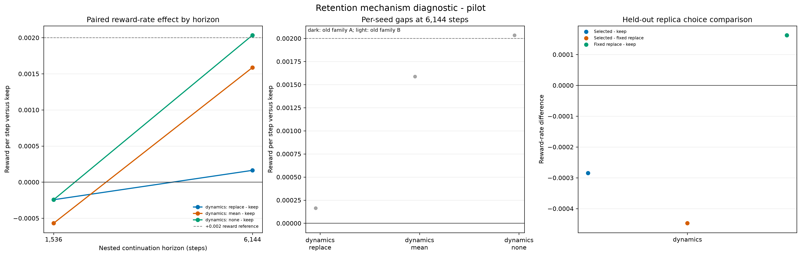

# Retention mechanism report

Phase: **pilot**. Role: exploratory_candidate_and_horizon_diagnostic. This is an observer-only action and horizon diagnosis.

The report reads frozen summaries and raw ledgers, makes no environment calls, and never feeds results to a learner.

## Design and audit

- Cases: 1; branches: 8; audited environment steps: 56,320.
- Prefix steps: 7,168; branch continuation steps: 49,152.
- SHA-256 checked raw ledger files: 27.
- Restore, grid, horizon reward, rollout and optimizer-update audits passed: **True**.
- Horizons are nested checkpoints within one continuation. They are not independent runs.
- Main intervals resample the six independent seeds within old-family A/B strata (three each). Histories, futures and replicas are averaged within each seed.
- Reward per step is primary. CPU seconds per 1,000 environment steps and utility rate remain separate outcomes.

## Paired action effects

Each operation is paired with keep from the same prefix, future and stochastic replica. The +0.002 reference is for reward per step only.

| relation | horizon | contrast | seeds | reward / step difference | 95% descriptive interval | interval interpretation | CPU seconds / 1,000 step difference | utility-rate difference |
|---|---:|---|---:|---:|---|---|---:|---:|
| dynamics | 1,536 | replace - keep | 1 | -0.000244 | not estimated | not estimated for the single-seed pilot | 0.000000 | -0.000244 |
| dynamics | 1,536 | mean - keep | 1 | -0.000570 | not estimated | not estimated for the single-seed pilot | -0.010173 | -0.000554 |
| dynamics | 1,536 | none - keep | 1 | -0.000244 | not estimated | not estimated for the single-seed pilot | 0.020345 | -0.000264 |
| dynamics | 6,144 | replace - keep | 1 | 0.000163 | not estimated | not estimated for the single-seed pilot | -0.000000 | 0.000163 |
| dynamics | 6,144 | mean - keep | 1 | 0.001587 | not estimated | not estimated for the single-seed pilot | 0.005086 | 0.001583 |
| dynamics | 6,144 | none - keep | 1 | 0.002035 | not estimated | not estimated for the single-seed pilot | 0.005086 | 0.002029 |

## Future-prevalence interaction

For replace versus keep, this is the new-major future contrast minus the old-major future contrast, averaged across history within seed.

| relation | horizon | reward / step interaction | 95% descriptive interval | interval interpretation | seeds |
|---|---:|---:|---|---|---:|

## All condition subgroups

Every relation, history, future, horizon and action contrast is retained below and in analysis.json.

| relation | history | future | horizon | contrast | seeds | reward / step difference | interval | interval interpretation |
|---|---|---|---:|---|---:|---:|---|---|
| dynamics | old_major | old_major | 1,536 | replace - keep | 1 | -0.000244 | not estimated | not estimated for the single-seed pilot |
| dynamics | old_major | old_major | 1,536 | mean - keep | 1 | -0.000570 | not estimated | not estimated for the single-seed pilot |
| dynamics | old_major | old_major | 1,536 | none - keep | 1 | -0.000244 | not estimated | not estimated for the single-seed pilot |
| dynamics | old_major | old_major | 6,144 | replace - keep | 1 | 0.000163 | not estimated | not estimated for the single-seed pilot |
| dynamics | old_major | old_major | 6,144 | mean - keep | 1 | 0.001587 | not estimated | not estimated for the single-seed pilot |
| dynamics | old_major | old_major | 6,144 | none - keep | 1 | 0.002035 | not estimated | not estimated for the single-seed pilot |

## Cross-replica selection diagnostic

The best action is selected using reward on one stochastic continuation and scored on the other continuation from the same prefix. The direction is swapped. The fixed comparator is replace, frozen before this run. The choice is future-aware and diagnostic; it does not estimate a deployed past-only selector or policy value. No same-replica maximum or global oracle bound is reported.
This ranking should not be treated as a stable past-only action ranking. Ties within 1e-12 prefer keep, then config action order. Selection margins and replica argmax agreement describe repeatability; six seeds do not support a formal negative conclusion.

| relation | horizon | future | chosen - keep | interval | interval interpretation | chosen - fixed replace | interval | fixed replace - keep | interval | argmax agreement |
|---|---:|---|---:|---|---|---:|---|---:|---|---:|
| dynamics | 1,536 | old_major | -0.001139 | not estimated | not estimated for the single-seed pilot | -0.000895 | not estimated | -0.000244 | not estimated | 0.000000 |
| dynamics | 6,144 | old_major | -0.000285 | not estimated | not estimated for the single-seed pilot | -0.000448 | not estimated | 0.000163 | not estimated | 0.000000 |

## Per-seed cross-replica comparisons

Each seed contributes after averaging the two selection/evaluation directions and histories within its condition. Family labels are shown to make the six-seed distribution inspectable.

| relation | future | horizon | seed | old family | selected - keep | selected - fixed replace | fixed replace - keep | argmax agreement |
|---|---|---:|---:|---|---:|---:|---:|---:|
| dynamics | old_major | 1,536 | 25089 | pilot | -0.001139 | -0.000895 | -0.000244 | 0.000000 |
| dynamics | old_major | 6,144 | 25089 | pilot | -0.000285 | -0.000448 | 0.000163 | 0.000000 |

## Per-seed long-horizon records

Each row reports a seed's paired reward-rate gap at 6,144 steps.

| relation | seed | old family | contrast | reward / step difference |
|---|---:|---|---|---:|
| dynamics | 25089 | pilot | replace - keep | 0.000163 |
| dynamics | 25089 | pilot | mean - keep | 0.001587 |
| dynamics | 25089 | pilot | none - keep | 0.002035 |

## Cost ledger

Runner timing fields are preserved below; raw transition and rollout totals were independently recounted.

Runner cost JSON

<pre>
{
  "prefix_environment_steps": 7168,
  "branch_environment_steps": 49152,
  "environment_steps_total": 56320,
  "expected_environment_steps_total": 56320,
  "expected_interactions": {
    "cases": 1,
    "branches": 8,
    "prefix_steps_per_case": 7168,
    "steps_per_branch": 6144,
    "prefix_steps": 7168,
    "branch_steps": 49152,
    "total_steps": 56320
  },
  "configured_expected_interactions": {
    "cases": 1,
    "branches": 8,
    "prefix_steps_per_case": 7168,
    "steps_per_branch": 6144,
    "prefix_steps": 7168,
    "branch_steps": 49152,
    "total_steps": 56320
  },
  "executor_mode": "inline",
  "requested_workers": 1,
  "actual_workers": 1,
  "campaign_parent_cpu_s": 31.578125,
  "campaign_case_cpu_s_sum": 31.578125,
  "campaign_child_case_cpu_s": 0.0,
  "campaign_cpu_s": 31.578125,
  "elapsed_wall_s": 32.04096100000061,
  "prefix_cpu_s": 3.78125,
  "branch_cpu_s": 27.171875,
  "prefix_wall_s": 3.8507002999995166,
  "branch_wall_s": 27.540808100000504
}
</pre>

## Figure

## Interpretation

The frozen practical reference is +0.002000 reward per step. An interval spanning useful and negligible effects is inconclusive, not evidence of no action value.
If no reproducible action gap appears under these candidates, prioritize candidate or representation diagnostics. If action gaps appear but cross-replica choices do not predict the other continuation reliably, prioritize an action-contrast diagnostic. The root records the gate decision after reviewing these results.

## Input hashes

Summary SHA-256: 343453beee8cc50498043d4d9c9c8fd01f30e412d1e0450f4d74884b68bb4957  
Config canonical SHA-256: 343e0ce573d8c74a5e2eb2f0a66ff8286b2343be6145517827ea3a40905a0c8b  
Source manifest canonical SHA-256: 716e4d66594e710389f8347000221e66f16505741a1ed699e91b0b7b632c93e7

## Software

The static multi-panel figure follows the object-oriented Matplotlib and vector-export guidance in Kassis, T., Agarwal, V., He, Y., Patel, D., and Brueckner, A. M. (2026), Scientific Agent Skills: A Library of Procedural Knowledge for Research Agents, arXiv:2609.00065 (current arXiv version v2, revised 2 September 2026). https://arxiv.org/abs/2609.00065
