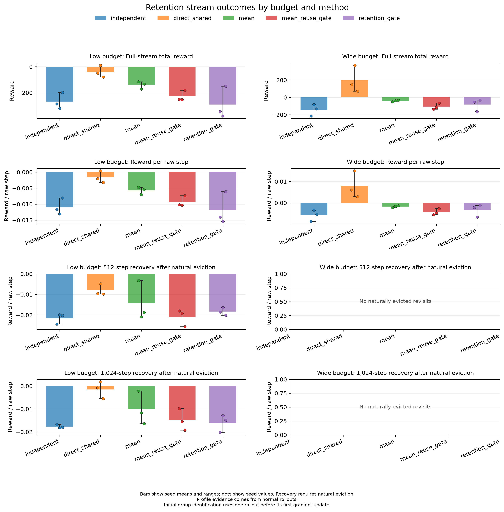

# Retention stream exploratory analysis

Analysis role: `exploratory`. Statistical unit: seed. Each seed is summarized before cross-seed means, ranges, or paired differences are calculated. Declared budgets are reported separately: low, wide.

The full-stream outcomes are total reward and reward per raw step. Recurrence recovery is classified within each seed and is counted as eviction recovery only when the task was naturally evicted before it returned. Resident revisits and revisits with zero evictions remain separate categories. Tasks and bouts are not independent replicates.

Profile evidence comes from normal rollouts; there is no independent probe, and initial group identification uses a rollout. The report does not assume an early cold-start gain. The primary recurrence comparisons are the later 512- and 1,024-step windows.

Cohort audit passed: `True`. Branches: 30; seeds: 3; cohort raw steps: 737280; evaluation steps: 0; total interactions: 737280; CPU s: 892.06; wall s: 461.48.

## Full-stream outcomes by budget

### Low budget

| method | seeds | total reward mean [range] | reward / raw step mean [range] |
|---|---:|---:|---:|
| independent | 3 | -268.1133 [-320.2800, -198.5300] | -0.0109 [-0.0130, -0.0081] |
| direct_shared | 3 | -40.0300 [-79.5300, 9.7200] | -0.0016 [-0.0032, 0.0004] |
| mean | 3 | -140.3633 [-171.2800, -116.5300] | -0.0057 [-0.0070, -0.0047] |
| mean_reuse_gate | 3 | -228.1967 [-252.7800, -180.7800] | -0.0093 [-0.0103, -0.0074] |
| retention_gate | 3 | -290.6133 [-377.7800, -150.0300] | -0.0118 [-0.0154, -0.0061] |

#### Low budget paired differences vs independent

| method | metric | paired seeds | per-seed differences | mean difference [range] |
|---|---|---|---|---:|
| independent | total_reward | 19001, 19013, 19031 | 19001: 0.0000, 19013: 0.0000, 19031: 0.0000 | 0.0000 [0.0000, 0.0000] |
| independent | reward_per_raw_step | 19001, 19013, 19031 | 19001: 0.0000, 19013: 0.0000, 19031: 0.0000 | 0.0000 [0.0000, 0.0000] |
| direct_shared | total_reward | 19001, 19013, 19031 | 19001: 235.2500, 19013: 330.0000, 19031: 119.0000 | 228.0833 [119.0000, 330.0000] |
| direct_shared | reward_per_raw_step | 19001, 19013, 19031 | 19001: 0.0096, 19013: 0.0134, 19031: 0.0048 | 0.0093 [0.0048, 0.0134] |
| mean | total_reward | 19001, 19013, 19031 | 19001: 169.0000, 19013: 149.0000, 19031: 65.2500 | 127.7500 [65.2500, 169.0000] |
| mean | reward_per_raw_step | 19001, 19013, 19031 | 19001: 0.0069, 19013: 0.0061, 19031: 0.0027 | 0.0052 [0.0027, 0.0069] |
| mean_reuse_gate | total_reward | 19001, 19013, 19031 | 19001: 34.5000, 19013: 67.5000, 19031: 17.7500 | 39.9167 [17.7500, 67.5000] |
| mean_reuse_gate | reward_per_raw_step | 19001, 19013, 19031 | 19001: 0.0014, 19013: 0.0027, 19031: 0.0007 | 0.0016 [0.0007, 0.0027] |
| retention_gate | total_reward | 19001, 19013, 19031 | 19001: -58.5000, 19013: -57.5000, 19031: 48.5000 | -22.5000 [-58.5000, 48.5000] |
| retention_gate | reward_per_raw_step | 19001, 19013, 19031 | 19001: -0.0024, 19013: -0.0023, 19031: 0.0020 | -0.0009 [-0.0024, 0.0020] |

### Wide budget

| method | seeds | total reward mean [range] | reward / raw step mean [range] |
|---|---:|---:|---:|
| independent | 3 | -143.4467 [-213.2800, -85.0300] | -0.0058 [-0.0087, -0.0035] |
| direct_shared | 3 | 196.1367 [71.4700, 368.2200] | 0.0080 [0.0029, 0.0150] |
| mean | 3 | -41.7800 [-52.5300, -33.2800] | -0.0017 [-0.0021, -0.0014] |
| mean_reuse_gate | 3 | -106.2800 [-136.7800, -65.5300] | -0.0043 [-0.0056, -0.0027] |
| retention_gate | 3 | -82.4467 [-163.7800, -30.5300] | -0.0034 [-0.0067, -0.0012] |

#### Wide budget paired differences vs independent

| method | metric | paired seeds | per-seed differences | mean difference [range] |
|---|---|---|---|---:|
| independent | total_reward | 19001, 19013, 19031 | 19001: 0.0000, 19013: 0.0000, 19031: 0.0000 | 0.0000 [0.0000, 0.0000] |
| independent | reward_per_raw_step | 19001, 19013, 19031 | 19001: 0.0000, 19013: 0.0000, 19031: 0.0000 | 0.0000 [0.0000, 0.0000] |
| direct_shared | total_reward | 19001, 19013, 19031 | 19001: 362.0000, 19013: 453.2500, 19031: 203.5000 | 339.5833 [203.5000, 453.2500] |
| direct_shared | reward_per_raw_step | 19001, 19013, 19031 | 19001: 0.0147, 19013: 0.0184, 19031: 0.0083 | 0.0138 [0.0083, 0.0184] |
| mean | total_reward | 19001, 19013, 19031 | 19001: 160.7500, 19013: 45.5000, 19031: 98.7500 | 101.6667 [45.5000, 160.7500] |
| mean | reward_per_raw_step | 19001, 19013, 19031 | 19001: 0.0065, 19013: 0.0019, 19031: 0.0040 | 0.0041 [0.0019, 0.0065] |
| mean_reuse_gate | total_reward | 19001, 19013, 19031 | 19001: 76.5000, 19013: -31.5000, 19031: 66.5000 | 37.1667 [-31.5000, 76.5000] |
| mean_reuse_gate | reward_per_raw_step | 19001, 19013, 19031 | 19001: 0.0031, 19013: -0.0013, 19031: 0.0027 | 0.0015 [-0.0013, 0.0031] |
| retention_gate | total_reward | 19001, 19013, 19031 | 19001: 160.2500, 19013: -78.7500, 19031: 101.5000 | 61.0000 [-78.7500, 160.2500] |
| retention_gate | reward_per_raw_step | 19001, 19013, 19031 | 19001: 0.0065, 19013: -0.0032, 19031: 0.0041 | 0.0025 [-0.0032, 0.0065] |

## Recurrence categories

### Low budget

Each task is averaged inside its seed first. The reported cross-seed mean and range use those seed-level averages.

| method | category | seed count | task count | first 256 mean [range] | recovery 512 mean [range] | recovery 1,024 mean [range] | first goal step mean [range] (n, missing) | first gradient step mean [range] |
|---|---|---:|---:|---:|---:|---:|---:|---:|
| independent | evicted_recovery | 3 | 12 | -0.0184 [-0.0234, -0.0118] | -0.0215 [-0.0244, -0.0199] | -0.0177 [-0.0182, -0.0168] | 425.9 [168.3, 586.8] (n=3, missing=0) | 256.0 [256.0, 256.0] |
| independent | resident_revisit | 3 | 6 | 0.0011 [-0.0001, 0.0032] | 0.0011 [-0.0068, 0.0066] | 0.0068 [-0.0014, 0.0208] | 162.7 [94.0, 281.0] (n=3, missing=0) | 256.0 [256.0, 256.0] |
| independent | no_eviction_revisit | 0 | 0 | n/a | n/a | n/a | n/a (n=0, missing=0) | n/a |
| direct_shared | evicted_recovery | 3 | 17 | -0.0172 [-0.0255, -0.0124] | -0.0080 [-0.0098, -0.0048] | -0.0015 [-0.0054, 0.0018] | 271.1 [212.8, 374.0] (n=3, missing=0) | 256.0 [256.0, 256.0] |
| direct_shared | resident_revisit | 1 | 1 | 0.0100 [0.0100, 0.0100] | 0.0266 [0.0266, 0.0266] | 0.0157 [0.0157, 0.0157] | 15.0 [15.0, 15.0] (n=1, missing=0) | 256.0 [256.0, 256.0] |
| direct_shared | no_eviction_revisit | 0 | 0 | n/a | n/a | n/a | n/a (n=0, missing=0) | n/a |
| mean | evicted_recovery | 3 | 17 | -0.0249 [-0.0315, -0.0150] | -0.0143 [-0.0209, -0.0033] | -0.0101 [-0.0164, -0.0022] | 516.4 [329.5, 740.6] (n=3, missing=0) | 256.0 [256.0, 256.0] |
| mean | resident_revisit | 1 | 1 | 0.0071 [0.0071, 0.0071] | -0.0100 [-0.0100, -0.0100] | 0.0059 [0.0059, 0.0059] | 100.0 [100.0, 100.0] (n=1, missing=0) | 256.0 [256.0, 256.0] |
| mean | no_eviction_revisit | 0 | 0 | n/a | n/a | n/a | n/a (n=0, missing=0) | n/a |
| mean_reuse_gate | evicted_recovery | 3 | 17 | -0.0222 [-0.0325, -0.0144] | -0.0210 [-0.0257, -0.0180] | -0.0148 [-0.0192, -0.0098] | 536.0 [287.7, 661.5] (n=3, missing=0) | 256.0 [256.0, 256.0] |
| mean_reuse_gate | resident_revisit | 1 | 1 | 0.0296 [0.0296, 0.0296] | 0.0139 [0.0139, 0.0139] | 0.0186 [0.0186, 0.0186] | 2.0 [2.0, 2.0] (n=1, missing=0) | 256.0 [256.0, 256.0] |
| mean_reuse_gate | no_eviction_revisit | 0 | 0 | n/a | n/a | n/a | n/a (n=0, missing=0) | n/a |
| retention_gate | evicted_recovery | 3 | 17 | -0.0216 [-0.0251, -0.0184] | -0.0184 [-0.0201, -0.0164] | -0.0160 [-0.0202, -0.0130] | 627.3 [497.2, 755.0] (n=3, missing=0) | 256.0 [256.0, 256.0] |
| retention_gate | resident_revisit | 1 | 1 | 0.0032 [0.0032, 0.0032] | -0.0071 [-0.0071, -0.0071] | 0.0093 [0.0093, 0.0093] | 116.0 [116.0, 116.0] (n=1, missing=0) | 256.0 [256.0, 256.0] |
| retention_gate | no_eviction_revisit | 0 | 0 | n/a | n/a | n/a | n/a (n=0, missing=0) | n/a |

#### Low budget paired eviction-recovery differences vs independent

Only the same seed and task/bout observed as previously evicted in both arms is included. Task/bout differences are averaged within seed before cross-seed summaries.

| method | recovery window | matched seeds | matched task/bout observations | per-seed count and mean difference | mean per-seed difference [range] |
|---|---:|---:|---:|---|---:|
| independent | 512 | 3 | 12 | 19001: n=4, 0.0000, 19013: n=5, 0.0000, 19031: n=3, 0.0000 | 0.0000 [0.0000, 0.0000] |
| independent | 1,024 | 3 | 12 | 19001: n=4, 0.0000, 19013: n=5, 0.0000, 19031: n=3, 0.0000 | 0.0000 [0.0000, 0.0000] |
| direct_shared | 512 | 3 | 12 | 19001: n=4, 0.0148, 19013: n=5, 0.0151, 19031: n=3, 0.0119 | 0.0139 [0.0119, 0.0151] |
| direct_shared | 1,024 | 3 | 12 | 19001: n=4, 0.0193, 19013: n=5, 0.0181, 19031: n=3, 0.0100 | 0.0158 [0.0100, 0.0193] |
| mean | 512 | 3 | 12 | 19001: n=4, 0.0172, 19013: n=5, -0.0009, 19031: n=3, -0.0010 | 0.0051 [-0.0010, 0.0172] |
| mean | 1,024 | 3 | 12 | 19001: n=4, 0.0154, 19013: n=5, 0.0074, 19031: n=3, -0.0020 | 0.0069 [-0.0020, 0.0154] |
| mean_reuse_gate | 512 | 3 | 12 | 19001: n=4, -0.0015, 19013: n=5, -0.0044, 19031: n=3, -0.0088 | -0.0049 [-0.0088, -0.0015] |
| mean_reuse_gate | 1,024 | 3 | 12 | 19001: n=4, 0.0035, 19013: n=5, -0.0002, 19031: n=3, -0.0024 | 0.0003 [-0.0024, 0.0035] |
| retention_gate | 512 | 3 | 12 | 19001: n=4, -0.0018, 19013: n=5, 0.0014, 19031: n=3, -0.0021 | -0.0009 [-0.0021, 0.0014] |
| retention_gate | 1,024 | 3 | 12 | 19001: n=4, -0.0078, 19013: n=5, 0.0030, 19031: n=3, 0.0003 | -0.0015 [-0.0078, 0.0030] |

#### Low budget all matched task/bout recurrence differences vs independent

Supplementary comparison of the same task/bout in both arms regardless of eviction status. This includes visits retained in one arm and evicted in the other.

| method | metric | matched seeds | matched task/bout observations | per-seed count and mean difference | mean per-seed difference [range] |
|---|---|---:|---:|---|---:|
| independent | first256_reward_per_step | 3 | 18 | 19001: n=6, 0.0000, 19013: n=6, 0.0000, 19031: n=6, 0.0000 | 0.0000 [0.0000, 0.0000] |
| independent | recovery512_reward_per_step | 3 | 18 | 19001: n=6, 0.0000, 19013: n=6, 0.0000, 19031: n=6, 0.0000 | 0.0000 [0.0000, 0.0000] |
| independent | recovery1024_reward_per_step | 3 | 18 | 19001: n=6, 0.0000, 19013: n=6, 0.0000, 19031: n=6, 0.0000 | 0.0000 [0.0000, 0.0000] |
| independent | first_goal_step | 3 | 17 | 19001: n=6, 0.0000, 19013: n=5, 0.0000, 19031: n=6, 0.0000 | 0.0000 [0.0000, 0.0000] |
| independent | first_gradient_step | 3 | 18 | 19001: n=6, 0.0000, 19013: n=6, 0.0000, 19031: n=6, 0.0000 | 0.0000 [0.0000, 0.0000] |
| direct_shared | first256_reward_per_step | 3 | 18 | 19001: n=6, 0.0031, 19013: n=6, -0.0042, 19031: n=6, -0.0096 | -0.0036 [-0.0096, 0.0031] |
| direct_shared | recovery512_reward_per_step | 3 | 18 | 19001: n=6, 0.0090, 19013: n=6, 0.0107, 19031: n=6, 0.0047 | 0.0081 [0.0047, 0.0107] |
| direct_shared | recovery1024_reward_per_step | 3 | 18 | 19001: n=6, 0.0100, 19013: n=6, 0.0135, 19031: n=6, 0.0078 | 0.0104 [0.0078, 0.0135] |
| direct_shared | first_goal_step | 3 | 17 | 19001: n=6, -258.3333, 19013: n=5, -152.8000, 19031: n=6, 39.1667 | -123.9889 [-258.3333, 39.1667] |
| direct_shared | first_gradient_step | 3 | 18 | 19001: n=6, 0.0000, 19013: n=6, 0.0000, 19031: n=6, 0.0000 | 0.0000 [0.0000, 0.0000] |
| mean | first256_reward_per_step | 3 | 18 | 19001: n=6, 0.0005, 19013: n=6, -0.0221, 19031: n=6, -0.0124 | -0.0113 [-0.0221, 0.0005] |
| mean | recovery512_reward_per_step | 3 | 18 | 19001: n=6, 0.0152, 19013: n=6, -0.0054, 19031: n=6, -0.0089 | 0.0003 [-0.0089, 0.0152] |
| mean | recovery1024_reward_per_step | 3 | 18 | 19001: n=6, 0.0086, 19013: n=6, 0.0000, 19031: n=6, -0.0030 | 0.0019 [-0.0030, 0.0086] |
| mean | first_goal_step | 3 | 17 | 19001: n=6, -155.3333, 19013: n=5, -183.8000, 19031: n=6, 493.1667 | 51.3444 [-183.8000, 493.1667] |
| mean | first_gradient_step | 3 | 18 | 19001: n=6, 0.0000, 19013: n=6, 0.0000, 19031: n=6, 0.0000 | 0.0000 [0.0000, 0.0000] |
| mean_reuse_gate | first256_reward_per_step | 3 | 18 | 19001: n=6, -0.0042, 19013: n=6, -0.0050, 19031: n=6, -0.0122 | -0.0072 [-0.0122, -0.0042] |
| mean_reuse_gate | recovery512_reward_per_step | 3 | 18 | 19001: n=6, 0.0005, 19013: n=6, -0.0037, 19031: n=6, -0.0107 | -0.0046 [-0.0107, 0.0005] |
| mean_reuse_gate | recovery1024_reward_per_step | 3 | 18 | 19001: n=6, 0.0010, 19013: n=6, -0.0038, 19031: n=6, -0.0032 | -0.0020 [-0.0038, 0.0010] |
| mean_reuse_gate | first_goal_step | 3 | 16 | 19001: n=6, -197.1667, 19013: n=5, 333.6000, 19031: n=5, 364.4000 | 166.9444 [-197.1667, 364.4000] |
| mean_reuse_gate | first_gradient_step | 3 | 18 | 19001: n=6, 0.0000, 19013: n=6, 0.0000, 19031: n=6, 0.0000 | 0.0000 [0.0000, 0.0000] |
| retention_gate | first256_reward_per_step | 3 | 18 | 19001: n=6, -0.0057, 19013: n=6, -0.0091, 19031: n=6, -0.0104 | -0.0084 [-0.0104, -0.0057] |
| retention_gate | recovery512_reward_per_step | 3 | 18 | 19001: n=6, -0.0000, 19013: n=6, -0.0009, 19031: n=6, -0.0095 | -0.0035 [-0.0095, -0.0000] |
| retention_gate | recovery1024_reward_per_step | 3 | 18 | 19001: n=6, -0.0094, 19013: n=6, -0.0013, 19031: n=6, -0.0012 | -0.0039 [-0.0094, -0.0012] |
| retention_gate | first_goal_step | 3 | 17 | 19001: n=6, 12.3333, 19013: n=5, -21.2000, 19031: n=6, 507.8333 | 166.3222 [-21.2000, 507.8333] |
| retention_gate | first_gradient_step | 3 | 18 | 19001: n=6, 0.0000, 19013: n=6, 0.0000, 19031: n=6, 0.0000 | 0.0000 [0.0000, 0.0000] |

### Wide budget

Each task is averaged inside its seed first. The reported cross-seed mean and range use those seed-level averages.

| method | category | seed count | task count | first 256 mean [range] | recovery 512 mean [range] | recovery 1,024 mean [range] | first goal step mean [range] (n, missing) | first gradient step mean [range] |
|---|---|---:|---:|---:|---:|---:|---:|---:|
| independent | evicted_recovery | 0 | 0 | n/a | n/a | n/a | n/a (n=0, missing=0) | n/a |
| independent | resident_revisit | 0 | 0 | n/a | n/a | n/a | n/a (n=0, missing=0) | n/a |
| independent | no_eviction_revisit | 3 | 18 | -0.0056 [-0.0098, 0.0016] | -0.0056 [-0.0102, 0.0002] | -0.0014 [-0.0064, 0.0028] | 318.2 [152.2, 500.3] (n=3, missing=0) | 256.0 [256.0, 256.0] |
| direct_shared | evicted_recovery | 0 | 0 | n/a | n/a | n/a | n/a (n=0, missing=0) | n/a |
| direct_shared | resident_revisit | 0 | 0 | n/a | n/a | n/a | n/a (n=0, missing=0) | n/a |
| direct_shared | no_eviction_revisit | 3 | 18 | 0.0093 [0.0034, 0.0136] | 0.0123 [0.0085, 0.0154] | 0.0166 [0.0082, 0.0214] | 154.1 [106.8, 187.8] (n=3, missing=0) | 256.0 [256.0, 256.0] |
| mean | evicted_recovery | 0 | 0 | n/a | n/a | n/a | n/a (n=0, missing=0) | n/a |
| mean | resident_revisit | 0 | 0 | n/a | n/a | n/a | n/a (n=0, missing=0) | n/a |
| mean | no_eviction_revisit | 3 | 18 | -0.0022 [-0.0093, 0.0092] | 0.0010 [-0.0082, 0.0108] | 0.0029 [0.0001, 0.0054] | 273.0 [133.5, 421.2] (n=3, missing=0) | 256.0 [256.0, 256.0] |
| mean_reuse_gate | evicted_recovery | 0 | 0 | n/a | n/a | n/a | n/a (n=0, missing=0) | n/a |
| mean_reuse_gate | resident_revisit | 0 | 0 | n/a | n/a | n/a | n/a (n=0, missing=0) | n/a |
| mean_reuse_gate | no_eviction_revisit | 3 | 18 | -0.0095 [-0.0111, -0.0085] | -0.0048 [-0.0093, -0.0018] | -0.0017 [-0.0024, -0.0007] | 317.5 [235.7, 368.0] (n=3, missing=0) | 256.0 [256.0, 256.0] |
| retention_gate | evicted_recovery | 0 | 0 | n/a | n/a | n/a | n/a (n=0, missing=0) | n/a |
| retention_gate | resident_revisit | 0 | 0 | n/a | n/a | n/a | n/a (n=0, missing=0) | n/a |
| retention_gate | no_eviction_revisit | 3 | 18 | -0.0020 [-0.0097, 0.0060] | 0.0047 [-0.0035, 0.0138] | 0.0025 [-0.0017, 0.0076] | 363.9 [137.8, 564.8] (n=3, missing=0) | 256.0 [256.0, 256.0] |

#### Wide budget paired eviction-recovery differences vs independent

Only the same seed and task/bout observed as previously evicted in both arms is included. Task/bout differences are averaged within seed before cross-seed summaries.

| method | recovery window | matched seeds | matched task/bout observations | per-seed count and mean difference | mean per-seed difference [range] |
|---|---:|---:|---:|---|---:|
| independent | 512 | 0 | 0 | none | n/a [n/a, n/a] |
| independent | 1,024 | 0 | 0 | none | n/a [n/a, n/a] |
| direct_shared | 512 | 0 | 0 | none | n/a [n/a, n/a] |
| direct_shared | 1,024 | 0 | 0 | none | n/a [n/a, n/a] |
| mean | 512 | 0 | 0 | none | n/a [n/a, n/a] |
| mean | 1,024 | 0 | 0 | none | n/a [n/a, n/a] |
| mean_reuse_gate | 512 | 0 | 0 | none | n/a [n/a, n/a] |
| mean_reuse_gate | 1,024 | 0 | 0 | none | n/a [n/a, n/a] |
| retention_gate | 512 | 0 | 0 | none | n/a [n/a, n/a] |
| retention_gate | 1,024 | 0 | 0 | none | n/a [n/a, n/a] |

#### Wide budget all matched task/bout recurrence differences vs independent

Supplementary comparison of the same task/bout in both arms regardless of eviction status. This includes visits retained in one arm and evicted in the other.

| method | metric | matched seeds | matched task/bout observations | per-seed count and mean difference | mean per-seed difference [range] |
|---|---|---:|---:|---|---:|
| independent | first256_reward_per_step | 3 | 18 | 19001: n=6, 0.0000, 19013: n=6, 0.0000, 19031: n=6, 0.0000 | 0.0000 [0.0000, 0.0000] |
| independent | recovery512_reward_per_step | 3 | 18 | 19001: n=6, 0.0000, 19013: n=6, 0.0000, 19031: n=6, 0.0000 | 0.0000 [0.0000, 0.0000] |
| independent | recovery1024_reward_per_step | 3 | 18 | 19001: n=6, 0.0000, 19013: n=6, 0.0000, 19031: n=6, 0.0000 | 0.0000 [0.0000, 0.0000] |
| independent | first_goal_step | 3 | 18 | 19001: n=6, 0.0000, 19013: n=6, 0.0000, 19031: n=6, 0.0000 | 0.0000 [0.0000, 0.0000] |
| independent | first_gradient_step | 3 | 18 | 19001: n=6, 0.0000, 19013: n=6, 0.0000, 19031: n=6, 0.0000 | 0.0000 [0.0000, 0.0000] |
| direct_shared | first256_reward_per_step | 3 | 18 | 19001: n=6, 0.0207, 19013: n=6, 0.0120, 19031: n=6, 0.0120 | 0.0149 [0.0120, 0.0207] |
| direct_shared | recovery512_reward_per_step | 3 | 18 | 19001: n=6, 0.0187, 19013: n=6, 0.0222, 19031: n=6, 0.0129 | 0.0179 [0.0129, 0.0222] |
| direct_shared | recovery1024_reward_per_step | 3 | 18 | 19001: n=6, 0.0278, 19013: n=6, 0.0207, 19031: n=6, 0.0055 | 0.0180 [0.0055, 0.0278] |
| direct_shared | first_goal_step | 3 | 18 | 19001: n=6, -195.1667, 19013: n=6, -312.5000, 19031: n=6, 15.3333 | -164.1111 [-312.5000, 15.3333] |
| direct_shared | first_gradient_step | 3 | 18 | 19001: n=6, 0.0000, 19013: n=6, 0.0000, 19031: n=6, 0.0000 | 0.0000 [0.0000, 0.0000] |
| mean | first256_reward_per_step | 3 | 18 | 19001: n=6, 0.0190, 19013: n=6, 0.0023, 19031: n=6, -0.0109 | 0.0035 [-0.0109, 0.0190] |
| mean | recovery512_reward_per_step | 3 | 18 | 19001: n=6, 0.0210, 19013: n=6, -0.0014, 19031: n=6, 0.0003 | 0.0066 [-0.0014, 0.0210] |
| mean | recovery1024_reward_per_step | 3 | 18 | 19001: n=6, 0.0117, 19013: n=6, 0.0037, 19031: n=6, -0.0027 | 0.0042 [-0.0027, 0.0117] |
| mean | first_goal_step | 3 | 18 | 19001: n=6, -168.5000, 19013: n=6, -236.0000, 19031: n=6, 269.0000 | -45.1667 [-236.0000, 269.0000] |
| mean | first_gradient_step | 3 | 18 | 19001: n=6, 0.0000, 19013: n=6, 0.0000, 19031: n=6, 0.0000 | 0.0000 [0.0000, 0.0000] |
| mean_reuse_gate | first256_reward_per_step | 3 | 18 | 19001: n=6, 0.0010, 19013: n=6, 0.0002, 19031: n=6, -0.0127 | -0.0039 [-0.0127, 0.0010] |
| mean_reuse_gate | recovery512_reward_per_step | 3 | 18 | 19001: n=6, 0.0070, 19013: n=6, 0.0050, 19031: n=6, -0.0095 | 0.0008 [-0.0095, 0.0070] |
| mean_reuse_gate | recovery1024_reward_per_step | 3 | 18 | 19001: n=6, 0.0056, 19013: n=6, -0.0019, 19031: n=6, -0.0048 | -0.0004 [-0.0048, 0.0056] |
| mean_reuse_gate | first_goal_step | 3 | 17 | 19001: n=5, -8.0000, 19013: n=6, -264.6667, 19031: n=6, 215.8333 | -18.9444 [-264.6667, 215.8333] |
| mean_reuse_gate | first_gradient_step | 3 | 18 | 19001: n=6, 0.0000, 19013: n=6, 0.0000, 19031: n=6, 0.0000 | 0.0000 [0.0000, 0.0000] |
| retention_gate | first256_reward_per_step | 3 | 18 | 19001: n=6, 0.0002, 19013: n=6, 0.0063, 19031: n=6, 0.0044 | 0.0036 [0.0002, 0.0063] |
| retention_gate | recovery512_reward_per_step | 3 | 18 | 19001: n=6, 0.0240, 19013: n=6, 0.0033, 19031: n=6, 0.0037 | 0.0104 [0.0033, 0.0240] |
| retention_gate | recovery1024_reward_per_step | 3 | 18 | 19001: n=6, 0.0140, 19013: n=6, -0.0012, 19031: n=6, -0.0012 | 0.0039 [-0.0012, 0.0140] |
| retention_gate | first_goal_step | 3 | 18 | 19001: n=6, -164.1667, 19013: n=6, 64.5000, 19031: n=6, 236.8333 | 45.7222 [-164.1667, 236.8333] |
| retention_gate | first_gradient_step | 3 | 18 | 19001: n=6, 0.0000, 19013: n=6, 0.0000, 19031: n=6, 0.0000 | 0.0000 [0.0000, 0.0000] |

## Capacity, storage, and operation counts

| budget | method | seeds | actor bytes max | full physical bytes max | package budget bytes | evidence bytes max | evictions | rollouts | minibatch updates | proposals / accepts | prior bindings | CPU s | wall s |
|---|---|---:|---:|---:|---:|---:|---:|---:|---:|---:|---:|---:|---:|
| low | independent | 3 | 140 | 224153 | 327680 | 21640 | 6.0 | 96.0 | 1536.0 | 0.0 / 0.0 | 0.0 | 29.20 | 30.02 |
| low | direct_shared | 3 | 134 | 209555 | 327680 | 21640 | 8.7 | 96.0 | 1536.0 | 0.0 / 0.0 | 11.7 | 29.86 | 30.66 |
| low | mean | 3 | 134 | 210451 | 327680 | 21640 | 8.7 | 96.0 | 1536.0 | 26.0 / 20.3 | 9.7 | 31.65 | 32.51 |
| low | mean_reuse_gate | 3 | 134 | 210515 | 327680 | 21640 | 8.7 | 96.0 | 1536.0 | 26.0 / 20.3 | 7.0 | 31.73 | 32.64 |
| low | retention_gate | 3 | 134 | 209939 | 327680 | 21640 | 8.7 | 96.0 | 1536.0 | 26.0 / 1.3 | 2.0 | 30.15 | 31.12 |
| wide | independent | 3 | 236 | 266233 | 327680 | 21640 | 0.0 | 96.0 | 1536.0 | 0.0 / 0.0 | 0.0 | 29.99 | 30.81 |
| wide | direct_shared | 3 | 230 | 252979 | 327680 | 21640 | 0.0 | 96.0 | 1536.0 | 0.0 / 0.0 | 6.0 | 28.60 | 29.35 |
| wide | mean | 3 | 230 | 254195 | 327680 | 21640 | 0.0 | 96.0 | 1536.0 | 29.3 / 22.0 | 4.0 | 28.96 | 29.66 |
| wide | mean_reuse_gate | 3 | 230 | 254195 | 327680 | 21640 | 0.0 | 96.0 | 1536.0 | 29.3 / 22.0 | 2.3 | 28.60 | 29.29 |
| wide | retention_gate | 3 | 230 | 253747 | 327680 | 21640 | 0.0 | 96.0 | 1536.0 | 29.3 / 1.0 | 0.3 | 28.60 | 29.21 |

## Per-seed records

All negative values and task-level recurrence observations, including missing first-goal outcomes, are retained in `analysis.json`. The table below preserves each seed's full-stream reward rate.

| budget | method | seed | total reward | reward / raw step | evictions |
|---|---|---:|---:|---:|---:|
| low | direct_shared | 19001 | -50.2800 | -0.0020 | 9 |
| low | direct_shared | 19013 | 9.7200 | 0.0004 | 9 |
| low | direct_shared | 19031 | -79.5300 | -0.0032 | 8 |
| low | independent | 19001 | -285.5300 | -0.0116 | 6 |
| low | independent | 19013 | -320.2800 | -0.0130 | 7 |
| low | independent | 19031 | -198.5300 | -0.0081 | 5 |
| low | mean | 19001 | -116.5300 | -0.0047 | 9 |
| low | mean | 19013 | -171.2800 | -0.0070 | 9 |
| low | mean | 19031 | -133.2800 | -0.0054 | 8 |
| low | mean_reuse_gate | 19001 | -251.0300 | -0.0102 | 9 |
| low | mean_reuse_gate | 19013 | -252.7800 | -0.0103 | 9 |
| low | mean_reuse_gate | 19031 | -180.7800 | -0.0074 | 8 |
| low | retention_gate | 19001 | -344.0300 | -0.0140 | 9 |
| low | retention_gate | 19013 | -377.7800 | -0.0154 | 9 |
| low | retention_gate | 19031 | -150.0300 | -0.0061 | 8 |
| wide | direct_shared | 19001 | 148.7200 | 0.0061 | 0 |
| wide | direct_shared | 19013 | 368.2200 | 0.0150 | 0 |
| wide | direct_shared | 19031 | 71.4700 | 0.0029 | 0 |
| wide | independent | 19001 | -213.2800 | -0.0087 | 0 |
| wide | independent | 19013 | -85.0300 | -0.0035 | 0 |
| wide | independent | 19031 | -132.0300 | -0.0054 | 0 |
| wide | mean | 19001 | -52.5300 | -0.0021 | 0 |
| wide | mean | 19013 | -39.5300 | -0.0016 | 0 |
| wide | mean | 19031 | -33.2800 | -0.0014 | 0 |
| wide | mean_reuse_gate | 19001 | -136.7800 | -0.0056 | 0 |
| wide | mean_reuse_gate | 19013 | -116.5300 | -0.0047 | 0 |
| wide | mean_reuse_gate | 19031 | -65.5300 | -0.0027 | 0 |
| wide | retention_gate | 19001 | -53.0300 | -0.0022 | 0 |
| wide | retention_gate | 19013 | -163.7800 | -0.0067 | 0 |
| wide | retention_gate | 19031 | -30.5300 | -0.0012 | 0 |

## Figure

This is an exploratory report. Seed-paired differences are descriptive; tasks, bouts, episodes, and transitions are not treated as independent seeds.

## Software

The visualization workflow follows the Matplotlib procedural guidance in Kassis, T., Agarwal, V., He, Y., Patel, D., and Brueckner, A. M. (2026), *Scientific Agent Skills: A Library of Procedural Knowledge for Research Agents*, arXiv:2609.00065 (current arXiv version v2, revised 2 September 2026). [arXiv record](https://arxiv.org/abs/2609.00065).
