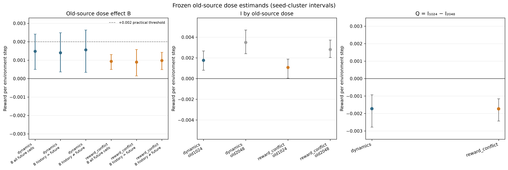

# Source-dose and learning-interaction follow-up

- Cohort phase: `main`
- Source directory: `D:\MovedFromC\ChatGPT\online\outputs\source_dose_main`
- Cases: 32 observed / 32 expected
- Report-generation environment steps: 0; this script only reads existing outputs.
- Independent unit: seed; histories are averaged within seed before the 10,000-resample paired seed-cluster bootstrap.
- Intervals are descriptive 95% percentile intervals. Aliases retain logical reward and duration but have zero actual environment steps and are not independent samples.

## Frozen source-dose estimands

Reward rate is cumulative future reward divided by logical future environment steps. `D_c = R_replace,c − R_keep,c`; `B = mean_h,f(D_1024 − D_2048)`. The primary B averages only history=future cells; the stress B averages history≠future cells.

All 64 observed 1024-step `replace` branches are hash-verified aliases of their 2048-step counterparts. Therefore B algebraically reduces to `mean_h,f(R_keep,2048 − R_keep,1024)`: this is an old-candidate-content effect under `keep`, not independent evidence that replace or automatic organization improves reward.

### Relation: `dynamics`

Complete paired seed clusters: 8 / 8.

| Estimand | Estimate [95% interval] | Predeclared reading |
|---|---|---|
| B, future-balanced | +0.00148 [[+0.00050, +0.00241]]; n=8, positive=7 | uncertain under the predeclared criterion |
| B, history=future | +0.00140 [[+0.00036, +0.00249]]; n=8, positive=6 | uncertain under the predeclared criterion |
| B, history≠future | +0.00156 [[+0.00034, +0.00263]]; n=8, positive=7 | descriptive stress condition |

| Contrast | Estimate [95% interval] | Definition / note |
|---|---|---|
| D old1024, future old_major | -0.00044 [[-0.00148, +0.00079]]; n=8, positive=2 | reversal=True |
| D old1024, future new_major | +0.00132 [[+0.00028, +0.00228]]; n=8, positive=5 | reversal=True |
| I old1024 | +0.00176 [[+0.00081, +0.00267]]; n=8, positive=7 | new-major future minus old-major future |
| D old2048, future old_major | -0.00278 [[-0.00466, -0.00104]]; n=8, positive=1 | reversal=True |
| D old2048, future new_major | +0.00070 [[-0.00091, +0.00226]]; n=8, positive=5 | reversal=True |
| I old2048 | +0.00349 [[+0.00240, +0.00469]]; n=8, positive=8 | new-major future minus old-major future |
| Q = I_1024 − I_2048 | -0.00173 [[-0.00278, -0.00093]]; n=8, positive=0 | two-sided; no fixed directional hypothesis |

All action mean reward rates

| Dose | Action | Future | Reward rate [95% interval] |
|---|---|---|---|
| old1024 | keep | old_major | -0.01486 [[-0.01573, -0.01393]]; n=8, positive=0 |
| old1024 | keep | new_major | -0.01399 [[-0.01516, -0.01285]]; n=8, positive=0 |
| old1024 | replace | old_major | -0.01530 [[-0.01622, -0.01426]]; n=8, positive=0 |
| old1024 | replace | new_major | -0.01267 [[-0.01447, -0.01097]]; n=8, positive=0 |
| old1024 | mean | old_major | -0.01588 [[-0.01709, -0.01468]]; n=8, positive=0 |
| old1024 | mean | new_major | -0.01375 [[-0.01514, -0.01222]]; n=8, positive=0 |
| old1024 | none | old_major | -0.01639 [[-0.01742, -0.01545]]; n=8, positive=0 |
| old1024 | none | new_major | -0.01429 [[-0.01539, -0.01319]]; n=8, positive=0 |
| old2048 | keep | old_major | -0.01251 [[-0.01386, -0.01121]]; n=8, positive=0 |
| old2048 | keep | new_major | -0.01337 [[-0.01414, -0.01265]]; n=8, positive=0 |
| old2048 | replace | old_major | -0.01530 [[-0.01622, -0.01426]]; n=8, positive=0 |
| old2048 | replace | new_major | -0.01267 [[-0.01447, -0.01097]]; n=8, positive=0 |
| old2048 | mean | old_major | -0.01452 [[-0.01546, -0.01365]]; n=8, positive=0 |
| old2048 | mean | new_major | -0.01413 [[-0.01537, -0.01298]]; n=8, positive=0 |
| old2048 | none | old_major | -0.01639 [[-0.01742, -0.01545]]; n=8, positive=0 |
| old2048 | none | new_major | -0.01429 [[-0.01539, -0.01319]]; n=8, positive=0 |

Per-seed estimates are in `analysis.json`; branches and histories are not resampled independently.

### Relation: `reward_conflict`

Complete paired seed clusters: 8 / 8.

| Estimand | Estimate [95% interval] | Predeclared reading |
|---|---|---|
| B, future-balanced | +0.00094 [[+0.00049, +0.00130]]; n=8, positive=7 | does not support the predeclared +0.002 reward/step magnitude |
| B, history=future | +0.00089 [[+0.00014, +0.00158]]; n=8, positive=5 | does not support the predeclared +0.002 reward/step magnitude |
| B, history≠future | +0.00098 [[+0.00049, +0.00142]]; n=8, positive=7 | descriptive stress condition |

| Contrast | Estimate [95% interval] | Definition / note |
|---|---|---|
| D old1024, future old_major | -0.00048 [[-0.00225, +0.00124]]; n=8, positive=3 | reversal=True |
| D old1024, future new_major | +0.00059 [[-0.00077, +0.00186]]; n=8, positive=5 | reversal=True |
| I old1024 | +0.00107 [[+0.00003, +0.00188]]; n=8, positive=7 | new-major future minus old-major future |
| D old2048, future old_major | -0.00229 [[-0.00422, -0.00053]]; n=8, positive=2 | reversal=True |
| D old2048, future new_major | +0.00052 [[-0.00076, +0.00176]]; n=8, positive=4 | reversal=True |
| I old2048 | +0.00281 [[+0.00204, +0.00371]]; n=8, positive=8 | new-major future minus old-major future |
| Q = I_1024 − I_2048 | -0.00173 [[-0.00243, -0.00116]]; n=8, positive=0 | two-sided; no fixed directional hypothesis |

All action mean reward rates

| Dose | Action | Future | Reward rate [95% interval] |
|---|---|---|---|
| old1024 | keep | old_major | +0.00427 [[-0.00153, +0.01002]]; n=8, positive=4 |
| old1024 | keep | new_major | +0.00487 [[-0.00164, +0.01172]]; n=8, positive=4 |
| old1024 | replace | old_major | +0.00379 [[-0.00380, +0.01117]]; n=8, positive=4 |
| old1024 | replace | new_major | +0.00545 [[+0.00010, +0.01099]]; n=8, positive=5 |
| old1024 | mean | old_major | +0.00306 [[-0.00342, +0.00953]]; n=8, positive=4 |
| old1024 | mean | new_major | +0.00357 [[-0.00220, +0.00970]]; n=8, positive=4 |
| old1024 | none | old_major | +0.00328 [[-0.00390, +0.01019]]; n=8, positive=4 |
| old1024 | none | new_major | +0.00423 [[-0.00198, +0.01072]]; n=8, positive=4 |
| old2048 | keep | old_major | +0.00607 [[+0.00025, +0.01179]]; n=8, positive=5 |
| old2048 | keep | new_major | +0.00493 [[-0.00160, +0.01176]]; n=8, positive=4 |
| old2048 | replace | old_major | +0.00379 [[-0.00380, +0.01117]]; n=8, positive=4 |
| old2048 | replace | new_major | +0.00545 [[+0.00010, +0.01099]]; n=8, positive=5 |
| old2048 | mean | old_major | +0.00391 [[-0.00237, +0.01011]]; n=8, positive=4 |
| old2048 | mean | new_major | +0.00395 [[-0.00239, +0.01064]]; n=8, positive=4 |
| old2048 | none | old_major | +0.00328 [[-0.00390, +0.01019]]; n=8, positive=4 |
| old2048 | none | new_major | +0.00423 [[-0.00198, +0.01072]]; n=8, positive=4 |

Per-seed estimates are in `analysis.json`; branches and histories are not resampled independently.

## Past-only selector contrasts

Each contrast is selected-action reward rate minus the fixed comparator, averaged within seed. `primary` uses history=future; `stress` uses history≠future. A missing selector map is reported as unavailable, never as a zero effect.

### `dynamics`

| Relation | Dose | Selector | Continuation | Comparator | Estimate [95% interval] | Decision source |
|---|---|---|---|---|---|---|
| dynamics | old2048 | frequency | primary | vs keep | +0.00060 [[-0.00046, +0.00159]]; n=8, positive=4 | old2048 decision map |
| dynamics | old2048 | frequency | primary | vs replace | +0.00142 [[+0.00051, +0.00233]]; n=8, positive=6 | old2048 decision map |
| dynamics | old2048 | frequency | primary | vs mean | +0.00214 [[+0.00108, +0.00312]]; n=8, positive=7 | old2048 decision map |
| dynamics | old2048 | frequency | stress | vs keep | -0.00137 [[-0.00245, -0.00035]]; n=8, positive=2 | old2048 decision map |
| dynamics | old2048 | frequency | stress | vs replace | -0.00011 [[-0.00088, +0.00079]]; n=8, positive=3 | old2048 decision map |
| dynamics | old2048 | frequency | stress | vs mean | -0.00015 [[-0.00108, +0.00067]]; n=8, positive=4 | old2048 decision map |
| dynamics | old2048 | recency | primary | vs keep | -0.00082 [[-0.00271, +0.00111]]; n=8, positive=4 | old2048 decision map |
| dynamics | old2048 | recency | primary | vs replace | +0.00000 [[+0.00000, +0.00000]]; n=8, positive=0 | old2048 decision map |
| dynamics | old2048 | recency | primary | vs mean | +0.00073 [[-0.00053, +0.00190]]; n=8, positive=6 | old2048 decision map |
| dynamics | old2048 | recency | stress | vs keep | -0.00126 [[-0.00298, +0.00019]]; n=8, positive=3 | old2048 decision map |
| dynamics | old2048 | recency | stress | vs replace | +0.00000 [[+0.00000, +0.00000]]; n=8, positive=0 | old2048 decision map |
| dynamics | old2048 | recency | stress | vs mean | -0.00005 [[-0.00119, +0.00106]]; n=8, positive=4 | old2048 decision map |
| dynamics | old2048 | surrogate_gain | primary | vs keep | -0.00042 [[-0.00183, +0.00095]]; n=8, positive=3 | old2048 decision map |
| dynamics | old2048 | surrogate_gain | primary | vs replace | +0.00040 [[-0.00046, +0.00135]]; n=8, positive=3 | old2048 decision map |
| dynamics | old2048 | surrogate_gain | primary | vs mean | +0.00113 [[-0.00018, +0.00223]]; n=8, positive=6 | old2048 decision map |
| dynamics | old2048 | surrogate_gain | stress | vs keep | -0.00094 [[-0.00185, -0.00019]]; n=8, positive=2 | old2048 decision map |
| dynamics | old2048 | surrogate_gain | stress | vs replace | +0.00033 [[-0.00077, +0.00156]]; n=8, positive=2 | old2048 decision map |
| dynamics | old2048 | surrogate_gain | stress | vs mean | +0.00028 [[-0.00044, +0.00098]]; n=8, positive=5 | old2048 decision map |
| dynamics | old2048 | surrogate_lower | primary | vs keep | +0.00074 [[+0.00023, +0.00147]]; n=8, positive=3 | old2048 decision map |
| dynamics | old2048 | surrogate_lower | primary | vs replace | +0.00156 [[+0.00014, +0.00294]]; n=8, positive=5 | old2048 decision map |
| dynamics | old2048 | surrogate_lower | primary | vs mean | +0.00229 [[+0.00111, +0.00339]]; n=8, positive=7 | old2048 decision map |
| dynamics | old2048 | surrogate_lower | stress | vs keep | -0.00001 [[-0.00023, +0.00025]]; n=8, positive=1 | old2048 decision map |
| dynamics | old2048 | surrogate_lower | stress | vs replace | +0.00125 [[-0.00025, +0.00297]]; n=8, positive=5 | old2048 decision map |
| dynamics | old2048 | surrogate_lower | stress | vs mean | +0.00120 [[+0.00038, +0.00210]]; n=8, positive=7 | old2048 decision map |
| dynamics | old1024 | frequency | primary | vs keep | +0.00105 [[+0.00028, +0.00176]]; n=8, positive=6 | dose decision map |
| dynamics | old1024 | frequency | primary | vs replace | +0.00047 [[-0.00006, +0.00099]]; n=8, positive=5 | dose decision map |
| dynamics | old1024 | frequency | primary | vs mean | +0.00117 [[+0.00020, +0.00218]]; n=8, positive=7 | dose decision map |
| dynamics | old1024 | frequency | stress | vs keep | +0.00003 [[-0.00070, +0.00087]]; n=8, positive=4 | dose decision map |
| dynamics | old1024 | frequency | stress | vs replace | -0.00027 [[-0.00071, +0.00018]]; n=8, positive=3 | dose decision map |
| dynamics | old1024 | frequency | stress | vs mean | +0.00069 [[+0.00017, +0.00125]]; n=8, positive=6 | dose decision map |
| dynamics | old1024 | recency | primary | vs keep | +0.00058 [[-0.00067, +0.00174]]; n=8, positive=5 | dose decision map |
| dynamics | old1024 | recency | primary | vs replace | +0.00000 [[+0.00000, +0.00000]]; n=8, positive=0 | dose decision map |
| dynamics | old1024 | recency | primary | vs mean | +0.00071 [[-0.00027, +0.00171]]; n=8, positive=5 | dose decision map |
| dynamics | old1024 | recency | stress | vs keep | +0.00030 [[-0.00074, +0.00131]]; n=8, positive=4 | dose decision map |
| dynamics | old1024 | recency | stress | vs replace | +0.00000 [[+0.00000, +0.00000]]; n=8, positive=0 | dose decision map |
| dynamics | old1024 | recency | stress | vs mean | +0.00096 [[+0.00010, +0.00186]]; n=8, positive=5 | dose decision map |
| dynamics | old1024 | surrogate_gain | primary | vs keep | +0.00091 [[-0.00028, +0.00198]]; n=8, positive=6 | dose decision map |
| dynamics | old1024 | surrogate_gain | primary | vs replace | +0.00033 [[+0.00008, +0.00059]]; n=8, positive=4 | dose decision map |
| dynamics | old1024 | surrogate_gain | primary | vs mean | +0.00104 [[-0.00006, +0.00214]]; n=8, positive=6 | dose decision map |
| dynamics | old1024 | surrogate_gain | stress | vs keep | +0.00027 [[-0.00054, +0.00115]]; n=8, positive=4 | dose decision map |
| dynamics | old1024 | surrogate_gain | stress | vs replace | -0.00003 [[-0.00048, +0.00040]]; n=8, positive=3 | dose decision map |
| dynamics | old1024 | surrogate_gain | stress | vs mean | +0.00093 [[+0.00026, +0.00164]]; n=8, positive=6 | dose decision map |
| dynamics | old1024 | surrogate_lower | primary | vs keep | +0.00096 [[+0.00028, +0.00169]]; n=8, positive=4 | dose decision map |
| dynamics | old1024 | surrogate_lower | primary | vs replace | +0.00038 [[-0.00033, +0.00115]]; n=8, positive=4 | dose decision map |
| dynamics | old1024 | surrogate_lower | primary | vs mean | +0.00109 [[+0.00040, +0.00170]]; n=8, positive=7 | dose decision map |
| dynamics | old1024 | surrogate_lower | stress | vs keep | +0.00028 [[-0.00036, +0.00104]]; n=8, positive=2 | dose decision map |
| dynamics | old1024 | surrogate_lower | stress | vs replace | -0.00002 [[-0.00076, +0.00083]]; n=8, positive=3 | dose decision map |
| dynamics | old1024 | surrogate_lower | stress | vs mean | +0.00094 [[+0.00029, +0.00163]]; n=8, positive=6 | dose decision map |

### `reward_conflict`

| Relation | Dose | Selector | Continuation | Comparator | Estimate [95% interval] | Decision source |
|---|---|---|---|---|---|---|
| reward_conflict | old2048 | frequency | primary | vs keep | +0.00047 [[-0.00041, +0.00141]]; n=8, positive=5 | old2048 decision map |
| reward_conflict | old2048 | frequency | primary | vs replace | +0.00115 [[+0.00027, +0.00197]]; n=8, positive=6 | old2048 decision map |
| reward_conflict | old2048 | frequency | primary | vs mean | +0.00207 [[+0.00091, +0.00303]]; n=8, positive=7 | old2048 decision map |
| reward_conflict | old2048 | frequency | stress | vs keep | -0.00114 [[-0.00237, +0.00002]]; n=8, positive=2 | old2048 decision map |
| reward_conflict | old2048 | frequency | stress | vs replace | -0.00004 [[-0.00076, +0.00064]]; n=8, positive=3 | old2048 decision map |
| reward_conflict | old2048 | frequency | stress | vs mean | +0.00041 [[-0.00011, +0.00091]]; n=8, positive=5 | old2048 decision map |
| reward_conflict | old2048 | recency | primary | vs keep | -0.00067 [[-0.00226, +0.00094]]; n=8, positive=3 | old2048 decision map |
| reward_conflict | old2048 | recency | primary | vs replace | +0.00000 [[+0.00000, +0.00000]]; n=8, positive=0 | old2048 decision map |
| reward_conflict | old2048 | recency | primary | vs mean | +0.00093 [[-0.00068, +0.00237]]; n=8, positive=5 | old2048 decision map |
| reward_conflict | old2048 | recency | stress | vs keep | -0.00110 [[-0.00290, +0.00061]]; n=8, positive=2 | old2048 decision map |
| reward_conflict | old2048 | recency | stress | vs replace | +0.00000 [[+0.00000, +0.00000]]; n=8, positive=0 | old2048 decision map |
| reward_conflict | old2048 | recency | stress | vs mean | +0.00045 [[-0.00065, +0.00143]]; n=8, positive=5 | old2048 decision map |
| reward_conflict | old2048 | surrogate_gain | primary | vs keep | -0.00016 [[-0.00147, +0.00117]]; n=8, positive=4 | old2048 decision map |
| reward_conflict | old2048 | surrogate_gain | primary | vs replace | +0.00052 [[-0.00010, +0.00117]]; n=8, positive=4 | old2048 decision map |
| reward_conflict | old2048 | surrogate_gain | primary | vs mean | +0.00144 [[+0.00021, +0.00260]]; n=8, positive=6 | old2048 decision map |
| reward_conflict | old2048 | surrogate_gain | stress | vs keep | -0.00030 [[-0.00124, +0.00071]]; n=8, positive=2 | old2048 decision map |
| reward_conflict | old2048 | surrogate_gain | stress | vs replace | +0.00079 [[-0.00041, +0.00219]]; n=8, positive=3 | old2048 decision map |
| reward_conflict | old2048 | surrogate_gain | stress | vs mean | +0.00124 [[+0.00056, +0.00188]]; n=8, positive=7 | old2048 decision map |
| reward_conflict | old2048 | surrogate_lower | primary | vs keep | +0.00013 [[+0.00000, +0.00038]]; n=8, positive=1 | old2048 decision map |
| reward_conflict | old2048 | surrogate_lower | primary | vs replace | +0.00080 [[-0.00087, +0.00236]]; n=8, positive=5 | old2048 decision map |
| reward_conflict | old2048 | surrogate_lower | primary | vs mean | +0.00173 [[+0.00081, +0.00260]]; n=8, positive=7 | old2048 decision map |
| reward_conflict | old2048 | surrogate_lower | stress | vs keep | -0.00005 [[-0.00014, +0.00000]]; n=8, positive=0 | old2048 decision map |
| reward_conflict | old2048 | surrogate_lower | stress | vs replace | +0.00105 [[-0.00068, +0.00287]]; n=8, positive=5 | old2048 decision map |
| reward_conflict | old2048 | surrogate_lower | stress | vs mean | +0.00150 [[+0.00069, +0.00230]]; n=8, positive=6 | old2048 decision map |
| reward_conflict | old1024 | frequency | primary | vs keep | +0.00045 [[-0.00033, +0.00129]]; n=8, positive=3 | dose decision map |
| reward_conflict | old1024 | frequency | primary | vs replace | +0.00023 [[-0.00041, +0.00084]]; n=8, positive=5 | dose decision map |
| reward_conflict | old1024 | frequency | primary | vs mean | +0.00145 [[+0.00077, +0.00214]]; n=8, positive=8 | dose decision map |
| reward_conflict | old1024 | frequency | stress | vs keep | -0.00026 [[-0.00156, +0.00093]]; n=8, positive=4 | dose decision map |
| reward_conflict | old1024 | frequency | stress | vs replace | -0.00014 [[-0.00086, +0.00060]]; n=8, positive=3 | dose decision map |
| reward_conflict | old1024 | frequency | stress | vs mean | +0.00125 [[+0.00073, +0.00173]]; n=8, positive=8 | dose decision map |
| reward_conflict | old1024 | recency | primary | vs keep | +0.00022 [[-0.00091, +0.00134]]; n=8, positive=4 | dose decision map |
| reward_conflict | old1024 | recency | primary | vs replace | +0.00000 [[+0.00000, +0.00000]]; n=8, positive=0 | dose decision map |
| reward_conflict | old1024 | recency | primary | vs mean | +0.00122 [[+0.00033, +0.00213]]; n=8, positive=6 | dose decision map |
| reward_conflict | old1024 | recency | stress | vs keep | -0.00012 [[-0.00214, +0.00176]]; n=8, positive=5 | dose decision map |
| reward_conflict | old1024 | recency | stress | vs replace | +0.00000 [[+0.00000, +0.00000]]; n=8, positive=0 | dose decision map |
| reward_conflict | old1024 | recency | stress | vs mean | +0.00139 [[+0.00047, +0.00225]]; n=8, positive=6 | dose decision map |
| reward_conflict | old1024 | surrogate_gain | primary | vs keep | +0.00039 [[-0.00054, +0.00138]]; n=8, positive=3 | dose decision map |
| reward_conflict | old1024 | surrogate_gain | primary | vs replace | +0.00017 [[-0.00041, +0.00073]]; n=8, positive=4 | dose decision map |
| reward_conflict | old1024 | surrogate_gain | primary | vs mean | +0.00139 [[+0.00059, +0.00220]]; n=8, positive=7 | dose decision map |
| reward_conflict | old1024 | surrogate_gain | stress | vs keep | +0.00019 [[-0.00105, +0.00138]]; n=8, positive=5 | dose decision map |
| reward_conflict | old1024 | surrogate_gain | stress | vs replace | +0.00031 [[-0.00054, +0.00126]]; n=8, positive=3 | dose decision map |
| reward_conflict | old1024 | surrogate_gain | stress | vs mean | +0.00170 [[+0.00099, +0.00250]]; n=8, positive=8 | dose decision map |
| reward_conflict | old1024 | surrogate_lower | primary | vs keep | +0.00074 [[+0.00016, +0.00149]]; n=8, positive=3 | dose decision map |
| reward_conflict | old1024 | surrogate_lower | primary | vs replace | +0.00052 [[-0.00011, +0.00119]]; n=8, positive=5 | dose decision map |
| reward_conflict | old1024 | surrogate_lower | primary | vs mean | +0.00174 [[+0.00113, +0.00236]]; n=8, positive=8 | dose decision map |
| reward_conflict | old1024 | surrogate_lower | stress | vs keep | +0.00046 [[+0.00007, +0.00098]]; n=8, positive=3 | dose decision map |
| reward_conflict | old1024 | surrogate_lower | stress | vs replace | +0.00057 [[-0.00118, +0.00233]]; n=8, positive=3 | dose decision map |
| reward_conflict | old1024 | surrogate_lower | stress | vs mean | +0.00196 [[+0.00091, +0.00313]]; n=8, positive=7 | dose decision map |

## Costs, storage, and integrity

| Measure | Observed value |
|---|---|
| Actual environment steps | 5111808 |
| Logical environment steps | 6684672 |
| Prefix environment steps | 393216 |
| Future branch environment steps (actual) | 4718592 |
| CPU seconds (runner aggregate) | 3764.359375 |
| Wall seconds (runner aggregate) | 956.8422393000001 |
| Child CPU seconds | 3764.328125 |
| Child wall seconds | 3808.0929061000206 |
| Logical / physical future branches | 512 / 384 |
| Verified alias branches | 128 |
| Failed or incomplete cases | 0 |

Capture records: 64; timing `after PPO update, int8 actor roundtrip, and actor optimizer-state clear`; requested bout-step values `[1024]`; actual bout steps `1024.0–1024.0`; global environment steps `1024.0–3072.0`. Fitted steps range `1024.0–1024.0`, trained rollouts `4.0–12.0`, and minibatch updates `64.0–192.0`. Candidate coefficient counts `[9]`; candidate storage `36` bytes per case when 9 float32 coefficients are present.

Storage: actor payload budget `89` bytes and observed payload range `[89, 89]`; full package budget `262144` bytes and observed full-persistent range `[231939, 233539]`. Observed over-budget packages `0`. Missing capacity remains unknown.

Codec and probability drift distributions below count only physical post-action branches; aliases are not counted again. Prequantized probability drift reflects compensation before int8 encoding, while postquantized drift measures behavior after the codec roundtrip.

| Dose | Action | Physical branches | Action codec error | Final codec error | Pre-int8 max |Δp| | Post-int8 max |Δp| | Post-int8 max KL |
|---|---|---|---|---|---|---|---|
| old2048 | keep | 64 | n=64; median=0; p95=0; max=0 | n=64; median=0; p95=0; max=0 | n=64; median=0; p95=0; max=0 | n=64; median=0; p95=0; max=0 | n=64; median=0; p95=0; max=0 |
| old2048 | replace | 64 | n=64; median=0.000399; p95=0.000477; max=0.000503 | n=64; median=0; p95=0; max=0 | n=64; median=0; p95=0; max=0 | n=64; median=0.000324; p95=0.000874; max=0.0011 | n=64; median=3.09e-07; p95=2.37e-06; max=2.81e-06 |
| old2048 | mean | 64 | n=64; median=0.000511; p95=0.000587; max=0.000713 | n=64; median=0; p95=0; max=0 | n=64; median=0; p95=1.9e-08; max=3.51e-08 | n=64; median=0.000563; p95=0.00144; max=0.00219 | n=64; median=7.81e-07; p95=5.22e-06; max=9.84e-06 |
| old2048 | none | 64 | n=64; median=0; p95=0; max=0 | n=64; median=0; p95=0; max=0 | n=64; median=0; p95=0; max=0 | n=64; median=0; p95=0; max=0 | n=64; median=0; p95=0; max=0 |
| old1024 | keep | 64 | n=64; median=0.000152; p95=0.000264; max=0.000264 | n=64; median=0; p95=0; max=0 | n=64; median=0; p95=0; max=0 | n=64; median=0; p95=0; max=0 | n=64; median=0; p95=0; max=0 |
| old1024 | replace | 0 | unavailable | unavailable | unavailable | unavailable | unavailable |
| old1024 | mean | 64 | n=64; median=0.000426; p95=0.000529; max=0.000563 | n=64; median=0; p95=0; max=0 | n=64; median=0; p95=4.66e-08; max=6.03e-08 | n=64; median=0.000374; p95=0.00138; max=0.00142 | n=64; median=3.59e-07; p95=4.1e-06; max=4.24e-06 |
| old1024 | none | 0 | unavailable | unavailable | unavailable | unavailable | unavailable |

## Scope and software

- This is a fitted-content dose intervention at a common full prefix, not an end-to-end process in which old sources were trained for only 1024 steps.
- The dose contrast does not assert equal old/new candidate quality.
- Bootstrap intervals are descriptive and do not establish adequate statistical power.
- Selector outcomes are evaluated on future branches; future outcomes do not enter selector decisions.
- Semantic alias hash verification is delegated to the separate source-follow-up audit; this report consumes runner alias records and does not repeat the full checkpoint audit.
- Figures use Matplotlib (Hunter, 2007). The analysis workflow cites Scientific Agent Skills for procedural context only (Kassis et al., 2026); it is not a task-performance reference.

