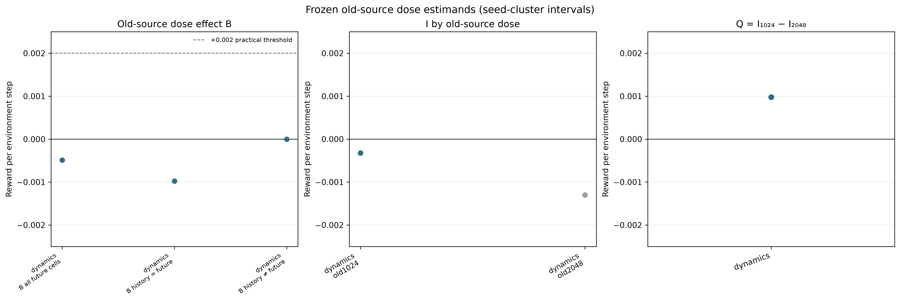

# Source-dose and learning-interaction follow-up

- Cohort phase: `pilot`
- Source directory: `D:\MovedFromC\ChatGPT\online\outputs\source_dose_pilot_v2`
- Cases: 1 observed / 1 expected
- Independent unit: seed; histories are averaged within seed before the 10,000-resample paired seed-cluster bootstrap.
- Intervals are descriptive 95% percentile intervals. Aliases retain logical reward and duration but have zero actual environment steps and are not independent samples.

## Frozen source-dose estimands

Reward rate is cumulative future reward divided by logical future environment steps. `D_c = R_replace,c − R_keep,c`; `B = mean_h,f(D_1024 − D_2048)`. The primary B averages only history=future cells; the stress B averages history≠future cells.

### Relation: `dynamics`

Complete paired seed clusters: 1 / 1.

| Estimand | Estimate [95% interval] | Predeclared reading |
|---|---|---|
| B, future-balanced | -0.00049 [no interval (fewer than 2 seed clusters)]; n=1, positive=0 | uncertain under the predeclared criterion |
| B, history=future | -0.00098 [no interval (fewer than 2 seed clusters)]; n=1, positive=0 | uncertain under the predeclared criterion |
| B, history≠future | +0.00000 [no interval (fewer than 2 seed clusters)]; n=1, positive=0 | descriptive stress condition |

| Contrast | Estimate [95% interval] | Definition / note |
|---|---|---|
| D old1024, future old_major | +0.00033 [no interval (fewer than 2 seed clusters)]; n=1, positive=1 | reversal=False |
| D old1024, future new_major | +0.00000 [no interval (fewer than 2 seed clusters)]; n=1, positive=0 | reversal=False |
| I old1024 | -0.00033 [no interval (fewer than 2 seed clusters)]; n=1, positive=0 | new-major future minus old-major future |
| D old2048, future old_major | +0.00130 [no interval (fewer than 2 seed clusters)]; n=1, positive=1 | reversal=False |
| D old2048, future new_major | +0.00000 [no interval (fewer than 2 seed clusters)]; n=1, positive=0 | reversal=False |
| I old2048 | -0.00130 [no interval (fewer than 2 seed clusters)]; n=1, positive=0 | new-major future minus old-major future |
| Q = I_1024 − I_2048 | +0.00098 [no interval (fewer than 2 seed clusters)]; n=1, positive=1 | two-sided; no fixed directional hypothesis |

Per-seed estimates are in `analysis.json`; branches and histories are not resampled independently.

## Past-only selector contrasts

Each contrast is selected-action reward rate minus the fixed comparator, averaged within seed. `primary` uses history=future; `stress` uses history≠future. A missing selector map is reported as unavailable, never as a zero effect.

### `dynamics`

| Relation | Dose | Selector | Continuation | Comparator | Estimate [95% interval] | Decision source |
|---|---|---|---|---|---|---|
| dynamics | old2048 | frequency | primary | vs keep | +0.00000 [no interval (fewer than 2 seed clusters)]; n=1, positive=0 | old2048 decision map |
| dynamics | old2048 | frequency | primary | vs replace | -0.00130 [no interval (fewer than 2 seed clusters)]; n=1, positive=0 | old2048 decision map |
| dynamics | old2048 | frequency | primary | vs mean | -0.00130 [no interval (fewer than 2 seed clusters)]; n=1, positive=0 | old2048 decision map |
| dynamics | old2048 | frequency | stress | vs keep | +0.00000 [no interval (fewer than 2 seed clusters)]; n=1, positive=0 | old2048 decision map |
| dynamics | old2048 | frequency | stress | vs replace | +0.00000 [no interval (fewer than 2 seed clusters)]; n=1, positive=0 | old2048 decision map |
| dynamics | old2048 | frequency | stress | vs mean | +0.00041 [no interval (fewer than 2 seed clusters)]; n=1, positive=1 | old2048 decision map |
| dynamics | old2048 | recency | primary | vs keep | +0.00130 [no interval (fewer than 2 seed clusters)]; n=1, positive=1 | old2048 decision map |
| dynamics | old2048 | recency | primary | vs replace | +0.00000 [no interval (fewer than 2 seed clusters)]; n=1, positive=0 | old2048 decision map |
| dynamics | old2048 | recency | primary | vs mean | -0.00000 [no interval (fewer than 2 seed clusters)]; n=1, positive=0 | old2048 decision map |
| dynamics | old2048 | recency | stress | vs keep | +0.00000 [no interval (fewer than 2 seed clusters)]; n=1, positive=0 | old2048 decision map |
| dynamics | old2048 | recency | stress | vs replace | +0.00000 [no interval (fewer than 2 seed clusters)]; n=1, positive=0 | old2048 decision map |
| dynamics | old2048 | recency | stress | vs mean | +0.00041 [no interval (fewer than 2 seed clusters)]; n=1, positive=1 | old2048 decision map |
| dynamics | old2048 | surrogate_gain | primary | vs keep | +0.00000 [no interval (fewer than 2 seed clusters)]; n=1, positive=0 | old2048 decision map |
| dynamics | old2048 | surrogate_gain | primary | vs replace | -0.00130 [no interval (fewer than 2 seed clusters)]; n=1, positive=0 | old2048 decision map |
| dynamics | old2048 | surrogate_gain | primary | vs mean | -0.00130 [no interval (fewer than 2 seed clusters)]; n=1, positive=0 | old2048 decision map |
| dynamics | old2048 | surrogate_gain | stress | vs keep | +0.00000 [no interval (fewer than 2 seed clusters)]; n=1, positive=0 | old2048 decision map |
| dynamics | old2048 | surrogate_gain | stress | vs replace | +0.00000 [no interval (fewer than 2 seed clusters)]; n=1, positive=0 | old2048 decision map |
| dynamics | old2048 | surrogate_gain | stress | vs mean | +0.00041 [no interval (fewer than 2 seed clusters)]; n=1, positive=1 | old2048 decision map |
| dynamics | old2048 | surrogate_lower | primary | vs keep | +0.00000 [no interval (fewer than 2 seed clusters)]; n=1, positive=0 | old2048 decision map |
| dynamics | old2048 | surrogate_lower | primary | vs replace | -0.00130 [no interval (fewer than 2 seed clusters)]; n=1, positive=0 | old2048 decision map |
| dynamics | old2048 | surrogate_lower | primary | vs mean | -0.00130 [no interval (fewer than 2 seed clusters)]; n=1, positive=0 | old2048 decision map |
| dynamics | old2048 | surrogate_lower | stress | vs keep | +0.00000 [no interval (fewer than 2 seed clusters)]; n=1, positive=0 | old2048 decision map |
| dynamics | old2048 | surrogate_lower | stress | vs replace | +0.00000 [no interval (fewer than 2 seed clusters)]; n=1, positive=0 | old2048 decision map |
| dynamics | old2048 | surrogate_lower | stress | vs mean | +0.00041 [no interval (fewer than 2 seed clusters)]; n=1, positive=1 | old2048 decision map |
| dynamics | old1024 | frequency | primary | vs keep | +0.00000 [no interval (fewer than 2 seed clusters)]; n=1, positive=0 | dose decision map |
| dynamics | old1024 | frequency | primary | vs replace | -0.00033 [no interval (fewer than 2 seed clusters)]; n=1, positive=0 | dose decision map |
| dynamics | old1024 | frequency | primary | vs mean | -0.00016 [no interval (fewer than 2 seed clusters)]; n=1, positive=0 | dose decision map |
| dynamics | old1024 | frequency | stress | vs keep | +0.00000 [no interval (fewer than 2 seed clusters)]; n=1, positive=0 | dose decision map |
| dynamics | old1024 | frequency | stress | vs replace | +0.00000 [no interval (fewer than 2 seed clusters)]; n=1, positive=0 | dose decision map |
| dynamics | old1024 | frequency | stress | vs mean | -0.00008 [no interval (fewer than 2 seed clusters)]; n=1, positive=0 | dose decision map |
| dynamics | old1024 | recency | primary | vs keep | +0.00033 [no interval (fewer than 2 seed clusters)]; n=1, positive=1 | dose decision map |
| dynamics | old1024 | recency | primary | vs replace | +0.00000 [no interval (fewer than 2 seed clusters)]; n=1, positive=0 | dose decision map |
| dynamics | old1024 | recency | primary | vs mean | +0.00016 [no interval (fewer than 2 seed clusters)]; n=1, positive=1 | dose decision map |
| dynamics | old1024 | recency | stress | vs keep | +0.00000 [no interval (fewer than 2 seed clusters)]; n=1, positive=0 | dose decision map |
| dynamics | old1024 | recency | stress | vs replace | +0.00000 [no interval (fewer than 2 seed clusters)]; n=1, positive=0 | dose decision map |
| dynamics | old1024 | recency | stress | vs mean | -0.00008 [no interval (fewer than 2 seed clusters)]; n=1, positive=0 | dose decision map |
| dynamics | old1024 | surrogate_gain | primary | vs keep | +0.00000 [no interval (fewer than 2 seed clusters)]; n=1, positive=0 | dose decision map |
| dynamics | old1024 | surrogate_gain | primary | vs replace | -0.00033 [no interval (fewer than 2 seed clusters)]; n=1, positive=0 | dose decision map |
| dynamics | old1024 | surrogate_gain | primary | vs mean | -0.00016 [no interval (fewer than 2 seed clusters)]; n=1, positive=0 | dose decision map |
| dynamics | old1024 | surrogate_gain | stress | vs keep | +0.00000 [no interval (fewer than 2 seed clusters)]; n=1, positive=0 | dose decision map |
| dynamics | old1024 | surrogate_gain | stress | vs replace | +0.00000 [no interval (fewer than 2 seed clusters)]; n=1, positive=0 | dose decision map |
| dynamics | old1024 | surrogate_gain | stress | vs mean | -0.00008 [no interval (fewer than 2 seed clusters)]; n=1, positive=0 | dose decision map |
| dynamics | old1024 | surrogate_lower | primary | vs keep | +0.00000 [no interval (fewer than 2 seed clusters)]; n=1, positive=0 | dose decision map |
| dynamics | old1024 | surrogate_lower | primary | vs replace | -0.00033 [no interval (fewer than 2 seed clusters)]; n=1, positive=0 | dose decision map |
| dynamics | old1024 | surrogate_lower | primary | vs mean | -0.00016 [no interval (fewer than 2 seed clusters)]; n=1, positive=0 | dose decision map |
| dynamics | old1024 | surrogate_lower | stress | vs keep | +0.00000 [no interval (fewer than 2 seed clusters)]; n=1, positive=0 | dose decision map |
| dynamics | old1024 | surrogate_lower | stress | vs replace | +0.00000 [no interval (fewer than 2 seed clusters)]; n=1, positive=0 | dose decision map |
| dynamics | old1024 | surrogate_lower | stress | vs mean | -0.00008 [no interval (fewer than 2 seed clusters)]; n=1, positive=0 | dose decision map |

## Costs, storage, and integrity

| Measure | Observed value |
|---|---|
| Actual environment steps | 39936 |
| Logical environment steps | 52224 |
| Prefix environment steps | 3072 |
| Future branch environment steps (actual) | 36864 |
| CPU seconds (runner aggregate) | 25.015625 |
| Wall seconds (runner aggregate) | 27.70787410000048 |
| Logical / physical future branches | 16 / 12 |
| Verified alias branches | 4 |
| Failed or incomplete cases | 0 |

Capture records: 2; requested bout-step values `[256]`; actor candidate coefficient counts `[9]`; candidate storage `36` bytes per case when 9 float32 coefficients are present. Timing and actual fitted/PPO counts are detailed in `analysis.json`.

Storage: actor payload budget `89` bytes and observed payload range `[89, 89]`; full package budget `262144` bytes and observed full-persistent range `[232387, 232387]`. Observed over-budget packages `0`. Missing capacity remains unknown.

## Scope and software

- This is a fitted-content dose intervention at a common full prefix, not an end-to-end process in which old sources were trained for only 1024 steps.
- The dose contrast does not assert equal old/new candidate quality.
- Bootstrap intervals are descriptive and do not establish adequate statistical power.
- Selector outcomes are evaluated on future branches; future outcomes do not enter selector decisions.
- Semantic alias hash verification is delegated to the separate source-follow-up audit; this report consumes runner alias records and does not repeat the full checkpoint audit.
- Figures use Matplotlib (Hunter, 2007). The analysis workflow cites Scientific Agent Skills for procedural context only (Kassis et al., 2026); it is not a task-performance reference.

