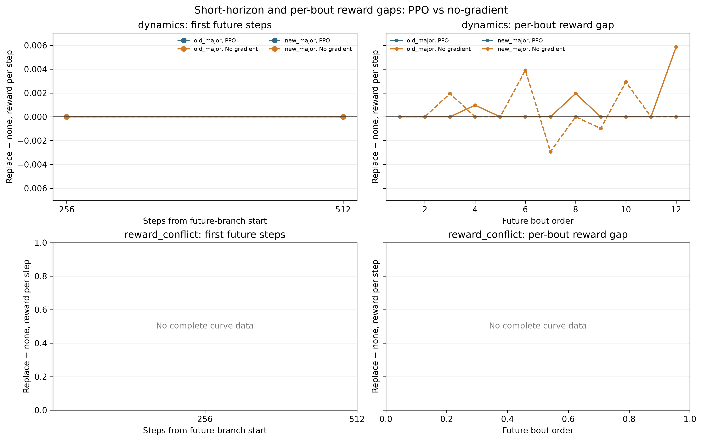
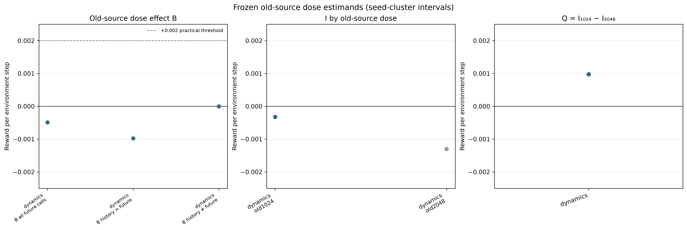
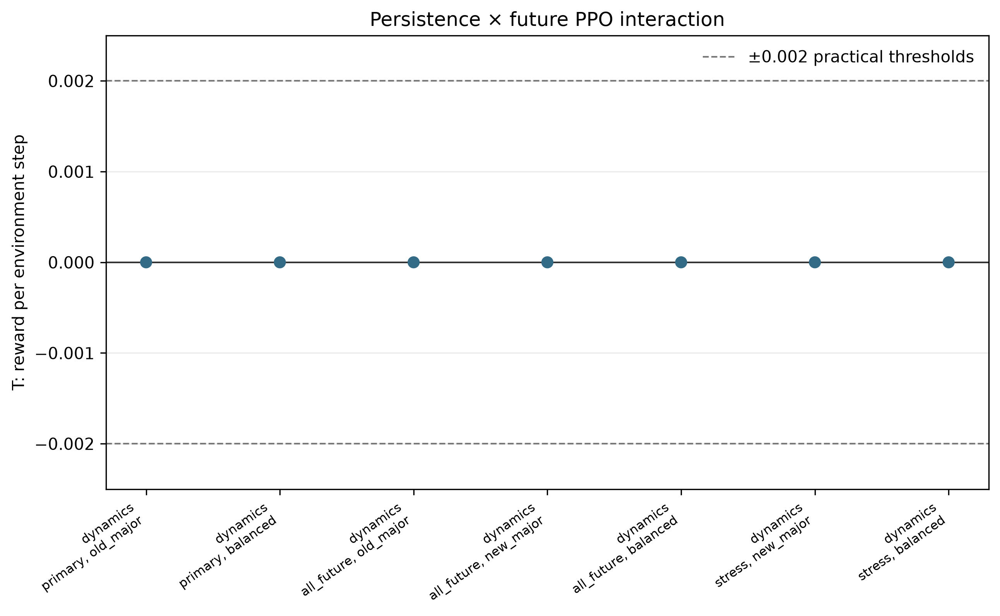

# Source-dose and learning-interaction follow-up

- Cohort phase: `pilot`
- Source directory: `D:\MovedFromC\ChatGPT\online\outputs\source_dose_pilot_v2`
- Cases: 1 observed / 1 expected
- Independent unit: seed; histories are averaged within seed before the 10,000-resample paired seed-cluster bootstrap.
- Intervals are descriptive 95% percentile intervals. Aliases retain logical reward and duration but have zero actual environment steps and are not independent samples.

## Frozen source-dose estimands

Reward rate is cumulative future reward divided by logical future environment steps. `D_c = R_replace,c − R_keep,c`; `B = mean_h,f(D_1024 − D_2048)`. The primary B averages only history=future cells; the stress B averages history≠future cells. Because `replace` is hash-verified and reused across source-dose branches, B algebraically reduces to `mean_h,f(R_keep,2048 − R_keep,1024)`: this is an old-candidate-content effect under `keep`, not independent evidence that replace or automatic organization improves reward.

### Relation: `dynamics`

Complete paired seed clusters: 1 / 1.

| Estimand | Estimate [95% interval] | Predeclared reading |
|---|---|---|
| B, future-balanced | -0.00049 [no interval (fewer than 2 seed clusters)]; n=1, positive=0 | uncertain under the predeclared criterion |
| B, history=future | -0.00098 [no interval (fewer than 2 seed clusters)]; n=1, positive=0 | uncertain under the predeclared criterion |
| B, history≠future | +0.00000 [no interval (fewer than 2 seed clusters)]; n=1, positive=0 | descriptive stress condition |

| Contrast | Estimate [95% interval] | Definition / note |
|---|---|---|
| D old1024, future old_major | +0.00033 [no interval (fewer than 2 seed clusters)]; n=1, positive=1 | reversal=False |
| D old1024, future new_major | +0.00000 [no interval (fewer than 2 seed clusters)]; n=1, positive=0 | reversal=False |
| I old1024 | -0.00033 [no interval (fewer than 2 seed clusters)]; n=1, positive=0 | new-major future minus old-major future |
| D old2048, future old_major | +0.00130 [no interval (fewer than 2 seed clusters)]; n=1, positive=1 | reversal=False |
| D old2048, future new_major | +0.00000 [no interval (fewer than 2 seed clusters)]; n=1, positive=0 | reversal=False |
| I old2048 | -0.00130 [no interval (fewer than 2 seed clusters)]; n=1, positive=0 | new-major future minus old-major future |
| Q = I_1024 − I_2048 | +0.00098 [no interval (fewer than 2 seed clusters)]; n=1, positive=1 | two-sided; no fixed directional hypothesis |

All action mean reward rates

| Dose | Action | Future | Reward rate [95% interval] |
|---|---|---|---|
| old1024 | keep | old_major | -0.01942 [no interval (fewer than 2 seed clusters)]; n=1, positive=0 |
| old1024 | keep | new_major | -0.01665 [no interval (fewer than 2 seed clusters)]; n=1, positive=0 |
| old1024 | replace | old_major | -0.01910 [no interval (fewer than 2 seed clusters)]; n=1, positive=0 |
| old1024 | replace | new_major | -0.01665 [no interval (fewer than 2 seed clusters)]; n=1, positive=0 |
| old1024 | mean | old_major | -0.01926 [no interval (fewer than 2 seed clusters)]; n=1, positive=0 |
| old1024 | mean | new_major | -0.01657 [no interval (fewer than 2 seed clusters)]; n=1, positive=0 |
| old1024 | none | old_major | -0.01983 [no interval (fewer than 2 seed clusters)]; n=1, positive=0 |
| old1024 | none | new_major | -0.01706 [no interval (fewer than 2 seed clusters)]; n=1, positive=0 |
| old2048 | keep | old_major | -0.02040 [no interval (fewer than 2 seed clusters)]; n=1, positive=0 |
| old2048 | keep | new_major | -0.01665 [no interval (fewer than 2 seed clusters)]; n=1, positive=0 |
| old2048 | replace | old_major | -0.01910 [no interval (fewer than 2 seed clusters)]; n=1, positive=0 |
| old2048 | replace | new_major | -0.01665 [no interval (fewer than 2 seed clusters)]; n=1, positive=0 |
| old2048 | mean | old_major | -0.01910 [no interval (fewer than 2 seed clusters)]; n=1, positive=0 |
| old2048 | mean | new_major | -0.01706 [no interval (fewer than 2 seed clusters)]; n=1, positive=0 |
| old2048 | none | old_major | -0.01983 [no interval (fewer than 2 seed clusters)]; n=1, positive=0 |
| old2048 | none | new_major | -0.01706 [no interval (fewer than 2 seed clusters)]; n=1, positive=0 |

Per-seed estimates are in `analysis.json`; branches and histories are not resampled independently.

## Past-only selector contrasts

Each contrast is selected-action reward rate minus the fixed comparator, averaged within seed. `primary` uses history=future; `stress` uses history≠future. A missing selector map is reported as unavailable, never as a zero effect.

### `dynamics`

| Relation | Dose | Selector | Continuation | Comparator | Estimate [95% interval] | Decision source |
|---|---|---|---|---|---|---|
| dynamics | old2048 | frequency | primary | vs keep | +0.00000 [no interval (fewer than 2 seed clusters)]; n=1, positive=0 | old2048 decision map |
| dynamics | old2048 | frequency | primary | vs replace | -0.00130 [no interval (fewer than 2 seed clusters)]; n=1, positive=0 | old2048 decision map |
| dynamics | old2048 | frequency | primary | vs mean | -0.00130 [no interval (fewer than 2 seed clusters)]; n=1, positive=0 | old2048 decision map |
| dynamics | old2048 | frequency | stress | vs keep | +0.00000 [no interval (fewer than 2 seed clusters)]; n=1, positive=0 | old2048 decision map |
| dynamics | old2048 | frequency | stress | vs replace | +0.00000 [no interval (fewer than 2 seed clusters)]; n=1, positive=0 | old2048 decision map |
| dynamics | old2048 | frequency | stress | vs mean | +0.00041 [no interval (fewer than 2 seed clusters)]; n=1, positive=1 | old2048 decision map |
| dynamics | old2048 | recency | primary | vs keep | +0.00130 [no interval (fewer than 2 seed clusters)]; n=1, positive=1 | old2048 decision map |
| dynamics | old2048 | recency | primary | vs replace | +0.00000 [no interval (fewer than 2 seed clusters)]; n=1, positive=0 | old2048 decision map |
| dynamics | old2048 | recency | primary | vs mean | -0.00000 [no interval (fewer than 2 seed clusters)]; n=1, positive=0 | old2048 decision map |
| dynamics | old2048 | recency | stress | vs keep | +0.00000 [no interval (fewer than 2 seed clusters)]; n=1, positive=0 | old2048 decision map |
| dynamics | old2048 | recency | stress | vs replace | +0.00000 [no interval (fewer than 2 seed clusters)]; n=1, positive=0 | old2048 decision map |
| dynamics | old2048 | recency | stress | vs mean | +0.00041 [no interval (fewer than 2 seed clusters)]; n=1, positive=1 | old2048 decision map |
| dynamics | old2048 | surrogate_gain | primary | vs keep | +0.00000 [no interval (fewer than 2 seed clusters)]; n=1, positive=0 | old2048 decision map |
| dynamics | old2048 | surrogate_gain | primary | vs replace | -0.00130 [no interval (fewer than 2 seed clusters)]; n=1, positive=0 | old2048 decision map |
| dynamics | old2048 | surrogate_gain | primary | vs mean | -0.00130 [no interval (fewer than 2 seed clusters)]; n=1, positive=0 | old2048 decision map |
| dynamics | old2048 | surrogate_gain | stress | vs keep | +0.00000 [no interval (fewer than 2 seed clusters)]; n=1, positive=0 | old2048 decision map |
| dynamics | old2048 | surrogate_gain | stress | vs replace | +0.00000 [no interval (fewer than 2 seed clusters)]; n=1, positive=0 | old2048 decision map |
| dynamics | old2048 | surrogate_gain | stress | vs mean | +0.00041 [no interval (fewer than 2 seed clusters)]; n=1, positive=1 | old2048 decision map |
| dynamics | old2048 | surrogate_lower | primary | vs keep | +0.00000 [no interval (fewer than 2 seed clusters)]; n=1, positive=0 | old2048 decision map |
| dynamics | old2048 | surrogate_lower | primary | vs replace | -0.00130 [no interval (fewer than 2 seed clusters)]; n=1, positive=0 | old2048 decision map |
| dynamics | old2048 | surrogate_lower | primary | vs mean | -0.00130 [no interval (fewer than 2 seed clusters)]; n=1, positive=0 | old2048 decision map |
| dynamics | old2048 | surrogate_lower | stress | vs keep | +0.00000 [no interval (fewer than 2 seed clusters)]; n=1, positive=0 | old2048 decision map |
| dynamics | old2048 | surrogate_lower | stress | vs replace | +0.00000 [no interval (fewer than 2 seed clusters)]; n=1, positive=0 | old2048 decision map |
| dynamics | old2048 | surrogate_lower | stress | vs mean | +0.00041 [no interval (fewer than 2 seed clusters)]; n=1, positive=1 | old2048 decision map |
| dynamics | old1024 | frequency | primary | vs keep | +0.00000 [no interval (fewer than 2 seed clusters)]; n=1, positive=0 | dose decision map |
| dynamics | old1024 | frequency | primary | vs replace | -0.00033 [no interval (fewer than 2 seed clusters)]; n=1, positive=0 | dose decision map |
| dynamics | old1024 | frequency | primary | vs mean | -0.00016 [no interval (fewer than 2 seed clusters)]; n=1, positive=0 | dose decision map |
| dynamics | old1024 | frequency | stress | vs keep | +0.00000 [no interval (fewer than 2 seed clusters)]; n=1, positive=0 | dose decision map |
| dynamics | old1024 | frequency | stress | vs replace | +0.00000 [no interval (fewer than 2 seed clusters)]; n=1, positive=0 | dose decision map |
| dynamics | old1024 | frequency | stress | vs mean | -0.00008 [no interval (fewer than 2 seed clusters)]; n=1, positive=0 | dose decision map |
| dynamics | old1024 | recency | primary | vs keep | +0.00033 [no interval (fewer than 2 seed clusters)]; n=1, positive=1 | dose decision map |
| dynamics | old1024 | recency | primary | vs replace | +0.00000 [no interval (fewer than 2 seed clusters)]; n=1, positive=0 | dose decision map |
| dynamics | old1024 | recency | primary | vs mean | +0.00016 [no interval (fewer than 2 seed clusters)]; n=1, positive=1 | dose decision map |
| dynamics | old1024 | recency | stress | vs keep | +0.00000 [no interval (fewer than 2 seed clusters)]; n=1, positive=0 | dose decision map |
| dynamics | old1024 | recency | stress | vs replace | +0.00000 [no interval (fewer than 2 seed clusters)]; n=1, positive=0 | dose decision map |
| dynamics | old1024 | recency | stress | vs mean | -0.00008 [no interval (fewer than 2 seed clusters)]; n=1, positive=0 | dose decision map |
| dynamics | old1024 | surrogate_gain | primary | vs keep | +0.00000 [no interval (fewer than 2 seed clusters)]; n=1, positive=0 | dose decision map |
| dynamics | old1024 | surrogate_gain | primary | vs replace | -0.00033 [no interval (fewer than 2 seed clusters)]; n=1, positive=0 | dose decision map |
| dynamics | old1024 | surrogate_gain | primary | vs mean | -0.00016 [no interval (fewer than 2 seed clusters)]; n=1, positive=0 | dose decision map |
| dynamics | old1024 | surrogate_gain | stress | vs keep | +0.00000 [no interval (fewer than 2 seed clusters)]; n=1, positive=0 | dose decision map |
| dynamics | old1024 | surrogate_gain | stress | vs replace | +0.00000 [no interval (fewer than 2 seed clusters)]; n=1, positive=0 | dose decision map |
| dynamics | old1024 | surrogate_gain | stress | vs mean | -0.00008 [no interval (fewer than 2 seed clusters)]; n=1, positive=0 | dose decision map |
| dynamics | old1024 | surrogate_lower | primary | vs keep | +0.00000 [no interval (fewer than 2 seed clusters)]; n=1, positive=0 | dose decision map |
| dynamics | old1024 | surrogate_lower | primary | vs replace | -0.00033 [no interval (fewer than 2 seed clusters)]; n=1, positive=0 | dose decision map |
| dynamics | old1024 | surrogate_lower | primary | vs mean | -0.00016 [no interval (fewer than 2 seed clusters)]; n=1, positive=0 | dose decision map |
| dynamics | old1024 | surrogate_lower | stress | vs keep | +0.00000 [no interval (fewer than 2 seed clusters)]; n=1, positive=0 | dose decision map |
| dynamics | old1024 | surrogate_lower | stress | vs replace | +0.00000 [no interval (fewer than 2 seed clusters)]; n=1, positive=0 | dose decision map |
| dynamics | old1024 | surrogate_lower | stress | vs mean | -0.00008 [no interval (fewer than 2 seed clusters)]; n=1, positive=0 | dose decision map |

## Persistence × future learning

`T = (R_replace − R_none)_PPO − (R_replace − R_none)_frozen`. Each cell is first averaged over histories within seed and then bootstrapped over paired seed clusters. `T < 0` means future learning narrowed the initial replace/none gap; it does not by itself reject persistence, learning, or sample-efficiency value.

### Ablation relation: `dynamics`

| Condition | Future | T estimate [95% interval] | S_train | S_frozen | ±0.002 reading |
|---|---|---|---|---|---|
| primary | old_major | +0.00000 [no interval (fewer than 2 seed clusters)]; n=1, positive=0 | +0.00073 [no interval (fewer than 2 seed clusters)]; n=1, positive=1 | +0.00073 [no interval (fewer than 2 seed clusters)]; n=1, positive=1 | not enough seed clusters to assess ±0.002 |
| primary | new_major | not estimable | not estimable | not estimable | not enough seed clusters to assess ±0.002 |
| primary | balanced | +0.00000 [no interval (fewer than 2 seed clusters)]; n=1, positive=0 | +0.00073 [no interval (fewer than 2 seed clusters)]; n=1, positive=1 | +0.00073 [no interval (fewer than 2 seed clusters)]; n=1, positive=1 | not enough seed clusters to assess ±0.002 |
| all_future | old_major | +0.00000 [no interval (fewer than 2 seed clusters)]; n=1, positive=0 | +0.00073 [no interval (fewer than 2 seed clusters)]; n=1, positive=1 | +0.00073 [no interval (fewer than 2 seed clusters)]; n=1, positive=1 | not enough seed clusters to assess ±0.002 |
| all_future | new_major | +0.00000 [no interval (fewer than 2 seed clusters)]; n=1, positive=0 | +0.00041 [no interval (fewer than 2 seed clusters)]; n=1, positive=1 | +0.00041 [no interval (fewer than 2 seed clusters)]; n=1, positive=1 | not enough seed clusters to assess ±0.002 |
| all_future | balanced | +0.00000 [no interval (fewer than 2 seed clusters)]; n=1, positive=0 | +0.00057 [no interval (fewer than 2 seed clusters)]; n=1, positive=1 | +0.00057 [no interval (fewer than 2 seed clusters)]; n=1, positive=1 | not enough seed clusters to assess ±0.002 |
| stress | old_major | not estimable | not estimable | not estimable | not enough seed clusters to assess ±0.002 |
| stress | new_major | +0.00000 [no interval (fewer than 2 seed clusters)]; n=1, positive=0 | +0.00041 [no interval (fewer than 2 seed clusters)]; n=1, positive=1 | +0.00041 [no interval (fewer than 2 seed clusters)]; n=1, positive=1 | not enough seed clusters to assess ±0.002 |
| stress | balanced | +0.00000 [no interval (fewer than 2 seed clusters)]; n=1, positive=0 | +0.00041 [no interval (fewer than 2 seed clusters)]; n=1, positive=1 | +0.00041 [no interval (fewer than 2 seed clusters)]; n=1, positive=1 | not enough seed clusters to assess ±0.002 |

### Ablation relation: `reward_conflict`

| Condition | Future | T estimate [95% interval] | S_train | S_frozen | ±0.002 reading |
|---|---|---|---|---|---|
| primary | old_major | not estimable | not estimable | not estimable | not enough seed clusters to assess ±0.002 |
| primary | new_major | not estimable | not estimable | not estimable | not enough seed clusters to assess ±0.002 |
| primary | balanced | not estimable | not estimable | not estimable | not enough seed clusters to assess ±0.002 |
| all_future | old_major | not estimable | not estimable | not estimable | not enough seed clusters to assess ±0.002 |
| all_future | new_major | not estimable | not estimable | not estimable | not enough seed clusters to assess ±0.002 |
| all_future | balanced | not estimable | not estimable | not estimable | not enough seed clusters to assess ±0.002 |
| stress | old_major | not estimable | not estimable | not estimable | not enough seed clusters to assess ±0.002 |
| stress | new_major | not estimable | not estimable | not estimable | not enough seed clusters to assess ±0.002 |
| stress | balanced | not estimable | not estimable | not estimable | not enough seed clusters to assess ±0.002 |

## Reward-trajectory diagnostics

Short-horizon and per-bout contrasts are computed from the source PPO and no-gradient branch `steps.csv` files. Only rows marked `future` are read; the common prefix logs are excluded. These curves explain initialization and relearning and do not replace the full-future estimand.

| Relation | Future | First N steps | S_train | S_frozen | T |
|---|---|---|---|---|---|
| dynamics | old_major | 256 | +0.00000 [no interval (fewer than 2 seed clusters)]; n=1, positive=0 | +0.00000 [no interval (fewer than 2 seed clusters)]; n=1, positive=0 | +0.00000 [no interval (fewer than 2 seed clusters)]; n=1, positive=0 |
| dynamics | old_major | 512 | +0.00000 [no interval (fewer than 2 seed clusters)]; n=1, positive=0 | +0.00000 [no interval (fewer than 2 seed clusters)]; n=1, positive=0 | +0.00000 [no interval (fewer than 2 seed clusters)]; n=1, positive=0 |
| dynamics | new_major | 256 | +0.00000 [no interval (fewer than 2 seed clusters)]; n=1, positive=0 | +0.00000 [no interval (fewer than 2 seed clusters)]; n=1, positive=0 | +0.00000 [no interval (fewer than 2 seed clusters)]; n=1, positive=0 |
| dynamics | new_major | 512 | +0.00000 [no interval (fewer than 2 seed clusters)]; n=1, positive=0 | +0.00000 [no interval (fewer than 2 seed clusters)]; n=1, positive=0 | +0.00000 [no interval (fewer than 2 seed clusters)]; n=1, positive=0 |
| reward_conflict | old_major | 256 | not estimable | not estimable | not estimable |
| reward_conflict | old_major | 512 | not estimable | not estimable | not estimable |
| reward_conflict | new_major | 256 | not estimable | not estimable | not estimable |
| reward_conflict | new_major | 512 | not estimable | not estimable | not estimable |

Future-only step logs read: 8; prefix included: `False`; step-curve issues: 0.

Per-bout seed-cluster estimates are in `analysis.json`; the figure plots `S_train` and `S_frozen` separately for each future regime.

## Costs, storage, and integrity

| Measure | Observed value |
|---|---|
| Actual environment steps | 39936 |
| Logical environment steps | 52224 |
| Prefix environment steps | 3072 |
| Future branch environment steps (actual) | 36864 |
| CPU seconds (runner aggregate) | 25.015625 |
| Wall seconds (runner aggregate) | 27.70787410000048 |
| Logical / physical future branches | 16 / 12 |
| Verified alias branches | 4 |
| Failed or incomplete cases | 0 |

Capture records: 2; timing `after PPO update, int8 actor roundtrip, and actor optimizer-state clear`; requested bout-step values `[256]`; actual bout steps `256.0–256.0`; global environment steps `256.0–768.0`. Fitted steps range `256.0–256.0`, trained rollouts `1.0–3.0`, and minibatch updates `16.0–48.0`. Candidate coefficient counts `[9]`; candidate storage `36` bytes per case when 9 float32 coefficients are present.

Storage: actor payload budget `89` bytes and observed payload range `[89, 89]`; full package budget `262144` bytes and observed full-persistent range `[232387, 232387]`. Observed over-budget packages `0`. Missing capacity remains unknown.

Codec and probability drift distributions below count only physical post-action branches; aliases are not counted again. Prequantized probability drift reflects compensation before int8 encoding, while postquantized drift measures behavior after the codec roundtrip.

| Dose | Action | Physical branches | Action codec error | Final codec error | Pre-int8 max |Δp| | Post-int8 max |Δp| | Post-int8 max KL |
|---|---|---|---|---|---|---|---|
| old2048 | keep | 2 | n=2; median=0; p95=0; max=0 | n=2; median=0; p95=0; max=0 | n=2; median=0; p95=0; max=0 | n=2; median=0; p95=0; max=0 | n=2; median=0; p95=0; max=0 |
| old2048 | replace | 2 | n=2; median=0.00018; p95=0.00018; max=0.00018 | n=2; median=0; p95=0; max=0 | n=2; median=0; p95=0; max=0 | n=2; median=0.000289; p95=0.000289; max=0.000289 | n=2; median=1.74e-07; p95=1.74e-07; max=1.74e-07 |
| old2048 | mean | 2 | n=2; median=0.000149; p95=0.000149; max=0.000149 | n=2; median=0; p95=0; max=0 | n=2; median=0; p95=0; max=0 | n=2; median=0.000193; p95=0.000193; max=0.000193 | n=2; median=7.72e-08; p95=7.72e-08; max=7.72e-08 |
| old2048 | none | 2 | n=2; median=0; p95=0; max=0 | n=2; median=0; p95=0; max=0 | n=2; median=0; p95=0; max=0 | n=2; median=0; p95=0; max=0 | n=2; median=0; p95=0; max=0 |
| old1024 | keep | 2 | n=2; median=7.56e-05; p95=7.56e-05; max=7.56e-05 | n=2; median=0; p95=0; max=0 | n=2; median=0; p95=0; max=0 | n=2; median=0; p95=0; max=0 | n=2; median=0; p95=0; max=0 |
| old1024 | replace | 0 | unavailable | unavailable | unavailable | unavailable | unavailable |
| old1024 | mean | 2 | n=2; median=0.00017; p95=0.00017; max=0.00017 | n=2; median=0; p95=0; max=0 | n=2; median=0; p95=0; max=0 | n=2; median=0.000339; p95=0.000339; max=0.000339 | n=2; median=2.4e-07; p95=2.4e-07; max=2.4e-07 |
| old1024 | none | 0 | unavailable | unavailable | unavailable | unavailable | unavailable |

### Learning-ablation incremental and merged costs

| Measure | Observed value |
|---|---|
| New prefix environment steps | 0 |
| New future environment steps | 12288 |
| New logical future environment steps | 12288.0 |
| New total environment steps | 12288 |
| Source PPO reference branches | 4 |
| Source PPO reference environment steps | 12288.0 |
| Source PPO reference CPU / wall seconds | 7.484375 / 7.597677899997507 |
| Ablation incremental CPU / wall seconds | 8.75 / 11.437952499996754 |

Source prefix and PPO comparator costs are references to the source-dose ledger; they are not added a second time to incremental ablation costs.

## Scope and software

- This is a fitted-content dose intervention at a common full prefix, not an end-to-end process in which old sources were trained for only 1024 steps.
- The dose contrast does not assert equal old/new candidate quality.
- Bootstrap intervals are descriptive and do not establish adequate statistical power.
- Selector outcomes are evaluated on future branches; future outcomes do not enter selector decisions.
- Pilot results are integration diagnostics only; they are not inferential evidence and were not used to tune the experiment.
- Semantic alias hash verification is delegated to the separate source-follow-up audit; this report consumes runner alias records and does not repeat the full checkpoint audit.
- Figures use Matplotlib (Hunter, 2007). The analysis workflow cites Scientific Agent Skills for procedural context only (Kassis et al., 2026); it is not a task-performance reference.

