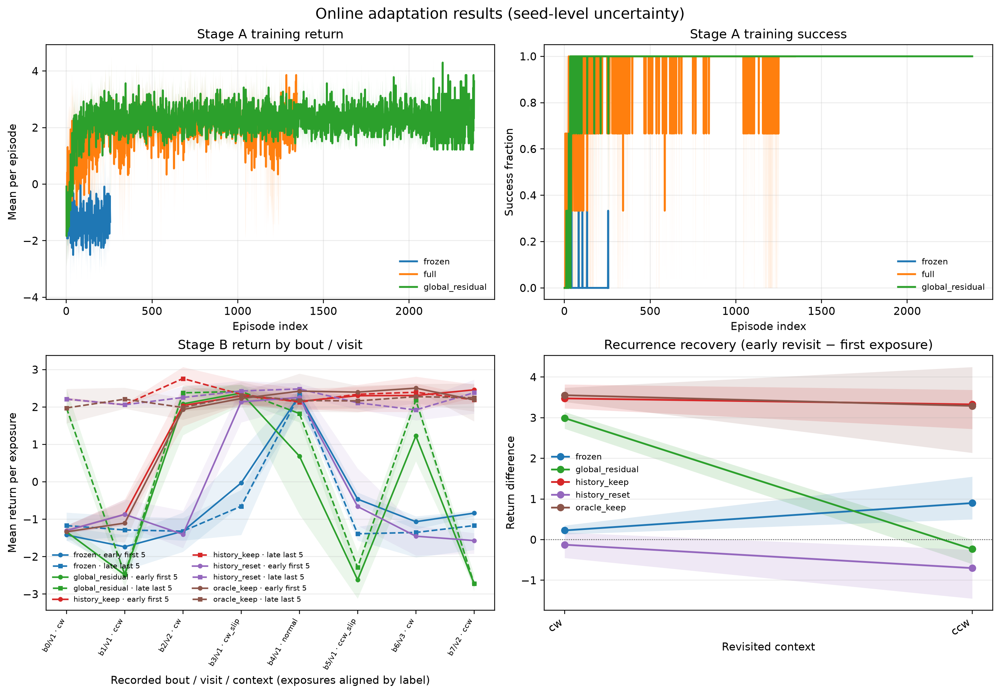

# Online adaptation report

Input directory: `D:\MovedFromC\ChatGPT\online\outputs\validated`. This report was generated from logged run data.



Vector figure: [learning_summary.pdf](learning_summary.pdf)

## Data coverage

- Run directories: 24
- Episode records: 53988 (0 marked evaluation)
- Training records used in curves and outcome summaries: 53988
- Methods: frozen, full, global_residual, history_keep, history_reset, oracle_keep
- Seed identifiers: 3
- Mixed-context episode records retained in overall counts: 94
- Distinct seed/method/stage groups: 24
- Curves first average within each seed and then across seeds. Confidence bands are 95% percentile bootstrap intervals resampled over seeds; episode rows are not treated as independent samples.
- Stage A and Stage B are independent seed/method groups. Stage B per-context exposure metrics exclude rows marked `mixed_context=true`; overall run totals still use the runner's cumulative summary values.
- Stage B records are grouped by each seed/method's recorded bout, visit, and context. Within each exposure, early means use the first up to 5 episodes and late means use the last up to 5. For exposures shorter than 10 episodes, these windows can overlap.

## Initial source pretraining evaluation

### `validated`

```json
{
  "bc_updates": 1500,
  "dataset_transitions": 20000,
  "elapsed_s": 6.983282100001816,
  "source": {
    "episodes": 64,
    "mean_return": 2.2512499999999998,
    "steps": 364,
    "success_rate": 1.0
  },
  "train_transitions": 17955,
  "unseen_ccw_before_online": {
    "episodes": 64,
    "mean_return": -2.111406249999999,
    "steps": 4096,
    "success_rate": 0.0
  },
  "unseen_cw_before_online": {
    "episodes": 64,
    "mean_return": -2.0645312499999995,
    "steps": 4096,
    "success_rate": 0.0
  },
  "validation_cross_entropy": 0.346333384513855,
  "validation_split": "whole trajectory: episode ID mod 10",
  "validation_transitions": 2045,
  "weights_sha256": "e6a22024a83aa5f1f8699d44702007f31e0d3132fd1cc6ed3a0f0fdc538c7222"
}
```

## Stage A deployment training

| Method | Seeds | Training return (mean ± seed SD) | Success fraction (mean ± seed SD) |
|---|---:|---:|---:|
| frozen | 3 | -1.336 ± 0.011 | 0.007 ± 0.002 |
| full | 3 | 1.986 ± 0.017 | 0.923 ± 0.007 |
| global_residual | 3 | 2.241 ± 0.019 | 0.984 ± 0.005 |
| history_keep | 0 | n/a | n/a |
| history_reset | 0 | n/a | n/a |
| oracle_keep | 0 | n/a | n/a |

### Baseline learning gate

| Run | Gate result | Evidence |
|---|---|---|
| `suite summary/config` | 達成 | stage_A_gate: {"interpretation": "pilot gate, not a statistical significance claim", "online_improvement": 1.0, "online_success_improvement_minimum": 0.2, "passed": true, "source_success": 1.0, "source_success_minimum": 0.9} |

### Evaluation episodes

| Stage | Method | Seed | Evaluation | Episodes | Steps | Mean return | Success fraction |
|---|---|---:|---|---:|---:|---:|---:|
| A | frozen | 41 | shift_cw | 64 | 4,096 | -1.916 | 0.000 |
| A | frozen | 41 | source_after_shift | 64 | 446 | 2.533 | 1.000 |
| A | frozen | 53 | shift_cw | 64 | 4,096 | -2.154 | 0.000 |
| A | frozen | 53 | source_after_shift | 64 | 410 | 2.409 | 1.000 |
| A | frozen | 67 | shift_cw | 64 | 4,096 | -1.955 | 0.000 |
| A | frozen | 67 | source_after_shift | 64 | 419 | 2.440 | 1.000 |
| A | full | 41 | shift_cw | 64 | 649 | 2.208 | 0.953 |
| A | full | 41 | source_after_shift | 64 | 954 | 2.065 | 0.875 |
| A | full | 53 | shift_cw | 64 | 412 | 2.354 | 1.000 |
| A | full | 53 | source_after_shift | 64 | 1,672 | 1.240 | 0.703 |
| A | full | 67 | shift_cw | 64 | 1,957 | 0.911 | 0.578 |
| A | full | 67 | source_after_shift | 64 | 2,546 | 0.400 | 0.438 |
| A | global_residual | 41 | shift_cw | 64 | 408 | 2.402 | 1.000 |
| A | global_residual | 41 | source_after_shift | 64 | 4,096 | -0.682 | 0.000 |
| A | global_residual | 53 | shift_cw | 64 | 396 | 2.361 | 1.000 |
| A | global_residual | 53 | source_after_shift | 64 | 4,096 | -0.748 | 0.000 |
| A | global_residual | 67 | shift_cw | 64 | 376 | 2.292 | 1.000 |
| A | global_residual | 67 | source_after_shift | 64 | 4,096 | -0.822 | 0.000 |

## Stage B unknown-route and revisit metrics

Operational definition: for each seed and method, the first chronological appearance of a recorded context in Stage B is an initial/unknown-route exposure; later exposures to that context are revisits. This is a logged-context proxy, not a claim about internal route knowledge.

| Method | Exposure type | Seed count | Early return | Late return | Early success | Late success | Early route confidence |
|---|---|---:|---:|---:|---:|---:|---:|
| frozen | Initial context exposure (unknown-route proxy) | 3 | -0.269 ± 0.208 | -0.436 ± 0.228 | 0.347 ± 0.061 | 0.280 ± 0.069 | 0.167 ± 0.027 |
| frozen | Context revisit | 3 | -1.074 ± 0.175 | -1.281 ± 0.463 | 0.022 ± 0.038 | 0.000 ± 0.000 | 0.000 ± 0.000 |
| global_residual | Initial context exposure (unknown-route proxy) | 3 | -0.677 ± 0.363 | 0.291 ± 0.075 | 0.320 ± 0.106 | 0.587 ± 0.023 | 0.203 ± 0.006 |
| global_residual | Context revisit | 3 | 0.196 ± 0.040 | 0.613 ± 0.157 | 0.556 ± 0.077 | 0.667 ± 0.000 | 0.000 ± 0.001 |
| history_keep | Initial context exposure (unknown-route proxy) | 3 | 0.915 ± 0.166 | 2.215 ± 0.071 | 0.600 ± 0.000 | 1.000 ± 0.000 | 0.937 ± 0.026 |
| history_keep | Context revisit | 3 | 2.267 ± 0.257 | 2.449 ± 0.025 | 0.978 ± 0.038 | 1.000 ± 0.000 | 0.936 ± 0.066 |
| history_reset | Initial context exposure (unknown-route proxy) | 3 | 0.312 ± 0.378 | 2.258 ± 0.093 | 0.440 ± 0.069 | 1.000 ± 0.000 | 0.916 ± 0.037 |
| history_reset | Context revisit | 3 | -1.476 ± 0.360 | 2.186 ± 0.108 | 0.000 ± 0.000 | 1.000 ± 0.000 | 0.928 ± 0.094 |
| oracle_keep | Initial context exposure (unknown-route proxy) | 3 | 0.921 ± 0.223 | 2.167 ± 0.043 | 0.600 ± 0.000 | 0.987 ± 0.023 | 0.222 ± 0.013 |
| oracle_keep | Context revisit | 3 | 2.208 ± 0.207 | 2.169 ± 0.111 | 1.000 ± 0.000 | 1.000 ± 0.000 | 0.000 ± 0.000 |

### Paired history retention comparison

| Outcome (history_keep − history_reset) | Paired seeds | Estimate | 95% paired seed-bootstrap interval | Reading |
|---|---:|---:|---:|---|
| Initial exposure early return | 3 | 0.603 | [0.365, 0.793] | Exploratory (< 5 pairs) |
| Recurrence early-return recovery | 3 | 3.814 | [3.568, 3.948] | Exploratory (< 5 pairs) |

Paired intervals resample matched seed clusters; they do not resample episode rows. An interval crossing zero is not a significance test, and with fewer than 5 pairs these contrasts are exploratory.

## Runtime, interaction, and capacity

| Stage | Method | Seeds | Online steps (mean ± seed SD) | Online time s (mean ± seed SD) | Updates (mean ± seed SD) | Online cumulative return (mean ± seed SD) | Evaluation steps (mean ± seed SD) | Evaluation time s (mean ± seed SD) | Peak agent state bytes | Peak process RSS bytes |
|---|---|---:|---:|---:|---:|---:|---:|---:|---:|---:|
| A | frozen | 3 | 16384.000 ± 0.000 | 7.308 ± 0.201 | 0.000 ± 0.000 | -341.520 ± 2.704 | 4521.000 ± 18.735 | 1.121 ± 0.071 | 93,089 | 321,175,552 |
| A | full | 3 | 16384.000 ± 0.000 | 9.302 ± 0.393 | 261.667 ± 64.268 | 2568.480 ± 108.530 | 2730.000 ± 1554.184 | 0.664 ± 0.364 | 181,365 | 321,798,144 |
| A | global_residual | 3 | 16384.000 ± 0.000 | 10.523 ± 0.259 | 1008.000 ± 3.000 | 4966.647 ± 362.170 | 4489.333 ± 16.166 | 1.155 ± 0.073 | 141,602 | 321,601,536 |
| B | frozen | 3 | 32768.000 ± 0.000 | 14.711 ± 0.436 | 0.000 ± 0.000 | 1038.710 ± 36.631 | 0.000 ± 0.000 | 0.003 ± 0.000 | 93,089 | 321,867,776 |
| B | global_residual | 3 | 32768.000 ± 0.000 | 19.693 ± 0.411 | 1975.333 ± 9.609 | 4216.627 ± 739.525 | 0.000 ± 0.000 | 0.006 ± 0.000 | 141,602 | 322,166,784 |
| B | history_keep | 3 | 32768.000 ± 0.000 | 20.366 ± 0.335 | 1980.333 ± 24.007 | 9163.960 ± 725.111 | 0.000 ± 0.000 | 0.006 ± 0.001 | 144,537 | 322,322,432 |
| B | history_reset | 3 | 32768.000 ± 0.000 | 20.272 ± 0.812 | 1931.667 ± 11.676 | 4694.627 ± 911.645 | 0.000 ± 0.000 | 0.006 ± 0.001 | 144,537 | 322,392,064 |
| B | oracle_keep | 3 | 32768.000 ± 0.000 | 22.468 ± 3.310 | 1988.667 ± 24.214 | 9408.460 ± 472.035 | 0.000 ± 0.000 | 0.009 ± 0.005 | 144,473 | 322,326,528 |

Runtime, interaction, updates, and evaluation costs come from each run's `summary.json`; per-episode cumulative `elapsed_s` values are not summed into a runtime estimate. `peak_agent_state_bytes` is reported as recorded and is not added to `rollout_bytes`, because the agent-state total already includes the rollout buffer. Process RSS is reported separately. The maximum recorded payload/RSS is not proof of all memory usage.

## Protocol and limitations

- Three declared configurations were selected on validation seed 901. The initial pilot (11, 23, 37) exposed a duplicate-node routing bug and was retained. The corrected implementation was rerun on fresh seeds (41, 53, 67) with the selected hyperparameters unchanged. This is an implementation verification pilot, not a pristine confirmatory study.
- The recorded evaluation_elapsed_s includes evaluation and output serialization; it is not isolated evaluation compute time. Online elapsed time excludes this output phase.
- The environment is a small synthetic navigation task. A small number of seeds and rotation/slip context shifts do not establish generalization to other worlds or shift families.
- There is no Phase C result here, so these data do not establish a shared-capacity conclusion.
- `oracle_keep` is diagnostic only and is excluded from formal method claims.
- The evaluated scope is a root plus leaf persistent residual bank with history routing. These runs do not establish parent-level sharing, compression efficiency, or a safe policy-improvement gate. The runner's `gain_gate` field describes experimental online trials; it is not the Stage A baseline gate.
- When fewer than 5 paired seeds are available, the seed-bootstrap intervals and paired contrasts are exploratory. No statistical-significance claim is made.
- Raw `episodes.csv` and `capacity.csv` files are retained in their run directories for review; this report does not replace them.

## Software and procedural sources

- [Stable-Baselines3 PPO](https://stable-baselines3.readthedocs.io/en/master/modules/ppo.html) and [PPO](https://arxiv.org/abs/1707.06347); [Gymnasium](https://gymnasium.farama.org/). Installed versions are recorded in requirements-lock.txt.
- [Karpathy autoresearch](https://github.com/karpathy/autoresearch) inspired the experiment loop; the original language-model trainer was not executed.
- Kassis, T., Agarwal, V., He, Y., Patel, D., & Brueckner, A. M. (2026). [Scientific Agent Skills: A Library of Procedural Knowledge for Research Agents](https://arxiv.org/abs/2609.00065). The stable-baselines3 and matplotlib skills supported integration and reporting; this citation does not imply external validation of the results.

## Runner-supplied summaries

### Suite summary `validated/summary.json`

```json
{
  "config": {
    "a_steps": 16384,
    "agent_budget_bytes": 262144,
    "bc_updates": 1500,
    "bout_steps": 4096,
    "ent_coef": 0.06,
    "learning_rate": 0.01,
    "novelty_threshold": 0.3,
    "pretrain_transitions": 20000,
    "route_window": 16
  },
  "pretrain": {
    "bc_updates": 1500,
    "dataset_transitions": 20000,
    "elapsed_s": 6.983282100001816,
    "source": {
      "episodes": 64,
      "mean_return": 2.2512499999999998,
      "steps": 364,
      "success_rate": 1.0
    },
    "train_transitions": 17955,
    "unseen_ccw_before_online": {
      "episodes": 64,
      "mean_return": -2.111406249999999,
      "steps": 4096,
      "success_rate": 0.0
    },
    "unseen_cw_before_online": {
      "episodes": 64,
      "mean_return": -2.0645312499999995,
      "steps": 4096,
      "success_rate": 0.0
    },
    "validation_cross_entropy": 0.346333384513855,
    "validation_split": "whole trajectory: episode ID mod 10",
    "validation_transitions": 2045,
    "weights_sha256": "e6a22024a83aa5f1f8699d44702007f31e0d3132fd1cc6ed3a0f0fdc538c7222"
  },
  "runs": [
    {
      "budget_bytes": 262144,
      "created_nodes": 0,
      "evaluation": {
        "shift_cw": {
          "episodes": 64,
          "mean_return": -1.9160937499999995,
          "steps": 4096,
          "success_rate": 0.0
        },
        "source_after_shift": {
          "episodes": 64,
          "mean_return": 2.533125,
          "steps": 446,
          "success_rate": 1.0
        }
      },
      "evaluation_elapsed_s": 1.0900548000063282,
      "evaluation_steps": 4542,
      "limitations": [
        "synthetic globally rotated actuators and slip",
        "response dot/cross summary assumes planar action-response structure",
        "no shared parent promotion/compression evaluated in AB",
        "no calibrated policy-improvement safety gate",
        "payload+rollout hard bound; process RSS reported separately",
        "oracle_keep is diagnostic only"
      ],
      "method": "frozen",
      "node_count": 1,
      "online_cumulative_return": -338.5199999999046,
      "online_elapsed_s": 7.170840000006137,
      "online_reward_per_step": -0.020661621093744177,
      "online_steps": 16384,
      "peak_agent_state_bytes": 93089,
      "peak_process_rss_bytes": 317673472,
      "policy_resets": 0,
      "ppo_epochs": 0,
      "route_accuracy": 0.0,
      "route_coverage": 0.0,
      "seed": 41,
      "stage": "A",
      "updates": 0
    },
    {
      "budget_bytes": 262144,
      "created_nodes": 0,
      "evaluation": {
        "shift_cw": {
          "episodes": 64,
          "mean_return": 2.2075,
          "steps": 649,
          "success_rate": 0.953125
        },
        "source_after_shift": {
          "episodes": 64,
          "mean_return": 2.06453125,
          "steps": 954,
          "success_rate": 0.875
        }
      },
      "evaluation_elapsed_s": 0.3921431000053417,
      "evaluation_steps": 1603,
      "limitations": [
        "synthetic globally rotated actuators and slip",
        "response dot/cross summary assumes planar action-response structure",
        "no shared parent promotion/compression evaluated in AB",
        "no calibrated policy-improvement safety gate",
        "payload+rollout hard bound; process RSS reported separately",
        "oracle_keep is diagnostic only"
      ],
      "method": "full",
      "node_count": 1,
      "online_cumulative_return": 2692.22999999977,
      "online_elapsed_s": 9.051671900000656,
      "online_reward_per_step": 0.16432067871092346,
      "online_steps": 16384,
      "peak_agent_state_bytes": 181301,
      "peak_process_rss_bytes": 321167360,
      "policy_resets": 0,
      "ppo_epochs": 99,
      "route_accuracy": 0.0,
      "route_coverage": 0.0,
      "seed": 41,
      "stage": "A",
      "updates": 247
    },
    {
      "budget_bytes": 262144,
      "created_nodes": 0,
      "evaluation": {
        "shift_cw": {
          "episodes": 64,
          "mean_return": 2.4025,
          "steps": 408,
          "success_rate": 1.0
        },
        "source_after_shift": {
          "episodes": 64,
          "mean_return": -0.6817187500000012,
          "steps": 4096,
          "success_rate": 0.0
        }
      },
      "evaluation_elapsed_s": 1.1007096000103047,
      "evaluation_steps": 4504,
      "limitations": [
        "synthetic globally rotated actuators and slip",
        "response dot/cross summary assumes planar action-response structure",
        "no shared parent promotion/compression evaluated in AB",
        "no calibrated policy-improvement safety gate",
        "payload+rollout hard bound; process RSS reported separately",
        "oracle_keep is diagnostic only"
      ],
      "method": "global_residual",
      "node_count": 1,
      "online_cumulative_return": 4738.229999999505,
      "online_elapsed_s": 10.408623600000283,
      "online_reward_per_step": 0.2891986083984073,
      "online_steps": 16384,
      "peak_agent_state_bytes": 141538,
      "peak_process_rss_bytes": 321564672,
      "policy_resets": 0,
      "ppo_epochs": 255,
      "route_accuracy": 0.0,
      "route_coverage": 0.0,
      "seed": 41,
      "stage": "A",
      "updates": 1011
    },
    {
      "budget_bytes": 262144,
      "created_nodes": 0,
      "evaluation": {
        "shift_cw": {
          "episodes": 64,
          "mean_return": -2.154374999999999,
          "steps": 4096,
          "success_rate": 0.0
        },
        "source_after_shift": {
          "episodes": 64,
          "mean_return": 2.4093750000000003,
          "steps": 410,
          "success_rate": 1.0
        }
      },
      "evaluation_elapsed_s": 1.0698741000087466,
      "evaluation_steps": 4506,
      "limitations": [
        "synthetic globally rotated actuators and slip",
        "response dot/cross summary assumes planar action-response structure",
        "no shared parent promotion/compression evaluated in AB",
        "no calibrated policy-improvement safety gate",
        "payload+rollout hard bound; process RSS reported separately",
        "oracle_keep is diagnostic only"
      ],
      "method": "frozen",
      "node_count": 1,
      "online_cumulative_return": -342.2699999999003,
      "online_elapsed_s": 7.215211900009308,
      "online_reward_per_step": -0.020890502929681413,
      "online_steps": 16384,
      "peak_agent_state_bytes": 93089,
      "peak_process_rss_bytes": 321175552,
      "policy_resets": 0,
      "ppo_epochs": 0,
      "route_accuracy": 0.0,
      "route_coverage": 0.0,
      "seed": 53,
      "stage": "A",
      "updates": 0
    },
    {
      "budget_bytes": 262144,
      "created_nodes": 0,
      "evaluation": {
        "shift_cw": {
          "episodes": 64,
          "mean_return": 2.3537500000000002,
          "steps": 412,
          "success_rate": 1.0
        },
        "source_after_shift": {
          "episodes": 64,
          "mean_return": 1.2396874999999996,
          "steps": 1672,
          "success_rate": 0.703125
        }
      },
      "evaluation_elapsed_s": 0.5214647999964654,
      "evaluation_steps": 2084,
      "limitations": [
        "synthetic globally rotated actuators and slip",
        "response dot/cross summary assumes planar action-response structure",
        "no shared parent promotion/compression evaluated in AB",
        "no calibrated policy-improvement safety gate",
        "payload+rollout hard bound; process RSS reported separately",
        "oracle_keep is diagnostic only"
      ],
      "method": "full",
      "node_count": 1,
      "online_cumulative_return": 2523.729999999859,
      "online_elapsed_s": 9.098721100002876,
      "online_reward_per_step": 0.1540362548828039,
      "online_steps": 16384,
      "peak_agent_state_bytes": 181365,
      "peak_process_rss_bytes": 321617920,
      "policy_resets": 0,
      "ppo_epochs": 117,
      "route_accuracy": 0.0,
      "route_coverage": 0.0,
      "seed": 53,
      "stage": "A",
      "updates": 332
    },
    {
      "budget_bytes": 262144,
      "created_nodes": 0,
      "evaluation": {
        "shift_cw": {
          "episodes": 64,
          "mean_return": 2.36125,
          "steps": 396,
          "success_rate": 1.0
        },
        "source_after_shift": {
          "episodes": 64,
          "mean_return": -0.7481250000000013,
          "steps": 4096,
          "success_rate": 0.0
        }
      },
      "evaluation_elapsed_s": 1.1265052000089781,
      "evaluation_steps": 4492,
      "limitations": [
        "synthetic globally rotated actuators and slip",
        "response dot/cross summary assumes planar action-response structure",
        "no shared parent promotion/compression evaluated in AB",
        "no calibrated policy-improvement safety gate",
        "payload+rollout hard bound; process RSS reported separately",
        "oracle_keep is diagnostic only"
      ],
      "method": "global_residual",
      "node_count": 1,
      "online_cumulative_return": 5384.229999999902,
      "online_elapsed_s": 10.819714199998998,
      "online_reward_per_step": 0.32862731933593153,
      "online_steps": 16384,
      "peak_agent_state_bytes": 141602,
      "peak_process_rss_bytes": 321601536,
      "policy_resets": 0,
      "ppo_epochs": 253,
      "route_accuracy": 0.0,
      "route_coverage": 0.0,
      "seed": 53,
      "stage": "A",
      "updates": 1008
    },
    {
      "budget_bytes": 262144,
      "created_nodes": 0,
      "evaluation": {
        "shift_cw": {
          "episodes": 64,
          "mean_return": -1.95515625,
          "steps": 4096,
          "success_rate": 0.0
        },
        "source_after_shift": {
          "episodes": 64,
          "mean_return": 2.4403125,
          "steps": 419,
          "success_rate": 1.0
        }
      },
      "evaluation_elapsed_s": 1.2022747000009986,
      "evaluation_steps": 4515,
      "limitations": [
        "synthetic globally rotated actuators and slip",
        "response dot/cross summary assumes planar action-response structure",
        "no shared parent promotion/compression evaluated in AB",
        "no calibrated policy-improvement safety gate",
        "payload+rollout hard bound; process RSS reported separately",
        "oracle_keep is diagnostic only"
      ],
      "method": "frozen",
      "node_count": 1,
      "online_cumulative_return": -343.7699999998875,
      "online_elapsed_s": 7.538424700003816,
      "online_reward_per_step": -0.020982055664055633,
      "online_steps": 16384,
      "peak_agent_state_bytes": 92961,
      "peak_process_rss_bytes": 321159168,
      "policy_resets": 0,
      "ppo_epochs": 0,
      "route_accuracy": 0.0,
      "route_coverage": 0.0,
      "seed": 67,
      "stage": "A",
      "updates": 0
    },
    {
      "budget_bytes": 262144,
      "created_nodes": 0,
      "evaluation": {
        "shift_cw": {
          "episodes": 64,
          "mean_return": 0.9107812499999995,
          "steps": 1957,
          "success_rate": 0.578125
        },
        "source_after_shift": {
          "episodes": 64,
          "mean_return": 0.4003124999999993,
          "steps": 2546,
          "success_rate": 0.4375
        }
      },
      "evaluation_elapsed_s": 1.0775160000048345,
      "evaluation_steps": 4503,
      "limitations": [
        "synthetic globally rotated actuators and slip",
        "response dot/cross summary assumes planar action-response structure",
        "no shared parent promotion/compression evaluated in AB",
        "no calibrated policy-improvement safety gate",
        "payload+rollout hard bound; process RSS reported separately",
        "oracle_keep is diagnostic only"
      ],
      "method": "full",
      "node_count": 1,
      "online_cumulative_return": 2489.479999999063,
      "online_elapsed_s": 9.754261499998393,
      "online_reward_per_step": 0.1519458007811928,
      "online_steps": 16384,
      "peak_agent_state_bytes": 181301,
      "peak_process_rss_bytes": 321798144,
      "policy_resets": 0,
      "ppo_epochs": 88,
      "route_accuracy": 0.0,
      "route_coverage": 0.0,
      "seed": 67,
      "stage": "A",
      "updates": 206
    },
    {
      "budget_bytes": 262144,
      "created_nodes": 0,
      "evaluation": {
        "shift_cw": {
          "episodes": 64,
          "mean_return": 2.2924999999999995,
          "steps": 376,
          "success_rate": 1.0
        },
        "source_after_shift": {
          "episodes": 64,
          "mean_return": -0.822343750000001,
          "steps": 4096,
          "success_rate": 0.0
        }
      },
      "evaluation_elapsed_s": 1.237549700003001,
      "evaluation_steps": 4472,
      "limitations": [
        "synthetic globally rotated actuators and slip",
        "response dot/cross summary assumes planar action-response structure",
        "no shared parent promotion/compression evaluated in AB",
        "no calibrated policy-improvement safety gate",
        "payload+rollout hard bound; process RSS reported separately",
        "oracle_keep is diagnostic only"
      ],
      "method": "global_residual",
      "node_count": 1,
      "online_cumulative_return": 4777.479999999537,
      "online_elapsed_s": 10.340457400001469,
      "online_reward_per_step": 0.2915942382812217,
      "online_steps": 16384,
      "peak_agent_state_bytes": 141538,
      "peak_process_rss_bytes": 321556480,
      "policy_resets": 0,
      "ppo_epochs": 254,
      "route_accuracy": 0.0,
      "route_coverage": 0.0,
      "seed": 67,
      "stage": "A",
      "updates": 1005
    },
    {
      "budget_bytes": 262144,
      "created_nodes": 0,
      "evaluation": {},
      "evaluation_elapsed_s": 0.0031504000071436167,
      "evaluation_steps": 0,
      "limitations": [
        "synthetic globally rotated actuators and slip",
        "response dot/cross summary assumes planar action-response structure",
        "no shared parent promotion/compression evaluated in AB",
        "no calibrated policy-improvement safety gate",
        "payload+rollout hard bound; process RSS reported separately",
        "oracle_keep is diagnostic only"
      ],
      "method": "frozen",
      "node_count": 1,
      "online_cumulative_return": 1037.9600000005073,
      "online_elapsed_s": 15.152445500003523,
      "online_reward_per_step": 0.03167602539064048,
      "online_steps": 32768,
      "peak_agent_state_bytes": 93089,
      "peak_process_rss_bytes": 321187840,
      "policy_resets": 0,
      "ppo_epochs": 0,
      "route_accuracy": 0.0,
      "route_coverage": 0.0,
      "seed": 41,
      "stage": "B",
      "updates": 0
    },
    {
      "budget_bytes": 262144,
      "created_nodes": 0,
      "evaluation": {},
      "evaluation_elapsed_s": 0.006076599995139986,
      "evaluation_steps": 0,
      "limitations": [
        "synthetic globally rotated actuators and slip",
        "response dot/cross summary assumes planar action-response structure",
        "no shared parent promotion/compression evaluated in AB",
        "no calibrated policy-improvement safety gate",
        "payload+rollout hard bound; process RSS reported separately",
        "oracle_keep is diagnostic only"
      ],
      "method": "global_residual",
      "node_count": 1,
      "online_cumulative_return": 3631.959999996744,
      "online_elapsed_s": 19.381478099996457,
      "online_reward_per_step": 0.11083862304677564,
      "online_steps": 32768,
      "peak_agent_state_bytes": 141602,
      "peak_process_rss_bytes": 321826816,
      "policy_resets": 0,
      "ppo_epochs": 502,
      "route_accuracy": 0.0,
      "route_coverage": 0.0,
      "seed": 41,
      "stage": "B",
      "updates": 1984
    },
    {
      "budget_bytes": 262144,
      "created_nodes": 2,
      "evaluation": {},
      "evaluation_elapsed_s": 0.005440499997348525,
      "evaluation_steps": 0,
      "limitations": [
        "synthetic globally rotated actuators and slip",
        "response dot/cross summary assumes planar action-response structure",
        "no shared parent promotion/compression evaluated in AB",
        "no calibrated policy-improvement safety gate",
        "payload+rollout hard bound; process RSS reported separately",
        "oracle_keep is diagnostic only"
      ],
      "method": "history_keep",
      "node_count": 3,
      "online_cumulative_return": 9044.960000000501,
      "online_elapsed_s": 20.10194059999776,
      "online_reward_per_step": 0.2760302734375153,
      "online_steps": 32768,
      "peak_agent_state_bytes": 144473,
      "peak_process_rss_bytes": 322105344,
      "policy_resets": 0,
      "ppo_epochs": 506,
      "route_accuracy": 0.994140625,
      "route_coverage": 0.99871826171875,
      "seed": 41,
      "stage": "B",
      "updates": 2001
    },
    {
      "budget_bytes": 262144,
      "created_nodes": 2,
      "evaluation": {},
      "evaluation_elapsed_s": 0.0068611000024247915,
      "evaluation_steps": 0,
      "limitations": [
        "synthetic globally rotated actuators and slip",
        "response dot/cross summary assumes planar action-response structure",
        "no shared parent promotion/compression evaluated in AB",
        "no calibrated policy-improvement safety gate",
        "payload+rollout hard bound; process RSS reported separately",
        "oracle_keep is diagnostic only"
      ],
      "method": "history_reset",
      "node_count": 3,
      "online_cumulative_return": 4687.709999998389,
      "online_elapsed_s": 19.686501200005296,
      "online_reward_per_step": 0.1430575561522946,
      "online_steps": 32768,
      "peak_agent_state_bytes": 144473,
      "peak_process_rss_bytes": 322064384,
      "policy_resets": 4,
      "ppo_epochs": 498,
      "route_accuracy": 0.992706298828125,
      "route_coverage": 0.998077392578125,
      "seed": 41,
      "stage": "B",
      "updates": 1934
    },
    {
      "budget_bytes": 262144,
      "created_nodes": 0,
      "evaluation": {},
      "evaluation_elapsed_s": 0.005609800005913712,
      "evaluation_steps": 0,
      "limitations": [
        "synthetic globally rotated actuators and slip",
        "response dot/cross summary assumes planar action-response structure",
        "no shared parent promotion/compression evaluated in AB",
        "no calibrated policy-improvement safety gate",
        "payload+rollout hard bound; process RSS reported separately",
        "oracle_keep is diagnostic only"
      ],
      "method": "oracle_keep",
      "node_count": 1,
      "online_cumulative_return": 9080.460000000434,
      "online_elapsed_s": 20.343633800002863,
      "online_reward_per_step": 0.27711364746095074,
      "online_steps": 32768,
      "peak_agent_state_bytes": 144409,
      "peak_process_rss_bytes": 321961984,
      "policy_resets": 0,
      "ppo_epochs": 496,
      "route_accuracy": 0.0,
      "route_coverage": 0.0,
      "seed": 41,
      "stage": "B",
      "updates": 1961
    },
    {
      "budget_bytes": 262144,
      "created_nodes": 0,
      "evaluation": {},
      "evaluation_elapsed_s": 0.0030359000083990395,
      "evaluation_steps": 0,
      "limitations": [
        "synthetic globally rotated actuators and slip",
        "response dot/cross summary assumes planar action-response structure",
        "no shared parent promotion/compression evaluated in AB",
        "no calibrated policy-improvement safety gate",
        "payload+rollout hard bound; process RSS reported separately",
        "oracle_keep is diagnostic only"
      ],
      "method": "frozen",
      "node_count": 1,
      "online_cumulative_return": 1002.4600000005134,
      "online_elapsed_s": 14.281438599995454,
      "online_reward_per_step": 0.03059265136720317,
      "online_steps": 32768,
      "peak_agent_state_bytes": 93089,
      "peak_process_rss_bytes": 321777664,
      "policy_resets": 0,
      "ppo_epochs": 0,
      "route_accuracy": 0.0,
      "route_coverage": 0.0,
      "seed": 53,
      "stage": "B",
      "updates": 0
    },
    {
      "budget_bytes": 262144,
      "created_nodes": 0,
      "evaluation": {},
      "evaluation_elapsed_s": 0.006059899998945184,
      "evaluation_steps": 0,
      "limitations": [
        "synthetic globally rotated actuators and slip",
        "response dot/cross summary assumes planar action-response structure",
        "no shared parent promotion/compression evaluated in AB",
        "no calibrated policy-improvement safety gate",
        "payload+rollout hard bound; process RSS reported separately",
        "oracle_keep is diagnostic only"
      ],
      "method": "global_residual",
      "node_count": 1,
      "online_cumulative_return": 5047.960000002108,
      "online_elapsed_s": 19.53928939999605,
      "online_reward_per_step": 0.15405151367193934,
      "online_steps": 32768,
      "peak_agent_state_bytes": 141602,
      "peak_process_rss_bytes": 321974272,
      "policy_resets": 0,
      "ppo_epochs": 502,
      "route_accuracy": 0.0,
      "route_coverage": 0.0,
      "seed": 53,
      "stage": "B",
      "updates": 1977
    },
    {
      "budget_bytes": 262144,
      "created_nodes": 2,
      "evaluation": {},
      "evaluation_elapsed_s": 0.005620900003123097,
      "evaluation_steps": 0,
      "limitations": [
        "synthetic globally rotated actuators and slip",
        "response dot/cross summary assumes planar action-response structure",
        "no shared parent promotion/compression evaluated in AB",
        "no calibrated policy-improvement safety gate",
        "payload+rollout hard bound; process RSS reported separately",
        "oracle_keep is diagnostic only"
      ],
      "method": "history_keep",
      "node_count": 3,
      "online_cumulative_return": 9941.20999999886,
      "online_elapsed_s": 20.25231700000586,
      "online_reward_per_step": 0.3033816528319965,
      "online_steps": 32768,
      "peak_agent_state_bytes": 144537,
      "peak_process_rss_bytes": 322322432,
      "policy_resets": 0,
      "ppo_epochs": 499,
      "route_accuracy": 0.9918212890625,
      "route_coverage": 0.999176025390625,
      "seed": 53,
      "stage": "B",
      "updates": 1954
    },
    {
      "budget_bytes": 262144,
      "created_nodes": 2,
      "evaluation": {},
      "evaluation_elapsed_s": 0.00631910000811331,
      "evaluation_steps": 0,
      "limitations": [
        "synthetic globally rotated actuators and slip",
        "response dot/cross summary assumes planar action-response structure",
        "no shared parent promotion/compression evaluated in AB",
        "no calibrated policy-improvement safety gate",
        "payload+rollout hard bound; process RSS reported separately",
        "oracle_keep is diagnostic only"
      ],
      "method": "history_reset",
      "node_count": 3,
      "online_cumulative_return": 5609.710000002429,
      "online_elapsed_s": 19.930427500003134,
      "online_reward_per_step": 0.1711947631836679,
      "online_steps": 32768,
      "peak_agent_state_bytes": 144537,
      "peak_process_rss_bytes": 322392064,
      "policy_resets": 4,
      "ppo_epochs": 497,
      "route_accuracy": 0.985565185546875,
      "route_coverage": 0.995758056640625,
      "seed": 53,
      "stage": "B",
      "updates": 1942
    },
    {
      "budget_bytes": 262144,
      "created_nodes": 0,
      "evaluation": {},
      "evaluation_elapsed_s": 0.0062938999908510596,
      "evaluation_steps": 0,
      "limitations": [
        "synthetic globally rotated actuators and slip",
        "response dot/cross summary assumes planar action-response structure",
        "no shared parent promotion/compression evaluated in AB",
        "no calibrated policy-improvement safety gate",
        "payload+rollout hard bound; process RSS reported separately",
        "oracle_keep is diagnostic only"
      ],
      "method": "oracle_keep",
      "node_count": 1,
      "online_cumulative_return": 9949.459999998915,
      "online_elapsed_s": 20.77902109999559,
      "online_reward_per_step": 0.3036334228515294,
      "online_steps": 32768,
      "peak_agent_state_bytes": 144473,
      "peak_process_rss_bytes": 322027520,
      "policy_resets": 0,
      "ppo_epochs": 506,
      "route_accuracy": 0.0,
      "route_coverage": 0.0,
      "seed": 53,
      "stage": "B",
      "updates": 1999
    },
    {
      "budget_bytes": 262144,
      "created_nodes": 0,
      "evaluation": {},
      "evaluation_elapsed_s": 0.0030436000088229775,
      "evaluation_steps": 0,
      "limitations": [
        "synthetic globally rotated actuators and slip",
        "response dot/cross summary assumes planar action-response structure",
        "no shared parent promotion/compression evaluated in AB",
        "no calibrated policy-improvement safety gate",
        "payload+rollout hard bound; process RSS reported separately",
        "oracle_keep is diagnostic only"
      ],
      "method": "frozen",
      "node_count": 1,
      "online_cumulative_return": 1075.7100000005235,
      "online_elapsed_s": 14.699239199995645,
      "online_reward_per_step": 0.032828063964859724,
      "online_steps": 32768,
      "peak_agent_state_bytes": 92961,
      "peak_process_rss_bytes": 321867776,
      "policy_resets": 0,
      "ppo_epochs": 0,
      "route_accuracy": 0.0,
      "route_coverage": 0.0,
      "seed": 67,
      "stage": "B",
      "updates": 0
    },
    {
      "budget_bytes": 262144,
      "created_nodes": 0,
      "evaluation": {},
      "evaluation_elapsed_s": 0.006007099989801645,
      "evaluation_steps": 0,
      "limitations": [
        "synthetic globally rotated actuators and slip",
        "response dot/cross summary assumes planar action-response structure",
        "no shared parent promotion/compression evaluated in AB",
        "no calibrated policy-improvement safety gate",
        "payload+rollout hard bound; process RSS reported separately",
        "oracle_keep is diagnostic only"
      ],
      "method": "global_residual",
      "node_count": 1,
      "online_cumulative_return": 3969.9599999970046,
      "online_elapsed_s": 20.15846489999967,
      "online_reward_per_step": 0.12115356445303359,
      "online_steps": 32768,
      "peak_agent_state_bytes": 141538,
      "peak_process_rss_bytes": 322166784,
      "policy_resets": 0,
      "ppo_epochs": 499,
      "route_accuracy": 0.0,
      "route_coverage": 0.0,
      "seed": 67,
      "stage": "B",
      "updates": 1965
    },
    {
      "budget_bytes": 262144,
      "created_nodes": 2,
      "evaluation": {},
      "evaluation_elapsed_s": 0.007765000002109446,
      "evaluation_steps": 0,
      "limitations": [
        "synthetic globally rotated actuators and slip",
        "response dot/cross summary assumes planar action-response structure",
        "no shared parent promotion/compression evaluated in AB",
        "no calibrated policy-improvement safety gate",
        "payload+rollout hard bound; process RSS reported separately",
        "oracle_keep is diagnostic only"
      ],
      "method": "history_keep",
      "node_count": 3,
      "online_cumulative_return": 8505.7100000015,
      "online_elapsed_s": 20.74334539999836,
      "online_reward_per_step": 0.2595736694336395,
      "online_steps": 32768,
      "peak_agent_state_bytes": 144473,
      "peak_process_rss_bytes": 322179072,
      "policy_resets": 0,
      "ppo_epochs": 503,
      "route_accuracy": 0.98699951171875,
      "route_coverage": 0.997100830078125,
      "seed": 67,
      "stage": "B",
      "updates": 1986
    },
    {
      "budget_bytes": 262144,
      "created_nodes": 2,
      "evaluation": {},
      "evaluation_elapsed_s": 0.004809100006241351,
      "evaluation_steps": 0,
      "limitations": [
        "synthetic globally rotated actuators and slip",
        "response dot/cross summary assumes planar action-response structure",
        "no shared parent promotion/compression evaluated in AB",
        "no calibrated policy-improvement safety gate",
        "payload+rollout hard bound; process RSS reported separately",
        "oracle_keep is diagnostic only"
      ],
      "method": "history_reset",
      "node_count": 3,
      "online_cumulative_return": 3786.4599999971565,
      "online_elapsed_s": 21.198565299986512,
      "online_reward_per_step": 0.11555358886710072,
      "online_steps": 32768,
      "peak_agent_state_bytes": 144409,
      "peak_process_rss_bytes": 322191360,
      "policy_resets": 4,
      "ppo_epochs": 492,
      "route_accuracy": 0.976715087890625,
      "route_coverage": 0.99420166015625,
      "seed": 67,
      "stage": "B",
      "updates": 1919
    },
    {
      "budget_bytes": 262144,
      "created_nodes": 0,
      "evaluation": {},
      "evaluation_elapsed_s": 0.01430330000584945,
      "evaluation_steps": 0,
      "limitations": [
        "synthetic globally rotated actuators and slip",
        "response dot/cross summary assumes planar action-response structure",
        "no shared parent promotion/compression evaluated in AB",
        "no calibrated policy-improvement safety gate",
        "payload+rollout hard bound; process RSS reported separately",
        "oracle_keep is diagnostic only"
      ],
      "method": "oracle_keep",
      "node_count": 1,
      "online_cumulative_return": 9195.460000000128,
      "online_elapsed_s": 26.28216690001136,
      "online_reward_per_step": 0.2806231689453164,
      "online_steps": 32768,
      "peak_agent_state_bytes": 144409,
      "peak_process_rss_bytes": 322326528,
      "policy_resets": 0,
      "ppo_epochs": 506,
      "route_accuracy": 0.0,
      "route_coverage": 0.0,
      "seed": 67,
      "stage": "B",
      "updates": 2006
    }
  ],
  "scope": "stage A/B mechanism pilot",
  "seeds": [
    41,
    53,
    67
  ],
  "stage_A_gate": {
    "interpretation": "pilot gate, not a statistical significance claim",
    "online_improvement": 1.0,
    "online_success_improvement_minimum": 0.2,
    "passed": true,
    "source_success": 1.0,
    "source_success_minimum": 0.9
  }
}
```

### Suite config `validated/config.json`

```json
{
  "a_steps": 16384,
  "agent_budget_bytes": 262144,
  "bc_updates": 1500,
  "bout_steps": 4096,
  "ent_coef": 0.06,
  "learning_rate": 0.01,
  "novelty_threshold": 0.3,
  "pretrain_transitions": 20000,
  "route_window": 16
}
```

### `A_frozen_s41`

```json
{
  "budget_bytes": 262144,
  "created_nodes": 0,
  "evaluation": {
    "shift_cw": {
      "episodes": 64,
      "mean_return": -1.9160937499999995,
      "steps": 4096,
      "success_rate": 0.0
    },
    "source_after_shift": {
      "episodes": 64,
      "mean_return": 2.533125,
      "steps": 446,
      "success_rate": 1.0
    }
  },
  "evaluation_elapsed_s": 1.0900548000063282,
  "evaluation_steps": 4542,
  "limitations": [
    "synthetic globally rotated actuators and slip",
    "response dot/cross summary assumes planar action-response structure",
    "no shared parent promotion/compression evaluated in AB",
    "no calibrated policy-improvement safety gate",
    "payload+rollout hard bound; process RSS reported separately",
    "oracle_keep is diagnostic only"
  ],
  "method": "frozen",
  "node_count": 1,
  "online_cumulative_return": -338.5199999999046,
  "online_elapsed_s": 7.170840000006137,
  "online_reward_per_step": -0.020661621093744177,
  "online_steps": 16384,
  "peak_agent_state_bytes": 93089,
  "peak_process_rss_bytes": 317673472,
  "policy_resets": 0,
  "ppo_epochs": 0,
  "route_accuracy": 0.0,
  "route_coverage": 0.0,
  "seed": 41,
  "stage": "A",
  "updates": 0
}
```

### `A_frozen_s53`

```json
{
  "budget_bytes": 262144,
  "created_nodes": 0,
  "evaluation": {
    "shift_cw": {
      "episodes": 64,
      "mean_return": -2.154374999999999,
      "steps": 4096,
      "success_rate": 0.0
    },
    "source_after_shift": {
      "episodes": 64,
      "mean_return": 2.4093750000000003,
      "steps": 410,
      "success_rate": 1.0
    }
  },
  "evaluation_elapsed_s": 1.0698741000087466,
  "evaluation_steps": 4506,
  "limitations": [
    "synthetic globally rotated actuators and slip",
    "response dot/cross summary assumes planar action-response structure",
    "no shared parent promotion/compression evaluated in AB",
    "no calibrated policy-improvement safety gate",
    "payload+rollout hard bound; process RSS reported separately",
    "oracle_keep is diagnostic only"
  ],
  "method": "frozen",
  "node_count": 1,
  "online_cumulative_return": -342.2699999999003,
  "online_elapsed_s": 7.215211900009308,
  "online_reward_per_step": -0.020890502929681413,
  "online_steps": 16384,
  "peak_agent_state_bytes": 93089,
  "peak_process_rss_bytes": 321175552,
  "policy_resets": 0,
  "ppo_epochs": 0,
  "route_accuracy": 0.0,
  "route_coverage": 0.0,
  "seed": 53,
  "stage": "A",
  "updates": 0
}
```

### `A_frozen_s67`

```json
{
  "budget_bytes": 262144,
  "created_nodes": 0,
  "evaluation": {
    "shift_cw": {
      "episodes": 64,
      "mean_return": -1.95515625,
      "steps": 4096,
      "success_rate": 0.0
    },
    "source_after_shift": {
      "episodes": 64,
      "mean_return": 2.4403125,
      "steps": 419,
      "success_rate": 1.0
    }
  },
  "evaluation_elapsed_s": 1.2022747000009986,
  "evaluation_steps": 4515,
  "limitations": [
    "synthetic globally rotated actuators and slip",
    "response dot/cross summary assumes planar action-response structure",
    "no shared parent promotion/compression evaluated in AB",
    "no calibrated policy-improvement safety gate",
    "payload+rollout hard bound; process RSS reported separately",
    "oracle_keep is diagnostic only"
  ],
  "method": "frozen",
  "node_count": 1,
  "online_cumulative_return": -343.7699999998875,
  "online_elapsed_s": 7.538424700003816,
  "online_reward_per_step": -0.020982055664055633,
  "online_steps": 16384,
  "peak_agent_state_bytes": 92961,
  "peak_process_rss_bytes": 321159168,
  "policy_resets": 0,
  "ppo_epochs": 0,
  "route_accuracy": 0.0,
  "route_coverage": 0.0,
  "seed": 67,
  "stage": "A",
  "updates": 0
}
```

### `A_full_s41`

```json
{
  "budget_bytes": 262144,
  "created_nodes": 0,
  "evaluation": {
    "shift_cw": {
      "episodes": 64,
      "mean_return": 2.2075,
      "steps": 649,
      "success_rate": 0.953125
    },
    "source_after_shift": {
      "episodes": 64,
      "mean_return": 2.06453125,
      "steps": 954,
      "success_rate": 0.875
    }
  },
  "evaluation_elapsed_s": 0.3921431000053417,
  "evaluation_steps": 1603,
  "limitations": [
    "synthetic globally rotated actuators and slip",
    "response dot/cross summary assumes planar action-response structure",
    "no shared parent promotion/compression evaluated in AB",
    "no calibrated policy-improvement safety gate",
    "payload+rollout hard bound; process RSS reported separately",
    "oracle_keep is diagnostic only"
  ],
  "method": "full",
  "node_count": 1,
  "online_cumulative_return": 2692.22999999977,
  "online_elapsed_s": 9.051671900000656,
  "online_reward_per_step": 0.16432067871092346,
  "online_steps": 16384,
  "peak_agent_state_bytes": 181301,
  "peak_process_rss_bytes": 321167360,
  "policy_resets": 0,
  "ppo_epochs": 99,
  "route_accuracy": 0.0,
  "route_coverage": 0.0,
  "seed": 41,
  "stage": "A",
  "updates": 247
}
```

### `A_full_s53`

```json
{
  "budget_bytes": 262144,
  "created_nodes": 0,
  "evaluation": {
    "shift_cw": {
      "episodes": 64,
      "mean_return": 2.3537500000000002,
      "steps": 412,
      "success_rate": 1.0
    },
    "source_after_shift": {
      "episodes": 64,
      "mean_return": 1.2396874999999996,
      "steps": 1672,
      "success_rate": 0.703125
    }
  },
  "evaluation_elapsed_s": 0.5214647999964654,
  "evaluation_steps": 2084,
  "limitations": [
    "synthetic globally rotated actuators and slip",
    "response dot/cross summary assumes planar action-response structure",
    "no shared parent promotion/compression evaluated in AB",
    "no calibrated policy-improvement safety gate",
    "payload+rollout hard bound; process RSS reported separately",
    "oracle_keep is diagnostic only"
  ],
  "method": "full",
  "node_count": 1,
  "online_cumulative_return": 2523.729999999859,
  "online_elapsed_s": 9.098721100002876,
  "online_reward_per_step": 0.1540362548828039,
  "online_steps": 16384,
  "peak_agent_state_bytes": 181365,
  "peak_process_rss_bytes": 321617920,
  "policy_resets": 0,
  "ppo_epochs": 117,
  "route_accuracy": 0.0,
  "route_coverage": 0.0,
  "seed": 53,
  "stage": "A",
  "updates": 332
}
```

### `A_full_s67`

```json
{
  "budget_bytes": 262144,
  "created_nodes": 0,
  "evaluation": {
    "shift_cw": {
      "episodes": 64,
      "mean_return": 0.9107812499999995,
      "steps": 1957,
      "success_rate": 0.578125
    },
    "source_after_shift": {
      "episodes": 64,
      "mean_return": 0.4003124999999993,
      "steps": 2546,
      "success_rate": 0.4375
    }
  },
  "evaluation_elapsed_s": 1.0775160000048345,
  "evaluation_steps": 4503,
  "limitations": [
    "synthetic globally rotated actuators and slip",
    "response dot/cross summary assumes planar action-response structure",
    "no shared parent promotion/compression evaluated in AB",
    "no calibrated policy-improvement safety gate",
    "payload+rollout hard bound; process RSS reported separately",
    "oracle_keep is diagnostic only"
  ],
  "method": "full",
  "node_count": 1,
  "online_cumulative_return": 2489.479999999063,
  "online_elapsed_s": 9.754261499998393,
  "online_reward_per_step": 0.1519458007811928,
  "online_steps": 16384,
  "peak_agent_state_bytes": 181301,
  "peak_process_rss_bytes": 321798144,
  "policy_resets": 0,
  "ppo_epochs": 88,
  "route_accuracy": 0.0,
  "route_coverage": 0.0,
  "seed": 67,
  "stage": "A",
  "updates": 206
}
```

### `A_global_residual_s41`

```json
{
  "budget_bytes": 262144,
  "created_nodes": 0,
  "evaluation": {
    "shift_cw": {
      "episodes": 64,
      "mean_return": 2.4025,
      "steps": 408,
      "success_rate": 1.0
    },
    "source_after_shift": {
      "episodes": 64,
      "mean_return": -0.6817187500000012,
      "steps": 4096,
      "success_rate": 0.0
    }
  },
  "evaluation_elapsed_s": 1.1007096000103047,
  "evaluation_steps": 4504,
  "limitations": [
    "synthetic globally rotated actuators and slip",
    "response dot/cross summary assumes planar action-response structure",
    "no shared parent promotion/compression evaluated in AB",
    "no calibrated policy-improvement safety gate",
    "payload+rollout hard bound; process RSS reported separately",
    "oracle_keep is diagnostic only"
  ],
  "method": "global_residual",
  "node_count": 1,
  "online_cumulative_return": 4738.229999999505,
  "online_elapsed_s": 10.408623600000283,
  "online_reward_per_step": 0.2891986083984073,
  "online_steps": 16384,
  "peak_agent_state_bytes": 141538,
  "peak_process_rss_bytes": 321564672,
  "policy_resets": 0,
  "ppo_epochs": 255,
  "route_accuracy": 0.0,
  "route_coverage": 0.0,
  "seed": 41,
  "stage": "A",
  "updates": 1011
}
```

### `A_global_residual_s53`

```json
{
  "budget_bytes": 262144,
  "created_nodes": 0,
  "evaluation": {
    "shift_cw": {
      "episodes": 64,
      "mean_return": 2.36125,
      "steps": 396,
      "success_rate": 1.0
    },
    "source_after_shift": {
      "episodes": 64,
      "mean_return": -0.7481250000000013,
      "steps": 4096,
      "success_rate": 0.0
    }
  },
  "evaluation_elapsed_s": 1.1265052000089781,
  "evaluation_steps": 4492,
  "limitations": [
    "synthetic globally rotated actuators and slip",
    "response dot/cross summary assumes planar action-response structure",
    "no shared parent promotion/compression evaluated in AB",
    "no calibrated policy-improvement safety gate",
    "payload+rollout hard bound; process RSS reported separately",
    "oracle_keep is diagnostic only"
  ],
  "method": "global_residual",
  "node_count": 1,
  "online_cumulative_return": 5384.229999999902,
  "online_elapsed_s": 10.819714199998998,
  "online_reward_per_step": 0.32862731933593153,
  "online_steps": 16384,
  "peak_agent_state_bytes": 141602,
  "peak_process_rss_bytes": 321601536,
  "policy_resets": 0,
  "ppo_epochs": 253,
  "route_accuracy": 0.0,
  "route_coverage": 0.0,
  "seed": 53,
  "stage": "A",
  "updates": 1008
}
```

### `A_global_residual_s67`

```json
{
  "budget_bytes": 262144,
  "created_nodes": 0,
  "evaluation": {
    "shift_cw": {
      "episodes": 64,
      "mean_return": 2.2924999999999995,
      "steps": 376,
      "success_rate": 1.0
    },
    "source_after_shift": {
      "episodes": 64,
      "mean_return": -0.822343750000001,
      "steps": 4096,
      "success_rate": 0.0
    }
  },
  "evaluation_elapsed_s": 1.237549700003001,
  "evaluation_steps": 4472,
  "limitations": [
    "synthetic globally rotated actuators and slip",
    "response dot/cross summary assumes planar action-response structure",
    "no shared parent promotion/compression evaluated in AB",
    "no calibrated policy-improvement safety gate",
    "payload+rollout hard bound; process RSS reported separately",
    "oracle_keep is diagnostic only"
  ],
  "method": "global_residual",
  "node_count": 1,
  "online_cumulative_return": 4777.479999999537,
  "online_elapsed_s": 10.340457400001469,
  "online_reward_per_step": 0.2915942382812217,
  "online_steps": 16384,
  "peak_agent_state_bytes": 141538,
  "peak_process_rss_bytes": 321556480,
  "policy_resets": 0,
  "ppo_epochs": 254,
  "route_accuracy": 0.0,
  "route_coverage": 0.0,
  "seed": 67,
  "stage": "A",
  "updates": 1005
}
```

### `B_frozen_s41`

```json
{
  "budget_bytes": 262144,
  "created_nodes": 0,
  "evaluation": {},
  "evaluation_elapsed_s": 0.0031504000071436167,
  "evaluation_steps": 0,
  "limitations": [
    "synthetic globally rotated actuators and slip",
    "response dot/cross summary assumes planar action-response structure",
    "no shared parent promotion/compression evaluated in AB",
    "no calibrated policy-improvement safety gate",
    "payload+rollout hard bound; process RSS reported separately",
    "oracle_keep is diagnostic only"
  ],
  "method": "frozen",
  "node_count": 1,
  "online_cumulative_return": 1037.9600000005073,
  "online_elapsed_s": 15.152445500003523,
  "online_reward_per_step": 0.03167602539064048,
  "online_steps": 32768,
  "peak_agent_state_bytes": 93089,
  "peak_process_rss_bytes": 321187840,
  "policy_resets": 0,
  "ppo_epochs": 0,
  "route_accuracy": 0.0,
  "route_coverage": 0.0,
  "seed": 41,
  "stage": "B",
  "updates": 0
}
```

### `B_frozen_s53`

```json
{
  "budget_bytes": 262144,
  "created_nodes": 0,
  "evaluation": {},
  "evaluation_elapsed_s": 0.0030359000083990395,
  "evaluation_steps": 0,
  "limitations": [
    "synthetic globally rotated actuators and slip",
    "response dot/cross summary assumes planar action-response structure",
    "no shared parent promotion/compression evaluated in AB",
    "no calibrated policy-improvement safety gate",
    "payload+rollout hard bound; process RSS reported separately",
    "oracle_keep is diagnostic only"
  ],
  "method": "frozen",
  "node_count": 1,
  "online_cumulative_return": 1002.4600000005134,
  "online_elapsed_s": 14.281438599995454,
  "online_reward_per_step": 0.03059265136720317,
  "online_steps": 32768,
  "peak_agent_state_bytes": 93089,
  "peak_process_rss_bytes": 321777664,
  "policy_resets": 0,
  "ppo_epochs": 0,
  "route_accuracy": 0.0,
  "route_coverage": 0.0,
  "seed": 53,
  "stage": "B",
  "updates": 0
}
```

### `B_frozen_s67`

```json
{
  "budget_bytes": 262144,
  "created_nodes": 0,
  "evaluation": {},
  "evaluation_elapsed_s": 0.0030436000088229775,
  "evaluation_steps": 0,
  "limitations": [
    "synthetic globally rotated actuators and slip",
    "response dot/cross summary assumes planar action-response structure",
    "no shared parent promotion/compression evaluated in AB",
    "no calibrated policy-improvement safety gate",
    "payload+rollout hard bound; process RSS reported separately",
    "oracle_keep is diagnostic only"
  ],
  "method": "frozen",
  "node_count": 1,
  "online_cumulative_return": 1075.7100000005235,
  "online_elapsed_s": 14.699239199995645,
  "online_reward_per_step": 0.032828063964859724,
  "online_steps": 32768,
  "peak_agent_state_bytes": 92961,
  "peak_process_rss_bytes": 321867776,
  "policy_resets": 0,
  "ppo_epochs": 0,
  "route_accuracy": 0.0,
  "route_coverage": 0.0,
  "seed": 67,
  "stage": "B",
  "updates": 0
}
```

### `B_global_residual_s41`

```json
{
  "budget_bytes": 262144,
  "created_nodes": 0,
  "evaluation": {},
  "evaluation_elapsed_s": 0.006076599995139986,
  "evaluation_steps": 0,
  "limitations": [
    "synthetic globally rotated actuators and slip",
    "response dot/cross summary assumes planar action-response structure",
    "no shared parent promotion/compression evaluated in AB",
    "no calibrated policy-improvement safety gate",
    "payload+rollout hard bound; process RSS reported separately",
    "oracle_keep is diagnostic only"
  ],
  "method": "global_residual",
  "node_count": 1,
  "online_cumulative_return": 3631.959999996744,
  "online_elapsed_s": 19.381478099996457,
  "online_reward_per_step": 0.11083862304677564,
  "online_steps": 32768,
  "peak_agent_state_bytes": 141602,
  "peak_process_rss_bytes": 321826816,
  "policy_resets": 0,
  "ppo_epochs": 502,
  "route_accuracy": 0.0,
  "route_coverage": 0.0,
  "seed": 41,
  "stage": "B",
  "updates": 1984
}
```

### `B_global_residual_s53`

```json
{
  "budget_bytes": 262144,
  "created_nodes": 0,
  "evaluation": {},
  "evaluation_elapsed_s": 0.006059899998945184,
  "evaluation_steps": 0,
  "limitations": [
    "synthetic globally rotated actuators and slip",
    "response dot/cross summary assumes planar action-response structure",
    "no shared parent promotion/compression evaluated in AB",
    "no calibrated policy-improvement safety gate",
    "payload+rollout hard bound; process RSS reported separately",
    "oracle_keep is diagnostic only"
  ],
  "method": "global_residual",
  "node_count": 1,
  "online_cumulative_return": 5047.960000002108,
  "online_elapsed_s": 19.53928939999605,
  "online_reward_per_step": 0.15405151367193934,
  "online_steps": 32768,
  "peak_agent_state_bytes": 141602,
  "peak_process_rss_bytes": 321974272,
  "policy_resets": 0,
  "ppo_epochs": 502,
  "route_accuracy": 0.0,
  "route_coverage": 0.0,
  "seed": 53,
  "stage": "B",
  "updates": 1977
}
```

### `B_global_residual_s67`

```json
{
  "budget_bytes": 262144,
  "created_nodes": 0,
  "evaluation": {},
  "evaluation_elapsed_s": 0.006007099989801645,
  "evaluation_steps": 0,
  "limitations": [
    "synthetic globally rotated actuators and slip",
    "response dot/cross summary assumes planar action-response structure",
    "no shared parent promotion/compression evaluated in AB",
    "no calibrated policy-improvement safety gate",
    "payload+rollout hard bound; process RSS reported separately",
    "oracle_keep is diagnostic only"
  ],
  "method": "global_residual",
  "node_count": 1,
  "online_cumulative_return": 3969.9599999970046,
  "online_elapsed_s": 20.15846489999967,
  "online_reward_per_step": 0.12115356445303359,
  "online_steps": 32768,
  "peak_agent_state_bytes": 141538,
  "peak_process_rss_bytes": 322166784,
  "policy_resets": 0,
  "ppo_epochs": 499,
  "route_accuracy": 0.0,
  "route_coverage": 0.0,
  "seed": 67,
  "stage": "B",
  "updates": 1965
}
```

### `B_history_keep_s41`

```json
{
  "budget_bytes": 262144,
  "created_nodes": 2,
  "evaluation": {},
  "evaluation_elapsed_s": 0.005440499997348525,
  "evaluation_steps": 0,
  "limitations": [
    "synthetic globally rotated actuators and slip",
    "response dot/cross summary assumes planar action-response structure",
    "no shared parent promotion/compression evaluated in AB",
    "no calibrated policy-improvement safety gate",
    "payload+rollout hard bound; process RSS reported separately",
    "oracle_keep is diagnostic only"
  ],
  "method": "history_keep",
  "node_count": 3,
  "online_cumulative_return": 9044.960000000501,
  "online_elapsed_s": 20.10194059999776,
  "online_reward_per_step": 0.2760302734375153,
  "online_steps": 32768,
  "peak_agent_state_bytes": 144473,
  "peak_process_rss_bytes": 322105344,
  "policy_resets": 0,
  "ppo_epochs": 506,
  "route_accuracy": 0.994140625,
  "route_coverage": 0.99871826171875,
  "seed": 41,
  "stage": "B",
  "updates": 2001
}
```

### `B_history_keep_s53`

```json
{
  "budget_bytes": 262144,
  "created_nodes": 2,
  "evaluation": {},
  "evaluation_elapsed_s": 0.005620900003123097,
  "evaluation_steps": 0,
  "limitations": [
    "synthetic globally rotated actuators and slip",
    "response dot/cross summary assumes planar action-response structure",
    "no shared parent promotion/compression evaluated in AB",
    "no calibrated policy-improvement safety gate",
    "payload+rollout hard bound; process RSS reported separately",
    "oracle_keep is diagnostic only"
  ],
  "method": "history_keep",
  "node_count": 3,
  "online_cumulative_return": 9941.20999999886,
  "online_elapsed_s": 20.25231700000586,
  "online_reward_per_step": 0.3033816528319965,
  "online_steps": 32768,
  "peak_agent_state_bytes": 144537,
  "peak_process_rss_bytes": 322322432,
  "policy_resets": 0,
  "ppo_epochs": 499,
  "route_accuracy": 0.9918212890625,
  "route_coverage": 0.999176025390625,
  "seed": 53,
  "stage": "B",
  "updates": 1954
}
```

### `B_history_keep_s67`

```json
{
  "budget_bytes": 262144,
  "created_nodes": 2,
  "evaluation": {},
  "evaluation_elapsed_s": 0.007765000002109446,
  "evaluation_steps": 0,
  "limitations": [
    "synthetic globally rotated actuators and slip",
    "response dot/cross summary assumes planar action-response structure",
    "no shared parent promotion/compression evaluated in AB",
    "no calibrated policy-improvement safety gate",
    "payload+rollout hard bound; process RSS reported separately",
    "oracle_keep is diagnostic only"
  ],
  "method": "history_keep",
  "node_count": 3,
  "online_cumulative_return": 8505.7100000015,
  "online_elapsed_s": 20.74334539999836,
  "online_reward_per_step": 0.2595736694336395,
  "online_steps": 32768,
  "peak_agent_state_bytes": 144473,
  "peak_process_rss_bytes": 322179072,
  "policy_resets": 0,
  "ppo_epochs": 503,
  "route_accuracy": 0.98699951171875,
  "route_coverage": 0.997100830078125,
  "seed": 67,
  "stage": "B",
  "updates": 1986
}
```

### `B_history_reset_s41`

```json
{
  "budget_bytes": 262144,
  "created_nodes": 2,
  "evaluation": {},
  "evaluation_elapsed_s": 0.0068611000024247915,
  "evaluation_steps": 0,
  "limitations": [
    "synthetic globally rotated actuators and slip",
    "response dot/cross summary assumes planar action-response structure",
    "no shared parent promotion/compression evaluated in AB",
    "no calibrated policy-improvement safety gate",
    "payload+rollout hard bound; process RSS reported separately",
    "oracle_keep is diagnostic only"
  ],
  "method": "history_reset",
  "node_count": 3,
  "online_cumulative_return": 4687.709999998389,
  "online_elapsed_s": 19.686501200005296,
  "online_reward_per_step": 0.1430575561522946,
  "online_steps": 32768,
  "peak_agent_state_bytes": 144473,
  "peak_process_rss_bytes": 322064384,
  "policy_resets": 4,
  "ppo_epochs": 498,
  "route_accuracy": 0.992706298828125,
  "route_coverage": 0.998077392578125,
  "seed": 41,
  "stage": "B",
  "updates": 1934
}
```

### `B_history_reset_s53`

```json
{
  "budget_bytes": 262144,
  "created_nodes": 2,
  "evaluation": {},
  "evaluation_elapsed_s": 0.00631910000811331,
  "evaluation_steps": 0,
  "limitations": [
    "synthetic globally rotated actuators and slip",
    "response dot/cross summary assumes planar action-response structure",
    "no shared parent promotion/compression evaluated in AB",
    "no calibrated policy-improvement safety gate",
    "payload+rollout hard bound; process RSS reported separately",
    "oracle_keep is diagnostic only"
  ],
  "method": "history_reset",
  "node_count": 3,
  "online_cumulative_return": 5609.710000002429,
  "online_elapsed_s": 19.930427500003134,
  "online_reward_per_step": 0.1711947631836679,
  "online_steps": 32768,
  "peak_agent_state_bytes": 144537,
  "peak_process_rss_bytes": 322392064,
  "policy_resets": 4,
  "ppo_epochs": 497,
  "route_accuracy": 0.985565185546875,
  "route_coverage": 0.995758056640625,
  "seed": 53,
  "stage": "B",
  "updates": 1942
}
```

### `B_history_reset_s67`

```json
{
  "budget_bytes": 262144,
  "created_nodes": 2,
  "evaluation": {},
  "evaluation_elapsed_s": 0.004809100006241351,
  "evaluation_steps": 0,
  "limitations": [
    "synthetic globally rotated actuators and slip",
    "response dot/cross summary assumes planar action-response structure",
    "no shared parent promotion/compression evaluated in AB",
    "no calibrated policy-improvement safety gate",
    "payload+rollout hard bound; process RSS reported separately",
    "oracle_keep is diagnostic only"
  ],
  "method": "history_reset",
  "node_count": 3,
  "online_cumulative_return": 3786.4599999971565,
  "online_elapsed_s": 21.198565299986512,
  "online_reward_per_step": 0.11555358886710072,
  "online_steps": 32768,
  "peak_agent_state_bytes": 144409,
  "peak_process_rss_bytes": 322191360,
  "policy_resets": 4,
  "ppo_epochs": 492,
  "route_accuracy": 0.976715087890625,
  "route_coverage": 0.99420166015625,
  "seed": 67,
  "stage": "B",
  "updates": 1919
}
```

### `B_oracle_keep_s41`

```json
{
  "budget_bytes": 262144,
  "created_nodes": 0,
  "evaluation": {},
  "evaluation_elapsed_s": 0.005609800005913712,
  "evaluation_steps": 0,
  "limitations": [
    "synthetic globally rotated actuators and slip",
    "response dot/cross summary assumes planar action-response structure",
    "no shared parent promotion/compression evaluated in AB",
    "no calibrated policy-improvement safety gate",
    "payload+rollout hard bound; process RSS reported separately",
    "oracle_keep is diagnostic only"
  ],
  "method": "oracle_keep",
  "node_count": 1,
  "online_cumulative_return": 9080.460000000434,
  "online_elapsed_s": 20.343633800002863,
  "online_reward_per_step": 0.27711364746095074,
  "online_steps": 32768,
  "peak_agent_state_bytes": 144409,
  "peak_process_rss_bytes": 321961984,
  "policy_resets": 0,
  "ppo_epochs": 496,
  "route_accuracy": 0.0,
  "route_coverage": 0.0,
  "seed": 41,
  "stage": "B",
  "updates": 1961
}
```

### `B_oracle_keep_s53`

```json
{
  "budget_bytes": 262144,
  "created_nodes": 0,
  "evaluation": {},
  "evaluation_elapsed_s": 0.0062938999908510596,
  "evaluation_steps": 0,
  "limitations": [
    "synthetic globally rotated actuators and slip",
    "response dot/cross summary assumes planar action-response structure",
    "no shared parent promotion/compression evaluated in AB",
    "no calibrated policy-improvement safety gate",
    "payload+rollout hard bound; process RSS reported separately",
    "oracle_keep is diagnostic only"
  ],
  "method": "oracle_keep",
  "node_count": 1,
  "online_cumulative_return": 9949.459999998915,
  "online_elapsed_s": 20.77902109999559,
  "online_reward_per_step": 0.3036334228515294,
  "online_steps": 32768,
  "peak_agent_state_bytes": 144473,
  "peak_process_rss_bytes": 322027520,
  "policy_resets": 0,
  "ppo_epochs": 506,
  "route_accuracy": 0.0,
  "route_coverage": 0.0,
  "seed": 53,
  "stage": "B",
  "updates": 1999
}
```

### `B_oracle_keep_s67`

```json
{
  "budget_bytes": 262144,
  "created_nodes": 0,
  "evaluation": {},
  "evaluation_elapsed_s": 0.01430330000584945,
  "evaluation_steps": 0,
  "limitations": [
    "synthetic globally rotated actuators and slip",
    "response dot/cross summary assumes planar action-response structure",
    "no shared parent promotion/compression evaluated in AB",
    "no calibrated policy-improvement safety gate",
    "payload+rollout hard bound; process RSS reported separately",
    "oracle_keep is diagnostic only"
  ],
  "method": "oracle_keep",
  "node_count": 1,
  "online_cumulative_return": 9195.460000000128,
  "online_elapsed_s": 26.28216690001136,
  "online_reward_per_step": 0.2806231689453164,
  "online_steps": 32768,
  "peak_agent_state_bytes": 144409,
  "peak_process_rss_bytes": 322326528,
  "policy_resets": 0,
  "ppo_epochs": 506,
  "route_accuracy": 0.0,
  "route_coverage": 0.0,
  "seed": 67,
  "stage": "B",
  "updates": 2006
}
```
