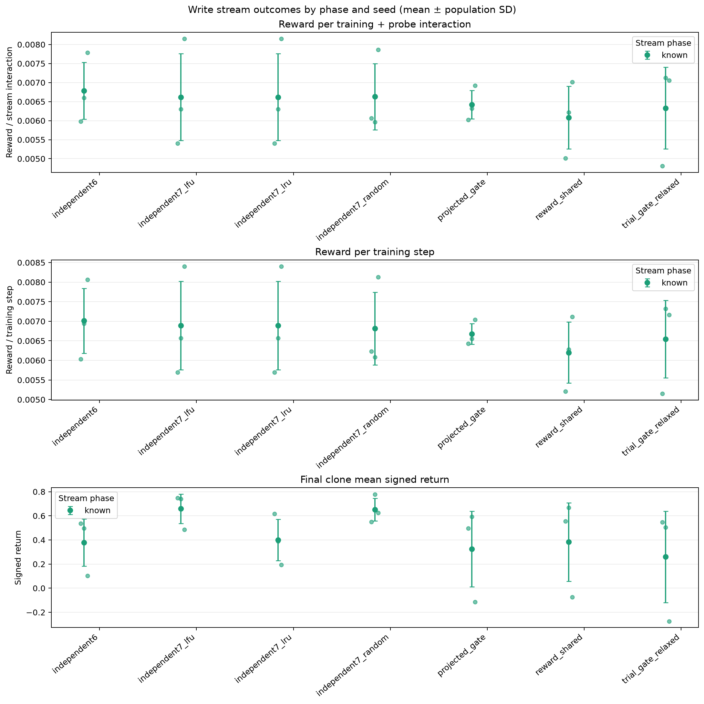

# Write Stream cohort analysis

## 统计口径

统计单位是 seed。episode 和 transition 只在 seed 内聚合，不作为独立样本。少于 4 个 seed 时只报告描述性结果；不做显著性结论。known 与 unknown phase 分开列出。

在线 reward / stream interaction 由 steps.csv 中 training 与 probe 行的 reward 总和除以两类交互总数计算；final clone evaluation 不计入分子或分母。reward / train step 仍保留作 training-only 指标。比较 full-use budget baseline 与 shared 条件时优先看前者：总交互数匹配，但 baseline 把交互都用于训练，shared 条件把一部分用于 uniform probes，因此 policy dwell time 和训练交互组成不同。

正向训练成功率只使用完整、起始和结束 taskobserver 相同、且 task 名以 `+` 结尾的 training episode。跨 task episode 会排除，并单独计数。评估回报按 final clone 的 signed return 汇总。

步骤成本由唯一的 `steps.csv` 核对，其中已经包含 training、probe 和 evaluation；不读取独立 probe ledger。训练与评估 episode 长度和也分别与交互账本核对。

## 每 seed 结果

| phase | seed | condition | reward / training + probe interaction | reward / train step | 正向训练成功率 | 被排除跨 task episodes | final clone signed return | final 正向成功率 | unknown route 比例 | group 满载后未分组比例 | gate 接受 / 拒绝 | CPU s | wall s |
|---|---:|---|---:|---:|---:|---:|---:|---:|---:|---:|---:|---:|---:|
| known | 1031 | independent6 | 0.0060 | 0.0060 | 0.1595 | 22 | 0.5371 | 0.2917 | n/a | n/a | 0 / 0 | 66.50 | 67.30 |
| known | 1031 | independent7_lfu | 0.0054 | 0.0057 | 0.1535 | 22 | 0.7487 | 0.2500 | n/a | n/a | 0 / 0 | 64.53 | 65.26 |
| known | 1031 | independent7_lru | 0.0054 | 0.0057 | 0.1535 | 22 | 0.6162 | 0.3333 | n/a | n/a | 0 / 0 | 76.69 | 77.83 |
| known | 1031 | independent7_random | 0.0061 | 0.0062 | 0.1714 | 22 | 0.5502 | 0.2917 | n/a | n/a | 0 / 0 | 76.33 | 77.94 |
| known | 1031 | projected_gate | 0.0060 | 0.0064 | 0.1690 | 22 | 0.4960 | 0.2917 | n/a | 0.6957 | 7 / 9 | 67.23 | 68.23 |
| known | 1031 | reward_shared | 0.0050 | 0.0052 | 0.1250 | 22 | 0.5562 | 0.3333 | n/a | 0.7391 | 0 / 0 | 67.36 | 68.20 |
| known | 1031 | trial_gate_relaxed | 0.0048 | 0.0052 | 0.1380 | 22 | 0.5483 | 0.2917 | n/a | 0.6957 | 10 / 6 | 66.47 | 67.43 |
| known | 1033 | independent6 | 0.0066 | 0.0069 | 0.1808 | 20 | 0.4965 | 0.2500 | n/a | n/a | 0 / 0 | 69.98 | 70.86 |
| known | 1033 | independent7_lfu | 0.0063 | 0.0066 | 0.1718 | 20 | 0.7410 | 0.2083 | n/a | n/a | 0 / 0 | 68.92 | 69.86 |
| known | 1033 | independent7_lru | 0.0063 | 0.0066 | 0.1718 | 20 | 0.3890 | 0.1667 | n/a | n/a | 0 / 0 | 69.42 | 70.54 |
| known | 1033 | independent7_random | 0.0060 | 0.0061 | 0.1686 | 20 | 0.7767 | 0.3333 | n/a | n/a | 0 / 0 | 69.81 | 70.74 |
| known | 1033 | projected_gate | 0.0063 | 0.0066 | 0.1729 | 22 | 0.5919 | 0.2500 | n/a | 0.6087 | 5 / 15 | 73.27 | 74.37 |
| known | 1033 | reward_shared | 0.0062 | 0.0063 | 0.1761 | 22 | 0.6665 | 0.2917 | n/a | 0.6522 | 0 / 0 | 73.33 | 74.17 |
| known | 1033 | trial_gate_relaxed | 0.0071 | 0.0073 | 0.1968 | 22 | 0.5042 | 0.2083 | n/a | 0.6087 | 17 / 3 | 65.33 | 66.02 |
| known | 1039 | independent6 | 0.0078 | 0.0081 | 0.2114 | 21 | 0.1019 | 0.2500 | n/a | n/a | 0 / 0 | 70.81 | 72.12 |
| known | 1039 | independent7_lfu | 0.0082 | 0.0084 | 0.1991 | 21 | 0.4858 | 0.3750 | n/a | n/a | 0 / 0 | 65.23 | 66.41 |
| known | 1039 | independent7_lru | 0.0082 | 0.0084 | 0.1991 | 21 | 0.1940 | 0.2917 | n/a | n/a | 0 / 0 | 68.20 | 69.30 |
| known | 1039 | independent7_random | 0.0079 | 0.0081 | 0.1945 | 21 | 0.6252 | 0.4583 | n/a | n/a | 0 / 0 | 68.36 | 69.54 |
| known | 1039 | projected_gate | 0.0069 | 0.0070 | 0.1651 | 21 | -0.1148 | 0.1667 | n/a | 0.8636 | 3 / 5 | 70.38 | 71.56 |
| known | 1039 | reward_shared | 0.0070 | 0.0071 | 0.1690 | 21 | -0.0733 | 0.2083 | n/a | 0.8636 | 0 / 0 | 71.70 | 72.83 |
| known | 1039 | trial_gate_relaxed | 0.0071 | 0.0072 | 0.1734 | 21 | -0.2744 | 0.1250 | n/a | 0.8636 | 6 / 2 | 69.97 | 71.20 |

## Paired reward / training + probe interaction differences

### known

| condition | baseline | common seeds | 每 seed difference | mean difference |
|---|---|---|---|---:|
| independent6 | reward_shared | 1031, 1033, 1039 | 1031: 0.0010, 1033: 0.0004, 1039: 0.0008 | 0.0007 |
| independent6 | independent7_lru | 1031, 1033, 1039 | 1031: 0.0006, 1033: 0.0003, 1039: -0.0004 | 0.0002 |
| independent7_lfu | reward_shared | 1031, 1033, 1039 | 1031: 0.0004, 1033: 0.0001, 1039: 0.0011 | 0.0005 |
| independent7_lfu | independent7_lru | 1031, 1033, 1039 | 1031: 0.0000, 1033: 0.0000, 1039: 0.0000 | 0.0000 |
| independent7_lru | reward_shared | 1031, 1033, 1039 | 1031: 0.0004, 1033: 0.0001, 1039: 0.0011 | 0.0005 |
| independent7_lru | independent7_lru | 1031, 1033, 1039 | 1031: 0.0000, 1033: 0.0000, 1039: 0.0000 | 0.0000 |
| independent7_random | reward_shared | 1031, 1033, 1039 | 1031: 0.0011, 1033: -0.0003, 1039: 0.0008 | 0.0005 |
| independent7_random | independent7_lru | 1031, 1033, 1039 | 1031: 0.0007, 1033: -0.0003, 1039: -0.0003 | 0.0000 |
| projected_gate | reward_shared | 1031, 1033, 1039 | 1031: 0.0010, 1033: 0.0001, 1039: -0.0001 | 0.0003 |
| projected_gate | independent7_lru | 1031, 1033, 1039 | 1031: 0.0006, 1033: 0.0000, 1039: -0.0012 | -0.0002 |
| reward_shared | reward_shared | 1031, 1033, 1039 | 1031: 0.0000, 1033: 0.0000, 1039: 0.0000 | 0.0000 |
| reward_shared | independent7_lru | 1031, 1033, 1039 | 1031: -0.0004, 1033: -0.0001, 1039: -0.0011 | -0.0005 |
| trial_gate_relaxed | reward_shared | 1031, 1033, 1039 | 1031: -0.0002, 1033: 0.0009, 1039: 0.0000 | 0.0002 |
| trial_gate_relaxed | independent7_lru | 1031, 1033, 1039 | 1031: -0.0006, 1033: 0.0008, 1039: -0.0011 | -0.0003 |

## Paired reward / train step differences

### known

| condition | baseline | common seeds | 每 seed difference | mean difference |
|---|---|---|---|---:|
| independent6 | reward_shared | 1031, 1033, 1039 | 1031: 0.0008, 1033: 0.0007, 1039: 0.0009 | 0.0008 |
| independent6 | independent7_lru | 1031, 1033, 1039 | 1031: 0.0003, 1033: 0.0004, 1039: -0.0003 | 0.0001 |
| independent7_lfu | reward_shared | 1031, 1033, 1039 | 1031: 0.0005, 1033: 0.0003, 1039: 0.0013 | 0.0007 |
| independent7_lfu | independent7_lru | 1031, 1033, 1039 | 1031: 0.0000, 1033: 0.0000, 1039: 0.0000 | 0.0000 |
| independent7_lru | reward_shared | 1031, 1033, 1039 | 1031: 0.0005, 1033: 0.0003, 1039: 0.0013 | 0.0007 |
| independent7_lru | independent7_lru | 1031, 1033, 1039 | 1031: 0.0000, 1033: 0.0000, 1039: 0.0000 | 0.0000 |
| independent7_random | reward_shared | 1031, 1033, 1039 | 1031: 0.0010, 1033: -0.0002, 1039: 0.0010 | 0.0006 |
| independent7_random | independent7_lru | 1031, 1033, 1039 | 1031: 0.0005, 1033: -0.0005, 1039: -0.0003 | -0.0001 |
| projected_gate | reward_shared | 1031, 1033, 1039 | 1031: 0.0012, 1033: 0.0003, 1039: -0.0001 | 0.0005 |
| projected_gate | independent7_lru | 1031, 1033, 1039 | 1031: 0.0007, 1033: -0.0000, 1039: -0.0014 | -0.0002 |
| reward_shared | reward_shared | 1031, 1033, 1039 | 1031: 0.0000, 1033: 0.0000, 1039: 0.0000 | 0.0000 |
| reward_shared | independent7_lru | 1031, 1033, 1039 | 1031: -0.0005, 1033: -0.0003, 1039: -0.0013 | -0.0007 |
| trial_gate_relaxed | reward_shared | 1031, 1033, 1039 | 1031: -0.0001, 1033: 0.0010, 1039: 0.0001 | 0.0003 |
| trial_gate_relaxed | independent7_lru | 1031, 1033, 1039 | 1031: -0.0005, 1033: 0.0008, 1039: -0.0012 | -0.0003 |

## Per-seed gate 与成本账本

| phase | seed | condition | full gate | 接受 | 拒绝 | no-holdout partial | gate reasons | train | probe | eval | total | CPU s | wall s | actor max B | checkpoint max B | W0 + checkpoint max B |
|---|---:|---|---:|---:|---:|---:|---|---:|---:|---:|---:|---:|---:|---:|---:|---:|
| known | 1031 | independent6 | 0 | 0 | 0 | 0 | none | 49152 | 2304 | 2582 | 54038 | 66.50 | 67.30 | 204 | 145432 | 200909 |
| known | 1031 | independent7_lfu | 0 | 0 | 0 | 0 | none | 49152 | 2176 | 2710 | 54038 | 64.53 | 65.26 | 236 | 154392 | 209869 |
| known | 1031 | independent7_lru | 0 | 0 | 0 | 0 | none | 49152 | 2176 | 2522 | 53850 | 76.69 | 77.83 | 236 | 154520 | 209997 |
| known | 1031 | independent7_random | 0 | 0 | 0 | 0 | none | 49152 | 2304 | 2529 | 53985 | 76.33 | 77.94 | 236 | 154200 | 209677 |
| known | 1031 | projected_gate | 16 | 7 | 9 | 0 | cold_gain_below_threshold:4, cold_support_failed:4, gate_accepted:4, old_group_loss_exceeds_tolerance:1, provisional_current_evidence:3 | 49152 | 2304 | 2581 | 54037 | 67.23 | 68.23 | 230 | 145368 | 200845 |
| known | 1031 | reward_shared | 0 | 0 | 0 | 0 | none | 49152 | 2304 | 2568 | 54024 | 67.36 | 68.20 | 230 | 145432 | 200909 |
| known | 1031 | trial_gate_relaxed | 16 | 10 | 6 | 0 | cold_gain_below_threshold:6, gate_accepted:5, provisional_current_evidence:5 | 49152 | 2304 | 2564 | 54020 | 66.47 | 67.43 | 230 | 145048 | 200525 |
| known | 1033 | independent6 | 0 | 0 | 0 | 0 | none | 49152 | 2304 | 2800 | 54256 | 69.98 | 70.86 | 204 | 144856 | 200333 |
| known | 1033 | independent7_lfu | 0 | 0 | 0 | 0 | none | 49152 | 2176 | 2853 | 54181 | 68.92 | 69.86 | 236 | 154008 | 209485 |
| known | 1033 | independent7_lru | 0 | 0 | 0 | 0 | none | 49152 | 2176 | 2812 | 54140 | 69.42 | 70.54 | 236 | 154008 | 209485 |
| known | 1033 | independent7_random | 0 | 0 | 0 | 0 | none | 49152 | 2560 | 2758 | 54470 | 69.81 | 70.74 | 236 | 153752 | 209229 |
| known | 1033 | projected_gate | 20 | 5 | 15 | 0 | cold_gain_below_threshold:7, cold_support_failed:7, gate_accepted:1, old_group_loss_exceeds_tolerance:1, provisional_current_evidence:4 | 49152 | 2304 | 2764 | 54220 | 73.27 | 74.37 | 230 | 145432 | 200909 |
| known | 1033 | reward_shared | 0 | 0 | 0 | 0 | none | 49152 | 2304 | 2753 | 54209 | 73.33 | 74.17 | 230 | 145048 | 200525 |
| known | 1033 | trial_gate_relaxed | 20 | 17 | 3 | 0 | cold_gain_below_threshold:2, cold_support_failed:1, gate_accepted:8, provisional_current_evidence:9 | 49152 | 2304 | 2786 | 54242 | 65.33 | 66.02 | 230 | 145304 | 200781 |
| known | 1039 | independent6 | 0 | 0 | 0 | 0 | none | 49152 | 2304 | 2677 | 54133 | 70.81 | 72.12 | 204 | 144728 | 200205 |
| known | 1039 | independent7_lfu | 0 | 0 | 0 | 0 | none | 49152 | 2176 | 2587 | 53915 | 65.23 | 66.41 | 236 | 153560 | 209037 |
| known | 1039 | independent7_lru | 0 | 0 | 0 | 0 | none | 49152 | 2176 | 2605 | 53933 | 68.20 | 69.30 | 236 | 153560 | 209037 |
| known | 1039 | independent7_random | 0 | 0 | 0 | 0 | none | 49152 | 2176 | 2557 | 53885 | 68.36 | 69.54 | 236 | 153432 | 208909 |
| known | 1039 | projected_gate | 8 | 3 | 5 | 0 | cold_gain_below_threshold:2, cold_support_failed:3, provisional_current_evidence:3 | 49152 | 2304 | 2816 | 54272 | 70.38 | 71.56 | 230 | 144984 | 200461 |
| known | 1039 | reward_shared | 0 | 0 | 0 | 0 | none | 49152 | 2304 | 2758 | 54214 | 71.70 | 72.83 | 230 | 144984 | 200461 |
| known | 1039 | trial_gate_relaxed | 8 | 6 | 2 | 0 | cold_gain_below_threshold:2, provisional_current_evidence:6 | 49152 | 2304 | 2763 | 54219 | 69.97 | 71.20 | 230 | 144984 | 200461 |

## 路由、分组与 gate 记录

unknown route 和 eviction 是观测到的路由事件；没有独立 route truth label，因此不能称为 false route/error 计数。组覆盖率是描述统计，低 unknown 或低未分组比例本身不代表算法优化。gate 的 surrogate 接受也不是共享有益的独立真值。

`gate_full_count` 统计有完整 gate 诊断的决定；`partial_no_holdout_count` 统计因没有新 holdout 而跳过 gate 的部分 cycle。两者在 analysis.json 中逐 seed 保留。

## 持久化容量与账本审计

每个 checkpoint 的物理 `.pt` 大小与 capacity ledger 对照；逐行检查 actor payload ≤ 236 B、声明 actor budget，以及 W0 foundation bytes + checkpoint bytes ≤ 256 KiB。CPU time、wall time、决策 CPU、评估 CPU 和 RSS 分开保存。

整体 cohort audit：**通过**；失败检查数：0。

## 图表

解释限制：本报告不把低 unknown-route 比率当成算法优化，不把 gate surrogate 当成共享有益的真值，也不声称 SOTA 或已证明创新。
