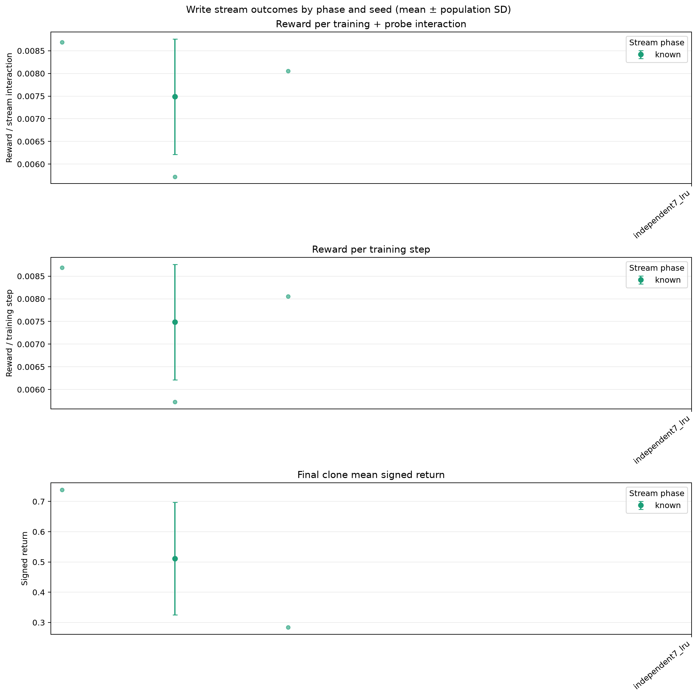

# Write Stream cohort analysis

## 统计口径

统计单位是 seed。episode 和 transition 只在 seed 内聚合，不作为独立样本。少于 4 个 seed 时只报告描述性结果；不做显著性结论。known 与 unknown phase 分开列出。

在线 reward / stream interaction 由 steps.csv 中 training 与 probe 行的 reward 总和除以两类交互总数计算；final clone evaluation 不计入分子或分母。reward / train step 仍保留作 training-only 指标。比较 full-use budget baseline 与 shared 条件时优先看前者：总交互数匹配，但 baseline 把交互都用于训练，shared 条件把一部分用于 uniform probes，因此 policy dwell time 和训练交互组成不同。

正向训练成功率只使用完整、起始和结束 taskobserver 相同、且 task 名以 `+` 结尾的 training episode。跨 task episode 会排除，并单独计数。评估回报按 final clone 的 signed return 汇总。

步骤成本由唯一的 `steps.csv` 核对，其中已经包含 training、probe 和 evaluation；不读取独立 probe ledger。训练与评估 episode 长度和也分别与交互账本核对。

## 每 seed 结果

| phase | seed | condition | reward / training + probe interaction | reward / train step | 正向训练成功率 | 被排除跨 task episodes | final clone signed return | final 正向成功率 | unknown route 比例 | group 满载后未分组比例 | gate 接受 / 拒绝 | CPU s | wall s |
|---|---:|---|---:|---:|---:|---:|---:|---:|---:|---:|---:|---:|---:|
| known | 1031 | independent7_lru | 0.0087 | 0.0087 | 0.2081 | 22 | 0.7390 | 0.3750 | n/a | n/a | 0 / 0 | 56.62 | 57.93 |
| known | 1033 | independent7_lru | 0.0057 | 0.0057 | 0.1412 | 22 | 0.5123 | 0.1667 | n/a | n/a | 0 / 0 | 57.50 | 58.74 |
| known | 1039 | independent7_lru | 0.0081 | 0.0081 | 0.2009 | 22 | 0.2835 | 0.2917 | n/a | n/a | 0 / 0 | 55.89 | 57.34 |

## Paired reward / training + probe interaction differences

### known

| condition | baseline | common seeds | 每 seed difference | mean difference |
|---|---|---|---|---:|
| independent7_lru | reward_shared | none | n/a | n/a |
| independent7_lru | independent7_lru | 1031, 1033, 1039 | 1031: 0.0000, 1033: 0.0000, 1039: 0.0000 | 0.0000 |

## Paired reward / train step differences

### known

| condition | baseline | common seeds | 每 seed difference | mean difference |
|---|---|---|---|---:|
| independent7_lru | reward_shared | none | n/a | n/a |
| independent7_lru | independent7_lru | 1031, 1033, 1039 | 1031: 0.0000, 1033: 0.0000, 1039: 0.0000 | 0.0000 |

## Per-seed gate 与成本账本

| phase | seed | condition | full gate | 接受 | 拒绝 | no-holdout partial | gate reasons | train | probe | eval | total | CPU s | wall s | actor max B | checkpoint max B | W0 + checkpoint max B |
|---|---:|---|---:|---:|---:|---:|---|---:|---:|---:|---:|---:|---:|---:|---:|---:|
| known | 1031 | independent7_lru | 0 | 0 | 0 | 0 | none | 51456 | 0 | 2484 | 53940 | 56.62 | 57.93 | 236 | 153560 | 209037 |
| known | 1033 | independent7_lru | 0 | 0 | 0 | 0 | none | 51456 | 0 | 2833 | 54289 | 57.50 | 58.74 | 236 | 153432 | 208909 |
| known | 1039 | independent7_lru | 0 | 0 | 0 | 0 | none | 51456 | 0 | 2728 | 54184 | 55.89 | 57.34 | 236 | 153496 | 208973 |

## 路由、分组与 gate 记录

unknown route 和 eviction 是观测到的路由事件；没有独立 route truth label，因此不能称为 false route/error 计数。组覆盖率是描述统计，低 unknown 或低未分组比例本身不代表算法优化。gate 的 surrogate 接受也不是共享有益的独立真值。

`gate_full_count` 统计有完整 gate 诊断的决定；`partial_no_holdout_count` 统计因没有新 holdout 而跳过 gate 的部分 cycle。两者在 analysis.json 中逐 seed 保留。

## 持久化容量与账本审计

每个 checkpoint 的物理 `.pt` 大小与 capacity ledger 对照；逐行检查 actor payload ≤ 236 B、声明 actor budget，以及 W0 foundation bytes + checkpoint bytes ≤ 256 KiB。CPU time、wall time、决策 CPU、评估 CPU 和 RSS 分开保存。

整体 cohort audit：**通过**；失败检查数：0。

## 图表

解释限制：本报告不把低 unknown-route 比率当成算法优化，不把 gate surrogate 当成共享有益的真值，也不声称 SOTA 或已证明创新。
