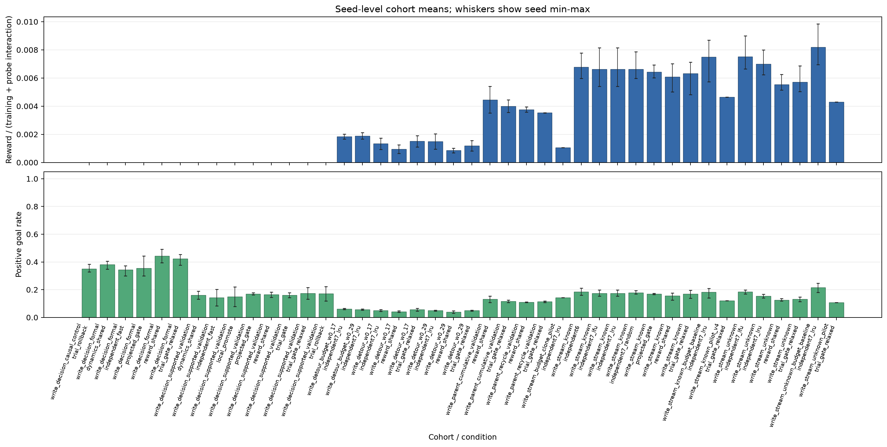

# Write Decision / Stream Investigation 汇总

本报告聚合顶层 write_* 实验目录；只有各目录顶层 summary.json 的 records 列表贡献 cohort 样本。不会递归读取 snapshot 或子 run summary 来增加样本数。统计单位是 seed。

## Cohort 与 condition 结果

在线 reward 和正奖励任务 goal rate 均先按 seed 汇总。Train R 仅训练流；Stream R 包含训练与探测奖励，分母为 training + probe，不含评估。缺失探测奖励时全流指标留空。完整交互预算基线以 Stream R 比较；known 的每段停留时间及计算/PPO 更新数仍不匹配。final endpoint signed return 对各 task 等权取 macro mean；positive goal rate 只平均正奖励任务的成功率。方括号为 seed 间 min–max，不是置信区间。

| Cohort | Condition | Seeds | Train R / step [min, max] | Stream R / interaction [min, max] | Positive goal rate | Final macro signed R | Final positive goal rate | Gate accept / reject | Endpoint unassigned slots | Training unassigned fraction | CPU sum (s) | Wall sum (s) | Peak checkpoint + W0 (B) | Actor payload peak (B) |
|---|---|---:|---:|---:|---:|---:|---:|---:|---:|---:|---:|---:|---:|---:|
| write_decision_causal_control | trial_rollback | 3 | 0.0148 [0.0141, 0.0163] | — | 0.3499 [0.3283, 0.3830] | 1.1131 [0.9119, 1.3031] | 0.4444 [0.3750, 0.5000] | 0.00 [0.00, 0.00] / 40.00 [40.00, 40.00] | 0.0000 [0.0000, 0.0000] | — | 33.30 [32.23, 34.23] | 33.91 [32.89, 34.87] | 162360 [162317, 162381] | 738 [738, 738] |
| write_decision_formal | dynamics_shared | 3 | 0.0152 [0.0143, 0.0163] | — | 0.3811 [0.3491, 0.4048] | 1.3515 [1.0300, 1.6256] | 0.5694 [0.4167, 0.7083] | 0.00 [0.00, 0.00] / 0.00 [0.00, 0.00] | 0.0000 [0.0000, 0.0000] | — | 36.76 [36.22, 37.83] | 37.54 [36.93, 38.75] | 162189 [162189, 162189] | 738 [738, 738] |
| write_decision_formal | independent_fast | 3 | 0.0148 [0.0124, 0.0166] | — | 0.3443 [0.2997, 0.3723] | 1.0667 [0.8710, 1.3356] | 0.3750 [0.3333, 0.4583] | 0.00 [0.00, 0.00] / 0.00 [0.00, 0.00] | 1.0000 [1.0000, 1.0000] | — | 36.18 [35.36, 37.08] | 36.84 [35.81, 37.97] | 161954 [161933, 161997] | 666 [666, 666] |
| write_decision_formal | projected_gate | 3 | 0.0153 [0.0131, 0.0195] | — | 0.3541 [0.3005, 0.4434] | 1.1713 [0.8677, 1.4192] | 0.4722 [0.3333, 0.6250] | 2.67 [1.00, 4.00] / 37.33 [36.00, 39.00] | 0.0000 [0.0000, 0.0000] | — | 36.29 [35.89, 36.59] | 36.95 [36.58, 37.35] | 162232 [162189, 162253] | 738 [738, 738] |
| write_decision_formal | reward_shared | 3 | 0.0191 [0.0162, 0.0214] | — | 0.4424 [0.3943, 0.4924] | 1.4140 [1.0031, 1.6396] | 0.5694 [0.4583, 0.6250] | 0.00 [0.00, 0.00] / 0.00 [0.00, 0.00] | 0.0000 [0.0000, 0.0000] | — | 36.91 [36.03, 37.38] | 37.67 [36.83, 38.24] | 162146 [162125, 162189] | 738 [738, 738] |
| write_decision_formal | trial_gate_relaxed | 3 | 0.0188 [0.0160, 0.0208] | — | 0.4237 [0.3768, 0.4541] | 1.2917 [1.0692, 1.4940] | 0.5139 [0.4583, 0.5417] | 22.33 [21.00, 23.00] / 17.67 [17.00, 19.00] | 0.0000 [0.0000, 0.0000] | — | 37.15 [35.98, 37.86] | 37.78 [36.52, 38.56] | 162210 [162189, 162253] | 738 [738, 738] |
| write_decision_supported_validation | dynamics_shared | 2 | 0.0045 [0.0035, 0.0054] | — | 0.1599 [0.1310, 0.1889] | 0.6068 [0.4927, 0.7208] | 0.3125 [0.2917, 0.3333] | 0.00 [0.00, 0.00] / 0.00 [0.00, 0.00] | 0.0000 [0.0000, 0.0000] | — | 19.77 [17.83, 21.70] | 20.28 [18.07, 22.48] | 162253 [162189, 162317] | 738 [738, 738] |
| write_decision_supported_validation | independent_fast | 2 | 0.0045 [0.0033, 0.0057] | — | 0.1438 [0.0843, 0.2033] | 0.4479 [0.2327, 0.6631] | 0.2500 [0.1667, 0.3333] | 0.00 [0.00, 0.00] / 0.00 [0.00, 0.00] | 1.0000 [1.0000, 1.0000] | — | 19.42 [17.73, 21.11] | 19.89 [17.92, 21.86] | 162029 [161997, 162061] | 666 [666, 666] |
| write_decision_supported_validation | local_promote | 2 | 0.0049 [0.0027, 0.0070] | — | 0.1498 [0.0793, 0.2204] | 0.4077 [0.3219, 0.4935] | 0.2500 [0.2500, 0.2500] | 2.50 [1.00, 4.00] / 17.50 [16.00, 19.00] | 0.0000 [0.0000, 0.0000] | — | 23.34 [21.83, 24.84] | 23.94 [22.39, 25.50] | 162253 [162189, 162317] | 738 [738, 738] |
| write_decision_supported_validation | projected_gate | 2 | 0.0057 [0.0056, 0.0058] | — | 0.1700 [0.1628, 0.1771] | 0.6401 [0.4646, 0.8156] | 0.3125 [0.2500, 0.3750] | 6.50 [6.00, 7.00] / 13.50 [13.00, 14.00] | 0.0000 [0.0000, 0.0000] | — | 23.27 [21.39, 25.16] | 23.98 [21.87, 26.09] | 162221 [162125, 162317] | 738 [738, 738] |
| write_decision_supported_validation | reward_shared | 2 | 0.0063 [0.0059, 0.0068] | — | 0.1640 [0.1462, 0.1818] | 0.8185 [0.6133, 1.0237] | 0.4375 [0.3750, 0.5000] | 0.00 [0.00, 0.00] / 0.00 [0.00, 0.00] | 0.0000 [0.0000, 0.0000] | — | 21.50 [17.84, 25.16] | 22.07 [18.00, 26.13] | 162285 [162253, 162317] | 738 [738, 738] |
| write_decision_supported_validation | trial_gate | 2 | 0.0054 [0.0052, 0.0056] | — | 0.1596 [0.1420, 0.1771] | 0.6397 [0.4646, 0.8148] | 0.3125 [0.2500, 0.3750] | 6.00 [6.00, 6.00] / 14.00 [14.00, 14.00] | 0.0000 [0.0000, 0.0000] | — | 22.09 [17.95, 26.23] | 22.55 [18.15, 26.95] | 162221 [162125, 162317] | 738 [738, 738] |
| write_decision_supported_validation | trial_gate_relaxed | 2 | 0.0062 [0.0052, 0.0072] | — | 0.1732 [0.1310, 0.2155] | 0.5907 [0.3108, 0.8706] | 0.3542 [0.2917, 0.4167] | 17.50 [17.00, 18.00] / 2.50 [2.00, 3.00] | 0.0000 [0.0000, 0.0000] | — | 22.95 [21.22, 24.67] | 23.37 [21.56, 25.18] | 162253 [162189, 162317] | 738 [738, 738] |
| write_decision_supported_validation | trial_rollback | 2 | 0.0055 [0.0039, 0.0071] | — | 0.1709 [0.1190, 0.2228] | 0.4773 [0.3183, 0.6362] | 0.2917 [0.2500, 0.3333] | 0.00 [0.00, 0.00] / 20.00 [20.00, 20.00] | 0.0000 [0.0000, 0.0000] | — | 23.10 [22.19, 24.02] | 23.71 [22.92, 24.49] | 162221 [162125, 162317] | 738 [738, 738] |
| write_detour_budget_w0_17 | independent7_lru | 2 | 0.0018 [0.0017, 0.0020] | 0.0018 [0.0017, 0.0020] | 0.0607 [0.0567, 0.0647] | 0.2397 [0.0254, 0.4540] | 0.1250 [0.0417, 0.2083] | 0.00 [0.00, 0.00] / 0.00 [0.00, 0.00] | 1.0000 [1.0000, 1.0000] | 1.0000 [1.0000, 1.0000] | 63.30 [63.00, 63.59] | 64.83 [64.73, 64.93] | 208941 [208653, 209229] | — |
| write_detour_budget_w0_29 | independent7_lru | 2 | 0.0019 [0.0017, 0.0021] | 0.0019 [0.0017, 0.0021] | 0.0571 [0.0525, 0.0617] | 0.3178 [0.1873, 0.4483] | 0.1667 [0.1250, 0.2083] | 0.00 [0.00, 0.00] / 0.00 [0.00, 0.00] | 1.0000 [1.0000, 1.0000] | 1.0000 [1.0000, 1.0000] | 65.34 [65.17, 65.52] | 66.51 [66.37, 66.65] | 208813 [208781, 208845] | — |
| write_detour_w0_17 | independent7_lru | 2 | 0.0014 [0.0011, 0.0018] | 0.0013 [0.0009, 0.0017] | 0.0499 [0.0436, 0.0561] | 0.3377 [0.2835, 0.3919] | 0.1667 [0.1667, 0.1667] | 0.00 [0.00, 0.00] / 0.00 [0.00, 0.00] | 1.0000 [1.0000, 1.0000] | 1.0000 [1.0000, 1.0000] | 62.05 [61.70, 62.41] | 63.55 [63.38, 63.72] | 209421 [209357, 209485] | — |
| write_detour_w0_17 | reward_shared | 2 | 0.0010 [0.0007, 0.0012] | 0.0009 [0.0006, 0.0013] | 0.0422 [0.0360, 0.0483] | 0.1141 [0.0235, 0.2046] | 0.0625 [0.0417, 0.0833] | 0.00 [0.00, 0.00] / 0.00 [0.00, 0.00] | 0.5833 [0.3333, 0.8333] | 0.7292 [0.6667, 0.7917] | 63.53 [63.44, 63.62] | 64.39 [64.31, 64.46] | 200653 [200397, 200909] | — |
| write_detour_w0_17 | trial_gate_relaxed | 2 | 0.0015 [0.0011, 0.0019] | 0.0015 [0.0011, 0.0019] | 0.0560 [0.0460, 0.0660] | 0.2032 [0.1113, 0.2952] | 0.1042 [0.0833, 0.1250] | 10.00 [10.00, 10.00] / 38.00 [38.00, 38.00] | 0.4167 [0.3333, 0.5000] | 0.6875 [0.6250, 0.7500] | 63.23 [62.77, 63.70] | 64.60 [64.39, 64.81] | 200813 [200781, 200845] | — |
| write_detour_w0_29 | independent7_lru | 2 | 0.0016 [0.0010, 0.0021] | 0.0015 [0.0010, 0.0020] | 0.0497 [0.0460, 0.0533] | 0.2878 [0.1383, 0.4373] | 0.1458 [0.0833, 0.2083] | 0.00 [0.00, 0.00] / 0.00 [0.00, 0.00] | 1.0000 [1.0000, 1.0000] | 1.0000 [1.0000, 1.0000] | 61.77 [61.44, 62.09] | 62.49 [62.11, 62.86] | 209517 [209485, 209549] | — |
| write_detour_w0_29 | reward_shared | 2 | 0.0009 [0.0008, 0.0011] | 0.0009 [0.0007, 0.0010] | 0.0398 [0.0309, 0.0487] | 0.2302 [0.1873, 0.2731] | 0.1250 [0.1250, 0.1250] | 0.00 [0.00, 0.00] / 0.00 [0.00, 0.00] | 0.5000 [0.3333, 0.6667] | 0.6979 [0.5625, 0.8333] | 62.52 [62.41, 62.62] | 63.32 [63.10, 63.54] | 201005 [200845, 201165] | — |
| write_detour_w0_29 | trial_gate_relaxed | 2 | 0.0012 [0.0008, 0.0015] | 0.0012 [0.0008, 0.0016] | 0.0495 [0.0460, 0.0530] | 0.2281 [0.1077, 0.3485] | 0.1250 [0.0833, 0.1667] | 8.50 [7.00, 10.00] / 39.50 [38.00, 41.00] | 0.5000 [0.5000, 0.5000] | 0.7292 [0.7083, 0.7500] | 62.93 [62.53, 63.33] | 63.88 [63.62, 64.15] | 200941 [200717, 201165] | — |
| write_parent_cumulative_validation | reward_shared | 2 | 0.0052 [0.0043, 0.0061] | 0.0045 [0.0035, 0.0054] | 0.1311 [0.1084, 0.1538] | 0.2370 [0.1508, 0.3231] | 0.0833 [0.0417, 0.1250] | 0.00 [0.00, 0.00] / 0.00 [0.00, 0.00] | 0.5833 [0.3333, 0.8333] | 0.6875 [0.5000, 0.8750] | 33.69 [33.56, 33.81] | 34.30 [33.96, 34.64] | 203469 [203469, 203469] | — |
| write_parent_cumulative_validation | trial_gate_relaxed | 2 | 0.0047 [0.0044, 0.0051] | 0.0040 [0.0036, 0.0044] | 0.1164 [0.1084, 0.1244] | 0.1710 [0.1456, 0.1965] | 0.0625 [0.0417, 0.0833] | 5.50 [2.00, 9.00] / 18.50 [15.00, 22.00] | 0.5833 [0.3333, 0.8333] | 0.6875 [0.5000, 0.8750] | 33.63 [33.59, 33.67] | 34.29 [34.10, 34.48] | 203469 [203469, 203469] | — |
| write_parent_recycle_validation | reward_shared | 2 | 0.0045 [0.0044, 0.0045] | 0.0038 [0.0036, 0.0039] | 0.1097 [0.1084, 0.1111] | 0.1232 [0.0904, 0.1560] | 0.0417 [0.0417, 0.0417] | 0.00 [0.00, 0.00] / 0.00 [0.00, 0.00] | 0.4167 [0.3333, 0.5000] | 0.4792 [0.1667, 0.7917] | 34.30 [34.12, 34.48] | 35.22 [35.09, 35.35] | 203469 [203469, 203469] | — |
| write_parent_recycle_validation | trial_gate_relaxed | 2 | 0.0041 [0.0038, 0.0044] | 0.0035 [0.0035, 0.0035] | 0.1136 [0.1084, 0.1188] | 0.1933 [0.1821, 0.2046] | 0.0417 [0.0417, 0.0417] | 10.00 [4.00, 16.00] / 14.00 [8.00, 20.00] | 0.5000 [0.5000, 0.5000] | 0.5208 [0.2500, 0.7917] | 34.25 [34.16, 34.34] | 35.09 [34.90, 35.28] | 203341 [203213, 203469] | — |
| write_stream_budget_clone_pilot | independent7_lru | 1 | 0.0011 [0.0011, 0.0011] | 0.0011 [0.0011, 0.0011] | 0.1429 [0.1429, 0.1429] | -0.2215 [-0.2215, -0.2215] | 0.0000 [0.0000, 0.0000] | 0.00 [0.00, 0.00] / 0.00 [0.00, 0.00] | 1.0000 [1.0000, 1.0000] | 1.0000 [1.0000, 1.0000] | 4.31 [4.31, 4.31] | 4.40 [4.40, 4.40] | 208461 [208461, 208461] | — |
| write_stream_known | independent6 | 3 | 0.0070 [0.0060, 0.0081] | 0.0068 [0.0060, 0.0078] | 0.1839 [0.1595, 0.2114] | 0.3785 [0.1019, 0.5371] | 0.2639 [0.2500, 0.2917] | 0.00 [0.00, 0.00] / 0.00 [0.00, 0.00] | 1.0000 [1.0000, 1.0000] | 1.0000 [1.0000, 1.0000] | 69.10 [66.50, 70.81] | 70.10 [67.30, 72.12] | 200482 [200205, 200909] | — |
| write_stream_known | independent7_lfu | 3 | 0.0069 [0.0057, 0.0084] | 0.0066 [0.0054, 0.0082] | 0.1748 [0.1535, 0.1991] | 0.6585 [0.4858, 0.7487] | 0.2778 [0.2083, 0.3750] | 0.00 [0.00, 0.00] / 0.00 [0.00, 0.00] | 1.0000 [1.0000, 1.0000] | 1.0000 [1.0000, 1.0000] | 66.23 [64.53, 68.92] | 67.18 [65.26, 69.86] | 209464 [209037, 209869] | — |
| write_stream_known | independent7_lru | 3 | 0.0069 [0.0057, 0.0084] | 0.0066 [0.0054, 0.0082] | 0.1748 [0.1535, 0.1991] | 0.3997 [0.1940, 0.6162] | 0.2639 [0.1667, 0.3333] | 0.00 [0.00, 0.00] / 0.00 [0.00, 0.00] | 1.0000 [1.0000, 1.0000] | 1.0000 [1.0000, 1.0000] | 71.44 [68.20, 76.69] | 72.56 [69.30, 77.83] | 209506 [209037, 209997] | — |
| write_stream_known | independent7_random | 3 | 0.0068 [0.0061, 0.0081] | 0.0066 [0.0060, 0.0079] | 0.1782 [0.1686, 0.1945] | 0.6507 [0.5502, 0.7767] | 0.3611 [0.2917, 0.4583] | 0.00 [0.00, 0.00] / 0.00 [0.00, 0.00] | 1.0000 [1.0000, 1.0000] | 1.0000 [1.0000, 1.0000] | 71.50 [68.36, 76.33] | 72.74 [69.54, 77.94] | 209272 [208909, 209677] | — |
| write_stream_known | projected_gate | 3 | 0.0067 [0.0064, 0.0070] | 0.0064 [0.0060, 0.0069] | 0.1690 [0.1651, 0.1729] | 0.3244 [-0.1148, 0.5919] | 0.2361 [0.1667, 0.2917] | 5.00 [3.00, 7.00] / 43.00 [41.00, 45.00] | 0.5000 [0.3333, 0.6667] | 0.6944 [0.5833, 0.8333] | 70.29 [67.23, 73.27] | 71.39 [68.23, 74.37] | 200738 [200461, 200909] | — |
| write_stream_known | reward_shared | 3 | 0.0062 [0.0052, 0.0071] | 0.0061 [0.0050, 0.0070] | 0.1567 [0.1250, 0.1761] | 0.3831 [-0.0733, 0.6665] | 0.2778 [0.2083, 0.3333] | 0.00 [0.00, 0.00] / 0.00 [0.00, 0.00] | 0.6111 [0.5000, 0.6667] | 0.7222 [0.6250, 0.8333] | 70.80 [67.36, 73.33] | 71.74 [68.20, 74.17] | 200632 [200461, 200909] | — |
| write_stream_known | trial_gate_relaxed | 3 | 0.0065 [0.0052, 0.0073] | 0.0063 [0.0048, 0.0071] | 0.1694 [0.1380, 0.1968] | 0.2594 [-0.2744, 0.5483] | 0.2083 [0.1250, 0.2917] | 11.00 [6.00, 17.00] / 37.00 [31.00, 42.00] | 0.5000 [0.3333, 0.6667] | 0.6944 [0.5833, 0.8333] | 67.26 [65.33, 69.97] | 68.22 [66.02, 71.20] | 200589 [200461, 200781] | — |
| write_stream_known_budget_baseline | independent7_lru | 3 | 0.0075 [0.0057, 0.0087] | 0.0075 [0.0057, 0.0087] | 0.1834 [0.1412, 0.2081] | 0.5116 [0.2835, 0.7390] | 0.2778 [0.1667, 0.3750] | 0.00 [0.00, 0.00] / 0.00 [0.00, 0.00] | 1.0000 [1.0000, 1.0000] | 1.0000 [1.0000, 1.0000] | 56.67 [55.89, 57.50] | 58.00 [57.34, 58.74] | 208973 [208909, 209037] | — |
| write_stream_known_pilot_v4 | trial_gate_relaxed | 1 | 0.0052 [0.0052, 0.0052] | 0.0046 [0.0046, 0.0046] | 0.1214 [0.1214, 0.1214] | 0.8425 [0.8425, 0.8425] | 0.2500 [0.2500, 0.2500] | 2.00 [2.00, 2.00] / 22.00 [22.00, 22.00] | 0.8333 [0.8333, 0.8333] | 0.8750 [0.8750, 0.8750] | 35.28 [35.28, 35.28] | 36.05 [36.05, 36.05] | 200653 [200653, 200653] | — |
| write_stream_unknown | independent7_lfu | 3 | 0.0075 [0.0067, 0.0090] | 0.0075 [0.0067, 0.0090] | 0.1855 [0.1703, 0.1981] | 0.5585 [0.3715, 0.6817] | 0.3056 [0.2083, 0.4167] | 0.00 [0.00, 0.00] / 0.00 [0.00, 0.00] | 1.0000 [1.0000, 1.0000] | 1.0000 [1.0000, 1.0000] | 63.11 [62.16, 64.59] | 64.03 [63.32, 65.28] | 175373 [175245, 175501] | — |
| write_stream_unknown | independent7_lru | 3 | 0.0070 [0.0062, 0.0080] | 0.0070 [0.0062, 0.0080] | 0.1547 [0.1400, 0.1675] | 0.3431 [0.1006, 0.4944] | 0.2222 [0.2083, 0.2500] | 0.00 [0.00, 0.00] / 0.00 [0.00, 0.00] | 1.0000 [1.0000, 1.0000] | 1.0000 [1.0000, 1.0000] | 62.78 [61.86, 63.89] | 63.73 [63.10, 64.79] | 175352 [175309, 175373] | — |
| write_stream_unknown | reward_shared | 3 | 0.0055 [0.0051, 0.0063] | 0.0055 [0.0051, 0.0063] | 0.1263 [0.1194, 0.1369] | 0.2289 [-0.0769, 0.4948] | 0.1806 [0.1250, 0.2500] | 0.00 [0.00, 0.00] / 0.00 [0.00, 0.00] | 0.5000 [0.3333, 0.6667] | 0.7255 [0.7111, 0.7331] | 71.19 [64.59, 84.28] | 72.39 [65.48, 85.80] | 172237 [171981, 172429] | — |
| write_stream_unknown | trial_gate_relaxed | 3 | 0.0057 [0.0050, 0.0069] | 0.0057 [0.0050, 0.0069] | 0.1320 [0.1139, 0.1478] | 0.2077 [-0.1429, 0.4725] | 0.1806 [0.1250, 0.2917] | 8.33 [8.00, 9.00] / 39.00 [38.00, 40.00] | 0.5000 [0.5000, 0.5000] | 0.7256 [0.7114, 0.7331] | 70.99 [64.52, 83.94] | 72.10 [65.10, 85.56] | 172173 [171917, 172301] | — |
| write_stream_unknown_budget_baseline | independent7_lru | 3 | 0.0082 [0.0069, 0.0099] | 0.0082 [0.0069, 0.0099] | 0.2156 [0.1810, 0.2466] | 0.4418 [0.2452, 0.6842] | 0.2639 [0.2083, 0.3333] | 0.00 [0.00, 0.00] / 0.00 [0.00, 0.00] | 1.0000 [1.0000, 1.0000] | 1.0000 [1.0000, 1.0000] | 67.02 [63.16, 69.06] | 68.04 [64.58, 69.88] | 173986 [173901, 174029] | — |
| write_stream_unknown_pilot | trial_gate_relaxed | 1 | 0.0043 [0.0043, 0.0043] | 0.0043 [0.0043, 0.0043] | 0.1082 [0.1082, 0.1082] | 0.8125 [0.8125, 0.8125] | 0.2500 [0.2500, 0.2500] | 2.00 [2.00, 2.00] / 22.00 [22.00, 22.00] | 0.8333 [0.8333, 0.8333] | 0.8691 [0.8691, 0.8691] | 41.88 [41.88, 41.88] | 42.61 [42.61, 42.61] | 171853 [171853, 171853] | — |

## Interaction 与计算成本账本

| 项目 | 数量 / 成本 |
|---|---:|
| 顶层 summary cost roots（每个只计一次，含已记录的 pending partial） | 18 |
| Summary roots training steps | 4033280 |
| Summary roots probe steps | 147840 |
| Summary roots evaluation steps（含 foundation 与 counterfactual） | 509677 |
| Summary roots reported environment interactions | 4690797 |
| Cohort roots declared total vs training + probe + evaluation | 4641939 vs 4641939（一致：True） |
| Summary roots CPU 秒和 | 5028.36 |
| Summary roots wall duration 秒和 | 5116.82 |
| Foundation 离线 BC updates（非环境交互） | 3000 |
| Failed marker exact interactions（不含已由 summary 覆盖者） | 547207 |
| Failed marker lower-bound interactions（不含已由 summary 覆盖者） | ≥ 40322 |
| Failed marker process CPU lower bound | ≥ 127.45 s |
| 已知 exact interactions（完整 roots + exact failed） | 5238004 |
| 含 lower-bound 的总计下界 | ≥ 5278326 |

中断 marker 的 lower-bound 始终使用 ≥ 展示，不能解读为全部真实交互的精确总数。CPU 为各 run CPU 秒相加；wall 为各 run wall duration 相加，不是端到端 makespan。Foundation BC 更新是离线训练更新，不计入环境交互。

## 配对比较

所有差值按相同 seed 配对并展示 left − right；episode / transition 不作独立样本。formal 选中条件与 baselines/control 的比较发生在 selection 之后，明确标为 post-selection，不能用于 method selection。最多 3 个 seed 时只作描述性对照。

| Family | Left | Right | Matched seeds | Δ Train R / step [min, max] | Δ Stream R / interaction [min, max] | Δ positive goal rate | Δ final signed R | Δ final positive goal rate | Post-selection |
|---|---|---|---|---:|---:|---:|---:|---:|---|
| step1_formal_selected_vs_baseline | trial_gate_relaxed | independent_fast | 1009, 1013, 1019 | 0.0040 [0.0036, 0.0042] | — | 0.0794 [0.0679, 0.0934] | 0.2251 [0.1583, 0.3188] | 0.1389 [0.0833, 0.2083] | 是 |
| step1_formal_selected_vs_baseline | trial_gate_relaxed | reward_shared | 1009, 1013, 1019 | -0.0004 [-0.0019, 0.0010] | — | -0.0187 [-0.0522, 0.0137] | -0.1222 [-0.2871, 0.0660] | -0.0556 [-0.0833, 0.0000] | 是 |
| step1_post_selection_causal_control | trial_gate_relaxed | trial_rollback | 1009, 1013, 1019 | 0.0039 [0.0019, 0.0067] | — | 0.0738 [0.0385, 0.1258] | 0.1787 [0.1573, 0.1908] | 0.0694 [0.0417, 0.0833] | 是 |
| step1_formal_selected_vs_baseline | projected_gate | independent_fast | 1009, 1013, 1019 | 0.0005 [-0.0033, 0.0041] | — | 0.0098 [-0.0603, 0.0711] | 0.1047 [-0.1085, 0.4258] | 0.0972 [0.0000, 0.2917] | 是 |
| step1_formal_selected_vs_baseline | projected_gate | reward_shared | 1009, 1013, 1019 | -0.0038 [-0.0065, -0.0019] | — | -0.0883 [-0.1399, -0.0490] | -0.2426 [-0.4125, -0.1354] | -0.0972 [-0.1667, 0.0000] | 是 |
| step1_post_selection_causal_control | projected_gate | trial_rollback | 1009, 1013, 1019 | 0.0005 [-0.0009, 0.0032] | — | 0.0042 [-0.0278, 0.0605] | 0.0583 [-0.0760, 0.2950] | 0.0278 [-0.0417, 0.1667] | 是 |
| stream_within_cohort | write_detour_w0_17:trial_gate_relaxed | write_detour_w0_17:independent7_lru | 1061, 1063 | 0.0001 [0.0001, 0.0001] | 0.0002 [0.0002, 0.0002] | 0.0062 [0.0024, 0.0099] | -0.1345 [-0.1723, -0.0967] | -0.0625 [-0.0833, -0.0417] | 否 |
| stream_within_cohort | write_detour_w0_17:trial_gate_relaxed | write_detour_w0_17:reward_shared | 1061, 1063 | 0.0006 [0.0004, 0.0007] | 0.0006 [0.0005, 0.0006] | 0.0138 [0.0100, 0.0176] | 0.0892 [0.0877, 0.0906] | 0.0417 [0.0417, 0.0417] | 否 |
| stream_within_cohort | write_detour_w0_29:trial_gate_relaxed | write_detour_w0_29:independent7_lru | 1061, 1063 | -0.0004 [-0.0006, -0.0002] | -0.0003 [-0.0005, -0.0001] | -0.0001 [-0.0003, 0.0000] | -0.0597 [-0.0887, -0.0306] | -0.0208 [-0.0417, 0.0000] | 否 |
| stream_within_cohort | write_detour_w0_29:trial_gate_relaxed | write_detour_w0_29:reward_shared | 1061, 1063 | 0.0003 [0.0001, 0.0005] | 0.0003 [0.0001, 0.0005] | 0.0097 [-0.0027, 0.0221] | -0.0021 [-0.0796, 0.0754] | -0.0000 [-0.0417, 0.0417] | 否 |
| stream_within_cohort | write_stream_known:independent6 | write_stream_known:independent7_lru | 1031, 1033, 1039 | 0.0001 [-0.0003, 0.0004] | 0.0002 [-0.0004, 0.0006] | 0.0091 [0.0060, 0.0123] | -0.0212 [-0.0921, 0.1075] | 0.0000 [-0.0417, 0.0833] | 否 |
| stream_within_cohort | write_stream_known:independent6 | write_stream_known:reward_shared | 1031, 1033, 1039 | 0.0008 [0.0007, 0.0009] | 0.0007 [0.0004, 0.0010] | 0.0272 [0.0047, 0.0423] | -0.0047 [-0.1700, 0.1752] | -0.0139 [-0.0417, 0.0417] | 否 |
| stream_within_cohort | write_stream_known:independent7_lfu | write_stream_known:independent7_lru | 1031, 1033, 1039 | 0.0000 [0.0000, 0.0000] | 0.0000 [0.0000, 0.0000] | 0.0000 [0.0000, 0.0000] | 0.2588 [0.1325, 0.3521] | 0.0139 [-0.0833, 0.0833] | 否 |
| stream_within_cohort | write_stream_known:independent7_lfu | write_stream_known:reward_shared | 1031, 1033, 1039 | 0.0007 [0.0003, 0.0013] | 0.0005 [0.0001, 0.0011] | 0.0181 [-0.0043, 0.0300] | 0.2754 [0.0746, 0.5592] | 0.0000 [-0.0833, 0.1667] | 否 |
| stream_within_cohort | write_stream_known:independent7_random | write_stream_known:independent7_lru | 1031, 1033, 1039 | -0.0001 [-0.0005, 0.0005] | 0.0000 [-0.0003, 0.0007] | 0.0034 [-0.0046, 0.0180] | 0.2510 [-0.0660, 0.4313] | 0.0972 [-0.0417, 0.1667] | 否 |
| stream_within_cohort | write_stream_known:independent7_random | write_stream_known:reward_shared | 1031, 1033, 1039 | 0.0006 [-0.0002, 0.0010] | 0.0005 [-0.0003, 0.0011] | 0.0215 [-0.0074, 0.0464] | 0.2676 [-0.0060, 0.6985] | 0.0833 [-0.0417, 0.2500] | 否 |
| stream_within_cohort | write_stream_known:projected_gate | write_stream_known:independent7_lru | 1031, 1033, 1039 | -0.0002 [-0.0014, 0.0007] | -0.0002 [-0.0012, 0.0006] | -0.0058 [-0.0340, 0.0156] | -0.0753 [-0.3087, 0.2029] | -0.0278 [-0.1250, 0.0833] | 否 |
| stream_within_cohort | write_stream_known:projected_gate | write_stream_known:reward_shared | 1031, 1033, 1039 | 0.0005 [-0.0001, 0.0012] | 0.0003 [-0.0001, 0.0010] | 0.0123 [-0.0040, 0.0440] | -0.0587 [-0.0746, -0.0415] | -0.0417 [-0.0417, -0.0417] | 否 |
| stream_within_cohort | write_stream_known:trial_gate_relaxed | write_stream_known:independent7_lru | 1031, 1033, 1039 | -0.0003 [-0.0012, 0.0008] | -0.0003 [-0.0011, 0.0008] | -0.0054 [-0.0257, 0.0250] | -0.1403 [-0.4683, 0.1152] | -0.0556 [-0.1667, 0.0417] | 否 |
| stream_within_cohort | write_stream_known:trial_gate_relaxed | write_stream_known:reward_shared | 1031, 1033, 1039 | 0.0003 [-0.0001, 0.0010] | 0.0002 [-0.0002, 0.0009] | 0.0127 [0.0043, 0.0207] | -0.1238 [-0.2010, -0.0079] | -0.0694 [-0.0833, -0.0417] | 否 |
| stream_within_cohort | write_stream_unknown:independent7_lfu | write_stream_unknown:independent7_lru | 1031, 1033, 1039 | 0.0005 [0.0001, 0.0010] | 0.0005 [0.0001, 0.0010] | 0.0308 [0.0136, 0.0480] | 0.2155 [0.1873, 0.2708] | 0.0833 [0.0000, 0.2083] | 否 |
| stream_within_cohort | write_stream_unknown:independent7_lfu | write_stream_unknown:reward_shared | 1031, 1033, 1039 | 0.0020 [0.0015, 0.0027] | 0.0020 [0.0015, 0.0027] | 0.0592 [0.0477, 0.0787] | 0.3297 [0.1869, 0.4483] | 0.1250 [0.0417, 0.2917] | 否 |
| stream_within_cohort | write_stream_unknown:trial_gate_relaxed | write_stream_unknown:independent7_lru | 1031, 1033, 1039 | -0.0013 [-0.0015, -0.0011] | -0.0013 [-0.0015, -0.0011] | -0.0227 [-0.0428, -0.0056] | -0.1353 [-0.2435, -0.0219] | -0.0417 [-0.0833, 0.0417] | 否 |
| stream_within_cohort | write_stream_unknown:trial_gate_relaxed | write_stream_unknown:reward_shared | 1031, 1033, 1039 | 0.0002 [-0.0001, 0.0006] | 0.0002 [-0.0001, 0.0006] | 0.0057 [-0.0087, 0.0284] | -0.0212 [-0.0660, 0.0248] | 0.0000 [-0.0417, 0.0417] | 否 |
| stream_total_interaction_budget_full_use_baseline | write_stream_known:projected_gate | write_stream_known_budget_baseline:independent7_lru | 1031, 1033, 1039 | -0.0008 [-0.0023, 0.0008] | -0.0011 [-0.0027, 0.0006] | -0.0144 [-0.0390, 0.0317] | -0.1872 [-0.3983, 0.0796] | -0.0417 [-0.1250, 0.0833] | 是 |
| stream_total_interaction_budget_full_use_baseline | write_stream_known:reward_shared | write_stream_known_budget_baseline:independent7_lru | 1031, 1033, 1039 | -0.0013 [-0.0035, 0.0006] | -0.0014 [-0.0037, 0.0005] | -0.0267 [-0.0831, 0.0349] | -0.1285 [-0.3569, 0.1542] | 0.0000 [-0.0833, 0.1250] | 是 |
| stream_total_interaction_budget_full_use_baseline | write_stream_known:trial_gate_relaxed | write_stream_known_budget_baseline:independent7_lru | 1031, 1033, 1039 | -0.0009 [-0.0035, 0.0016] | -0.0012 [-0.0039, 0.0014] | -0.0140 [-0.0700, 0.0556] | -0.2522 [-0.5579, -0.0081] | -0.0694 [-0.1667, 0.0417] | 是 |
| stream_total_interaction_budget_full_use_baseline | write_stream_unknown:reward_shared | write_stream_unknown_budget_baseline:independent7_lru | 1031, 1033, 1039 | -0.0026 [-0.0036, -0.0018] | -0.0026 [-0.0036, -0.0018] | -0.0893 [-0.1272, -0.0584] | -0.2129 [-0.4729, 0.0235] | -0.0833 [-0.2083, 0.0000] | 是 |
| stream_total_interaction_budget_full_use_baseline | write_stream_unknown:trial_gate_relaxed | write_stream_unknown_budget_baseline:independent7_lru | 1031, 1033, 1039 | -0.0025 [-0.0030, -0.0019] | -0.0025 [-0.0030, -0.0019] | -0.0835 [-0.0989, -0.0671] | -0.2341 [-0.5390, 0.0483] | -0.0833 [-0.2083, 0.0417] | 是 |
| stream_total_interaction_budget_full_use_baseline | write_detour_w0_17:reward_shared | write_detour_budget_w0_17:independent7_lru | 1061, 1063 | -0.0009 [-0.0010, -0.0008] | -0.0009 [-0.0010, -0.0008] | -0.0185 [-0.0207, -0.0163] | -0.1256 [-0.2494, -0.0019] | -0.0625 [-0.1250, 0.0000] | 是 |
| stream_total_interaction_budget_full_use_baseline | write_detour_w0_17:trial_gate_relaxed | write_detour_budget_w0_17:independent7_lru | 1061, 1063 | -0.0003 [-0.0005, -0.0001] | -0.0003 [-0.0006, -0.0001] | -0.0047 [-0.0106, 0.0013] | -0.0365 [-0.1587, 0.0858] | -0.0208 [-0.0833, 0.0417] | 是 |
| stream_total_interaction_budget_full_use_baseline | write_detour_w0_29:reward_shared | write_detour_budget_w0_29:independent7_lru | 1061, 1063 | -0.0010 [-0.0011, -0.0009] | -0.0010 [-0.0011, -0.0010] | -0.0173 [-0.0308, -0.0038] | -0.0876 [-0.1752, -0.0000] | -0.0417 [-0.0833, 0.0000] | 是 |
| stream_total_interaction_budget_full_use_baseline | write_detour_w0_29:trial_gate_relaxed | write_detour_budget_w0_29:independent7_lru | 1061, 1063 | -0.0007 [-0.0008, -0.0006] | -0.0007 [-0.0008, -0.0006] | -0.0076 [-0.0087, -0.0065] | -0.0897 [-0.0998, -0.0796] | -0.0417 [-0.0417, -0.0417] | 是 |
| recycle_fixed_vs_cumulative_same_seed_condition | write_parent_recycle_validation:reward_shared | write_parent_cumulative_validation:reward_shared | 1049, 1051 | -0.0007 [-0.0016, 0.0001] | -0.0007 [-0.0015, 0.0001] | -0.0214 [-0.0427, 0.0000] | -0.1137 [-0.2327, 0.0052] | -0.0417 [-0.0833, 0.0000] | 否 |
| recycle_fixed_vs_cumulative_same_seed_condition | write_parent_recycle_validation:trial_gate_relaxed | write_parent_cumulative_validation:trial_gate_relaxed | 1049, 1051 | -0.0007 [-0.0013, -0.0000] | -0.0005 [-0.0009, -0.0000] | -0.0028 [-0.0056, 0.0000] | 0.0223 [0.0081, 0.0365] | -0.0208 [-0.0417, 0.0000] | 否 |

### Recycle-fixed 与 cumulative evidence

Only matched seed and identical condition rows are paired; no favorable effect is asserted.

有 matched pair 时见 analysis.json 的 pairing.recycle_cumulative.pairs；只按同 seed、同 condition 配对。

### 预登记扩展门槛

- selection.json：[write_parent_selection/selection.json](../write_parent_selection/selection.json)；{"validation_seeds": [1049, 1051], "fixed_mean_reward": {"trial_gate_relaxed": 0.0047454833984376535, "reward_shared": 0.0051981608072918396}, "recycle_mean_reward": {"trial_gate_relaxed": 0.004094441731770981, "reward_shared": 0.004450480143229331}, "paired_mean_gain": {"trial_gate_relaxed": -0.0006510416666666722, "reward_shared": -0.0007476806640625087}, "formal_admitted": false, "best_validation_condition": "trial_gate_relaxed", "rule": "Prespecified positive validation mean gain; no formal ranking tunes thresholds."}
- formal_decision.json：[write_parent_selection/formal_decision.json](../write_parent_selection/formal_decision.json)；{"formal_mean_gains": {}, "unknown_followup_admitted": false}
- SKIPPED.json：[write_parent_selection/SKIPPED.json](../write_parent_selection/SKIPPED.json)；{"formal_and_unknown_followup": "skipped per prespecified validation rule", "validation_gains": {"trial_gate_relaxed": -0.0006510416666666722, "reward_shared": -0.0007476806640625087}}
未达到准入门槛而跳过的 formal/unknown 扩展不算运行成功、运行失败或 pending，也不虚构样本成本。

## Pending 与失败结果

- 当前没有识别到 pending 的顶层 cohort。

失败或中断 marker 保留如下：

- write_decision_validation：failed_cohort_not_for_selection，交互计数 392671。A real AnchorBank generation array overwrote scalar metadata; gated runs errored when older group anchors were first scored. All raw artifacts retained. New regression test exercises the live bank-to-gate path. A separate reward-feature coverage issue is also being investigated.
- write_stream_known_budget_failed_clone：failed_endpoint_clone_after_training，交互计数 154368。Cached non-leaf autograd tensors in the SB3 action distribution prevented deepcopy in final clone evaluation; training parameters were not changed by this repair. All three completed training ledgers retained.
- write_stream_known_pilot：failed_before_any_environment_interaction，交互计数 0。Runner called nonexistent AnchorBank.clear_slot API; corrected to add(slot,new_generation,[]) and replaced stub with real-bank regression test.
- write_stream_known_pilot_v2：failed_or_stopped_pilot，交互计数 168。Float32 policy probabilities were cast to float64 without renormalization; numpy choice rejected their tiny sum error. No protocol claim is based on this failed run.
- write_stream_known_pilot_v3：failed_or_stopped_pilot，交互计数 ≥ 3880。Stopped to repair repeated full-window history recomputation. Known-route trial was unnecessarily O(window) several times per step. Raw CSV tail may have been buffered when the process stopped.
- write_stream_unknown_interrupted：externally_interrupted_partial_cells，交互计数 ≥ 36442。Execution session was unavailable and no training processes remained when work resumed. Exact in-flight environment state was not saved. Complete cells remain in the main cohort; only these partial cells are rerun.

## 固定限制与审计说明

- 正式 cohort 的 PROVENANCE_NOTE 记录了 docs-only hash 变异：代码和配置相同，但 strict source audit 不是 clean pass。
- cold_prior_binding 未经过 gate；stream 观测到的绑定结果不能解释为已验证安全写入。
- 当前任务环境是自定义 9×9 navigation 与 detour，不是 SOTA 结果，也不能外推为通用导航能力。
- 正式结果最多 3 个 seed，只作描述性统计，不作显著性声称；episodes 和 transitions 不作为独立样本。
- 报告保留失败和负结果；不会自动给出‘创新已证明’结论。
- 报告只统计 summary/failed marker 明示的实验成本；本报告自身的合成单元测试不计入样本效率。
- CPU 时间是各 run CPU 秒求和；wall 时间是各 run wall duration 求和，不代表 cohort 端到端 makespan。
- Checkpoint、W0 与 actor 字节优先取物理文件长度；缺少可核对文件时会标记 capacity.json 回退来源，不把声明值伪装成实测。
- 236 B actor 上限和 256 KiB 完整持久包上限是双重约束；同上限并非物理包字节恰好相等，尚未验证只约束总持久字节时的最优分配。
- 完整数据利用基线只匹配 training + probe 交互总数，不匹配 known 每段停留时间、PPO 更新数或计算成本；跨 cohort 比较以全流奖励为准。
- known 固定流中的 independent7_lru 与 independent7_lfu 训练回报及训练正任务成功率相同，终点缓存诊断仍可不同；不能把二者当作额外独立验证。unknown 中二者可以不同。

正式 cohort provenance：[write_decision_formal/PROVENANCE_NOTE.json](../write_decision_formal/PROVENANCE_NOTE.json)。记录的 strict source audit 为 True；原因是 docs-only hash 变异。报告保留该记录，不修补或重标历史快照。

## 数据源

- write_decision_causal_control summary：[write_decision_causal_control/summary.json](../write_decision_causal_control/summary.json)
- write_decision_causal_control frozen config：[write_decision_causal_control/frozen_config.json](../write_decision_causal_control/frozen_config.json)
- write_decision_causal_control raw run data：[write_decision_causal_control/seed_1009/trial_rollback/summary.json](../write_decision_causal_control/seed_1009/trial_rollback/summary.json)
- write_decision_causal_control raw run data：[write_decision_causal_control/seed_1009/trial_rollback/steps.csv](../write_decision_causal_control/seed_1009/trial_rollback/steps.csv)
- write_decision_causal_control raw run data：[write_decision_causal_control/seed_1009/trial_rollback/episodes.csv](../write_decision_causal_control/seed_1009/trial_rollback/episodes.csv)
- write_decision_causal_control raw run data：[write_decision_causal_control/seed_1009/trial_rollback/evaluations.csv](../write_decision_causal_control/seed_1009/trial_rollback/evaluations.csv)
- write_decision_causal_control raw run data：[write_decision_causal_control/seed_1009/trial_rollback/decisions.jsonl](../write_decision_causal_control/seed_1009/trial_rollback/decisions.jsonl)
- write_decision_causal_control raw run data：[write_decision_causal_control/seed_1009/trial_rollback/probes.csv](../write_decision_causal_control/seed_1009/trial_rollback/probes.csv)
- write_decision_causal_control raw run data：[write_decision_causal_control/seed_1009/trial_rollback/profile_assignments.csv](../write_decision_causal_control/seed_1009/trial_rollback/profile_assignments.csv)
- write_decision_causal_control raw run data：[write_decision_causal_control/seed_1009/trial_rollback/capacity.json](../write_decision_causal_control/seed_1009/trial_rollback/capacity.json)
- write_decision_causal_control raw run data：[write_decision_causal_control/seed_1009/trial_rollback/config.json](../write_decision_causal_control/seed_1009/trial_rollback/config.json)
- write_decision_causal_control raw run data：[write_decision_causal_control/seed_1009/trial_rollback/source_snapshot/manifest.json](../write_decision_causal_control/seed_1009/trial_rollback/source_snapshot/manifest.json)
- write_decision_causal_control measured artifact：[write_decision_causal_control/seed_1009/trial_rollback/checkpoints/checkpoint_step_00037888.pt](../write_decision_causal_control/seed_1009/trial_rollback/checkpoints/checkpoint_step_00037888.pt)
- write_decision_causal_control measured artifact：[write_decision_causal_control/seed_1009/trial_rollback/checkpoints/checkpoint_step_00001024.actor.bin](../write_decision_causal_control/seed_1009/trial_rollback/checkpoints/checkpoint_step_00001024.actor.bin)
- write_decision_causal_control measured artifact：[../data/foundation.pt](../../data/foundation.pt)
- write_decision_causal_control raw run data：[write_decision_causal_control/seed_1013/trial_rollback/summary.json](../write_decision_causal_control/seed_1013/trial_rollback/summary.json)
- write_decision_causal_control raw run data：[write_decision_causal_control/seed_1013/trial_rollback/steps.csv](../write_decision_causal_control/seed_1013/trial_rollback/steps.csv)
- write_decision_causal_control raw run data：[write_decision_causal_control/seed_1013/trial_rollback/episodes.csv](../write_decision_causal_control/seed_1013/trial_rollback/episodes.csv)
- write_decision_causal_control raw run data：[write_decision_causal_control/seed_1013/trial_rollback/evaluations.csv](../write_decision_causal_control/seed_1013/trial_rollback/evaluations.csv)
- write_decision_causal_control raw run data：[write_decision_causal_control/seed_1013/trial_rollback/decisions.jsonl](../write_decision_causal_control/seed_1013/trial_rollback/decisions.jsonl)
- write_decision_causal_control raw run data：[write_decision_causal_control/seed_1013/trial_rollback/probes.csv](../write_decision_causal_control/seed_1013/trial_rollback/probes.csv)
- write_decision_causal_control raw run data：[write_decision_causal_control/seed_1013/trial_rollback/profile_assignments.csv](../write_decision_causal_control/seed_1013/trial_rollback/profile_assignments.csv)
- write_decision_causal_control raw run data：[write_decision_causal_control/seed_1013/trial_rollback/capacity.json](../write_decision_causal_control/seed_1013/trial_rollback/capacity.json)
- write_decision_causal_control raw run data：[write_decision_causal_control/seed_1013/trial_rollback/config.json](../write_decision_causal_control/seed_1013/trial_rollback/config.json)
- write_decision_causal_control raw run data：[write_decision_causal_control/seed_1013/trial_rollback/source_snapshot/manifest.json](../write_decision_causal_control/seed_1013/trial_rollback/source_snapshot/manifest.json)
- write_decision_causal_control measured artifact：[write_decision_causal_control/seed_1013/trial_rollback/checkpoints/checkpoint_step_00037888.pt](../write_decision_causal_control/seed_1013/trial_rollback/checkpoints/checkpoint_step_00037888.pt)
- write_decision_causal_control measured artifact：[write_decision_causal_control/seed_1013/trial_rollback/checkpoints/checkpoint_step_00001024.actor.bin](../write_decision_causal_control/seed_1013/trial_rollback/checkpoints/checkpoint_step_00001024.actor.bin)
- write_decision_causal_control raw run data：[write_decision_causal_control/seed_1019/trial_rollback/summary.json](../write_decision_causal_control/seed_1019/trial_rollback/summary.json)
- write_decision_causal_control raw run data：[write_decision_causal_control/seed_1019/trial_rollback/steps.csv](../write_decision_causal_control/seed_1019/trial_rollback/steps.csv)
- write_decision_causal_control raw run data：[write_decision_causal_control/seed_1019/trial_rollback/episodes.csv](../write_decision_causal_control/seed_1019/trial_rollback/episodes.csv)
- write_decision_causal_control raw run data：[write_decision_causal_control/seed_1019/trial_rollback/evaluations.csv](../write_decision_causal_control/seed_1019/trial_rollback/evaluations.csv)
- write_decision_causal_control raw run data：[write_decision_causal_control/seed_1019/trial_rollback/decisions.jsonl](../write_decision_causal_control/seed_1019/trial_rollback/decisions.jsonl)
- write_decision_causal_control raw run data：[write_decision_causal_control/seed_1019/trial_rollback/probes.csv](../write_decision_causal_control/seed_1019/trial_rollback/probes.csv)
- write_decision_causal_control raw run data：[write_decision_causal_control/seed_1019/trial_rollback/profile_assignments.csv](../write_decision_causal_control/seed_1019/trial_rollback/profile_assignments.csv)
- write_decision_causal_control raw run data：[write_decision_causal_control/seed_1019/trial_rollback/capacity.json](../write_decision_causal_control/seed_1019/trial_rollback/capacity.json)
- write_decision_causal_control raw run data：[write_decision_causal_control/seed_1019/trial_rollback/config.json](../write_decision_causal_control/seed_1019/trial_rollback/config.json)
- write_decision_causal_control raw run data：[write_decision_causal_control/seed_1019/trial_rollback/source_snapshot/manifest.json](../write_decision_causal_control/seed_1019/trial_rollback/source_snapshot/manifest.json)
- write_decision_causal_control measured artifact：[write_decision_causal_control/seed_1019/trial_rollback/checkpoints/checkpoint_step_00037888.pt](../write_decision_causal_control/seed_1019/trial_rollback/checkpoints/checkpoint_step_00037888.pt)
- write_decision_causal_control measured artifact：[write_decision_causal_control/seed_1019/trial_rollback/checkpoints/checkpoint_step_00001024.actor.bin](../write_decision_causal_control/seed_1019/trial_rollback/checkpoints/checkpoint_step_00001024.actor.bin)
- write_decision_formal summary：[write_decision_formal/summary.json](../write_decision_formal/summary.json)
- write_decision_formal frozen config：[write_decision_formal/frozen_config.json](../write_decision_formal/frozen_config.json)
- write_decision_formal raw run data：[write_decision_formal/seed_1009/dynamics_shared/summary.json](../write_decision_formal/seed_1009/dynamics_shared/summary.json)
- write_decision_formal raw run data：[write_decision_formal/seed_1009/dynamics_shared/steps.csv](../write_decision_formal/seed_1009/dynamics_shared/steps.csv)
- write_decision_formal raw run data：[write_decision_formal/seed_1009/dynamics_shared/episodes.csv](../write_decision_formal/seed_1009/dynamics_shared/episodes.csv)
- write_decision_formal raw run data：[write_decision_formal/seed_1009/dynamics_shared/evaluations.csv](../write_decision_formal/seed_1009/dynamics_shared/evaluations.csv)
- write_decision_formal raw run data：[write_decision_formal/seed_1009/dynamics_shared/decisions.jsonl](../write_decision_formal/seed_1009/dynamics_shared/decisions.jsonl)
- write_decision_formal raw run data：[write_decision_formal/seed_1009/dynamics_shared/probes.csv](../write_decision_formal/seed_1009/dynamics_shared/probes.csv)
- write_decision_formal raw run data：[write_decision_formal/seed_1009/dynamics_shared/profile_assignments.csv](../write_decision_formal/seed_1009/dynamics_shared/profile_assignments.csv)
- write_decision_formal raw run data：[write_decision_formal/seed_1009/dynamics_shared/capacity.json](../write_decision_formal/seed_1009/dynamics_shared/capacity.json)
- write_decision_formal raw run data：[write_decision_formal/seed_1009/dynamics_shared/config.json](../write_decision_formal/seed_1009/dynamics_shared/config.json)
- write_decision_formal raw run data：[write_decision_formal/seed_1009/dynamics_shared/source_snapshot/manifest.json](../write_decision_formal/seed_1009/dynamics_shared/source_snapshot/manifest.json)
- write_decision_formal measured artifact：[write_decision_formal/seed_1009/dynamics_shared/checkpoints/checkpoint_step_00038912.pt](../write_decision_formal/seed_1009/dynamics_shared/checkpoints/checkpoint_step_00038912.pt)
- write_decision_formal measured artifact：[write_decision_formal/seed_1009/dynamics_shared/checkpoints/checkpoint_step_00001024.actor.bin](../write_decision_formal/seed_1009/dynamics_shared/checkpoints/checkpoint_step_00001024.actor.bin)
- write_decision_formal measured artifact：[../data/foundation.pt](../../data/foundation.pt)
- write_decision_formal raw run data：[write_decision_formal/seed_1009/independent_fast/summary.json](../write_decision_formal/seed_1009/independent_fast/summary.json)
- write_decision_formal raw run data：[write_decision_formal/seed_1009/independent_fast/steps.csv](../write_decision_formal/seed_1009/independent_fast/steps.csv)
- write_decision_formal raw run data：[write_decision_formal/seed_1009/independent_fast/episodes.csv](../write_decision_formal/seed_1009/independent_fast/episodes.csv)
- write_decision_formal raw run data：[write_decision_formal/seed_1009/independent_fast/evaluations.csv](../write_decision_formal/seed_1009/independent_fast/evaluations.csv)
- write_decision_formal raw run data：[write_decision_formal/seed_1009/independent_fast/decisions.jsonl](../write_decision_formal/seed_1009/independent_fast/decisions.jsonl)
- write_decision_formal raw run data：[write_decision_formal/seed_1009/independent_fast/probes.csv](../write_decision_formal/seed_1009/independent_fast/probes.csv)
- write_decision_formal raw run data：[write_decision_formal/seed_1009/independent_fast/profile_assignments.csv](../write_decision_formal/seed_1009/independent_fast/profile_assignments.csv)
- write_decision_formal raw run data：[write_decision_formal/seed_1009/independent_fast/capacity.json](../write_decision_formal/seed_1009/independent_fast/capacity.json)
- write_decision_formal raw run data：[write_decision_formal/seed_1009/independent_fast/config.json](../write_decision_formal/seed_1009/independent_fast/config.json)
- write_decision_formal raw run data：[write_decision_formal/seed_1009/independent_fast/source_snapshot/manifest.json](../write_decision_formal/seed_1009/independent_fast/source_snapshot/manifest.json)
- write_decision_formal measured artifact：[write_decision_formal/seed_1009/independent_fast/checkpoints/checkpoint_step_00040960.pt](../write_decision_formal/seed_1009/independent_fast/checkpoints/checkpoint_step_00040960.pt)
- write_decision_formal measured artifact：[write_decision_formal/seed_1009/independent_fast/checkpoints/checkpoint_step_00001024.actor.bin](../write_decision_formal/seed_1009/independent_fast/checkpoints/checkpoint_step_00001024.actor.bin)
- write_decision_formal raw run data：[write_decision_formal/seed_1009/projected_gate/summary.json](../write_decision_formal/seed_1009/projected_gate/summary.json)
- write_decision_formal raw run data：[write_decision_formal/seed_1009/projected_gate/steps.csv](../write_decision_formal/seed_1009/projected_gate/steps.csv)
- write_decision_formal raw run data：[write_decision_formal/seed_1009/projected_gate/episodes.csv](../write_decision_formal/seed_1009/projected_gate/episodes.csv)
- write_decision_formal raw run data：[write_decision_formal/seed_1009/projected_gate/evaluations.csv](../write_decision_formal/seed_1009/projected_gate/evaluations.csv)
- write_decision_formal raw run data：[write_decision_formal/seed_1009/projected_gate/decisions.jsonl](../write_decision_formal/seed_1009/projected_gate/decisions.jsonl)
- write_decision_formal raw run data：[write_decision_formal/seed_1009/projected_gate/probes.csv](../write_decision_formal/seed_1009/projected_gate/probes.csv)
- write_decision_formal raw run data：[write_decision_formal/seed_1009/projected_gate/profile_assignments.csv](../write_decision_formal/seed_1009/projected_gate/profile_assignments.csv)
- write_decision_formal raw run data：[write_decision_formal/seed_1009/projected_gate/capacity.json](../write_decision_formal/seed_1009/projected_gate/capacity.json)
- write_decision_formal raw run data：[write_decision_formal/seed_1009/projected_gate/config.json](../write_decision_formal/seed_1009/projected_gate/config.json)
- write_decision_formal raw run data：[write_decision_formal/seed_1009/projected_gate/source_snapshot/manifest.json](../write_decision_formal/seed_1009/projected_gate/source_snapshot/manifest.json)
- write_decision_formal measured artifact：[write_decision_formal/seed_1009/projected_gate/checkpoints/checkpoint_step_00037888.pt](../write_decision_formal/seed_1009/projected_gate/checkpoints/checkpoint_step_00037888.pt)
- write_decision_formal measured artifact：[write_decision_formal/seed_1009/projected_gate/checkpoints/checkpoint_step_00001024.actor.bin](../write_decision_formal/seed_1009/projected_gate/checkpoints/checkpoint_step_00001024.actor.bin)
- write_decision_formal raw run data：[write_decision_formal/seed_1009/reward_shared/summary.json](../write_decision_formal/seed_1009/reward_shared/summary.json)
- write_decision_formal raw run data：[write_decision_formal/seed_1009/reward_shared/steps.csv](../write_decision_formal/seed_1009/reward_shared/steps.csv)
- write_decision_formal raw run data：[write_decision_formal/seed_1009/reward_shared/episodes.csv](../write_decision_formal/seed_1009/reward_shared/episodes.csv)
- write_decision_formal raw run data：[write_decision_formal/seed_1009/reward_shared/evaluations.csv](../write_decision_formal/seed_1009/reward_shared/evaluations.csv)
- write_decision_formal raw run data：[write_decision_formal/seed_1009/reward_shared/decisions.jsonl](../write_decision_formal/seed_1009/reward_shared/decisions.jsonl)
- write_decision_formal raw run data：[write_decision_formal/seed_1009/reward_shared/probes.csv](../write_decision_formal/seed_1009/reward_shared/probes.csv)
- write_decision_formal raw run data：[write_decision_formal/seed_1009/reward_shared/profile_assignments.csv](../write_decision_formal/seed_1009/reward_shared/profile_assignments.csv)
- write_decision_formal raw run data：[write_decision_formal/seed_1009/reward_shared/capacity.json](../write_decision_formal/seed_1009/reward_shared/capacity.json)
- write_decision_formal raw run data：[write_decision_formal/seed_1009/reward_shared/config.json](../write_decision_formal/seed_1009/reward_shared/config.json)
- write_decision_formal raw run data：[write_decision_formal/seed_1009/reward_shared/source_snapshot/manifest.json](../write_decision_formal/seed_1009/reward_shared/source_snapshot/manifest.json)
- write_decision_formal measured artifact：[write_decision_formal/seed_1009/reward_shared/checkpoints/checkpoint_step_00037888.pt](../write_decision_formal/seed_1009/reward_shared/checkpoints/checkpoint_step_00037888.pt)
- write_decision_formal measured artifact：[write_decision_formal/seed_1009/reward_shared/checkpoints/checkpoint_step_00001024.actor.bin](../write_decision_formal/seed_1009/reward_shared/checkpoints/checkpoint_step_00001024.actor.bin)
- write_decision_formal raw run data：[write_decision_formal/seed_1009/trial_gate_relaxed/summary.json](../write_decision_formal/seed_1009/trial_gate_relaxed/summary.json)
- write_decision_formal raw run data：[write_decision_formal/seed_1009/trial_gate_relaxed/steps.csv](../write_decision_formal/seed_1009/trial_gate_relaxed/steps.csv)
- write_decision_formal raw run data：[write_decision_formal/seed_1009/trial_gate_relaxed/episodes.csv](../write_decision_formal/seed_1009/trial_gate_relaxed/episodes.csv)
- write_decision_formal raw run data：[write_decision_formal/seed_1009/trial_gate_relaxed/evaluations.csv](../write_decision_formal/seed_1009/trial_gate_relaxed/evaluations.csv)
- write_decision_formal raw run data：[write_decision_formal/seed_1009/trial_gate_relaxed/decisions.jsonl](../write_decision_formal/seed_1009/trial_gate_relaxed/decisions.jsonl)
- write_decision_formal raw run data：[write_decision_formal/seed_1009/trial_gate_relaxed/probes.csv](../write_decision_formal/seed_1009/trial_gate_relaxed/probes.csv)
- write_decision_formal raw run data：[write_decision_formal/seed_1009/trial_gate_relaxed/profile_assignments.csv](../write_decision_formal/seed_1009/trial_gate_relaxed/profile_assignments.csv)
- write_decision_formal raw run data：[write_decision_formal/seed_1009/trial_gate_relaxed/capacity.json](../write_decision_formal/seed_1009/trial_gate_relaxed/capacity.json)
- write_decision_formal raw run data：[write_decision_formal/seed_1009/trial_gate_relaxed/config.json](../write_decision_formal/seed_1009/trial_gate_relaxed/config.json)
- write_decision_formal raw run data：[write_decision_formal/seed_1009/trial_gate_relaxed/source_snapshot/manifest.json](../write_decision_formal/seed_1009/trial_gate_relaxed/source_snapshot/manifest.json)
- write_decision_formal measured artifact：[write_decision_formal/seed_1009/trial_gate_relaxed/checkpoints/checkpoint_step_00037888.pt](../write_decision_formal/seed_1009/trial_gate_relaxed/checkpoints/checkpoint_step_00037888.pt)
- write_decision_formal measured artifact：[write_decision_formal/seed_1009/trial_gate_relaxed/checkpoints/checkpoint_step_00001024.actor.bin](../write_decision_formal/seed_1009/trial_gate_relaxed/checkpoints/checkpoint_step_00001024.actor.bin)
- write_decision_formal raw run data：[write_decision_formal/seed_1013/dynamics_shared/summary.json](../write_decision_formal/seed_1013/dynamics_shared/summary.json)
- write_decision_formal raw run data：[write_decision_formal/seed_1013/dynamics_shared/steps.csv](../write_decision_formal/seed_1013/dynamics_shared/steps.csv)
- write_decision_formal raw run data：[write_decision_formal/seed_1013/dynamics_shared/episodes.csv](../write_decision_formal/seed_1013/dynamics_shared/episodes.csv)
- write_decision_formal raw run data：[write_decision_formal/seed_1013/dynamics_shared/evaluations.csv](../write_decision_formal/seed_1013/dynamics_shared/evaluations.csv)
- write_decision_formal raw run data：[write_decision_formal/seed_1013/dynamics_shared/decisions.jsonl](../write_decision_formal/seed_1013/dynamics_shared/decisions.jsonl)
- write_decision_formal raw run data：[write_decision_formal/seed_1013/dynamics_shared/probes.csv](../write_decision_formal/seed_1013/dynamics_shared/probes.csv)
- write_decision_formal raw run data：[write_decision_formal/seed_1013/dynamics_shared/profile_assignments.csv](../write_decision_formal/seed_1013/dynamics_shared/profile_assignments.csv)
- write_decision_formal raw run data：[write_decision_formal/seed_1013/dynamics_shared/capacity.json](../write_decision_formal/seed_1013/dynamics_shared/capacity.json)
- write_decision_formal raw run data：[write_decision_formal/seed_1013/dynamics_shared/config.json](../write_decision_formal/seed_1013/dynamics_shared/config.json)
- write_decision_formal raw run data：[write_decision_formal/seed_1013/dynamics_shared/source_snapshot/manifest.json](../write_decision_formal/seed_1013/dynamics_shared/source_snapshot/manifest.json)
- write_decision_formal measured artifact：[write_decision_formal/seed_1013/dynamics_shared/checkpoints/checkpoint_step_00037888.pt](../write_decision_formal/seed_1013/dynamics_shared/checkpoints/checkpoint_step_00037888.pt)
- write_decision_formal measured artifact：[write_decision_formal/seed_1013/dynamics_shared/checkpoints/checkpoint_step_00001024.actor.bin](../write_decision_formal/seed_1013/dynamics_shared/checkpoints/checkpoint_step_00001024.actor.bin)
- write_decision_formal raw run data：[write_decision_formal/seed_1013/independent_fast/summary.json](../write_decision_formal/seed_1013/independent_fast/summary.json)
- write_decision_formal raw run data：[write_decision_formal/seed_1013/independent_fast/steps.csv](../write_decision_formal/seed_1013/independent_fast/steps.csv)
- write_decision_formal raw run data：[write_decision_formal/seed_1013/independent_fast/episodes.csv](../write_decision_formal/seed_1013/independent_fast/episodes.csv)
- write_decision_formal raw run data：[write_decision_formal/seed_1013/independent_fast/evaluations.csv](../write_decision_formal/seed_1013/independent_fast/evaluations.csv)
- write_decision_formal raw run data：[write_decision_formal/seed_1013/independent_fast/decisions.jsonl](../write_decision_formal/seed_1013/independent_fast/decisions.jsonl)
- write_decision_formal raw run data：[write_decision_formal/seed_1013/independent_fast/probes.csv](../write_decision_formal/seed_1013/independent_fast/probes.csv)
- write_decision_formal raw run data：[write_decision_formal/seed_1013/independent_fast/profile_assignments.csv](../write_decision_formal/seed_1013/independent_fast/profile_assignments.csv)
- write_decision_formal raw run data：[write_decision_formal/seed_1013/independent_fast/capacity.json](../write_decision_formal/seed_1013/independent_fast/capacity.json)
- write_decision_formal raw run data：[write_decision_formal/seed_1013/independent_fast/config.json](../write_decision_formal/seed_1013/independent_fast/config.json)
- write_decision_formal raw run data：[write_decision_formal/seed_1013/independent_fast/source_snapshot/manifest.json](../write_decision_formal/seed_1013/independent_fast/source_snapshot/manifest.json)
- write_decision_formal measured artifact：[write_decision_formal/seed_1013/independent_fast/checkpoints/checkpoint_step_00037888.pt](../write_decision_formal/seed_1013/independent_fast/checkpoints/checkpoint_step_00037888.pt)
- write_decision_formal measured artifact：[write_decision_formal/seed_1013/independent_fast/checkpoints/checkpoint_step_00001024.actor.bin](../write_decision_formal/seed_1013/independent_fast/checkpoints/checkpoint_step_00001024.actor.bin)
- write_decision_formal raw run data：[write_decision_formal/seed_1013/projected_gate/summary.json](../write_decision_formal/seed_1013/projected_gate/summary.json)
- write_decision_formal raw run data：[write_decision_formal/seed_1013/projected_gate/steps.csv](../write_decision_formal/seed_1013/projected_gate/steps.csv)
- write_decision_formal raw run data：[write_decision_formal/seed_1013/projected_gate/episodes.csv](../write_decision_formal/seed_1013/projected_gate/episodes.csv)
- write_decision_formal raw run data：[write_decision_formal/seed_1013/projected_gate/evaluations.csv](../write_decision_formal/seed_1013/projected_gate/evaluations.csv)
- write_decision_formal raw run data：[write_decision_formal/seed_1013/projected_gate/decisions.jsonl](../write_decision_formal/seed_1013/projected_gate/decisions.jsonl)
- write_decision_formal raw run data：[write_decision_formal/seed_1013/projected_gate/probes.csv](../write_decision_formal/seed_1013/projected_gate/probes.csv)
- write_decision_formal raw run data：[write_decision_formal/seed_1013/projected_gate/profile_assignments.csv](../write_decision_formal/seed_1013/projected_gate/profile_assignments.csv)
- write_decision_formal raw run data：[write_decision_formal/seed_1013/projected_gate/capacity.json](../write_decision_formal/seed_1013/projected_gate/capacity.json)
- write_decision_formal raw run data：[write_decision_formal/seed_1013/projected_gate/config.json](../write_decision_formal/seed_1013/projected_gate/config.json)
- write_decision_formal raw run data：[write_decision_formal/seed_1013/projected_gate/source_snapshot/manifest.json](../write_decision_formal/seed_1013/projected_gate/source_snapshot/manifest.json)
- write_decision_formal measured artifact：[write_decision_formal/seed_1013/projected_gate/checkpoints/checkpoint_step_00038912.pt](../write_decision_formal/seed_1013/projected_gate/checkpoints/checkpoint_step_00038912.pt)
- write_decision_formal measured artifact：[write_decision_formal/seed_1013/projected_gate/checkpoints/checkpoint_step_00001024.actor.bin](../write_decision_formal/seed_1013/projected_gate/checkpoints/checkpoint_step_00001024.actor.bin)
- write_decision_formal raw run data：[write_decision_formal/seed_1013/reward_shared/summary.json](../write_decision_formal/seed_1013/reward_shared/summary.json)
- write_decision_formal raw run data：[write_decision_formal/seed_1013/reward_shared/steps.csv](../write_decision_formal/seed_1013/reward_shared/steps.csv)
- write_decision_formal raw run data：[write_decision_formal/seed_1013/reward_shared/episodes.csv](../write_decision_formal/seed_1013/reward_shared/episodes.csv)
- write_decision_formal raw run data：[write_decision_formal/seed_1013/reward_shared/evaluations.csv](../write_decision_formal/seed_1013/reward_shared/evaluations.csv)
- write_decision_formal raw run data：[write_decision_formal/seed_1013/reward_shared/decisions.jsonl](../write_decision_formal/seed_1013/reward_shared/decisions.jsonl)
- write_decision_formal raw run data：[write_decision_formal/seed_1013/reward_shared/probes.csv](../write_decision_formal/seed_1013/reward_shared/probes.csv)
- write_decision_formal raw run data：[write_decision_formal/seed_1013/reward_shared/profile_assignments.csv](../write_decision_formal/seed_1013/reward_shared/profile_assignments.csv)
- write_decision_formal raw run data：[write_decision_formal/seed_1013/reward_shared/capacity.json](../write_decision_formal/seed_1013/reward_shared/capacity.json)
- write_decision_formal raw run data：[write_decision_formal/seed_1013/reward_shared/config.json](../write_decision_formal/seed_1013/reward_shared/config.json)
- write_decision_formal raw run data：[write_decision_formal/seed_1013/reward_shared/source_snapshot/manifest.json](../write_decision_formal/seed_1013/reward_shared/source_snapshot/manifest.json)
- write_decision_formal measured artifact：[write_decision_formal/seed_1013/reward_shared/checkpoints/checkpoint_step_00040960.pt](../write_decision_formal/seed_1013/reward_shared/checkpoints/checkpoint_step_00040960.pt)
- write_decision_formal measured artifact：[write_decision_formal/seed_1013/reward_shared/checkpoints/checkpoint_step_00001024.actor.bin](../write_decision_formal/seed_1013/reward_shared/checkpoints/checkpoint_step_00001024.actor.bin)
- write_decision_formal raw run data：[write_decision_formal/seed_1013/trial_gate_relaxed/summary.json](../write_decision_formal/seed_1013/trial_gate_relaxed/summary.json)
- write_decision_formal raw run data：[write_decision_formal/seed_1013/trial_gate_relaxed/steps.csv](../write_decision_formal/seed_1013/trial_gate_relaxed/steps.csv)
- write_decision_formal raw run data：[write_decision_formal/seed_1013/trial_gate_relaxed/episodes.csv](../write_decision_formal/seed_1013/trial_gate_relaxed/episodes.csv)
- write_decision_formal raw run data：[write_decision_formal/seed_1013/trial_gate_relaxed/evaluations.csv](../write_decision_formal/seed_1013/trial_gate_relaxed/evaluations.csv)
- write_decision_formal raw run data：[write_decision_formal/seed_1013/trial_gate_relaxed/decisions.jsonl](../write_decision_formal/seed_1013/trial_gate_relaxed/decisions.jsonl)
- write_decision_formal raw run data：[write_decision_formal/seed_1013/trial_gate_relaxed/probes.csv](../write_decision_formal/seed_1013/trial_gate_relaxed/probes.csv)
- write_decision_formal raw run data：[write_decision_formal/seed_1013/trial_gate_relaxed/profile_assignments.csv](../write_decision_formal/seed_1013/trial_gate_relaxed/profile_assignments.csv)
- write_decision_formal raw run data：[write_decision_formal/seed_1013/trial_gate_relaxed/capacity.json](../write_decision_formal/seed_1013/trial_gate_relaxed/capacity.json)
- write_decision_formal raw run data：[write_decision_formal/seed_1013/trial_gate_relaxed/config.json](../write_decision_formal/seed_1013/trial_gate_relaxed/config.json)
- write_decision_formal raw run data：[write_decision_formal/seed_1013/trial_gate_relaxed/source_snapshot/manifest.json](../write_decision_formal/seed_1013/trial_gate_relaxed/source_snapshot/manifest.json)
- write_decision_formal measured artifact：[write_decision_formal/seed_1013/trial_gate_relaxed/checkpoints/checkpoint_step_00040960.pt](../write_decision_formal/seed_1013/trial_gate_relaxed/checkpoints/checkpoint_step_00040960.pt)
- write_decision_formal measured artifact：[write_decision_formal/seed_1013/trial_gate_relaxed/checkpoints/checkpoint_step_00001024.actor.bin](../write_decision_formal/seed_1013/trial_gate_relaxed/checkpoints/checkpoint_step_00001024.actor.bin)
- write_decision_formal raw run data：[write_decision_formal/seed_1019/dynamics_shared/summary.json](../write_decision_formal/seed_1019/dynamics_shared/summary.json)
- write_decision_formal raw run data：[write_decision_formal/seed_1019/dynamics_shared/steps.csv](../write_decision_formal/seed_1019/dynamics_shared/steps.csv)
- write_decision_formal raw run data：[write_decision_formal/seed_1019/dynamics_shared/episodes.csv](../write_decision_formal/seed_1019/dynamics_shared/episodes.csv)
- write_decision_formal raw run data：[write_decision_formal/seed_1019/dynamics_shared/evaluations.csv](../write_decision_formal/seed_1019/dynamics_shared/evaluations.csv)
- write_decision_formal raw run data：[write_decision_formal/seed_1019/dynamics_shared/decisions.jsonl](../write_decision_formal/seed_1019/dynamics_shared/decisions.jsonl)
- write_decision_formal raw run data：[write_decision_formal/seed_1019/dynamics_shared/probes.csv](../write_decision_formal/seed_1019/dynamics_shared/probes.csv)
- write_decision_formal raw run data：[write_decision_formal/seed_1019/dynamics_shared/profile_assignments.csv](../write_decision_formal/seed_1019/dynamics_shared/profile_assignments.csv)
- write_decision_formal raw run data：[write_decision_formal/seed_1019/dynamics_shared/capacity.json](../write_decision_formal/seed_1019/dynamics_shared/capacity.json)
- write_decision_formal raw run data：[write_decision_formal/seed_1019/dynamics_shared/config.json](../write_decision_formal/seed_1019/dynamics_shared/config.json)
- write_decision_formal raw run data：[write_decision_formal/seed_1019/dynamics_shared/source_snapshot/manifest.json](../write_decision_formal/seed_1019/dynamics_shared/source_snapshot/manifest.json)
- write_decision_formal measured artifact：[write_decision_formal/seed_1019/dynamics_shared/checkpoints/checkpoint_step_00037888.pt](../write_decision_formal/seed_1019/dynamics_shared/checkpoints/checkpoint_step_00037888.pt)
- write_decision_formal measured artifact：[write_decision_formal/seed_1019/dynamics_shared/checkpoints/checkpoint_step_00001024.actor.bin](../write_decision_formal/seed_1019/dynamics_shared/checkpoints/checkpoint_step_00001024.actor.bin)
- write_decision_formal raw run data：[write_decision_formal/seed_1019/independent_fast/summary.json](../write_decision_formal/seed_1019/independent_fast/summary.json)
- write_decision_formal raw run data：[write_decision_formal/seed_1019/independent_fast/steps.csv](../write_decision_formal/seed_1019/independent_fast/steps.csv)
- write_decision_formal raw run data：[write_decision_formal/seed_1019/independent_fast/episodes.csv](../write_decision_formal/seed_1019/independent_fast/episodes.csv)
- write_decision_formal raw run data：[write_decision_formal/seed_1019/independent_fast/evaluations.csv](../write_decision_formal/seed_1019/independent_fast/evaluations.csv)
- write_decision_formal raw run data：[write_decision_formal/seed_1019/independent_fast/decisions.jsonl](../write_decision_formal/seed_1019/independent_fast/decisions.jsonl)
- write_decision_formal raw run data：[write_decision_formal/seed_1019/independent_fast/probes.csv](../write_decision_formal/seed_1019/independent_fast/probes.csv)
- write_decision_formal raw run data：[write_decision_formal/seed_1019/independent_fast/profile_assignments.csv](../write_decision_formal/seed_1019/independent_fast/profile_assignments.csv)
- write_decision_formal raw run data：[write_decision_formal/seed_1019/independent_fast/capacity.json](../write_decision_formal/seed_1019/independent_fast/capacity.json)
- write_decision_formal raw run data：[write_decision_formal/seed_1019/independent_fast/config.json](../write_decision_formal/seed_1019/independent_fast/config.json)
- write_decision_formal raw run data：[write_decision_formal/seed_1019/independent_fast/source_snapshot/manifest.json](../write_decision_formal/seed_1019/independent_fast/source_snapshot/manifest.json)
- write_decision_formal measured artifact：[write_decision_formal/seed_1019/independent_fast/checkpoints/checkpoint_step_00037888.pt](../write_decision_formal/seed_1019/independent_fast/checkpoints/checkpoint_step_00037888.pt)
- write_decision_formal measured artifact：[write_decision_formal/seed_1019/independent_fast/checkpoints/checkpoint_step_00001024.actor.bin](../write_decision_formal/seed_1019/independent_fast/checkpoints/checkpoint_step_00001024.actor.bin)
- write_decision_formal raw run data：[write_decision_formal/seed_1019/projected_gate/summary.json](../write_decision_formal/seed_1019/projected_gate/summary.json)
- write_decision_formal raw run data：[write_decision_formal/seed_1019/projected_gate/steps.csv](../write_decision_formal/seed_1019/projected_gate/steps.csv)
- write_decision_formal raw run data：[write_decision_formal/seed_1019/projected_gate/episodes.csv](../write_decision_formal/seed_1019/projected_gate/episodes.csv)
- write_decision_formal raw run data：[write_decision_formal/seed_1019/projected_gate/evaluations.csv](../write_decision_formal/seed_1019/projected_gate/evaluations.csv)
- write_decision_formal raw run data：[write_decision_formal/seed_1019/projected_gate/decisions.jsonl](../write_decision_formal/seed_1019/projected_gate/decisions.jsonl)
- write_decision_formal raw run data：[write_decision_formal/seed_1019/projected_gate/probes.csv](../write_decision_formal/seed_1019/projected_gate/probes.csv)
- write_decision_formal raw run data：[write_decision_formal/seed_1019/projected_gate/profile_assignments.csv](../write_decision_formal/seed_1019/projected_gate/profile_assignments.csv)
- write_decision_formal raw run data：[write_decision_formal/seed_1019/projected_gate/capacity.json](../write_decision_formal/seed_1019/projected_gate/capacity.json)
- write_decision_formal raw run data：[write_decision_formal/seed_1019/projected_gate/config.json](../write_decision_formal/seed_1019/projected_gate/config.json)
- write_decision_formal raw run data：[write_decision_formal/seed_1019/projected_gate/source_snapshot/manifest.json](../write_decision_formal/seed_1019/projected_gate/source_snapshot/manifest.json)
- write_decision_formal measured artifact：[write_decision_formal/seed_1019/projected_gate/checkpoints/checkpoint_step_00037888.pt](../write_decision_formal/seed_1019/projected_gate/checkpoints/checkpoint_step_00037888.pt)
- write_decision_formal measured artifact：[write_decision_formal/seed_1019/projected_gate/checkpoints/checkpoint_step_00001024.actor.bin](../write_decision_formal/seed_1019/projected_gate/checkpoints/checkpoint_step_00001024.actor.bin)
- write_decision_formal raw run data：[write_decision_formal/seed_1019/reward_shared/summary.json](../write_decision_formal/seed_1019/reward_shared/summary.json)
- write_decision_formal raw run data：[write_decision_formal/seed_1019/reward_shared/steps.csv](../write_decision_formal/seed_1019/reward_shared/steps.csv)
- write_decision_formal raw run data：[write_decision_formal/seed_1019/reward_shared/episodes.csv](../write_decision_formal/seed_1019/reward_shared/episodes.csv)
- write_decision_formal raw run data：[write_decision_formal/seed_1019/reward_shared/evaluations.csv](../write_decision_formal/seed_1019/reward_shared/evaluations.csv)
- write_decision_formal raw run data：[write_decision_formal/seed_1019/reward_shared/decisions.jsonl](../write_decision_formal/seed_1019/reward_shared/decisions.jsonl)
- write_decision_formal raw run data：[write_decision_formal/seed_1019/reward_shared/probes.csv](../write_decision_formal/seed_1019/reward_shared/probes.csv)
- write_decision_formal raw run data：[write_decision_formal/seed_1019/reward_shared/profile_assignments.csv](../write_decision_formal/seed_1019/reward_shared/profile_assignments.csv)
- write_decision_formal raw run data：[write_decision_formal/seed_1019/reward_shared/capacity.json](../write_decision_formal/seed_1019/reward_shared/capacity.json)
- write_decision_formal raw run data：[write_decision_formal/seed_1019/reward_shared/config.json](../write_decision_formal/seed_1019/reward_shared/config.json)
- write_decision_formal raw run data：[write_decision_formal/seed_1019/reward_shared/source_snapshot/manifest.json](../write_decision_formal/seed_1019/reward_shared/source_snapshot/manifest.json)
- write_decision_formal measured artifact：[write_decision_formal/seed_1019/reward_shared/checkpoints/checkpoint_step_00037888.pt](../write_decision_formal/seed_1019/reward_shared/checkpoints/checkpoint_step_00037888.pt)
- write_decision_formal measured artifact：[write_decision_formal/seed_1019/reward_shared/checkpoints/checkpoint_step_00001024.actor.bin](../write_decision_formal/seed_1019/reward_shared/checkpoints/checkpoint_step_00001024.actor.bin)
- write_decision_formal raw run data：[write_decision_formal/seed_1019/trial_gate_relaxed/summary.json](../write_decision_formal/seed_1019/trial_gate_relaxed/summary.json)
- write_decision_formal raw run data：[write_decision_formal/seed_1019/trial_gate_relaxed/steps.csv](../write_decision_formal/seed_1019/trial_gate_relaxed/steps.csv)
- write_decision_formal raw run data：[write_decision_formal/seed_1019/trial_gate_relaxed/episodes.csv](../write_decision_formal/seed_1019/trial_gate_relaxed/episodes.csv)
- write_decision_formal raw run data：[write_decision_formal/seed_1019/trial_gate_relaxed/evaluations.csv](../write_decision_formal/seed_1019/trial_gate_relaxed/evaluations.csv)
- write_decision_formal raw run data：[write_decision_formal/seed_1019/trial_gate_relaxed/decisions.jsonl](../write_decision_formal/seed_1019/trial_gate_relaxed/decisions.jsonl)
- write_decision_formal raw run data：[write_decision_formal/seed_1019/trial_gate_relaxed/probes.csv](../write_decision_formal/seed_1019/trial_gate_relaxed/probes.csv)
- write_decision_formal raw run data：[write_decision_formal/seed_1019/trial_gate_relaxed/profile_assignments.csv](../write_decision_formal/seed_1019/trial_gate_relaxed/profile_assignments.csv)
- write_decision_formal raw run data：[write_decision_formal/seed_1019/trial_gate_relaxed/capacity.json](../write_decision_formal/seed_1019/trial_gate_relaxed/capacity.json)
- write_decision_formal raw run data：[write_decision_formal/seed_1019/trial_gate_relaxed/config.json](../write_decision_formal/seed_1019/trial_gate_relaxed/config.json)
- write_decision_formal raw run data：[write_decision_formal/seed_1019/trial_gate_relaxed/source_snapshot/manifest.json](../write_decision_formal/seed_1019/trial_gate_relaxed/source_snapshot/manifest.json)
- write_decision_formal measured artifact：[write_decision_formal/seed_1019/trial_gate_relaxed/checkpoints/checkpoint_step_00037888.pt](../write_decision_formal/seed_1019/trial_gate_relaxed/checkpoints/checkpoint_step_00037888.pt)
- write_decision_formal measured artifact：[write_decision_formal/seed_1019/trial_gate_relaxed/checkpoints/checkpoint_step_00001024.actor.bin](../write_decision_formal/seed_1019/trial_gate_relaxed/checkpoints/checkpoint_step_00001024.actor.bin)
- write_decision_supported_validation summary：[write_decision_supported_validation/summary.json](../write_decision_supported_validation/summary.json)
- write_decision_supported_validation frozen config：[write_decision_supported_validation/frozen_config.json](../write_decision_supported_validation/frozen_config.json)
- write_decision_supported_validation raw run data：[write_decision_supported_validation/seed_859/dynamics_shared/summary.json](../write_decision_supported_validation/seed_859/dynamics_shared/summary.json)
- write_decision_supported_validation raw run data：[write_decision_supported_validation/seed_859/dynamics_shared/steps.csv](../write_decision_supported_validation/seed_859/dynamics_shared/steps.csv)
- write_decision_supported_validation raw run data：[write_decision_supported_validation/seed_859/dynamics_shared/episodes.csv](../write_decision_supported_validation/seed_859/dynamics_shared/episodes.csv)
- write_decision_supported_validation raw run data：[write_decision_supported_validation/seed_859/dynamics_shared/evaluations.csv](../write_decision_supported_validation/seed_859/dynamics_shared/evaluations.csv)
- write_decision_supported_validation raw run data：[write_decision_supported_validation/seed_859/dynamics_shared/decisions.jsonl](../write_decision_supported_validation/seed_859/dynamics_shared/decisions.jsonl)
- write_decision_supported_validation raw run data：[write_decision_supported_validation/seed_859/dynamics_shared/probes.csv](../write_decision_supported_validation/seed_859/dynamics_shared/probes.csv)
- write_decision_supported_validation raw run data：[write_decision_supported_validation/seed_859/dynamics_shared/profile_assignments.csv](../write_decision_supported_validation/seed_859/dynamics_shared/profile_assignments.csv)
- write_decision_supported_validation raw run data：[write_decision_supported_validation/seed_859/dynamics_shared/capacity.json](../write_decision_supported_validation/seed_859/dynamics_shared/capacity.json)
- write_decision_supported_validation raw run data：[write_decision_supported_validation/seed_859/dynamics_shared/config.json](../write_decision_supported_validation/seed_859/dynamics_shared/config.json)
- write_decision_supported_validation raw run data：[write_decision_supported_validation/seed_859/dynamics_shared/source_snapshot/manifest.json](../write_decision_supported_validation/seed_859/dynamics_shared/source_snapshot/manifest.json)
- write_decision_supported_validation measured artifact：[write_decision_supported_validation/seed_859/dynamics_shared/checkpoints/checkpoint_step_00020480.pt](../write_decision_supported_validation/seed_859/dynamics_shared/checkpoints/checkpoint_step_00020480.pt)
- write_decision_supported_validation measured artifact：[write_decision_supported_validation/seed_859/dynamics_shared/checkpoints/checkpoint_step_00001024.actor.bin](../write_decision_supported_validation/seed_859/dynamics_shared/checkpoints/checkpoint_step_00001024.actor.bin)
- write_decision_supported_validation measured artifact：[../data/foundation.pt](../../data/foundation.pt)
- write_decision_supported_validation raw run data：[write_decision_supported_validation/seed_859/independent_fast/summary.json](../write_decision_supported_validation/seed_859/independent_fast/summary.json)
- write_decision_supported_validation raw run data：[write_decision_supported_validation/seed_859/independent_fast/steps.csv](../write_decision_supported_validation/seed_859/independent_fast/steps.csv)
- write_decision_supported_validation raw run data：[write_decision_supported_validation/seed_859/independent_fast/episodes.csv](../write_decision_supported_validation/seed_859/independent_fast/episodes.csv)
- write_decision_supported_validation raw run data：[write_decision_supported_validation/seed_859/independent_fast/evaluations.csv](../write_decision_supported_validation/seed_859/independent_fast/evaluations.csv)
- write_decision_supported_validation raw run data：[write_decision_supported_validation/seed_859/independent_fast/decisions.jsonl](../write_decision_supported_validation/seed_859/independent_fast/decisions.jsonl)
- write_decision_supported_validation raw run data：[write_decision_supported_validation/seed_859/independent_fast/probes.csv](../write_decision_supported_validation/seed_859/independent_fast/probes.csv)
- write_decision_supported_validation raw run data：[write_decision_supported_validation/seed_859/independent_fast/profile_assignments.csv](../write_decision_supported_validation/seed_859/independent_fast/profile_assignments.csv)
- write_decision_supported_validation raw run data：[write_decision_supported_validation/seed_859/independent_fast/capacity.json](../write_decision_supported_validation/seed_859/independent_fast/capacity.json)
- write_decision_supported_validation raw run data：[write_decision_supported_validation/seed_859/independent_fast/config.json](../write_decision_supported_validation/seed_859/independent_fast/config.json)
- write_decision_supported_validation raw run data：[write_decision_supported_validation/seed_859/independent_fast/source_snapshot/manifest.json](../write_decision_supported_validation/seed_859/independent_fast/source_snapshot/manifest.json)
- write_decision_supported_validation measured artifact：[write_decision_supported_validation/seed_859/independent_fast/checkpoints/checkpoint_step_00019456.pt](../write_decision_supported_validation/seed_859/independent_fast/checkpoints/checkpoint_step_00019456.pt)
- write_decision_supported_validation measured artifact：[write_decision_supported_validation/seed_859/independent_fast/checkpoints/checkpoint_step_00001024.actor.bin](../write_decision_supported_validation/seed_859/independent_fast/checkpoints/checkpoint_step_00001024.actor.bin)
- write_decision_supported_validation raw run data：[write_decision_supported_validation/seed_859/local_promote/summary.json](../write_decision_supported_validation/seed_859/local_promote/summary.json)
- write_decision_supported_validation raw run data：[write_decision_supported_validation/seed_859/local_promote/steps.csv](../write_decision_supported_validation/seed_859/local_promote/steps.csv)
- write_decision_supported_validation raw run data：[write_decision_supported_validation/seed_859/local_promote/episodes.csv](../write_decision_supported_validation/seed_859/local_promote/episodes.csv)
- write_decision_supported_validation raw run data：[write_decision_supported_validation/seed_859/local_promote/evaluations.csv](../write_decision_supported_validation/seed_859/local_promote/evaluations.csv)
- write_decision_supported_validation raw run data：[write_decision_supported_validation/seed_859/local_promote/decisions.jsonl](../write_decision_supported_validation/seed_859/local_promote/decisions.jsonl)
- write_decision_supported_validation raw run data：[write_decision_supported_validation/seed_859/local_promote/probes.csv](../write_decision_supported_validation/seed_859/local_promote/probes.csv)
- write_decision_supported_validation raw run data：[write_decision_supported_validation/seed_859/local_promote/profile_assignments.csv](../write_decision_supported_validation/seed_859/local_promote/profile_assignments.csv)
- write_decision_supported_validation raw run data：[write_decision_supported_validation/seed_859/local_promote/capacity.json](../write_decision_supported_validation/seed_859/local_promote/capacity.json)
- write_decision_supported_validation raw run data：[write_decision_supported_validation/seed_859/local_promote/config.json](../write_decision_supported_validation/seed_859/local_promote/config.json)
- write_decision_supported_validation raw run data：[write_decision_supported_validation/seed_859/local_promote/source_snapshot/manifest.json](../write_decision_supported_validation/seed_859/local_promote/source_snapshot/manifest.json)
- write_decision_supported_validation measured artifact：[write_decision_supported_validation/seed_859/local_promote/checkpoints/checkpoint_step_00020480.pt](../write_decision_supported_validation/seed_859/local_promote/checkpoints/checkpoint_step_00020480.pt)
- write_decision_supported_validation measured artifact：[write_decision_supported_validation/seed_859/local_promote/checkpoints/checkpoint_step_00001024.actor.bin](../write_decision_supported_validation/seed_859/local_promote/checkpoints/checkpoint_step_00001024.actor.bin)
- write_decision_supported_validation raw run data：[write_decision_supported_validation/seed_859/projected_gate/summary.json](../write_decision_supported_validation/seed_859/projected_gate/summary.json)
- write_decision_supported_validation raw run data：[write_decision_supported_validation/seed_859/projected_gate/steps.csv](../write_decision_supported_validation/seed_859/projected_gate/steps.csv)
- write_decision_supported_validation raw run data：[write_decision_supported_validation/seed_859/projected_gate/episodes.csv](../write_decision_supported_validation/seed_859/projected_gate/episodes.csv)
- write_decision_supported_validation raw run data：[write_decision_supported_validation/seed_859/projected_gate/evaluations.csv](../write_decision_supported_validation/seed_859/projected_gate/evaluations.csv)
- write_decision_supported_validation raw run data：[write_decision_supported_validation/seed_859/projected_gate/decisions.jsonl](../write_decision_supported_validation/seed_859/projected_gate/decisions.jsonl)
- write_decision_supported_validation raw run data：[write_decision_supported_validation/seed_859/projected_gate/probes.csv](../write_decision_supported_validation/seed_859/projected_gate/probes.csv)
- write_decision_supported_validation raw run data：[write_decision_supported_validation/seed_859/projected_gate/profile_assignments.csv](../write_decision_supported_validation/seed_859/projected_gate/profile_assignments.csv)
- write_decision_supported_validation raw run data：[write_decision_supported_validation/seed_859/projected_gate/capacity.json](../write_decision_supported_validation/seed_859/projected_gate/capacity.json)
- write_decision_supported_validation raw run data：[write_decision_supported_validation/seed_859/projected_gate/config.json](../write_decision_supported_validation/seed_859/projected_gate/config.json)
- write_decision_supported_validation raw run data：[write_decision_supported_validation/seed_859/projected_gate/source_snapshot/manifest.json](../write_decision_supported_validation/seed_859/projected_gate/source_snapshot/manifest.json)
- write_decision_supported_validation measured artifact：[write_decision_supported_validation/seed_859/projected_gate/checkpoints/checkpoint_step_00019456.pt](../write_decision_supported_validation/seed_859/projected_gate/checkpoints/checkpoint_step_00019456.pt)
- write_decision_supported_validation measured artifact：[write_decision_supported_validation/seed_859/projected_gate/checkpoints/checkpoint_step_00001024.actor.bin](../write_decision_supported_validation/seed_859/projected_gate/checkpoints/checkpoint_step_00001024.actor.bin)
- write_decision_supported_validation raw run data：[write_decision_supported_validation/seed_859/reward_shared/summary.json](../write_decision_supported_validation/seed_859/reward_shared/summary.json)
- write_decision_supported_validation raw run data：[write_decision_supported_validation/seed_859/reward_shared/steps.csv](../write_decision_supported_validation/seed_859/reward_shared/steps.csv)
- write_decision_supported_validation raw run data：[write_decision_supported_validation/seed_859/reward_shared/episodes.csv](../write_decision_supported_validation/seed_859/reward_shared/episodes.csv)
- write_decision_supported_validation raw run data：[write_decision_supported_validation/seed_859/reward_shared/evaluations.csv](../write_decision_supported_validation/seed_859/reward_shared/evaluations.csv)
- write_decision_supported_validation raw run data：[write_decision_supported_validation/seed_859/reward_shared/decisions.jsonl](../write_decision_supported_validation/seed_859/reward_shared/decisions.jsonl)
- write_decision_supported_validation raw run data：[write_decision_supported_validation/seed_859/reward_shared/probes.csv](../write_decision_supported_validation/seed_859/reward_shared/probes.csv)
- write_decision_supported_validation raw run data：[write_decision_supported_validation/seed_859/reward_shared/profile_assignments.csv](../write_decision_supported_validation/seed_859/reward_shared/profile_assignments.csv)
- write_decision_supported_validation raw run data：[write_decision_supported_validation/seed_859/reward_shared/capacity.json](../write_decision_supported_validation/seed_859/reward_shared/capacity.json)
- write_decision_supported_validation raw run data：[write_decision_supported_validation/seed_859/reward_shared/config.json](../write_decision_supported_validation/seed_859/reward_shared/config.json)
- write_decision_supported_validation raw run data：[write_decision_supported_validation/seed_859/reward_shared/source_snapshot/manifest.json](../write_decision_supported_validation/seed_859/reward_shared/source_snapshot/manifest.json)
- write_decision_supported_validation measured artifact：[write_decision_supported_validation/seed_859/reward_shared/checkpoints/checkpoint_step_00019456.pt](../write_decision_supported_validation/seed_859/reward_shared/checkpoints/checkpoint_step_00019456.pt)
- write_decision_supported_validation measured artifact：[write_decision_supported_validation/seed_859/reward_shared/checkpoints/checkpoint_step_00001024.actor.bin](../write_decision_supported_validation/seed_859/reward_shared/checkpoints/checkpoint_step_00001024.actor.bin)
- write_decision_supported_validation raw run data：[write_decision_supported_validation/seed_859/trial_gate/summary.json](../write_decision_supported_validation/seed_859/trial_gate/summary.json)
- write_decision_supported_validation raw run data：[write_decision_supported_validation/seed_859/trial_gate/steps.csv](../write_decision_supported_validation/seed_859/trial_gate/steps.csv)
- write_decision_supported_validation raw run data：[write_decision_supported_validation/seed_859/trial_gate/episodes.csv](../write_decision_supported_validation/seed_859/trial_gate/episodes.csv)
- write_decision_supported_validation raw run data：[write_decision_supported_validation/seed_859/trial_gate/evaluations.csv](../write_decision_supported_validation/seed_859/trial_gate/evaluations.csv)
- write_decision_supported_validation raw run data：[write_decision_supported_validation/seed_859/trial_gate/decisions.jsonl](../write_decision_supported_validation/seed_859/trial_gate/decisions.jsonl)
- write_decision_supported_validation raw run data：[write_decision_supported_validation/seed_859/trial_gate/probes.csv](../write_decision_supported_validation/seed_859/trial_gate/probes.csv)
- write_decision_supported_validation raw run data：[write_decision_supported_validation/seed_859/trial_gate/profile_assignments.csv](../write_decision_supported_validation/seed_859/trial_gate/profile_assignments.csv)
- write_decision_supported_validation raw run data：[write_decision_supported_validation/seed_859/trial_gate/capacity.json](../write_decision_supported_validation/seed_859/trial_gate/capacity.json)
- write_decision_supported_validation raw run data：[write_decision_supported_validation/seed_859/trial_gate/config.json](../write_decision_supported_validation/seed_859/trial_gate/config.json)
- write_decision_supported_validation raw run data：[write_decision_supported_validation/seed_859/trial_gate/source_snapshot/manifest.json](../write_decision_supported_validation/seed_859/trial_gate/source_snapshot/manifest.json)
- write_decision_supported_validation measured artifact：[write_decision_supported_validation/seed_859/trial_gate/checkpoints/checkpoint_step_00019456.pt](../write_decision_supported_validation/seed_859/trial_gate/checkpoints/checkpoint_step_00019456.pt)
- write_decision_supported_validation measured artifact：[write_decision_supported_validation/seed_859/trial_gate/checkpoints/checkpoint_step_00001024.actor.bin](../write_decision_supported_validation/seed_859/trial_gate/checkpoints/checkpoint_step_00001024.actor.bin)
- write_decision_supported_validation raw run data：[write_decision_supported_validation/seed_859/trial_gate_relaxed/summary.json](../write_decision_supported_validation/seed_859/trial_gate_relaxed/summary.json)
- write_decision_supported_validation raw run data：[write_decision_supported_validation/seed_859/trial_gate_relaxed/steps.csv](../write_decision_supported_validation/seed_859/trial_gate_relaxed/steps.csv)
- write_decision_supported_validation raw run data：[write_decision_supported_validation/seed_859/trial_gate_relaxed/episodes.csv](../write_decision_supported_validation/seed_859/trial_gate_relaxed/episodes.csv)
- write_decision_supported_validation raw run data：[write_decision_supported_validation/seed_859/trial_gate_relaxed/evaluations.csv](../write_decision_supported_validation/seed_859/trial_gate_relaxed/evaluations.csv)
- write_decision_supported_validation raw run data：[write_decision_supported_validation/seed_859/trial_gate_relaxed/decisions.jsonl](../write_decision_supported_validation/seed_859/trial_gate_relaxed/decisions.jsonl)
- write_decision_supported_validation raw run data：[write_decision_supported_validation/seed_859/trial_gate_relaxed/probes.csv](../write_decision_supported_validation/seed_859/trial_gate_relaxed/probes.csv)
- write_decision_supported_validation raw run data：[write_decision_supported_validation/seed_859/trial_gate_relaxed/profile_assignments.csv](../write_decision_supported_validation/seed_859/trial_gate_relaxed/profile_assignments.csv)
- write_decision_supported_validation raw run data：[write_decision_supported_validation/seed_859/trial_gate_relaxed/capacity.json](../write_decision_supported_validation/seed_859/trial_gate_relaxed/capacity.json)
- write_decision_supported_validation raw run data：[write_decision_supported_validation/seed_859/trial_gate_relaxed/config.json](../write_decision_supported_validation/seed_859/trial_gate_relaxed/config.json)
- write_decision_supported_validation raw run data：[write_decision_supported_validation/seed_859/trial_gate_relaxed/source_snapshot/manifest.json](../write_decision_supported_validation/seed_859/trial_gate_relaxed/source_snapshot/manifest.json)
- write_decision_supported_validation measured artifact：[write_decision_supported_validation/seed_859/trial_gate_relaxed/checkpoints/checkpoint_step_00019456.pt](../write_decision_supported_validation/seed_859/trial_gate_relaxed/checkpoints/checkpoint_step_00019456.pt)
- write_decision_supported_validation measured artifact：[write_decision_supported_validation/seed_859/trial_gate_relaxed/checkpoints/checkpoint_step_00001024.actor.bin](../write_decision_supported_validation/seed_859/trial_gate_relaxed/checkpoints/checkpoint_step_00001024.actor.bin)
- write_decision_supported_validation raw run data：[write_decision_supported_validation/seed_859/trial_rollback/summary.json](../write_decision_supported_validation/seed_859/trial_rollback/summary.json)
- write_decision_supported_validation raw run data：[write_decision_supported_validation/seed_859/trial_rollback/steps.csv](../write_decision_supported_validation/seed_859/trial_rollback/steps.csv)
- write_decision_supported_validation raw run data：[write_decision_supported_validation/seed_859/trial_rollback/episodes.csv](../write_decision_supported_validation/seed_859/trial_rollback/episodes.csv)
- write_decision_supported_validation raw run data：[write_decision_supported_validation/seed_859/trial_rollback/evaluations.csv](../write_decision_supported_validation/seed_859/trial_rollback/evaluations.csv)
- write_decision_supported_validation raw run data：[write_decision_supported_validation/seed_859/trial_rollback/decisions.jsonl](../write_decision_supported_validation/seed_859/trial_rollback/decisions.jsonl)
- write_decision_supported_validation raw run data：[write_decision_supported_validation/seed_859/trial_rollback/probes.csv](../write_decision_supported_validation/seed_859/trial_rollback/probes.csv)
- write_decision_supported_validation raw run data：[write_decision_supported_validation/seed_859/trial_rollback/profile_assignments.csv](../write_decision_supported_validation/seed_859/trial_rollback/profile_assignments.csv)
- write_decision_supported_validation raw run data：[write_decision_supported_validation/seed_859/trial_rollback/capacity.json](../write_decision_supported_validation/seed_859/trial_rollback/capacity.json)
- write_decision_supported_validation raw run data：[write_decision_supported_validation/seed_859/trial_rollback/config.json](../write_decision_supported_validation/seed_859/trial_rollback/config.json)
- write_decision_supported_validation raw run data：[write_decision_supported_validation/seed_859/trial_rollback/source_snapshot/manifest.json](../write_decision_supported_validation/seed_859/trial_rollback/source_snapshot/manifest.json)
- write_decision_supported_validation measured artifact：[write_decision_supported_validation/seed_859/trial_rollback/checkpoints/checkpoint_step_00019456.pt](../write_decision_supported_validation/seed_859/trial_rollback/checkpoints/checkpoint_step_00019456.pt)
- write_decision_supported_validation measured artifact：[write_decision_supported_validation/seed_859/trial_rollback/checkpoints/checkpoint_step_00001024.actor.bin](../write_decision_supported_validation/seed_859/trial_rollback/checkpoints/checkpoint_step_00001024.actor.bin)
- write_decision_supported_validation raw run data：[write_decision_supported_validation/seed_863/dynamics_shared/summary.json](../write_decision_supported_validation/seed_863/dynamics_shared/summary.json)
- write_decision_supported_validation raw run data：[write_decision_supported_validation/seed_863/dynamics_shared/steps.csv](../write_decision_supported_validation/seed_863/dynamics_shared/steps.csv)
- write_decision_supported_validation raw run data：[write_decision_supported_validation/seed_863/dynamics_shared/episodes.csv](../write_decision_supported_validation/seed_863/dynamics_shared/episodes.csv)
- write_decision_supported_validation raw run data：[write_decision_supported_validation/seed_863/dynamics_shared/evaluations.csv](../write_decision_supported_validation/seed_863/dynamics_shared/evaluations.csv)
- write_decision_supported_validation raw run data：[write_decision_supported_validation/seed_863/dynamics_shared/decisions.jsonl](../write_decision_supported_validation/seed_863/dynamics_shared/decisions.jsonl)
- write_decision_supported_validation raw run data：[write_decision_supported_validation/seed_863/dynamics_shared/probes.csv](../write_decision_supported_validation/seed_863/dynamics_shared/probes.csv)
- write_decision_supported_validation raw run data：[write_decision_supported_validation/seed_863/dynamics_shared/profile_assignments.csv](../write_decision_supported_validation/seed_863/dynamics_shared/profile_assignments.csv)
- write_decision_supported_validation raw run data：[write_decision_supported_validation/seed_863/dynamics_shared/capacity.json](../write_decision_supported_validation/seed_863/dynamics_shared/capacity.json)
- write_decision_supported_validation raw run data：[write_decision_supported_validation/seed_863/dynamics_shared/config.json](../write_decision_supported_validation/seed_863/dynamics_shared/config.json)
- write_decision_supported_validation raw run data：[write_decision_supported_validation/seed_863/dynamics_shared/source_snapshot/manifest.json](../write_decision_supported_validation/seed_863/dynamics_shared/source_snapshot/manifest.json)
- write_decision_supported_validation measured artifact：[write_decision_supported_validation/seed_863/dynamics_shared/checkpoints/checkpoint_step_00019456.pt](../write_decision_supported_validation/seed_863/dynamics_shared/checkpoints/checkpoint_step_00019456.pt)
- write_decision_supported_validation measured artifact：[write_decision_supported_validation/seed_863/dynamics_shared/checkpoints/checkpoint_step_00001024.actor.bin](../write_decision_supported_validation/seed_863/dynamics_shared/checkpoints/checkpoint_step_00001024.actor.bin)
- write_decision_supported_validation raw run data：[write_decision_supported_validation/seed_863/independent_fast/summary.json](../write_decision_supported_validation/seed_863/independent_fast/summary.json)
- write_decision_supported_validation raw run data：[write_decision_supported_validation/seed_863/independent_fast/steps.csv](../write_decision_supported_validation/seed_863/independent_fast/steps.csv)
- write_decision_supported_validation raw run data：[write_decision_supported_validation/seed_863/independent_fast/episodes.csv](../write_decision_supported_validation/seed_863/independent_fast/episodes.csv)
- write_decision_supported_validation raw run data：[write_decision_supported_validation/seed_863/independent_fast/evaluations.csv](../write_decision_supported_validation/seed_863/independent_fast/evaluations.csv)
- write_decision_supported_validation raw run data：[write_decision_supported_validation/seed_863/independent_fast/decisions.jsonl](../write_decision_supported_validation/seed_863/independent_fast/decisions.jsonl)
- write_decision_supported_validation raw run data：[write_decision_supported_validation/seed_863/independent_fast/probes.csv](../write_decision_supported_validation/seed_863/independent_fast/probes.csv)
- write_decision_supported_validation raw run data：[write_decision_supported_validation/seed_863/independent_fast/profile_assignments.csv](../write_decision_supported_validation/seed_863/independent_fast/profile_assignments.csv)
- write_decision_supported_validation raw run data：[write_decision_supported_validation/seed_863/independent_fast/capacity.json](../write_decision_supported_validation/seed_863/independent_fast/capacity.json)
- write_decision_supported_validation raw run data：[write_decision_supported_validation/seed_863/independent_fast/config.json](../write_decision_supported_validation/seed_863/independent_fast/config.json)
- write_decision_supported_validation raw run data：[write_decision_supported_validation/seed_863/independent_fast/source_snapshot/manifest.json](../write_decision_supported_validation/seed_863/independent_fast/source_snapshot/manifest.json)
- write_decision_supported_validation measured artifact：[write_decision_supported_validation/seed_863/independent_fast/checkpoints/checkpoint_step_00019456.pt](../write_decision_supported_validation/seed_863/independent_fast/checkpoints/checkpoint_step_00019456.pt)
- write_decision_supported_validation measured artifact：[write_decision_supported_validation/seed_863/independent_fast/checkpoints/checkpoint_step_00001024.actor.bin](../write_decision_supported_validation/seed_863/independent_fast/checkpoints/checkpoint_step_00001024.actor.bin)
- write_decision_supported_validation raw run data：[write_decision_supported_validation/seed_863/local_promote/summary.json](../write_decision_supported_validation/seed_863/local_promote/summary.json)
- write_decision_supported_validation raw run data：[write_decision_supported_validation/seed_863/local_promote/steps.csv](../write_decision_supported_validation/seed_863/local_promote/steps.csv)
- write_decision_supported_validation raw run data：[write_decision_supported_validation/seed_863/local_promote/episodes.csv](../write_decision_supported_validation/seed_863/local_promote/episodes.csv)
- write_decision_supported_validation raw run data：[write_decision_supported_validation/seed_863/local_promote/evaluations.csv](../write_decision_supported_validation/seed_863/local_promote/evaluations.csv)
- write_decision_supported_validation raw run data：[write_decision_supported_validation/seed_863/local_promote/decisions.jsonl](../write_decision_supported_validation/seed_863/local_promote/decisions.jsonl)
- write_decision_supported_validation raw run data：[write_decision_supported_validation/seed_863/local_promote/probes.csv](../write_decision_supported_validation/seed_863/local_promote/probes.csv)
- write_decision_supported_validation raw run data：[write_decision_supported_validation/seed_863/local_promote/profile_assignments.csv](../write_decision_supported_validation/seed_863/local_promote/profile_assignments.csv)
- write_decision_supported_validation raw run data：[write_decision_supported_validation/seed_863/local_promote/capacity.json](../write_decision_supported_validation/seed_863/local_promote/capacity.json)
- write_decision_supported_validation raw run data：[write_decision_supported_validation/seed_863/local_promote/config.json](../write_decision_supported_validation/seed_863/local_promote/config.json)
- write_decision_supported_validation raw run data：[write_decision_supported_validation/seed_863/local_promote/source_snapshot/manifest.json](../write_decision_supported_validation/seed_863/local_promote/source_snapshot/manifest.json)
- write_decision_supported_validation measured artifact：[write_decision_supported_validation/seed_863/local_promote/checkpoints/checkpoint_step_00019456.pt](../write_decision_supported_validation/seed_863/local_promote/checkpoints/checkpoint_step_00019456.pt)
- write_decision_supported_validation measured artifact：[write_decision_supported_validation/seed_863/local_promote/checkpoints/checkpoint_step_00001024.actor.bin](../write_decision_supported_validation/seed_863/local_promote/checkpoints/checkpoint_step_00001024.actor.bin)
- write_decision_supported_validation raw run data：[write_decision_supported_validation/seed_863/projected_gate/summary.json](../write_decision_supported_validation/seed_863/projected_gate/summary.json)
- write_decision_supported_validation raw run data：[write_decision_supported_validation/seed_863/projected_gate/steps.csv](../write_decision_supported_validation/seed_863/projected_gate/steps.csv)
- write_decision_supported_validation raw run data：[write_decision_supported_validation/seed_863/projected_gate/episodes.csv](../write_decision_supported_validation/seed_863/projected_gate/episodes.csv)
- write_decision_supported_validation raw run data：[write_decision_supported_validation/seed_863/projected_gate/evaluations.csv](../write_decision_supported_validation/seed_863/projected_gate/evaluations.csv)
- write_decision_supported_validation raw run data：[write_decision_supported_validation/seed_863/projected_gate/decisions.jsonl](../write_decision_supported_validation/seed_863/projected_gate/decisions.jsonl)
- write_decision_supported_validation raw run data：[write_decision_supported_validation/seed_863/projected_gate/probes.csv](../write_decision_supported_validation/seed_863/projected_gate/probes.csv)
- write_decision_supported_validation raw run data：[write_decision_supported_validation/seed_863/projected_gate/profile_assignments.csv](../write_decision_supported_validation/seed_863/projected_gate/profile_assignments.csv)
- write_decision_supported_validation raw run data：[write_decision_supported_validation/seed_863/projected_gate/capacity.json](../write_decision_supported_validation/seed_863/projected_gate/capacity.json)
- write_decision_supported_validation raw run data：[write_decision_supported_validation/seed_863/projected_gate/config.json](../write_decision_supported_validation/seed_863/projected_gate/config.json)
- write_decision_supported_validation raw run data：[write_decision_supported_validation/seed_863/projected_gate/source_snapshot/manifest.json](../write_decision_supported_validation/seed_863/projected_gate/source_snapshot/manifest.json)
- write_decision_supported_validation measured artifact：[write_decision_supported_validation/seed_863/projected_gate/checkpoints/checkpoint_step_00019456.pt](../write_decision_supported_validation/seed_863/projected_gate/checkpoints/checkpoint_step_00019456.pt)
- write_decision_supported_validation measured artifact：[write_decision_supported_validation/seed_863/projected_gate/checkpoints/checkpoint_step_00001024.actor.bin](../write_decision_supported_validation/seed_863/projected_gate/checkpoints/checkpoint_step_00001024.actor.bin)
- write_decision_supported_validation raw run data：[write_decision_supported_validation/seed_863/reward_shared/summary.json](../write_decision_supported_validation/seed_863/reward_shared/summary.json)
- write_decision_supported_validation raw run data：[write_decision_supported_validation/seed_863/reward_shared/steps.csv](../write_decision_supported_validation/seed_863/reward_shared/steps.csv)
- write_decision_supported_validation raw run data：[write_decision_supported_validation/seed_863/reward_shared/episodes.csv](../write_decision_supported_validation/seed_863/reward_shared/episodes.csv)
- write_decision_supported_validation raw run data：[write_decision_supported_validation/seed_863/reward_shared/evaluations.csv](../write_decision_supported_validation/seed_863/reward_shared/evaluations.csv)
- write_decision_supported_validation raw run data：[write_decision_supported_validation/seed_863/reward_shared/decisions.jsonl](../write_decision_supported_validation/seed_863/reward_shared/decisions.jsonl)
- write_decision_supported_validation raw run data：[write_decision_supported_validation/seed_863/reward_shared/probes.csv](../write_decision_supported_validation/seed_863/reward_shared/probes.csv)
- write_decision_supported_validation raw run data：[write_decision_supported_validation/seed_863/reward_shared/profile_assignments.csv](../write_decision_supported_validation/seed_863/reward_shared/profile_assignments.csv)
- write_decision_supported_validation raw run data：[write_decision_supported_validation/seed_863/reward_shared/capacity.json](../write_decision_supported_validation/seed_863/reward_shared/capacity.json)
- write_decision_supported_validation raw run data：[write_decision_supported_validation/seed_863/reward_shared/config.json](../write_decision_supported_validation/seed_863/reward_shared/config.json)
- write_decision_supported_validation raw run data：[write_decision_supported_validation/seed_863/reward_shared/source_snapshot/manifest.json](../write_decision_supported_validation/seed_863/reward_shared/source_snapshot/manifest.json)
- write_decision_supported_validation measured artifact：[write_decision_supported_validation/seed_863/reward_shared/checkpoints/checkpoint_step_00019456.pt](../write_decision_supported_validation/seed_863/reward_shared/checkpoints/checkpoint_step_00019456.pt)
- write_decision_supported_validation measured artifact：[write_decision_supported_validation/seed_863/reward_shared/checkpoints/checkpoint_step_00001024.actor.bin](../write_decision_supported_validation/seed_863/reward_shared/checkpoints/checkpoint_step_00001024.actor.bin)
- write_decision_supported_validation raw run data：[write_decision_supported_validation/seed_863/trial_gate/summary.json](../write_decision_supported_validation/seed_863/trial_gate/summary.json)
- write_decision_supported_validation raw run data：[write_decision_supported_validation/seed_863/trial_gate/steps.csv](../write_decision_supported_validation/seed_863/trial_gate/steps.csv)
- write_decision_supported_validation raw run data：[write_decision_supported_validation/seed_863/trial_gate/episodes.csv](../write_decision_supported_validation/seed_863/trial_gate/episodes.csv)
- write_decision_supported_validation raw run data：[write_decision_supported_validation/seed_863/trial_gate/evaluations.csv](../write_decision_supported_validation/seed_863/trial_gate/evaluations.csv)
- write_decision_supported_validation raw run data：[write_decision_supported_validation/seed_863/trial_gate/decisions.jsonl](../write_decision_supported_validation/seed_863/trial_gate/decisions.jsonl)
- write_decision_supported_validation raw run data：[write_decision_supported_validation/seed_863/trial_gate/probes.csv](../write_decision_supported_validation/seed_863/trial_gate/probes.csv)
- write_decision_supported_validation raw run data：[write_decision_supported_validation/seed_863/trial_gate/profile_assignments.csv](../write_decision_supported_validation/seed_863/trial_gate/profile_assignments.csv)
- write_decision_supported_validation raw run data：[write_decision_supported_validation/seed_863/trial_gate/capacity.json](../write_decision_supported_validation/seed_863/trial_gate/capacity.json)
- write_decision_supported_validation raw run data：[write_decision_supported_validation/seed_863/trial_gate/config.json](../write_decision_supported_validation/seed_863/trial_gate/config.json)
- write_decision_supported_validation raw run data：[write_decision_supported_validation/seed_863/trial_gate/source_snapshot/manifest.json](../write_decision_supported_validation/seed_863/trial_gate/source_snapshot/manifest.json)
- write_decision_supported_validation measured artifact：[write_decision_supported_validation/seed_863/trial_gate/checkpoints/checkpoint_step_00019456.pt](../write_decision_supported_validation/seed_863/trial_gate/checkpoints/checkpoint_step_00019456.pt)
- write_decision_supported_validation measured artifact：[write_decision_supported_validation/seed_863/trial_gate/checkpoints/checkpoint_step_00001024.actor.bin](../write_decision_supported_validation/seed_863/trial_gate/checkpoints/checkpoint_step_00001024.actor.bin)
- write_decision_supported_validation raw run data：[write_decision_supported_validation/seed_863/trial_gate_relaxed/summary.json](../write_decision_supported_validation/seed_863/trial_gate_relaxed/summary.json)
- write_decision_supported_validation raw run data：[write_decision_supported_validation/seed_863/trial_gate_relaxed/steps.csv](../write_decision_supported_validation/seed_863/trial_gate_relaxed/steps.csv)
- write_decision_supported_validation raw run data：[write_decision_supported_validation/seed_863/trial_gate_relaxed/episodes.csv](../write_decision_supported_validation/seed_863/trial_gate_relaxed/episodes.csv)
- write_decision_supported_validation raw run data：[write_decision_supported_validation/seed_863/trial_gate_relaxed/evaluations.csv](../write_decision_supported_validation/seed_863/trial_gate_relaxed/evaluations.csv)
- write_decision_supported_validation raw run data：[write_decision_supported_validation/seed_863/trial_gate_relaxed/decisions.jsonl](../write_decision_supported_validation/seed_863/trial_gate_relaxed/decisions.jsonl)
- write_decision_supported_validation raw run data：[write_decision_supported_validation/seed_863/trial_gate_relaxed/probes.csv](../write_decision_supported_validation/seed_863/trial_gate_relaxed/probes.csv)
- write_decision_supported_validation raw run data：[write_decision_supported_validation/seed_863/trial_gate_relaxed/profile_assignments.csv](../write_decision_supported_validation/seed_863/trial_gate_relaxed/profile_assignments.csv)
- write_decision_supported_validation raw run data：[write_decision_supported_validation/seed_863/trial_gate_relaxed/capacity.json](../write_decision_supported_validation/seed_863/trial_gate_relaxed/capacity.json)
- write_decision_supported_validation raw run data：[write_decision_supported_validation/seed_863/trial_gate_relaxed/config.json](../write_decision_supported_validation/seed_863/trial_gate_relaxed/config.json)
- write_decision_supported_validation raw run data：[write_decision_supported_validation/seed_863/trial_gate_relaxed/source_snapshot/manifest.json](../write_decision_supported_validation/seed_863/trial_gate_relaxed/source_snapshot/manifest.json)
- write_decision_supported_validation measured artifact：[write_decision_supported_validation/seed_863/trial_gate_relaxed/checkpoints/checkpoint_step_00019456.pt](../write_decision_supported_validation/seed_863/trial_gate_relaxed/checkpoints/checkpoint_step_00019456.pt)
- write_decision_supported_validation measured artifact：[write_decision_supported_validation/seed_863/trial_gate_relaxed/checkpoints/checkpoint_step_00001024.actor.bin](../write_decision_supported_validation/seed_863/trial_gate_relaxed/checkpoints/checkpoint_step_00001024.actor.bin)
- write_decision_supported_validation raw run data：[write_decision_supported_validation/seed_863/trial_rollback/summary.json](../write_decision_supported_validation/seed_863/trial_rollback/summary.json)
- write_decision_supported_validation raw run data：[write_decision_supported_validation/seed_863/trial_rollback/steps.csv](../write_decision_supported_validation/seed_863/trial_rollback/steps.csv)
- write_decision_supported_validation raw run data：[write_decision_supported_validation/seed_863/trial_rollback/episodes.csv](../write_decision_supported_validation/seed_863/trial_rollback/episodes.csv)
- write_decision_supported_validation raw run data：[write_decision_supported_validation/seed_863/trial_rollback/evaluations.csv](../write_decision_supported_validation/seed_863/trial_rollback/evaluations.csv)
- write_decision_supported_validation raw run data：[write_decision_supported_validation/seed_863/trial_rollback/decisions.jsonl](../write_decision_supported_validation/seed_863/trial_rollback/decisions.jsonl)
- write_decision_supported_validation raw run data：[write_decision_supported_validation/seed_863/trial_rollback/probes.csv](../write_decision_supported_validation/seed_863/trial_rollback/probes.csv)
- write_decision_supported_validation raw run data：[write_decision_supported_validation/seed_863/trial_rollback/profile_assignments.csv](../write_decision_supported_validation/seed_863/trial_rollback/profile_assignments.csv)
- write_decision_supported_validation raw run data：[write_decision_supported_validation/seed_863/trial_rollback/capacity.json](../write_decision_supported_validation/seed_863/trial_rollback/capacity.json)
- write_decision_supported_validation raw run data：[write_decision_supported_validation/seed_863/trial_rollback/config.json](../write_decision_supported_validation/seed_863/trial_rollback/config.json)
- write_decision_supported_validation raw run data：[write_decision_supported_validation/seed_863/trial_rollback/source_snapshot/manifest.json](../write_decision_supported_validation/seed_863/trial_rollback/source_snapshot/manifest.json)
- write_decision_supported_validation measured artifact：[write_decision_supported_validation/seed_863/trial_rollback/checkpoints/checkpoint_step_00020480.pt](../write_decision_supported_validation/seed_863/trial_rollback/checkpoints/checkpoint_step_00020480.pt)
- write_decision_supported_validation measured artifact：[write_decision_supported_validation/seed_863/trial_rollback/checkpoints/checkpoint_step_00001024.actor.bin](../write_decision_supported_validation/seed_863/trial_rollback/checkpoints/checkpoint_step_00001024.actor.bin)
- write_detour_budget_w0_17 summary：[write_detour_budget_w0_17/summary.json](../write_detour_budget_w0_17/summary.json)
- write_detour_budget_w0_17 frozen config：[write_detour_budget_w0_17/frozen_config.json](../write_detour_budget_w0_17/frozen_config.json)
- write_detour_budget_w0_17 raw run data：[write_detour_budget_w0_17/seed_1061/independent7_lru/summary.json](../write_detour_budget_w0_17/seed_1061/independent7_lru/summary.json)
- write_detour_budget_w0_17 raw run data：[write_detour_budget_w0_17/seed_1061/independent7_lru/steps.csv](../write_detour_budget_w0_17/seed_1061/independent7_lru/steps.csv)
- write_detour_budget_w0_17 raw run data：[write_detour_budget_w0_17/seed_1061/independent7_lru/episodes.csv](../write_detour_budget_w0_17/seed_1061/independent7_lru/episodes.csv)
- write_detour_budget_w0_17 raw run data：[write_detour_budget_w0_17/seed_1061/independent7_lru/evaluations.csv](../write_detour_budget_w0_17/seed_1061/independent7_lru/evaluations.csv)
- write_detour_budget_w0_17 raw run data：[write_detour_budget_w0_17/seed_1061/independent7_lru/decisions.jsonl](../write_detour_budget_w0_17/seed_1061/independent7_lru/decisions.jsonl)
- write_detour_budget_w0_17 raw run data：[write_detour_budget_w0_17/seed_1061/independent7_lru/routing.csv](../write_detour_budget_w0_17/seed_1061/independent7_lru/routing.csv)
- write_detour_budget_w0_17 raw run data：[write_detour_budget_w0_17/seed_1061/independent7_lru/profile_assignments.csv](../write_detour_budget_w0_17/seed_1061/independent7_lru/profile_assignments.csv)
- write_detour_budget_w0_17 raw run data：[write_detour_budget_w0_17/seed_1061/independent7_lru/observer_group_coverage.csv](../write_detour_budget_w0_17/seed_1061/independent7_lru/observer_group_coverage.csv)
- write_detour_budget_w0_17 raw run data：[write_detour_budget_w0_17/seed_1061/independent7_lru/capacity.json](../write_detour_budget_w0_17/seed_1061/independent7_lru/capacity.json)
- write_detour_budget_w0_17 raw run data：[write_detour_budget_w0_17/seed_1061/independent7_lru/config.json](../write_detour_budget_w0_17/seed_1061/independent7_lru/config.json)
- write_detour_budget_w0_17 raw run data：[write_detour_budget_w0_17/seed_1061/independent7_lru/source_snapshot/manifest.json](../write_detour_budget_w0_17/seed_1061/independent7_lru/source_snapshot/manifest.json)
- write_detour_budget_w0_17 measured artifact：[write_detour_budget_w0_17/seed_1061/independent7_lru/checkpoints/step_00046048.pt](../write_detour_budget_w0_17/seed_1061/independent7_lru/checkpoints/step_00046048.pt)
- write_detour_budget_w0_17 measured artifact：[write_decision_foundations/seed_17/foundation.pt](../write_decision_foundations/seed_17/foundation.pt)
- write_detour_budget_w0_17 raw run data：[write_detour_budget_w0_17/seed_1063/independent7_lru/summary.json](../write_detour_budget_w0_17/seed_1063/independent7_lru/summary.json)
- write_detour_budget_w0_17 raw run data：[write_detour_budget_w0_17/seed_1063/independent7_lru/steps.csv](../write_detour_budget_w0_17/seed_1063/independent7_lru/steps.csv)
- write_detour_budget_w0_17 raw run data：[write_detour_budget_w0_17/seed_1063/independent7_lru/episodes.csv](../write_detour_budget_w0_17/seed_1063/independent7_lru/episodes.csv)
- write_detour_budget_w0_17 raw run data：[write_detour_budget_w0_17/seed_1063/independent7_lru/evaluations.csv](../write_detour_budget_w0_17/seed_1063/independent7_lru/evaluations.csv)
- write_detour_budget_w0_17 raw run data：[write_detour_budget_w0_17/seed_1063/independent7_lru/decisions.jsonl](../write_detour_budget_w0_17/seed_1063/independent7_lru/decisions.jsonl)
- write_detour_budget_w0_17 raw run data：[write_detour_budget_w0_17/seed_1063/independent7_lru/routing.csv](../write_detour_budget_w0_17/seed_1063/independent7_lru/routing.csv)
- write_detour_budget_w0_17 raw run data：[write_detour_budget_w0_17/seed_1063/independent7_lru/profile_assignments.csv](../write_detour_budget_w0_17/seed_1063/independent7_lru/profile_assignments.csv)
- write_detour_budget_w0_17 raw run data：[write_detour_budget_w0_17/seed_1063/independent7_lru/observer_group_coverage.csv](../write_detour_budget_w0_17/seed_1063/independent7_lru/observer_group_coverage.csv)
- write_detour_budget_w0_17 raw run data：[write_detour_budget_w0_17/seed_1063/independent7_lru/capacity.json](../write_detour_budget_w0_17/seed_1063/independent7_lru/capacity.json)
- write_detour_budget_w0_17 raw run data：[write_detour_budget_w0_17/seed_1063/independent7_lru/config.json](../write_detour_budget_w0_17/seed_1063/independent7_lru/config.json)
- write_detour_budget_w0_17 raw run data：[write_detour_budget_w0_17/seed_1063/independent7_lru/source_snapshot/manifest.json](../write_detour_budget_w0_17/seed_1063/independent7_lru/source_snapshot/manifest.json)
- write_detour_budget_w0_17 measured artifact：[write_detour_budget_w0_17/seed_1063/independent7_lru/checkpoints/step_00013888.pt](../write_detour_budget_w0_17/seed_1063/independent7_lru/checkpoints/step_00013888.pt)
- write_detour_budget_w0_29 summary：[write_detour_budget_w0_29/summary.json](../write_detour_budget_w0_29/summary.json)
- write_detour_budget_w0_29 frozen config：[write_detour_budget_w0_29/frozen_config.json](../write_detour_budget_w0_29/frozen_config.json)
- write_detour_budget_w0_29 raw run data：[write_detour_budget_w0_29/seed_1061/independent7_lru/summary.json](../write_detour_budget_w0_29/seed_1061/independent7_lru/summary.json)
- write_detour_budget_w0_29 raw run data：[write_detour_budget_w0_29/seed_1061/independent7_lru/steps.csv](../write_detour_budget_w0_29/seed_1061/independent7_lru/steps.csv)
- write_detour_budget_w0_29 raw run data：[write_detour_budget_w0_29/seed_1061/independent7_lru/episodes.csv](../write_detour_budget_w0_29/seed_1061/independent7_lru/episodes.csv)
- write_detour_budget_w0_29 raw run data：[write_detour_budget_w0_29/seed_1061/independent7_lru/evaluations.csv](../write_detour_budget_w0_29/seed_1061/independent7_lru/evaluations.csv)
- write_detour_budget_w0_29 raw run data：[write_detour_budget_w0_29/seed_1061/independent7_lru/decisions.jsonl](../write_detour_budget_w0_29/seed_1061/independent7_lru/decisions.jsonl)
- write_detour_budget_w0_29 raw run data：[write_detour_budget_w0_29/seed_1061/independent7_lru/routing.csv](../write_detour_budget_w0_29/seed_1061/independent7_lru/routing.csv)
- write_detour_budget_w0_29 raw run data：[write_detour_budget_w0_29/seed_1061/independent7_lru/profile_assignments.csv](../write_detour_budget_w0_29/seed_1061/independent7_lru/profile_assignments.csv)
- write_detour_budget_w0_29 raw run data：[write_detour_budget_w0_29/seed_1061/independent7_lru/observer_group_coverage.csv](../write_detour_budget_w0_29/seed_1061/independent7_lru/observer_group_coverage.csv)
- write_detour_budget_w0_29 raw run data：[write_detour_budget_w0_29/seed_1061/independent7_lru/capacity.json](../write_detour_budget_w0_29/seed_1061/independent7_lru/capacity.json)
- write_detour_budget_w0_29 raw run data：[write_detour_budget_w0_29/seed_1061/independent7_lru/config.json](../write_detour_budget_w0_29/seed_1061/independent7_lru/config.json)
- write_detour_budget_w0_29 raw run data：[write_detour_budget_w0_29/seed_1061/independent7_lru/source_snapshot/manifest.json](../write_detour_budget_w0_29/seed_1061/independent7_lru/source_snapshot/manifest.json)
- write_detour_budget_w0_29 measured artifact：[write_detour_budget_w0_29/seed_1061/independent7_lru/checkpoints/step_00032160_slot_2_gen_2.pt](../write_detour_budget_w0_29/seed_1061/independent7_lru/checkpoints/step_00032160_slot_2_gen_2.pt)
- write_detour_budget_w0_29 measured artifact：[write_decision_foundations/seed_29/foundation.pt](../write_decision_foundations/seed_29/foundation.pt)
- write_detour_budget_w0_29 raw run data：[write_detour_budget_w0_29/seed_1063/independent7_lru/summary.json](../write_detour_budget_w0_29/seed_1063/independent7_lru/summary.json)
- write_detour_budget_w0_29 raw run data：[write_detour_budget_w0_29/seed_1063/independent7_lru/steps.csv](../write_detour_budget_w0_29/seed_1063/independent7_lru/steps.csv)
- write_detour_budget_w0_29 raw run data：[write_detour_budget_w0_29/seed_1063/independent7_lru/episodes.csv](../write_detour_budget_w0_29/seed_1063/independent7_lru/episodes.csv)
- write_detour_budget_w0_29 raw run data：[write_detour_budget_w0_29/seed_1063/independent7_lru/evaluations.csv](../write_detour_budget_w0_29/seed_1063/independent7_lru/evaluations.csv)
- write_detour_budget_w0_29 raw run data：[write_detour_budget_w0_29/seed_1063/independent7_lru/decisions.jsonl](../write_detour_budget_w0_29/seed_1063/independent7_lru/decisions.jsonl)
- write_detour_budget_w0_29 raw run data：[write_detour_budget_w0_29/seed_1063/independent7_lru/routing.csv](../write_detour_budget_w0_29/seed_1063/independent7_lru/routing.csv)
- write_detour_budget_w0_29 raw run data：[write_detour_budget_w0_29/seed_1063/independent7_lru/profile_assignments.csv](../write_detour_budget_w0_29/seed_1063/independent7_lru/profile_assignments.csv)
- write_detour_budget_w0_29 raw run data：[write_detour_budget_w0_29/seed_1063/independent7_lru/observer_group_coverage.csv](../write_detour_budget_w0_29/seed_1063/independent7_lru/observer_group_coverage.csv)
- write_detour_budget_w0_29 raw run data：[write_detour_budget_w0_29/seed_1063/independent7_lru/capacity.json](../write_detour_budget_w0_29/seed_1063/independent7_lru/capacity.json)
- write_detour_budget_w0_29 raw run data：[write_detour_budget_w0_29/seed_1063/independent7_lru/config.json](../write_detour_budget_w0_29/seed_1063/independent7_lru/config.json)
- write_detour_budget_w0_29 raw run data：[write_detour_budget_w0_29/seed_1063/independent7_lru/source_snapshot/manifest.json](../write_detour_budget_w0_29/seed_1063/independent7_lru/source_snapshot/manifest.json)
- write_detour_budget_w0_29 measured artifact：[write_detour_budget_w0_29/seed_1063/independent7_lru/checkpoints/step_00038592_slot_6_gen_1.pt](../write_detour_budget_w0_29/seed_1063/independent7_lru/checkpoints/step_00038592_slot_6_gen_1.pt)
- write_detour_w0_17 summary：[write_detour_w0_17/summary.json](../write_detour_w0_17/summary.json)
- write_detour_w0_17 frozen config：[write_detour_w0_17/frozen_config.json](../write_detour_w0_17/frozen_config.json)
- write_detour_w0_17 raw run data：[write_detour_w0_17/seed_1061/independent7_lru/summary.json](../write_detour_w0_17/seed_1061/independent7_lru/summary.json)
- write_detour_w0_17 raw run data：[write_detour_w0_17/seed_1061/independent7_lru/steps.csv](../write_detour_w0_17/seed_1061/independent7_lru/steps.csv)
- write_detour_w0_17 raw run data：[write_detour_w0_17/seed_1061/independent7_lru/episodes.csv](../write_detour_w0_17/seed_1061/independent7_lru/episodes.csv)
- write_detour_w0_17 raw run data：[write_detour_w0_17/seed_1061/independent7_lru/evaluations.csv](../write_detour_w0_17/seed_1061/independent7_lru/evaluations.csv)
- write_detour_w0_17 raw run data：[write_detour_w0_17/seed_1061/independent7_lru/decisions.jsonl](../write_detour_w0_17/seed_1061/independent7_lru/decisions.jsonl)
- write_detour_w0_17 raw run data：[write_detour_w0_17/seed_1061/independent7_lru/routing.csv](../write_detour_w0_17/seed_1061/independent7_lru/routing.csv)
- write_detour_w0_17 raw run data：[write_detour_w0_17/seed_1061/independent7_lru/profile_assignments.csv](../write_detour_w0_17/seed_1061/independent7_lru/profile_assignments.csv)
- write_detour_w0_17 raw run data：[write_detour_w0_17/seed_1061/independent7_lru/observer_group_coverage.csv](../write_detour_w0_17/seed_1061/independent7_lru/observer_group_coverage.csv)
- write_detour_w0_17 raw run data：[write_detour_w0_17/seed_1061/independent7_lru/capacity.json](../write_detour_w0_17/seed_1061/independent7_lru/capacity.json)
- write_detour_w0_17 raw run data：[write_detour_w0_17/seed_1061/independent7_lru/config.json](../write_detour_w0_17/seed_1061/independent7_lru/config.json)
- write_detour_w0_17 raw run data：[write_detour_w0_17/seed_1061/independent7_lru/source_snapshot/manifest.json](../write_detour_w0_17/seed_1061/independent7_lru/source_snapshot/manifest.json)
- write_detour_w0_17 measured artifact：[write_detour_w0_17/seed_1061/independent7_lru/checkpoints/step_00039936.pt](../write_detour_w0_17/seed_1061/independent7_lru/checkpoints/step_00039936.pt)
- write_detour_w0_17 measured artifact：[write_decision_foundations/seed_17/foundation.pt](../write_decision_foundations/seed_17/foundation.pt)
- write_detour_w0_17 raw run data：[write_detour_w0_17/seed_1061/reward_shared/summary.json](../write_detour_w0_17/seed_1061/reward_shared/summary.json)
- write_detour_w0_17 raw run data：[write_detour_w0_17/seed_1061/reward_shared/steps.csv](../write_detour_w0_17/seed_1061/reward_shared/steps.csv)
- write_detour_w0_17 raw run data：[write_detour_w0_17/seed_1061/reward_shared/episodes.csv](../write_detour_w0_17/seed_1061/reward_shared/episodes.csv)
- write_detour_w0_17 raw run data：[write_detour_w0_17/seed_1061/reward_shared/evaluations.csv](../write_detour_w0_17/seed_1061/reward_shared/evaluations.csv)
- write_detour_w0_17 raw run data：[write_detour_w0_17/seed_1061/reward_shared/decisions.jsonl](../write_detour_w0_17/seed_1061/reward_shared/decisions.jsonl)
- write_detour_w0_17 raw run data：[write_detour_w0_17/seed_1061/reward_shared/routing.csv](../write_detour_w0_17/seed_1061/reward_shared/routing.csv)
- write_detour_w0_17 raw run data：[write_detour_w0_17/seed_1061/reward_shared/profile_assignments.csv](../write_detour_w0_17/seed_1061/reward_shared/profile_assignments.csv)
- write_detour_w0_17 raw run data：[write_detour_w0_17/seed_1061/reward_shared/observer_group_coverage.csv](../write_detour_w0_17/seed_1061/reward_shared/observer_group_coverage.csv)
- write_detour_w0_17 raw run data：[write_detour_w0_17/seed_1061/reward_shared/capacity.json](../write_detour_w0_17/seed_1061/reward_shared/capacity.json)
- write_detour_w0_17 raw run data：[write_detour_w0_17/seed_1061/reward_shared/config.json](../write_detour_w0_17/seed_1061/reward_shared/config.json)
- write_detour_w0_17 raw run data：[write_detour_w0_17/seed_1061/reward_shared/source_snapshot/manifest.json](../write_detour_w0_17/seed_1061/reward_shared/source_snapshot/manifest.json)
- write_detour_w0_17 measured artifact：[write_detour_w0_17/seed_1061/reward_shared/checkpoints/step_00024576.pt](../write_detour_w0_17/seed_1061/reward_shared/checkpoints/step_00024576.pt)
- write_detour_w0_17 raw run data：[write_detour_w0_17/seed_1061/trial_gate_relaxed/summary.json](../write_detour_w0_17/seed_1061/trial_gate_relaxed/summary.json)
- write_detour_w0_17 raw run data：[write_detour_w0_17/seed_1061/trial_gate_relaxed/steps.csv](../write_detour_w0_17/seed_1061/trial_gate_relaxed/steps.csv)
- write_detour_w0_17 raw run data：[write_detour_w0_17/seed_1061/trial_gate_relaxed/episodes.csv](../write_detour_w0_17/seed_1061/trial_gate_relaxed/episodes.csv)
- write_detour_w0_17 raw run data：[write_detour_w0_17/seed_1061/trial_gate_relaxed/evaluations.csv](../write_detour_w0_17/seed_1061/trial_gate_relaxed/evaluations.csv)
- write_detour_w0_17 raw run data：[write_detour_w0_17/seed_1061/trial_gate_relaxed/decisions.jsonl](../write_detour_w0_17/seed_1061/trial_gate_relaxed/decisions.jsonl)
- write_detour_w0_17 raw run data：[write_detour_w0_17/seed_1061/trial_gate_relaxed/routing.csv](../write_detour_w0_17/seed_1061/trial_gate_relaxed/routing.csv)
- write_detour_w0_17 raw run data：[write_detour_w0_17/seed_1061/trial_gate_relaxed/profile_assignments.csv](../write_detour_w0_17/seed_1061/trial_gate_relaxed/profile_assignments.csv)
- write_detour_w0_17 raw run data：[write_detour_w0_17/seed_1061/trial_gate_relaxed/observer_group_coverage.csv](../write_detour_w0_17/seed_1061/trial_gate_relaxed/observer_group_coverage.csv)
- write_detour_w0_17 raw run data：[write_detour_w0_17/seed_1061/trial_gate_relaxed/capacity.json](../write_detour_w0_17/seed_1061/trial_gate_relaxed/capacity.json)
- write_detour_w0_17 raw run data：[write_detour_w0_17/seed_1061/trial_gate_relaxed/config.json](../write_detour_w0_17/seed_1061/trial_gate_relaxed/config.json)
- write_detour_w0_17 raw run data：[write_detour_w0_17/seed_1061/trial_gate_relaxed/source_snapshot/manifest.json](../write_detour_w0_17/seed_1061/trial_gate_relaxed/source_snapshot/manifest.json)
- write_detour_w0_17 measured artifact：[write_detour_w0_17/seed_1061/trial_gate_relaxed/checkpoints/step_00033792.pt](../write_detour_w0_17/seed_1061/trial_gate_relaxed/checkpoints/step_00033792.pt)
- write_detour_w0_17 raw run data：[write_detour_w0_17/seed_1063/independent7_lru/summary.json](../write_detour_w0_17/seed_1063/independent7_lru/summary.json)
- write_detour_w0_17 raw run data：[write_detour_w0_17/seed_1063/independent7_lru/steps.csv](../write_detour_w0_17/seed_1063/independent7_lru/steps.csv)
- write_detour_w0_17 raw run data：[write_detour_w0_17/seed_1063/independent7_lru/episodes.csv](../write_detour_w0_17/seed_1063/independent7_lru/episodes.csv)
- write_detour_w0_17 raw run data：[write_detour_w0_17/seed_1063/independent7_lru/evaluations.csv](../write_detour_w0_17/seed_1063/independent7_lru/evaluations.csv)
- write_detour_w0_17 raw run data：[write_detour_w0_17/seed_1063/independent7_lru/decisions.jsonl](../write_detour_w0_17/seed_1063/independent7_lru/decisions.jsonl)
- write_detour_w0_17 raw run data：[write_detour_w0_17/seed_1063/independent7_lru/routing.csv](../write_detour_w0_17/seed_1063/independent7_lru/routing.csv)
- write_detour_w0_17 raw run data：[write_detour_w0_17/seed_1063/independent7_lru/profile_assignments.csv](../write_detour_w0_17/seed_1063/independent7_lru/profile_assignments.csv)
- write_detour_w0_17 raw run data：[write_detour_w0_17/seed_1063/independent7_lru/observer_group_coverage.csv](../write_detour_w0_17/seed_1063/independent7_lru/observer_group_coverage.csv)
- write_detour_w0_17 raw run data：[write_detour_w0_17/seed_1063/independent7_lru/capacity.json](../write_detour_w0_17/seed_1063/independent7_lru/capacity.json)
- write_detour_w0_17 raw run data：[write_detour_w0_17/seed_1063/independent7_lru/config.json](../write_detour_w0_17/seed_1063/independent7_lru/config.json)
- write_detour_w0_17 raw run data：[write_detour_w0_17/seed_1063/independent7_lru/source_snapshot/manifest.json](../write_detour_w0_17/seed_1063/independent7_lru/source_snapshot/manifest.json)
- write_detour_w0_17 measured artifact：[write_detour_w0_17/seed_1063/independent7_lru/checkpoints/step_00036864.pt](../write_detour_w0_17/seed_1063/independent7_lru/checkpoints/step_00036864.pt)
- write_detour_w0_17 raw run data：[write_detour_w0_17/seed_1063/reward_shared/summary.json](../write_detour_w0_17/seed_1063/reward_shared/summary.json)
- write_detour_w0_17 raw run data：[write_detour_w0_17/seed_1063/reward_shared/steps.csv](../write_detour_w0_17/seed_1063/reward_shared/steps.csv)
- write_detour_w0_17 raw run data：[write_detour_w0_17/seed_1063/reward_shared/episodes.csv](../write_detour_w0_17/seed_1063/reward_shared/episodes.csv)
- write_detour_w0_17 raw run data：[write_detour_w0_17/seed_1063/reward_shared/evaluations.csv](../write_detour_w0_17/seed_1063/reward_shared/evaluations.csv)
- write_detour_w0_17 raw run data：[write_detour_w0_17/seed_1063/reward_shared/decisions.jsonl](../write_detour_w0_17/seed_1063/reward_shared/decisions.jsonl)
- write_detour_w0_17 raw run data：[write_detour_w0_17/seed_1063/reward_shared/routing.csv](../write_detour_w0_17/seed_1063/reward_shared/routing.csv)
- write_detour_w0_17 raw run data：[write_detour_w0_17/seed_1063/reward_shared/profile_assignments.csv](../write_detour_w0_17/seed_1063/reward_shared/profile_assignments.csv)
- write_detour_w0_17 raw run data：[write_detour_w0_17/seed_1063/reward_shared/observer_group_coverage.csv](../write_detour_w0_17/seed_1063/reward_shared/observer_group_coverage.csv)
- write_detour_w0_17 raw run data：[write_detour_w0_17/seed_1063/reward_shared/capacity.json](../write_detour_w0_17/seed_1063/reward_shared/capacity.json)
- write_detour_w0_17 raw run data：[write_detour_w0_17/seed_1063/reward_shared/config.json](../write_detour_w0_17/seed_1063/reward_shared/config.json)
- write_detour_w0_17 raw run data：[write_detour_w0_17/seed_1063/reward_shared/source_snapshot/manifest.json](../write_detour_w0_17/seed_1063/reward_shared/source_snapshot/manifest.json)
- write_detour_w0_17 measured artifact：[write_detour_w0_17/seed_1063/reward_shared/checkpoints/step_00011264.pt](../write_detour_w0_17/seed_1063/reward_shared/checkpoints/step_00011264.pt)
- write_detour_w0_17 raw run data：[write_detour_w0_17/seed_1063/trial_gate_relaxed/summary.json](../write_detour_w0_17/seed_1063/trial_gate_relaxed/summary.json)
- write_detour_w0_17 raw run data：[write_detour_w0_17/seed_1063/trial_gate_relaxed/steps.csv](../write_detour_w0_17/seed_1063/trial_gate_relaxed/steps.csv)
- write_detour_w0_17 raw run data：[write_detour_w0_17/seed_1063/trial_gate_relaxed/episodes.csv](../write_detour_w0_17/seed_1063/trial_gate_relaxed/episodes.csv)
- write_detour_w0_17 raw run data：[write_detour_w0_17/seed_1063/trial_gate_relaxed/evaluations.csv](../write_detour_w0_17/seed_1063/trial_gate_relaxed/evaluations.csv)
- write_detour_w0_17 raw run data：[write_detour_w0_17/seed_1063/trial_gate_relaxed/decisions.jsonl](../write_detour_w0_17/seed_1063/trial_gate_relaxed/decisions.jsonl)
- write_detour_w0_17 raw run data：[write_detour_w0_17/seed_1063/trial_gate_relaxed/routing.csv](../write_detour_w0_17/seed_1063/trial_gate_relaxed/routing.csv)
- write_detour_w0_17 raw run data：[write_detour_w0_17/seed_1063/trial_gate_relaxed/profile_assignments.csv](../write_detour_w0_17/seed_1063/trial_gate_relaxed/profile_assignments.csv)
- write_detour_w0_17 raw run data：[write_detour_w0_17/seed_1063/trial_gate_relaxed/observer_group_coverage.csv](../write_detour_w0_17/seed_1063/trial_gate_relaxed/observer_group_coverage.csv)
- write_detour_w0_17 raw run data：[write_detour_w0_17/seed_1063/trial_gate_relaxed/capacity.json](../write_detour_w0_17/seed_1063/trial_gate_relaxed/capacity.json)
- write_detour_w0_17 raw run data：[write_detour_w0_17/seed_1063/trial_gate_relaxed/config.json](../write_detour_w0_17/seed_1063/trial_gate_relaxed/config.json)
- write_detour_w0_17 raw run data：[write_detour_w0_17/seed_1063/trial_gate_relaxed/source_snapshot/manifest.json](../write_detour_w0_17/seed_1063/trial_gate_relaxed/source_snapshot/manifest.json)
- write_detour_w0_17 measured artifact：[write_detour_w0_17/seed_1063/trial_gate_relaxed/checkpoints/step_00016384.pt](../write_detour_w0_17/seed_1063/trial_gate_relaxed/checkpoints/step_00016384.pt)
- write_detour_w0_29 summary：[write_detour_w0_29/summary.json](../write_detour_w0_29/summary.json)
- write_detour_w0_29 frozen config：[write_detour_w0_29/frozen_config.json](../write_detour_w0_29/frozen_config.json)
- write_detour_w0_29 raw run data：[write_detour_w0_29/seed_1061/independent7_lru/summary.json](../write_detour_w0_29/seed_1061/independent7_lru/summary.json)
- write_detour_w0_29 raw run data：[write_detour_w0_29/seed_1061/independent7_lru/steps.csv](../write_detour_w0_29/seed_1061/independent7_lru/steps.csv)
- write_detour_w0_29 raw run data：[write_detour_w0_29/seed_1061/independent7_lru/episodes.csv](../write_detour_w0_29/seed_1061/independent7_lru/episodes.csv)
- write_detour_w0_29 raw run data：[write_detour_w0_29/seed_1061/independent7_lru/evaluations.csv](../write_detour_w0_29/seed_1061/independent7_lru/evaluations.csv)
- write_detour_w0_29 raw run data：[write_detour_w0_29/seed_1061/independent7_lru/decisions.jsonl](../write_detour_w0_29/seed_1061/independent7_lru/decisions.jsonl)
- write_detour_w0_29 raw run data：[write_detour_w0_29/seed_1061/independent7_lru/routing.csv](../write_detour_w0_29/seed_1061/independent7_lru/routing.csv)
- write_detour_w0_29 raw run data：[write_detour_w0_29/seed_1061/independent7_lru/profile_assignments.csv](../write_detour_w0_29/seed_1061/independent7_lru/profile_assignments.csv)
- write_detour_w0_29 raw run data：[write_detour_w0_29/seed_1061/independent7_lru/observer_group_coverage.csv](../write_detour_w0_29/seed_1061/independent7_lru/observer_group_coverage.csv)
- write_detour_w0_29 raw run data：[write_detour_w0_29/seed_1061/independent7_lru/capacity.json](../write_detour_w0_29/seed_1061/independent7_lru/capacity.json)
- write_detour_w0_29 raw run data：[write_detour_w0_29/seed_1061/independent7_lru/config.json](../write_detour_w0_29/seed_1061/independent7_lru/config.json)
- write_detour_w0_29 raw run data：[write_detour_w0_29/seed_1061/independent7_lru/source_snapshot/manifest.json](../write_detour_w0_29/seed_1061/independent7_lru/source_snapshot/manifest.json)
- write_detour_w0_29 measured artifact：[write_detour_w0_29/seed_1061/independent7_lru/checkpoints/step_00044032.pt](../write_detour_w0_29/seed_1061/independent7_lru/checkpoints/step_00044032.pt)
- write_detour_w0_29 measured artifact：[write_decision_foundations/seed_29/foundation.pt](../write_decision_foundations/seed_29/foundation.pt)
- write_detour_w0_29 raw run data：[write_detour_w0_29/seed_1061/reward_shared/summary.json](../write_detour_w0_29/seed_1061/reward_shared/summary.json)
- write_detour_w0_29 raw run data：[write_detour_w0_29/seed_1061/reward_shared/steps.csv](../write_detour_w0_29/seed_1061/reward_shared/steps.csv)
- write_detour_w0_29 raw run data：[write_detour_w0_29/seed_1061/reward_shared/episodes.csv](../write_detour_w0_29/seed_1061/reward_shared/episodes.csv)
- write_detour_w0_29 raw run data：[write_detour_w0_29/seed_1061/reward_shared/evaluations.csv](../write_detour_w0_29/seed_1061/reward_shared/evaluations.csv)
- write_detour_w0_29 raw run data：[write_detour_w0_29/seed_1061/reward_shared/decisions.jsonl](../write_detour_w0_29/seed_1061/reward_shared/decisions.jsonl)
- write_detour_w0_29 raw run data：[write_detour_w0_29/seed_1061/reward_shared/routing.csv](../write_detour_w0_29/seed_1061/reward_shared/routing.csv)
- write_detour_w0_29 raw run data：[write_detour_w0_29/seed_1061/reward_shared/profile_assignments.csv](../write_detour_w0_29/seed_1061/reward_shared/profile_assignments.csv)
- write_detour_w0_29 raw run data：[write_detour_w0_29/seed_1061/reward_shared/observer_group_coverage.csv](../write_detour_w0_29/seed_1061/reward_shared/observer_group_coverage.csv)
- write_detour_w0_29 raw run data：[write_detour_w0_29/seed_1061/reward_shared/capacity.json](../write_detour_w0_29/seed_1061/reward_shared/capacity.json)
- write_detour_w0_29 raw run data：[write_detour_w0_29/seed_1061/reward_shared/config.json](../write_detour_w0_29/seed_1061/reward_shared/config.json)
- write_detour_w0_29 raw run data：[write_detour_w0_29/seed_1061/reward_shared/source_snapshot/manifest.json](../write_detour_w0_29/seed_1061/reward_shared/source_snapshot/manifest.json)
- write_detour_w0_29 measured artifact：[write_detour_w0_29/seed_1061/reward_shared/checkpoints/step_00036864.pt](../write_detour_w0_29/seed_1061/reward_shared/checkpoints/step_00036864.pt)
- write_detour_w0_29 raw run data：[write_detour_w0_29/seed_1061/trial_gate_relaxed/summary.json](../write_detour_w0_29/seed_1061/trial_gate_relaxed/summary.json)
- write_detour_w0_29 raw run data：[write_detour_w0_29/seed_1061/trial_gate_relaxed/steps.csv](../write_detour_w0_29/seed_1061/trial_gate_relaxed/steps.csv)
- write_detour_w0_29 raw run data：[write_detour_w0_29/seed_1061/trial_gate_relaxed/episodes.csv](../write_detour_w0_29/seed_1061/trial_gate_relaxed/episodes.csv)
- write_detour_w0_29 raw run data：[write_detour_w0_29/seed_1061/trial_gate_relaxed/evaluations.csv](../write_detour_w0_29/seed_1061/trial_gate_relaxed/evaluations.csv)
- write_detour_w0_29 raw run data：[write_detour_w0_29/seed_1061/trial_gate_relaxed/decisions.jsonl](../write_detour_w0_29/seed_1061/trial_gate_relaxed/decisions.jsonl)
- write_detour_w0_29 raw run data：[write_detour_w0_29/seed_1061/trial_gate_relaxed/routing.csv](../write_detour_w0_29/seed_1061/trial_gate_relaxed/routing.csv)
- write_detour_w0_29 raw run data：[write_detour_w0_29/seed_1061/trial_gate_relaxed/profile_assignments.csv](../write_detour_w0_29/seed_1061/trial_gate_relaxed/profile_assignments.csv)
- write_detour_w0_29 raw run data：[write_detour_w0_29/seed_1061/trial_gate_relaxed/observer_group_coverage.csv](../write_detour_w0_29/seed_1061/trial_gate_relaxed/observer_group_coverage.csv)
- write_detour_w0_29 raw run data：[write_detour_w0_29/seed_1061/trial_gate_relaxed/capacity.json](../write_detour_w0_29/seed_1061/trial_gate_relaxed/capacity.json)
- write_detour_w0_29 raw run data：[write_detour_w0_29/seed_1061/trial_gate_relaxed/config.json](../write_detour_w0_29/seed_1061/trial_gate_relaxed/config.json)
- write_detour_w0_29 raw run data：[write_detour_w0_29/seed_1061/trial_gate_relaxed/source_snapshot/manifest.json](../write_detour_w0_29/seed_1061/trial_gate_relaxed/source_snapshot/manifest.json)
- write_detour_w0_29 measured artifact：[write_detour_w0_29/seed_1061/trial_gate_relaxed/checkpoints/step_00044032.pt](../write_detour_w0_29/seed_1061/trial_gate_relaxed/checkpoints/step_00044032.pt)
- write_detour_w0_29 raw run data：[write_detour_w0_29/seed_1063/independent7_lru/summary.json](../write_detour_w0_29/seed_1063/independent7_lru/summary.json)
- write_detour_w0_29 raw run data：[write_detour_w0_29/seed_1063/independent7_lru/steps.csv](../write_detour_w0_29/seed_1063/independent7_lru/steps.csv)
- write_detour_w0_29 raw run data：[write_detour_w0_29/seed_1063/independent7_lru/episodes.csv](../write_detour_w0_29/seed_1063/independent7_lru/episodes.csv)
- write_detour_w0_29 raw run data：[write_detour_w0_29/seed_1063/independent7_lru/evaluations.csv](../write_detour_w0_29/seed_1063/independent7_lru/evaluations.csv)
- write_detour_w0_29 raw run data：[write_detour_w0_29/seed_1063/independent7_lru/decisions.jsonl](../write_detour_w0_29/seed_1063/independent7_lru/decisions.jsonl)
- write_detour_w0_29 raw run data：[write_detour_w0_29/seed_1063/independent7_lru/routing.csv](../write_detour_w0_29/seed_1063/independent7_lru/routing.csv)
- write_detour_w0_29 raw run data：[write_detour_w0_29/seed_1063/independent7_lru/profile_assignments.csv](../write_detour_w0_29/seed_1063/independent7_lru/profile_assignments.csv)
- write_detour_w0_29 raw run data：[write_detour_w0_29/seed_1063/independent7_lru/observer_group_coverage.csv](../write_detour_w0_29/seed_1063/independent7_lru/observer_group_coverage.csv)
- write_detour_w0_29 raw run data：[write_detour_w0_29/seed_1063/independent7_lru/capacity.json](../write_detour_w0_29/seed_1063/independent7_lru/capacity.json)
- write_detour_w0_29 raw run data：[write_detour_w0_29/seed_1063/independent7_lru/config.json](../write_detour_w0_29/seed_1063/independent7_lru/config.json)
- write_detour_w0_29 raw run data：[write_detour_w0_29/seed_1063/independent7_lru/source_snapshot/manifest.json](../write_detour_w0_29/seed_1063/independent7_lru/source_snapshot/manifest.json)
- write_detour_w0_29 measured artifact：[write_detour_w0_29/seed_1063/independent7_lru/checkpoints/step_00017408.pt](../write_detour_w0_29/seed_1063/independent7_lru/checkpoints/step_00017408.pt)
- write_detour_w0_29 raw run data：[write_detour_w0_29/seed_1063/reward_shared/summary.json](../write_detour_w0_29/seed_1063/reward_shared/summary.json)
- write_detour_w0_29 raw run data：[write_detour_w0_29/seed_1063/reward_shared/steps.csv](../write_detour_w0_29/seed_1063/reward_shared/steps.csv)
- write_detour_w0_29 raw run data：[write_detour_w0_29/seed_1063/reward_shared/episodes.csv](../write_detour_w0_29/seed_1063/reward_shared/episodes.csv)
- write_detour_w0_29 raw run data：[write_detour_w0_29/seed_1063/reward_shared/evaluations.csv](../write_detour_w0_29/seed_1063/reward_shared/evaluations.csv)
- write_detour_w0_29 raw run data：[write_detour_w0_29/seed_1063/reward_shared/decisions.jsonl](../write_detour_w0_29/seed_1063/reward_shared/decisions.jsonl)
- write_detour_w0_29 raw run data：[write_detour_w0_29/seed_1063/reward_shared/routing.csv](../write_detour_w0_29/seed_1063/reward_shared/routing.csv)
- write_detour_w0_29 raw run data：[write_detour_w0_29/seed_1063/reward_shared/profile_assignments.csv](../write_detour_w0_29/seed_1063/reward_shared/profile_assignments.csv)
- write_detour_w0_29 raw run data：[write_detour_w0_29/seed_1063/reward_shared/observer_group_coverage.csv](../write_detour_w0_29/seed_1063/reward_shared/observer_group_coverage.csv)
- write_detour_w0_29 raw run data：[write_detour_w0_29/seed_1063/reward_shared/capacity.json](../write_detour_w0_29/seed_1063/reward_shared/capacity.json)
- write_detour_w0_29 raw run data：[write_detour_w0_29/seed_1063/reward_shared/config.json](../write_detour_w0_29/seed_1063/reward_shared/config.json)
- write_detour_w0_29 raw run data：[write_detour_w0_29/seed_1063/reward_shared/source_snapshot/manifest.json](../write_detour_w0_29/seed_1063/reward_shared/source_snapshot/manifest.json)
- write_detour_w0_29 measured artifact：[write_detour_w0_29/seed_1063/reward_shared/checkpoints/step_00037888.pt](../write_detour_w0_29/seed_1063/reward_shared/checkpoints/step_00037888.pt)
- write_detour_w0_29 raw run data：[write_detour_w0_29/seed_1063/trial_gate_relaxed/summary.json](../write_detour_w0_29/seed_1063/trial_gate_relaxed/summary.json)
- write_detour_w0_29 raw run data：[write_detour_w0_29/seed_1063/trial_gate_relaxed/steps.csv](../write_detour_w0_29/seed_1063/trial_gate_relaxed/steps.csv)
- write_detour_w0_29 raw run data：[write_detour_w0_29/seed_1063/trial_gate_relaxed/episodes.csv](../write_detour_w0_29/seed_1063/trial_gate_relaxed/episodes.csv)
- write_detour_w0_29 raw run data：[write_detour_w0_29/seed_1063/trial_gate_relaxed/evaluations.csv](../write_detour_w0_29/seed_1063/trial_gate_relaxed/evaluations.csv)
- write_detour_w0_29 raw run data：[write_detour_w0_29/seed_1063/trial_gate_relaxed/decisions.jsonl](../write_detour_w0_29/seed_1063/trial_gate_relaxed/decisions.jsonl)
- write_detour_w0_29 raw run data：[write_detour_w0_29/seed_1063/trial_gate_relaxed/routing.csv](../write_detour_w0_29/seed_1063/trial_gate_relaxed/routing.csv)
- write_detour_w0_29 raw run data：[write_detour_w0_29/seed_1063/trial_gate_relaxed/profile_assignments.csv](../write_detour_w0_29/seed_1063/trial_gate_relaxed/profile_assignments.csv)
- write_detour_w0_29 raw run data：[write_detour_w0_29/seed_1063/trial_gate_relaxed/observer_group_coverage.csv](../write_detour_w0_29/seed_1063/trial_gate_relaxed/observer_group_coverage.csv)
- write_detour_w0_29 raw run data：[write_detour_w0_29/seed_1063/trial_gate_relaxed/capacity.json](../write_detour_w0_29/seed_1063/trial_gate_relaxed/capacity.json)
- write_detour_w0_29 raw run data：[write_detour_w0_29/seed_1063/trial_gate_relaxed/config.json](../write_detour_w0_29/seed_1063/trial_gate_relaxed/config.json)
- write_detour_w0_29 raw run data：[write_detour_w0_29/seed_1063/trial_gate_relaxed/source_snapshot/manifest.json](../write_detour_w0_29/seed_1063/trial_gate_relaxed/source_snapshot/manifest.json)
- write_detour_w0_29 measured artifact：[write_detour_w0_29/seed_1063/trial_gate_relaxed/checkpoints/step_00021504.pt](../write_detour_w0_29/seed_1063/trial_gate_relaxed/checkpoints/step_00021504.pt)
- write_parent_cumulative_validation summary：[write_parent_cumulative_validation/summary.json](../write_parent_cumulative_validation/summary.json)
- write_parent_cumulative_validation frozen config：[write_parent_cumulative_validation/frozen_config.json](../write_parent_cumulative_validation/frozen_config.json)
- write_parent_cumulative_validation raw run data：[write_parent_cumulative_validation/seed_1049/reward_shared/summary.json](../write_parent_cumulative_validation/seed_1049/reward_shared/summary.json)
- write_parent_cumulative_validation raw run data：[write_parent_cumulative_validation/seed_1049/reward_shared/steps.csv](../write_parent_cumulative_validation/seed_1049/reward_shared/steps.csv)
- write_parent_cumulative_validation raw run data：[write_parent_cumulative_validation/seed_1049/reward_shared/episodes.csv](../write_parent_cumulative_validation/seed_1049/reward_shared/episodes.csv)
- write_parent_cumulative_validation raw run data：[write_parent_cumulative_validation/seed_1049/reward_shared/evaluations.csv](../write_parent_cumulative_validation/seed_1049/reward_shared/evaluations.csv)
- write_parent_cumulative_validation raw run data：[write_parent_cumulative_validation/seed_1049/reward_shared/decisions.jsonl](../write_parent_cumulative_validation/seed_1049/reward_shared/decisions.jsonl)
- write_parent_cumulative_validation raw run data：[write_parent_cumulative_validation/seed_1049/reward_shared/routing.csv](../write_parent_cumulative_validation/seed_1049/reward_shared/routing.csv)
- write_parent_cumulative_validation raw run data：[write_parent_cumulative_validation/seed_1049/reward_shared/profile_assignments.csv](../write_parent_cumulative_validation/seed_1049/reward_shared/profile_assignments.csv)
- write_parent_cumulative_validation raw run data：[write_parent_cumulative_validation/seed_1049/reward_shared/observer_group_coverage.csv](../write_parent_cumulative_validation/seed_1049/reward_shared/observer_group_coverage.csv)
- write_parent_cumulative_validation raw run data：[write_parent_cumulative_validation/seed_1049/reward_shared/capacity.json](../write_parent_cumulative_validation/seed_1049/reward_shared/capacity.json)
- write_parent_cumulative_validation raw run data：[write_parent_cumulative_validation/seed_1049/reward_shared/config.json](../write_parent_cumulative_validation/seed_1049/reward_shared/config.json)
- write_parent_cumulative_validation raw run data：[write_parent_cumulative_validation/seed_1049/reward_shared/source_snapshot/manifest.json](../write_parent_cumulative_validation/seed_1049/reward_shared/source_snapshot/manifest.json)
- write_parent_cumulative_validation measured artifact：[write_parent_cumulative_validation/seed_1049/reward_shared/checkpoints/step_00011264.pt](../write_parent_cumulative_validation/seed_1049/reward_shared/checkpoints/step_00011264.pt)
- write_parent_cumulative_validation measured artifact：[../data/foundation.pt](../../data/foundation.pt)
- write_parent_cumulative_validation raw run data：[write_parent_cumulative_validation/seed_1049/trial_gate_relaxed/summary.json](../write_parent_cumulative_validation/seed_1049/trial_gate_relaxed/summary.json)
- write_parent_cumulative_validation raw run data：[write_parent_cumulative_validation/seed_1049/trial_gate_relaxed/steps.csv](../write_parent_cumulative_validation/seed_1049/trial_gate_relaxed/steps.csv)
- write_parent_cumulative_validation raw run data：[write_parent_cumulative_validation/seed_1049/trial_gate_relaxed/episodes.csv](../write_parent_cumulative_validation/seed_1049/trial_gate_relaxed/episodes.csv)
- write_parent_cumulative_validation raw run data：[write_parent_cumulative_validation/seed_1049/trial_gate_relaxed/evaluations.csv](../write_parent_cumulative_validation/seed_1049/trial_gate_relaxed/evaluations.csv)
- write_parent_cumulative_validation raw run data：[write_parent_cumulative_validation/seed_1049/trial_gate_relaxed/decisions.jsonl](../write_parent_cumulative_validation/seed_1049/trial_gate_relaxed/decisions.jsonl)
- write_parent_cumulative_validation raw run data：[write_parent_cumulative_validation/seed_1049/trial_gate_relaxed/routing.csv](../write_parent_cumulative_validation/seed_1049/trial_gate_relaxed/routing.csv)
- write_parent_cumulative_validation raw run data：[write_parent_cumulative_validation/seed_1049/trial_gate_relaxed/profile_assignments.csv](../write_parent_cumulative_validation/seed_1049/trial_gate_relaxed/profile_assignments.csv)
- write_parent_cumulative_validation raw run data：[write_parent_cumulative_validation/seed_1049/trial_gate_relaxed/observer_group_coverage.csv](../write_parent_cumulative_validation/seed_1049/trial_gate_relaxed/observer_group_coverage.csv)
- write_parent_cumulative_validation raw run data：[write_parent_cumulative_validation/seed_1049/trial_gate_relaxed/capacity.json](../write_parent_cumulative_validation/seed_1049/trial_gate_relaxed/capacity.json)
- write_parent_cumulative_validation raw run data：[write_parent_cumulative_validation/seed_1049/trial_gate_relaxed/config.json](../write_parent_cumulative_validation/seed_1049/trial_gate_relaxed/config.json)
- write_parent_cumulative_validation raw run data：[write_parent_cumulative_validation/seed_1049/trial_gate_relaxed/source_snapshot/manifest.json](../write_parent_cumulative_validation/seed_1049/trial_gate_relaxed/source_snapshot/manifest.json)
- write_parent_cumulative_validation measured artifact：[write_parent_cumulative_validation/seed_1049/trial_gate_relaxed/checkpoints/step_00016384.pt](../write_parent_cumulative_validation/seed_1049/trial_gate_relaxed/checkpoints/step_00016384.pt)
- write_parent_cumulative_validation raw run data：[write_parent_cumulative_validation/seed_1051/reward_shared/summary.json](../write_parent_cumulative_validation/seed_1051/reward_shared/summary.json)
- write_parent_cumulative_validation raw run data：[write_parent_cumulative_validation/seed_1051/reward_shared/steps.csv](../write_parent_cumulative_validation/seed_1051/reward_shared/steps.csv)
- write_parent_cumulative_validation raw run data：[write_parent_cumulative_validation/seed_1051/reward_shared/episodes.csv](../write_parent_cumulative_validation/seed_1051/reward_shared/episodes.csv)
- write_parent_cumulative_validation raw run data：[write_parent_cumulative_validation/seed_1051/reward_shared/evaluations.csv](../write_parent_cumulative_validation/seed_1051/reward_shared/evaluations.csv)
- write_parent_cumulative_validation raw run data：[write_parent_cumulative_validation/seed_1051/reward_shared/decisions.jsonl](../write_parent_cumulative_validation/seed_1051/reward_shared/decisions.jsonl)
- write_parent_cumulative_validation raw run data：[write_parent_cumulative_validation/seed_1051/reward_shared/routing.csv](../write_parent_cumulative_validation/seed_1051/reward_shared/routing.csv)
- write_parent_cumulative_validation raw run data：[write_parent_cumulative_validation/seed_1051/reward_shared/profile_assignments.csv](../write_parent_cumulative_validation/seed_1051/reward_shared/profile_assignments.csv)
- write_parent_cumulative_validation raw run data：[write_parent_cumulative_validation/seed_1051/reward_shared/observer_group_coverage.csv](../write_parent_cumulative_validation/seed_1051/reward_shared/observer_group_coverage.csv)
- write_parent_cumulative_validation raw run data：[write_parent_cumulative_validation/seed_1051/reward_shared/capacity.json](../write_parent_cumulative_validation/seed_1051/reward_shared/capacity.json)
- write_parent_cumulative_validation raw run data：[write_parent_cumulative_validation/seed_1051/reward_shared/config.json](../write_parent_cumulative_validation/seed_1051/reward_shared/config.json)
- write_parent_cumulative_validation raw run data：[write_parent_cumulative_validation/seed_1051/reward_shared/source_snapshot/manifest.json](../write_parent_cumulative_validation/seed_1051/reward_shared/source_snapshot/manifest.json)
- write_parent_cumulative_validation measured artifact：[write_parent_cumulative_validation/seed_1051/reward_shared/checkpoints/step_00018432.pt](../write_parent_cumulative_validation/seed_1051/reward_shared/checkpoints/step_00018432.pt)
- write_parent_cumulative_validation raw run data：[write_parent_cumulative_validation/seed_1051/trial_gate_relaxed/summary.json](../write_parent_cumulative_validation/seed_1051/trial_gate_relaxed/summary.json)
- write_parent_cumulative_validation raw run data：[write_parent_cumulative_validation/seed_1051/trial_gate_relaxed/steps.csv](../write_parent_cumulative_validation/seed_1051/trial_gate_relaxed/steps.csv)
- write_parent_cumulative_validation raw run data：[write_parent_cumulative_validation/seed_1051/trial_gate_relaxed/episodes.csv](../write_parent_cumulative_validation/seed_1051/trial_gate_relaxed/episodes.csv)
- write_parent_cumulative_validation raw run data：[write_parent_cumulative_validation/seed_1051/trial_gate_relaxed/evaluations.csv](../write_parent_cumulative_validation/seed_1051/trial_gate_relaxed/evaluations.csv)
- write_parent_cumulative_validation raw run data：[write_parent_cumulative_validation/seed_1051/trial_gate_relaxed/decisions.jsonl](../write_parent_cumulative_validation/seed_1051/trial_gate_relaxed/decisions.jsonl)
- write_parent_cumulative_validation raw run data：[write_parent_cumulative_validation/seed_1051/trial_gate_relaxed/routing.csv](../write_parent_cumulative_validation/seed_1051/trial_gate_relaxed/routing.csv)
- write_parent_cumulative_validation raw run data：[write_parent_cumulative_validation/seed_1051/trial_gate_relaxed/profile_assignments.csv](../write_parent_cumulative_validation/seed_1051/trial_gate_relaxed/profile_assignments.csv)
- write_parent_cumulative_validation raw run data：[write_parent_cumulative_validation/seed_1051/trial_gate_relaxed/observer_group_coverage.csv](../write_parent_cumulative_validation/seed_1051/trial_gate_relaxed/observer_group_coverage.csv)
- write_parent_cumulative_validation raw run data：[write_parent_cumulative_validation/seed_1051/trial_gate_relaxed/capacity.json](../write_parent_cumulative_validation/seed_1051/trial_gate_relaxed/capacity.json)
- write_parent_cumulative_validation raw run data：[write_parent_cumulative_validation/seed_1051/trial_gate_relaxed/config.json](../write_parent_cumulative_validation/seed_1051/trial_gate_relaxed/config.json)
- write_parent_cumulative_validation raw run data：[write_parent_cumulative_validation/seed_1051/trial_gate_relaxed/source_snapshot/manifest.json](../write_parent_cumulative_validation/seed_1051/trial_gate_relaxed/source_snapshot/manifest.json)
- write_parent_cumulative_validation measured artifact：[write_parent_cumulative_validation/seed_1051/trial_gate_relaxed/checkpoints/step_00018432.pt](../write_parent_cumulative_validation/seed_1051/trial_gate_relaxed/checkpoints/step_00018432.pt)
- write_parent_recycle_validation summary：[write_parent_recycle_validation/summary.json](../write_parent_recycle_validation/summary.json)
- write_parent_recycle_validation frozen config：[write_parent_recycle_validation/frozen_config.json](../write_parent_recycle_validation/frozen_config.json)
- write_parent_recycle_validation raw run data：[write_parent_recycle_validation/seed_1049/reward_shared/summary.json](../write_parent_recycle_validation/seed_1049/reward_shared/summary.json)
- write_parent_recycle_validation raw run data：[write_parent_recycle_validation/seed_1049/reward_shared/steps.csv](../write_parent_recycle_validation/seed_1049/reward_shared/steps.csv)
- write_parent_recycle_validation raw run data：[write_parent_recycle_validation/seed_1049/reward_shared/episodes.csv](../write_parent_recycle_validation/seed_1049/reward_shared/episodes.csv)
- write_parent_recycle_validation raw run data：[write_parent_recycle_validation/seed_1049/reward_shared/evaluations.csv](../write_parent_recycle_validation/seed_1049/reward_shared/evaluations.csv)
- write_parent_recycle_validation raw run data：[write_parent_recycle_validation/seed_1049/reward_shared/decisions.jsonl](../write_parent_recycle_validation/seed_1049/reward_shared/decisions.jsonl)
- write_parent_recycle_validation raw run data：[write_parent_recycle_validation/seed_1049/reward_shared/routing.csv](../write_parent_recycle_validation/seed_1049/reward_shared/routing.csv)
- write_parent_recycle_validation raw run data：[write_parent_recycle_validation/seed_1049/reward_shared/profile_assignments.csv](../write_parent_recycle_validation/seed_1049/reward_shared/profile_assignments.csv)
- write_parent_recycle_validation raw run data：[write_parent_recycle_validation/seed_1049/reward_shared/observer_group_coverage.csv](../write_parent_recycle_validation/seed_1049/reward_shared/observer_group_coverage.csv)
- write_parent_recycle_validation raw run data：[write_parent_recycle_validation/seed_1049/reward_shared/capacity.json](../write_parent_recycle_validation/seed_1049/reward_shared/capacity.json)
- write_parent_recycle_validation raw run data：[write_parent_recycle_validation/seed_1049/reward_shared/config.json](../write_parent_recycle_validation/seed_1049/reward_shared/config.json)
- write_parent_recycle_validation raw run data：[write_parent_recycle_validation/seed_1049/reward_shared/source_snapshot/manifest.json](../write_parent_recycle_validation/seed_1049/reward_shared/source_snapshot/manifest.json)
- write_parent_recycle_validation measured artifact：[write_parent_recycle_validation/seed_1049/reward_shared/checkpoints/step_00018432.pt](../write_parent_recycle_validation/seed_1049/reward_shared/checkpoints/step_00018432.pt)
- write_parent_recycle_validation measured artifact：[../data/foundation.pt](../../data/foundation.pt)
- write_parent_recycle_validation raw run data：[write_parent_recycle_validation/seed_1049/trial_gate_relaxed/summary.json](../write_parent_recycle_validation/seed_1049/trial_gate_relaxed/summary.json)
- write_parent_recycle_validation raw run data：[write_parent_recycle_validation/seed_1049/trial_gate_relaxed/steps.csv](../write_parent_recycle_validation/seed_1049/trial_gate_relaxed/steps.csv)
- write_parent_recycle_validation raw run data：[write_parent_recycle_validation/seed_1049/trial_gate_relaxed/episodes.csv](../write_parent_recycle_validation/seed_1049/trial_gate_relaxed/episodes.csv)
- write_parent_recycle_validation raw run data：[write_parent_recycle_validation/seed_1049/trial_gate_relaxed/evaluations.csv](../write_parent_recycle_validation/seed_1049/trial_gate_relaxed/evaluations.csv)
- write_parent_recycle_validation raw run data：[write_parent_recycle_validation/seed_1049/trial_gate_relaxed/decisions.jsonl](../write_parent_recycle_validation/seed_1049/trial_gate_relaxed/decisions.jsonl)
- write_parent_recycle_validation raw run data：[write_parent_recycle_validation/seed_1049/trial_gate_relaxed/routing.csv](../write_parent_recycle_validation/seed_1049/trial_gate_relaxed/routing.csv)
- write_parent_recycle_validation raw run data：[write_parent_recycle_validation/seed_1049/trial_gate_relaxed/profile_assignments.csv](../write_parent_recycle_validation/seed_1049/trial_gate_relaxed/profile_assignments.csv)
- write_parent_recycle_validation raw run data：[write_parent_recycle_validation/seed_1049/trial_gate_relaxed/observer_group_coverage.csv](../write_parent_recycle_validation/seed_1049/trial_gate_relaxed/observer_group_coverage.csv)
- write_parent_recycle_validation raw run data：[write_parent_recycle_validation/seed_1049/trial_gate_relaxed/capacity.json](../write_parent_recycle_validation/seed_1049/trial_gate_relaxed/capacity.json)
- write_parent_recycle_validation raw run data：[write_parent_recycle_validation/seed_1049/trial_gate_relaxed/config.json](../write_parent_recycle_validation/seed_1049/trial_gate_relaxed/config.json)
- write_parent_recycle_validation raw run data：[write_parent_recycle_validation/seed_1049/trial_gate_relaxed/source_snapshot/manifest.json](../write_parent_recycle_validation/seed_1049/trial_gate_relaxed/source_snapshot/manifest.json)
- write_parent_recycle_validation measured artifact：[write_parent_recycle_validation/seed_1049/trial_gate_relaxed/checkpoints/step_00016384.pt](../write_parent_recycle_validation/seed_1049/trial_gate_relaxed/checkpoints/step_00016384.pt)
- write_parent_recycle_validation raw run data：[write_parent_recycle_validation/seed_1051/reward_shared/summary.json](../write_parent_recycle_validation/seed_1051/reward_shared/summary.json)
- write_parent_recycle_validation raw run data：[write_parent_recycle_validation/seed_1051/reward_shared/steps.csv](../write_parent_recycle_validation/seed_1051/reward_shared/steps.csv)
- write_parent_recycle_validation raw run data：[write_parent_recycle_validation/seed_1051/reward_shared/episodes.csv](../write_parent_recycle_validation/seed_1051/reward_shared/episodes.csv)
- write_parent_recycle_validation raw run data：[write_parent_recycle_validation/seed_1051/reward_shared/evaluations.csv](../write_parent_recycle_validation/seed_1051/reward_shared/evaluations.csv)
- write_parent_recycle_validation raw run data：[write_parent_recycle_validation/seed_1051/reward_shared/decisions.jsonl](../write_parent_recycle_validation/seed_1051/reward_shared/decisions.jsonl)
- write_parent_recycle_validation raw run data：[write_parent_recycle_validation/seed_1051/reward_shared/routing.csv](../write_parent_recycle_validation/seed_1051/reward_shared/routing.csv)
- write_parent_recycle_validation raw run data：[write_parent_recycle_validation/seed_1051/reward_shared/profile_assignments.csv](../write_parent_recycle_validation/seed_1051/reward_shared/profile_assignments.csv)
- write_parent_recycle_validation raw run data：[write_parent_recycle_validation/seed_1051/reward_shared/observer_group_coverage.csv](../write_parent_recycle_validation/seed_1051/reward_shared/observer_group_coverage.csv)
- write_parent_recycle_validation raw run data：[write_parent_recycle_validation/seed_1051/reward_shared/capacity.json](../write_parent_recycle_validation/seed_1051/reward_shared/capacity.json)
- write_parent_recycle_validation raw run data：[write_parent_recycle_validation/seed_1051/reward_shared/config.json](../write_parent_recycle_validation/seed_1051/reward_shared/config.json)
- write_parent_recycle_validation raw run data：[write_parent_recycle_validation/seed_1051/reward_shared/source_snapshot/manifest.json](../write_parent_recycle_validation/seed_1051/reward_shared/source_snapshot/manifest.json)
- write_parent_recycle_validation measured artifact：[write_parent_recycle_validation/seed_1051/reward_shared/checkpoints/step_00018432.pt](../write_parent_recycle_validation/seed_1051/reward_shared/checkpoints/step_00018432.pt)
- write_parent_recycle_validation raw run data：[write_parent_recycle_validation/seed_1051/trial_gate_relaxed/summary.json](../write_parent_recycle_validation/seed_1051/trial_gate_relaxed/summary.json)
- write_parent_recycle_validation raw run data：[write_parent_recycle_validation/seed_1051/trial_gate_relaxed/steps.csv](../write_parent_recycle_validation/seed_1051/trial_gate_relaxed/steps.csv)
- write_parent_recycle_validation raw run data：[write_parent_recycle_validation/seed_1051/trial_gate_relaxed/episodes.csv](../write_parent_recycle_validation/seed_1051/trial_gate_relaxed/episodes.csv)
- write_parent_recycle_validation raw run data：[write_parent_recycle_validation/seed_1051/trial_gate_relaxed/evaluations.csv](../write_parent_recycle_validation/seed_1051/trial_gate_relaxed/evaluations.csv)
- write_parent_recycle_validation raw run data：[write_parent_recycle_validation/seed_1051/trial_gate_relaxed/decisions.jsonl](../write_parent_recycle_validation/seed_1051/trial_gate_relaxed/decisions.jsonl)
- write_parent_recycle_validation raw run data：[write_parent_recycle_validation/seed_1051/trial_gate_relaxed/routing.csv](../write_parent_recycle_validation/seed_1051/trial_gate_relaxed/routing.csv)
- write_parent_recycle_validation raw run data：[write_parent_recycle_validation/seed_1051/trial_gate_relaxed/profile_assignments.csv](../write_parent_recycle_validation/seed_1051/trial_gate_relaxed/profile_assignments.csv)
- write_parent_recycle_validation raw run data：[write_parent_recycle_validation/seed_1051/trial_gate_relaxed/observer_group_coverage.csv](../write_parent_recycle_validation/seed_1051/trial_gate_relaxed/observer_group_coverage.csv)
- write_parent_recycle_validation raw run data：[write_parent_recycle_validation/seed_1051/trial_gate_relaxed/capacity.json](../write_parent_recycle_validation/seed_1051/trial_gate_relaxed/capacity.json)
- write_parent_recycle_validation raw run data：[write_parent_recycle_validation/seed_1051/trial_gate_relaxed/config.json](../write_parent_recycle_validation/seed_1051/trial_gate_relaxed/config.json)
- write_parent_recycle_validation raw run data：[write_parent_recycle_validation/seed_1051/trial_gate_relaxed/source_snapshot/manifest.json](../write_parent_recycle_validation/seed_1051/trial_gate_relaxed/source_snapshot/manifest.json)
- write_parent_recycle_validation measured artifact：[write_parent_recycle_validation/seed_1051/trial_gate_relaxed/checkpoints/step_00018432.pt](../write_parent_recycle_validation/seed_1051/trial_gate_relaxed/checkpoints/step_00018432.pt)
- write_stream_budget_clone_pilot summary：[write_stream_budget_clone_pilot/summary.json](../write_stream_budget_clone_pilot/summary.json)
- write_stream_budget_clone_pilot frozen config：[write_stream_budget_clone_pilot/frozen_config.json](../write_stream_budget_clone_pilot/frozen_config.json)
- write_stream_budget_clone_pilot raw run data：[write_stream_budget_clone_pilot/seed_1217/independent7_lru/summary.json](../write_stream_budget_clone_pilot/seed_1217/independent7_lru/summary.json)
- write_stream_budget_clone_pilot raw run data：[write_stream_budget_clone_pilot/seed_1217/independent7_lru/steps.csv](../write_stream_budget_clone_pilot/seed_1217/independent7_lru/steps.csv)
- write_stream_budget_clone_pilot raw run data：[write_stream_budget_clone_pilot/seed_1217/independent7_lru/episodes.csv](../write_stream_budget_clone_pilot/seed_1217/independent7_lru/episodes.csv)
- write_stream_budget_clone_pilot raw run data：[write_stream_budget_clone_pilot/seed_1217/independent7_lru/evaluations.csv](../write_stream_budget_clone_pilot/seed_1217/independent7_lru/evaluations.csv)
- write_stream_budget_clone_pilot raw run data：[write_stream_budget_clone_pilot/seed_1217/independent7_lru/decisions.jsonl](../write_stream_budget_clone_pilot/seed_1217/independent7_lru/decisions.jsonl)
- write_stream_budget_clone_pilot raw run data：[write_stream_budget_clone_pilot/seed_1217/independent7_lru/routing.csv](../write_stream_budget_clone_pilot/seed_1217/independent7_lru/routing.csv)
- write_stream_budget_clone_pilot raw run data：[write_stream_budget_clone_pilot/seed_1217/independent7_lru/profile_assignments.csv](../write_stream_budget_clone_pilot/seed_1217/independent7_lru/profile_assignments.csv)
- write_stream_budget_clone_pilot raw run data：[write_stream_budget_clone_pilot/seed_1217/independent7_lru/observer_group_coverage.csv](../write_stream_budget_clone_pilot/seed_1217/independent7_lru/observer_group_coverage.csv)
- write_stream_budget_clone_pilot raw run data：[write_stream_budget_clone_pilot/seed_1217/independent7_lru/capacity.json](../write_stream_budget_clone_pilot/seed_1217/independent7_lru/capacity.json)
- write_stream_budget_clone_pilot raw run data：[write_stream_budget_clone_pilot/seed_1217/independent7_lru/config.json](../write_stream_budget_clone_pilot/seed_1217/independent7_lru/config.json)
- write_stream_budget_clone_pilot raw run data：[write_stream_budget_clone_pilot/seed_1217/independent7_lru/source_snapshot/manifest.json](../write_stream_budget_clone_pilot/seed_1217/independent7_lru/source_snapshot/manifest.json)
- write_stream_budget_clone_pilot measured artifact：[write_stream_budget_clone_pilot/seed_1217/independent7_lru/checkpoints/step_00001280_slot_2_gen_2.pt](../write_stream_budget_clone_pilot/seed_1217/independent7_lru/checkpoints/step_00001280_slot_2_gen_2.pt)
- write_stream_budget_clone_pilot measured artifact：[../data/foundation.pt](../../data/foundation.pt)
- write_stream_known summary：[write_stream_known/summary.json](../write_stream_known/summary.json)
- write_stream_known frozen config：[write_stream_known/frozen_config.json](../write_stream_known/frozen_config.json)
- write_stream_known raw run data：[write_stream_known/seed_1031/independent6/summary.json](../write_stream_known/seed_1031/independent6/summary.json)
- write_stream_known raw run data：[write_stream_known/seed_1031/independent6/steps.csv](../write_stream_known/seed_1031/independent6/steps.csv)
- write_stream_known raw run data：[write_stream_known/seed_1031/independent6/episodes.csv](../write_stream_known/seed_1031/independent6/episodes.csv)
- write_stream_known raw run data：[write_stream_known/seed_1031/independent6/evaluations.csv](../write_stream_known/seed_1031/independent6/evaluations.csv)
- write_stream_known raw run data：[write_stream_known/seed_1031/independent6/decisions.jsonl](../write_stream_known/seed_1031/independent6/decisions.jsonl)
- write_stream_known raw run data：[write_stream_known/seed_1031/independent6/routing.csv](../write_stream_known/seed_1031/independent6/routing.csv)
- write_stream_known raw run data：[write_stream_known/seed_1031/independent6/profile_assignments.csv](../write_stream_known/seed_1031/independent6/profile_assignments.csv)
- write_stream_known raw run data：[write_stream_known/seed_1031/independent6/observer_group_coverage.csv](../write_stream_known/seed_1031/independent6/observer_group_coverage.csv)
- write_stream_known raw run data：[write_stream_known/seed_1031/independent6/capacity.json](../write_stream_known/seed_1031/independent6/capacity.json)
- write_stream_known raw run data：[write_stream_known/seed_1031/independent6/config.json](../write_stream_known/seed_1031/independent6/config.json)
- write_stream_known raw run data：[write_stream_known/seed_1031/independent6/source_snapshot/manifest.json](../write_stream_known/seed_1031/independent6/source_snapshot/manifest.json)
- write_stream_known measured artifact：[write_stream_known/seed_1031/independent6/checkpoint_final.pt](../write_stream_known/seed_1031/independent6/checkpoint_final.pt)
- write_stream_known measured artifact：[../data/foundation.pt](../../data/foundation.pt)
- write_stream_known raw run data：[write_stream_known/seed_1031/independent7_lfu/summary.json](../write_stream_known/seed_1031/independent7_lfu/summary.json)
- write_stream_known raw run data：[write_stream_known/seed_1031/independent7_lfu/steps.csv](../write_stream_known/seed_1031/independent7_lfu/steps.csv)
- write_stream_known raw run data：[write_stream_known/seed_1031/independent7_lfu/episodes.csv](../write_stream_known/seed_1031/independent7_lfu/episodes.csv)
- write_stream_known raw run data：[write_stream_known/seed_1031/independent7_lfu/evaluations.csv](../write_stream_known/seed_1031/independent7_lfu/evaluations.csv)
- write_stream_known raw run data：[write_stream_known/seed_1031/independent7_lfu/decisions.jsonl](../write_stream_known/seed_1031/independent7_lfu/decisions.jsonl)
- write_stream_known raw run data：[write_stream_known/seed_1031/independent7_lfu/routing.csv](../write_stream_known/seed_1031/independent7_lfu/routing.csv)
- write_stream_known raw run data：[write_stream_known/seed_1031/independent7_lfu/profile_assignments.csv](../write_stream_known/seed_1031/independent7_lfu/profile_assignments.csv)
- write_stream_known raw run data：[write_stream_known/seed_1031/independent7_lfu/observer_group_coverage.csv](../write_stream_known/seed_1031/independent7_lfu/observer_group_coverage.csv)
- write_stream_known raw run data：[write_stream_known/seed_1031/independent7_lfu/capacity.json](../write_stream_known/seed_1031/independent7_lfu/capacity.json)
- write_stream_known raw run data：[write_stream_known/seed_1031/independent7_lfu/config.json](../write_stream_known/seed_1031/independent7_lfu/config.json)
- write_stream_known raw run data：[write_stream_known/seed_1031/independent7_lfu/source_snapshot/manifest.json](../write_stream_known/seed_1031/independent7_lfu/source_snapshot/manifest.json)
- write_stream_known measured artifact：[write_stream_known/seed_1031/independent7_lfu/checkpoints/step_00040960.pt](../write_stream_known/seed_1031/independent7_lfu/checkpoints/step_00040960.pt)
- write_stream_known raw run data：[write_stream_known/seed_1031/independent7_lru/summary.json](../write_stream_known/seed_1031/independent7_lru/summary.json)
- write_stream_known raw run data：[write_stream_known/seed_1031/independent7_lru/steps.csv](../write_stream_known/seed_1031/independent7_lru/steps.csv)
- write_stream_known raw run data：[write_stream_known/seed_1031/independent7_lru/episodes.csv](../write_stream_known/seed_1031/independent7_lru/episodes.csv)
- write_stream_known raw run data：[write_stream_known/seed_1031/independent7_lru/evaluations.csv](../write_stream_known/seed_1031/independent7_lru/evaluations.csv)
- write_stream_known raw run data：[write_stream_known/seed_1031/independent7_lru/decisions.jsonl](../write_stream_known/seed_1031/independent7_lru/decisions.jsonl)
- write_stream_known raw run data：[write_stream_known/seed_1031/independent7_lru/routing.csv](../write_stream_known/seed_1031/independent7_lru/routing.csv)
- write_stream_known raw run data：[write_stream_known/seed_1031/independent7_lru/profile_assignments.csv](../write_stream_known/seed_1031/independent7_lru/profile_assignments.csv)
- write_stream_known raw run data：[write_stream_known/seed_1031/independent7_lru/observer_group_coverage.csv](../write_stream_known/seed_1031/independent7_lru/observer_group_coverage.csv)
- write_stream_known raw run data：[write_stream_known/seed_1031/independent7_lru/capacity.json](../write_stream_known/seed_1031/independent7_lru/capacity.json)
- write_stream_known raw run data：[write_stream_known/seed_1031/independent7_lru/config.json](../write_stream_known/seed_1031/independent7_lru/config.json)
- write_stream_known raw run data：[write_stream_known/seed_1031/independent7_lru/source_snapshot/manifest.json](../write_stream_known/seed_1031/independent7_lru/source_snapshot/manifest.json)
- write_stream_known measured artifact：[write_stream_known/seed_1031/independent7_lru/checkpoints/step_00048128.pt](../write_stream_known/seed_1031/independent7_lru/checkpoints/step_00048128.pt)
- write_stream_known raw run data：[write_stream_known/seed_1031/independent7_random/summary.json](../write_stream_known/seed_1031/independent7_random/summary.json)
- write_stream_known raw run data：[write_stream_known/seed_1031/independent7_random/steps.csv](../write_stream_known/seed_1031/independent7_random/steps.csv)
- write_stream_known raw run data：[write_stream_known/seed_1031/independent7_random/episodes.csv](../write_stream_known/seed_1031/independent7_random/episodes.csv)
- write_stream_known raw run data：[write_stream_known/seed_1031/independent7_random/evaluations.csv](../write_stream_known/seed_1031/independent7_random/evaluations.csv)
- write_stream_known raw run data：[write_stream_known/seed_1031/independent7_random/decisions.jsonl](../write_stream_known/seed_1031/independent7_random/decisions.jsonl)
- write_stream_known raw run data：[write_stream_known/seed_1031/independent7_random/routing.csv](../write_stream_known/seed_1031/independent7_random/routing.csv)
- write_stream_known raw run data：[write_stream_known/seed_1031/independent7_random/profile_assignments.csv](../write_stream_known/seed_1031/independent7_random/profile_assignments.csv)
- write_stream_known raw run data：[write_stream_known/seed_1031/independent7_random/observer_group_coverage.csv](../write_stream_known/seed_1031/independent7_random/observer_group_coverage.csv)
- write_stream_known raw run data：[write_stream_known/seed_1031/independent7_random/capacity.json](../write_stream_known/seed_1031/independent7_random/capacity.json)
- write_stream_known raw run data：[write_stream_known/seed_1031/independent7_random/config.json](../write_stream_known/seed_1031/independent7_random/config.json)
- write_stream_known raw run data：[write_stream_known/seed_1031/independent7_random/source_snapshot/manifest.json](../write_stream_known/seed_1031/independent7_random/source_snapshot/manifest.json)
- write_stream_known measured artifact：[write_stream_known/seed_1031/independent7_random/checkpoints/step_00033792.pt](../write_stream_known/seed_1031/independent7_random/checkpoints/step_00033792.pt)
- write_stream_known raw run data：[write_stream_known/seed_1031/projected_gate/summary.json](../write_stream_known/seed_1031/projected_gate/summary.json)
- write_stream_known raw run data：[write_stream_known/seed_1031/projected_gate/steps.csv](../write_stream_known/seed_1031/projected_gate/steps.csv)
- write_stream_known raw run data：[write_stream_known/seed_1031/projected_gate/episodes.csv](../write_stream_known/seed_1031/projected_gate/episodes.csv)
- write_stream_known raw run data：[write_stream_known/seed_1031/projected_gate/evaluations.csv](../write_stream_known/seed_1031/projected_gate/evaluations.csv)
- write_stream_known raw run data：[write_stream_known/seed_1031/projected_gate/decisions.jsonl](../write_stream_known/seed_1031/projected_gate/decisions.jsonl)
- write_stream_known raw run data：[write_stream_known/seed_1031/projected_gate/routing.csv](../write_stream_known/seed_1031/projected_gate/routing.csv)
- write_stream_known raw run data：[write_stream_known/seed_1031/projected_gate/profile_assignments.csv](../write_stream_known/seed_1031/projected_gate/profile_assignments.csv)
- write_stream_known raw run data：[write_stream_known/seed_1031/projected_gate/observer_group_coverage.csv](../write_stream_known/seed_1031/projected_gate/observer_group_coverage.csv)
- write_stream_known raw run data：[write_stream_known/seed_1031/projected_gate/capacity.json](../write_stream_known/seed_1031/projected_gate/capacity.json)
- write_stream_known raw run data：[write_stream_known/seed_1031/projected_gate/config.json](../write_stream_known/seed_1031/projected_gate/config.json)
- write_stream_known raw run data：[write_stream_known/seed_1031/projected_gate/source_snapshot/manifest.json](../write_stream_known/seed_1031/projected_gate/source_snapshot/manifest.json)
- write_stream_known measured artifact：[write_stream_known/seed_1031/projected_gate/checkpoint_final.pt](../write_stream_known/seed_1031/projected_gate/checkpoint_final.pt)
- write_stream_known raw run data：[write_stream_known/seed_1031/reward_shared/summary.json](../write_stream_known/seed_1031/reward_shared/summary.json)
- write_stream_known raw run data：[write_stream_known/seed_1031/reward_shared/steps.csv](../write_stream_known/seed_1031/reward_shared/steps.csv)
- write_stream_known raw run data：[write_stream_known/seed_1031/reward_shared/episodes.csv](../write_stream_known/seed_1031/reward_shared/episodes.csv)
- write_stream_known raw run data：[write_stream_known/seed_1031/reward_shared/evaluations.csv](../write_stream_known/seed_1031/reward_shared/evaluations.csv)
- write_stream_known raw run data：[write_stream_known/seed_1031/reward_shared/decisions.jsonl](../write_stream_known/seed_1031/reward_shared/decisions.jsonl)
- write_stream_known raw run data：[write_stream_known/seed_1031/reward_shared/routing.csv](../write_stream_known/seed_1031/reward_shared/routing.csv)
- write_stream_known raw run data：[write_stream_known/seed_1031/reward_shared/profile_assignments.csv](../write_stream_known/seed_1031/reward_shared/profile_assignments.csv)
- write_stream_known raw run data：[write_stream_known/seed_1031/reward_shared/observer_group_coverage.csv](../write_stream_known/seed_1031/reward_shared/observer_group_coverage.csv)
- write_stream_known raw run data：[write_stream_known/seed_1031/reward_shared/capacity.json](../write_stream_known/seed_1031/reward_shared/capacity.json)
- write_stream_known raw run data：[write_stream_known/seed_1031/reward_shared/config.json](../write_stream_known/seed_1031/reward_shared/config.json)
- write_stream_known raw run data：[write_stream_known/seed_1031/reward_shared/source_snapshot/manifest.json](../write_stream_known/seed_1031/reward_shared/source_snapshot/manifest.json)
- write_stream_known measured artifact：[write_stream_known/seed_1031/reward_shared/checkpoints/step_00034816.pt](../write_stream_known/seed_1031/reward_shared/checkpoints/step_00034816.pt)
- write_stream_known raw run data：[write_stream_known/seed_1031/trial_gate_relaxed/summary.json](../write_stream_known/seed_1031/trial_gate_relaxed/summary.json)
- write_stream_known raw run data：[write_stream_known/seed_1031/trial_gate_relaxed/steps.csv](../write_stream_known/seed_1031/trial_gate_relaxed/steps.csv)
- write_stream_known raw run data：[write_stream_known/seed_1031/trial_gate_relaxed/episodes.csv](../write_stream_known/seed_1031/trial_gate_relaxed/episodes.csv)
- write_stream_known raw run data：[write_stream_known/seed_1031/trial_gate_relaxed/evaluations.csv](../write_stream_known/seed_1031/trial_gate_relaxed/evaluations.csv)
- write_stream_known raw run data：[write_stream_known/seed_1031/trial_gate_relaxed/decisions.jsonl](../write_stream_known/seed_1031/trial_gate_relaxed/decisions.jsonl)
- write_stream_known raw run data：[write_stream_known/seed_1031/trial_gate_relaxed/routing.csv](../write_stream_known/seed_1031/trial_gate_relaxed/routing.csv)
- write_stream_known raw run data：[write_stream_known/seed_1031/trial_gate_relaxed/profile_assignments.csv](../write_stream_known/seed_1031/trial_gate_relaxed/profile_assignments.csv)
- write_stream_known raw run data：[write_stream_known/seed_1031/trial_gate_relaxed/observer_group_coverage.csv](../write_stream_known/seed_1031/trial_gate_relaxed/observer_group_coverage.csv)
- write_stream_known raw run data：[write_stream_known/seed_1031/trial_gate_relaxed/capacity.json](../write_stream_known/seed_1031/trial_gate_relaxed/capacity.json)
- write_stream_known raw run data：[write_stream_known/seed_1031/trial_gate_relaxed/config.json](../write_stream_known/seed_1031/trial_gate_relaxed/config.json)
- write_stream_known raw run data：[write_stream_known/seed_1031/trial_gate_relaxed/source_snapshot/manifest.json](../write_stream_known/seed_1031/trial_gate_relaxed/source_snapshot/manifest.json)
- write_stream_known measured artifact：[write_stream_known/seed_1031/trial_gate_relaxed/checkpoints/step_00046080.pt](../write_stream_known/seed_1031/trial_gate_relaxed/checkpoints/step_00046080.pt)
- write_stream_known raw run data：[write_stream_known/seed_1033/independent6/summary.json](../write_stream_known/seed_1033/independent6/summary.json)
- write_stream_known raw run data：[write_stream_known/seed_1033/independent6/steps.csv](../write_stream_known/seed_1033/independent6/steps.csv)
- write_stream_known raw run data：[write_stream_known/seed_1033/independent6/episodes.csv](../write_stream_known/seed_1033/independent6/episodes.csv)
- write_stream_known raw run data：[write_stream_known/seed_1033/independent6/evaluations.csv](../write_stream_known/seed_1033/independent6/evaluations.csv)
- write_stream_known raw run data：[write_stream_known/seed_1033/independent6/decisions.jsonl](../write_stream_known/seed_1033/independent6/decisions.jsonl)
- write_stream_known raw run data：[write_stream_known/seed_1033/independent6/routing.csv](../write_stream_known/seed_1033/independent6/routing.csv)
- write_stream_known raw run data：[write_stream_known/seed_1033/independent6/profile_assignments.csv](../write_stream_known/seed_1033/independent6/profile_assignments.csv)
- write_stream_known raw run data：[write_stream_known/seed_1033/independent6/observer_group_coverage.csv](../write_stream_known/seed_1033/independent6/observer_group_coverage.csv)
- write_stream_known raw run data：[write_stream_known/seed_1033/independent6/capacity.json](../write_stream_known/seed_1033/independent6/capacity.json)
- write_stream_known raw run data：[write_stream_known/seed_1033/independent6/config.json](../write_stream_known/seed_1033/independent6/config.json)
- write_stream_known raw run data：[write_stream_known/seed_1033/independent6/source_snapshot/manifest.json](../write_stream_known/seed_1033/independent6/source_snapshot/manifest.json)
- write_stream_known measured artifact：[write_stream_known/seed_1033/independent6/checkpoints/step_00020480.pt](../write_stream_known/seed_1033/independent6/checkpoints/step_00020480.pt)
- write_stream_known raw run data：[write_stream_known/seed_1033/independent7_lfu/summary.json](../write_stream_known/seed_1033/independent7_lfu/summary.json)
- write_stream_known raw run data：[write_stream_known/seed_1033/independent7_lfu/steps.csv](../write_stream_known/seed_1033/independent7_lfu/steps.csv)
- write_stream_known raw run data：[write_stream_known/seed_1033/independent7_lfu/episodes.csv](../write_stream_known/seed_1033/independent7_lfu/episodes.csv)
- write_stream_known raw run data：[write_stream_known/seed_1033/independent7_lfu/evaluations.csv](../write_stream_known/seed_1033/independent7_lfu/evaluations.csv)
- write_stream_known raw run data：[write_stream_known/seed_1033/independent7_lfu/decisions.jsonl](../write_stream_known/seed_1033/independent7_lfu/decisions.jsonl)
- write_stream_known raw run data：[write_stream_known/seed_1033/independent7_lfu/routing.csv](../write_stream_known/seed_1033/independent7_lfu/routing.csv)
- write_stream_known raw run data：[write_stream_known/seed_1033/independent7_lfu/profile_assignments.csv](../write_stream_known/seed_1033/independent7_lfu/profile_assignments.csv)
- write_stream_known raw run data：[write_stream_known/seed_1033/independent7_lfu/observer_group_coverage.csv](../write_stream_known/seed_1033/independent7_lfu/observer_group_coverage.csv)
- write_stream_known raw run data：[write_stream_known/seed_1033/independent7_lfu/capacity.json](../write_stream_known/seed_1033/independent7_lfu/capacity.json)
- write_stream_known raw run data：[write_stream_known/seed_1033/independent7_lfu/config.json](../write_stream_known/seed_1033/independent7_lfu/config.json)
- write_stream_known raw run data：[write_stream_known/seed_1033/independent7_lfu/source_snapshot/manifest.json](../write_stream_known/seed_1033/independent7_lfu/source_snapshot/manifest.json)
- write_stream_known measured artifact：[write_stream_known/seed_1033/independent7_lfu/checkpoints/step_00021504.pt](../write_stream_known/seed_1033/independent7_lfu/checkpoints/step_00021504.pt)
- write_stream_known raw run data：[write_stream_known/seed_1033/independent7_lru/summary.json](../write_stream_known/seed_1033/independent7_lru/summary.json)
- write_stream_known raw run data：[write_stream_known/seed_1033/independent7_lru/steps.csv](../write_stream_known/seed_1033/independent7_lru/steps.csv)
- write_stream_known raw run data：[write_stream_known/seed_1033/independent7_lru/episodes.csv](../write_stream_known/seed_1033/independent7_lru/episodes.csv)
- write_stream_known raw run data：[write_stream_known/seed_1033/independent7_lru/evaluations.csv](../write_stream_known/seed_1033/independent7_lru/evaluations.csv)
- write_stream_known raw run data：[write_stream_known/seed_1033/independent7_lru/decisions.jsonl](../write_stream_known/seed_1033/independent7_lru/decisions.jsonl)
- write_stream_known raw run data：[write_stream_known/seed_1033/independent7_lru/routing.csv](../write_stream_known/seed_1033/independent7_lru/routing.csv)
- write_stream_known raw run data：[write_stream_known/seed_1033/independent7_lru/profile_assignments.csv](../write_stream_known/seed_1033/independent7_lru/profile_assignments.csv)
- write_stream_known raw run data：[write_stream_known/seed_1033/independent7_lru/observer_group_coverage.csv](../write_stream_known/seed_1033/independent7_lru/observer_group_coverage.csv)
- write_stream_known raw run data：[write_stream_known/seed_1033/independent7_lru/capacity.json](../write_stream_known/seed_1033/independent7_lru/capacity.json)
- write_stream_known raw run data：[write_stream_known/seed_1033/independent7_lru/config.json](../write_stream_known/seed_1033/independent7_lru/config.json)
- write_stream_known raw run data：[write_stream_known/seed_1033/independent7_lru/source_snapshot/manifest.json](../write_stream_known/seed_1033/independent7_lru/source_snapshot/manifest.json)
- write_stream_known measured artifact：[write_stream_known/seed_1033/independent7_lru/checkpoints/step_00021504.pt](../write_stream_known/seed_1033/independent7_lru/checkpoints/step_00021504.pt)
- write_stream_known raw run data：[write_stream_known/seed_1033/independent7_random/summary.json](../write_stream_known/seed_1033/independent7_random/summary.json)
- write_stream_known raw run data：[write_stream_known/seed_1033/independent7_random/steps.csv](../write_stream_known/seed_1033/independent7_random/steps.csv)
- write_stream_known raw run data：[write_stream_known/seed_1033/independent7_random/episodes.csv](../write_stream_known/seed_1033/independent7_random/episodes.csv)
- write_stream_known raw run data：[write_stream_known/seed_1033/independent7_random/evaluations.csv](../write_stream_known/seed_1033/independent7_random/evaluations.csv)
- write_stream_known raw run data：[write_stream_known/seed_1033/independent7_random/decisions.jsonl](../write_stream_known/seed_1033/independent7_random/decisions.jsonl)
- write_stream_known raw run data：[write_stream_known/seed_1033/independent7_random/routing.csv](../write_stream_known/seed_1033/independent7_random/routing.csv)
- write_stream_known raw run data：[write_stream_known/seed_1033/independent7_random/profile_assignments.csv](../write_stream_known/seed_1033/independent7_random/profile_assignments.csv)
- write_stream_known raw run data：[write_stream_known/seed_1033/independent7_random/observer_group_coverage.csv](../write_stream_known/seed_1033/independent7_random/observer_group_coverage.csv)
- write_stream_known raw run data：[write_stream_known/seed_1033/independent7_random/capacity.json](../write_stream_known/seed_1033/independent7_random/capacity.json)
- write_stream_known raw run data：[write_stream_known/seed_1033/independent7_random/config.json](../write_stream_known/seed_1033/independent7_random/config.json)
- write_stream_known raw run data：[write_stream_known/seed_1033/independent7_random/source_snapshot/manifest.json](../write_stream_known/seed_1033/independent7_random/source_snapshot/manifest.json)
- write_stream_known measured artifact：[write_stream_known/seed_1033/independent7_random/checkpoints/step_00020480.pt](../write_stream_known/seed_1033/independent7_random/checkpoints/step_00020480.pt)
- write_stream_known raw run data：[write_stream_known/seed_1033/projected_gate/summary.json](../write_stream_known/seed_1033/projected_gate/summary.json)
- write_stream_known raw run data：[write_stream_known/seed_1033/projected_gate/steps.csv](../write_stream_known/seed_1033/projected_gate/steps.csv)
- write_stream_known raw run data：[write_stream_known/seed_1033/projected_gate/episodes.csv](../write_stream_known/seed_1033/projected_gate/episodes.csv)
- write_stream_known raw run data：[write_stream_known/seed_1033/projected_gate/evaluations.csv](../write_stream_known/seed_1033/projected_gate/evaluations.csv)
- write_stream_known raw run data：[write_stream_known/seed_1033/projected_gate/decisions.jsonl](../write_stream_known/seed_1033/projected_gate/decisions.jsonl)
- write_stream_known raw run data：[write_stream_known/seed_1033/projected_gate/routing.csv](../write_stream_known/seed_1033/projected_gate/routing.csv)
- write_stream_known raw run data：[write_stream_known/seed_1033/projected_gate/profile_assignments.csv](../write_stream_known/seed_1033/projected_gate/profile_assignments.csv)
- write_stream_known raw run data：[write_stream_known/seed_1033/projected_gate/observer_group_coverage.csv](../write_stream_known/seed_1033/projected_gate/observer_group_coverage.csv)
- write_stream_known raw run data：[write_stream_known/seed_1033/projected_gate/capacity.json](../write_stream_known/seed_1033/projected_gate/capacity.json)
- write_stream_known raw run data：[write_stream_known/seed_1033/projected_gate/config.json](../write_stream_known/seed_1033/projected_gate/config.json)
- write_stream_known raw run data：[write_stream_known/seed_1033/projected_gate/source_snapshot/manifest.json](../write_stream_known/seed_1033/projected_gate/source_snapshot/manifest.json)
- write_stream_known measured artifact：[write_stream_known/seed_1033/projected_gate/checkpoints/step_00036864.pt](../write_stream_known/seed_1033/projected_gate/checkpoints/step_00036864.pt)
- write_stream_known raw run data：[write_stream_known/seed_1033/reward_shared/summary.json](../write_stream_known/seed_1033/reward_shared/summary.json)
- write_stream_known raw run data：[write_stream_known/seed_1033/reward_shared/steps.csv](../write_stream_known/seed_1033/reward_shared/steps.csv)
- write_stream_known raw run data：[write_stream_known/seed_1033/reward_shared/episodes.csv](../write_stream_known/seed_1033/reward_shared/episodes.csv)
- write_stream_known raw run data：[write_stream_known/seed_1033/reward_shared/evaluations.csv](../write_stream_known/seed_1033/reward_shared/evaluations.csv)
- write_stream_known raw run data：[write_stream_known/seed_1033/reward_shared/decisions.jsonl](../write_stream_known/seed_1033/reward_shared/decisions.jsonl)
- write_stream_known raw run data：[write_stream_known/seed_1033/reward_shared/routing.csv](../write_stream_known/seed_1033/reward_shared/routing.csv)
- write_stream_known raw run data：[write_stream_known/seed_1033/reward_shared/profile_assignments.csv](../write_stream_known/seed_1033/reward_shared/profile_assignments.csv)
- write_stream_known raw run data：[write_stream_known/seed_1033/reward_shared/observer_group_coverage.csv](../write_stream_known/seed_1033/reward_shared/observer_group_coverage.csv)
- write_stream_known raw run data：[write_stream_known/seed_1033/reward_shared/capacity.json](../write_stream_known/seed_1033/reward_shared/capacity.json)
- write_stream_known raw run data：[write_stream_known/seed_1033/reward_shared/config.json](../write_stream_known/seed_1033/reward_shared/config.json)
- write_stream_known raw run data：[write_stream_known/seed_1033/reward_shared/source_snapshot/manifest.json](../write_stream_known/seed_1033/reward_shared/source_snapshot/manifest.json)
- write_stream_known measured artifact：[write_stream_known/seed_1033/reward_shared/checkpoints/step_00027648.pt](../write_stream_known/seed_1033/reward_shared/checkpoints/step_00027648.pt)
- write_stream_known raw run data：[write_stream_known/seed_1033/trial_gate_relaxed/summary.json](../write_stream_known/seed_1033/trial_gate_relaxed/summary.json)
- write_stream_known raw run data：[write_stream_known/seed_1033/trial_gate_relaxed/steps.csv](../write_stream_known/seed_1033/trial_gate_relaxed/steps.csv)
- write_stream_known raw run data：[write_stream_known/seed_1033/trial_gate_relaxed/episodes.csv](../write_stream_known/seed_1033/trial_gate_relaxed/episodes.csv)
- write_stream_known raw run data：[write_stream_known/seed_1033/trial_gate_relaxed/evaluations.csv](../write_stream_known/seed_1033/trial_gate_relaxed/evaluations.csv)
- write_stream_known raw run data：[write_stream_known/seed_1033/trial_gate_relaxed/decisions.jsonl](../write_stream_known/seed_1033/trial_gate_relaxed/decisions.jsonl)
- write_stream_known raw run data：[write_stream_known/seed_1033/trial_gate_relaxed/routing.csv](../write_stream_known/seed_1033/trial_gate_relaxed/routing.csv)
- write_stream_known raw run data：[write_stream_known/seed_1033/trial_gate_relaxed/profile_assignments.csv](../write_stream_known/seed_1033/trial_gate_relaxed/profile_assignments.csv)
- write_stream_known raw run data：[write_stream_known/seed_1033/trial_gate_relaxed/observer_group_coverage.csv](../write_stream_known/seed_1033/trial_gate_relaxed/observer_group_coverage.csv)
- write_stream_known raw run data：[write_stream_known/seed_1033/trial_gate_relaxed/capacity.json](../write_stream_known/seed_1033/trial_gate_relaxed/capacity.json)
- write_stream_known raw run data：[write_stream_known/seed_1033/trial_gate_relaxed/config.json](../write_stream_known/seed_1033/trial_gate_relaxed/config.json)
- write_stream_known raw run data：[write_stream_known/seed_1033/trial_gate_relaxed/source_snapshot/manifest.json](../write_stream_known/seed_1033/trial_gate_relaxed/source_snapshot/manifest.json)
- write_stream_known measured artifact：[write_stream_known/seed_1033/trial_gate_relaxed/checkpoints/step_00036864.pt](../write_stream_known/seed_1033/trial_gate_relaxed/checkpoints/step_00036864.pt)
- write_stream_known raw run data：[write_stream_known/seed_1039/independent6/summary.json](../write_stream_known/seed_1039/independent6/summary.json)
- write_stream_known raw run data：[write_stream_known/seed_1039/independent6/steps.csv](../write_stream_known/seed_1039/independent6/steps.csv)
- write_stream_known raw run data：[write_stream_known/seed_1039/independent6/episodes.csv](../write_stream_known/seed_1039/independent6/episodes.csv)
- write_stream_known raw run data：[write_stream_known/seed_1039/independent6/evaluations.csv](../write_stream_known/seed_1039/independent6/evaluations.csv)
- write_stream_known raw run data：[write_stream_known/seed_1039/independent6/decisions.jsonl](../write_stream_known/seed_1039/independent6/decisions.jsonl)
- write_stream_known raw run data：[write_stream_known/seed_1039/independent6/routing.csv](../write_stream_known/seed_1039/independent6/routing.csv)
- write_stream_known raw run data：[write_stream_known/seed_1039/independent6/profile_assignments.csv](../write_stream_known/seed_1039/independent6/profile_assignments.csv)
- write_stream_known raw run data：[write_stream_known/seed_1039/independent6/observer_group_coverage.csv](../write_stream_known/seed_1039/independent6/observer_group_coverage.csv)
- write_stream_known raw run data：[write_stream_known/seed_1039/independent6/capacity.json](../write_stream_known/seed_1039/independent6/capacity.json)
- write_stream_known raw run data：[write_stream_known/seed_1039/independent6/config.json](../write_stream_known/seed_1039/independent6/config.json)
- write_stream_known raw run data：[write_stream_known/seed_1039/independent6/source_snapshot/manifest.json](../write_stream_known/seed_1039/independent6/source_snapshot/manifest.json)
- write_stream_known measured artifact：[write_stream_known/seed_1039/independent6/checkpoints/step_00048128.pt](../write_stream_known/seed_1039/independent6/checkpoints/step_00048128.pt)
- write_stream_known raw run data：[write_stream_known/seed_1039/independent7_lfu/summary.json](../write_stream_known/seed_1039/independent7_lfu/summary.json)
- write_stream_known raw run data：[write_stream_known/seed_1039/independent7_lfu/steps.csv](../write_stream_known/seed_1039/independent7_lfu/steps.csv)
- write_stream_known raw run data：[write_stream_known/seed_1039/independent7_lfu/episodes.csv](../write_stream_known/seed_1039/independent7_lfu/episodes.csv)
- write_stream_known raw run data：[write_stream_known/seed_1039/independent7_lfu/evaluations.csv](../write_stream_known/seed_1039/independent7_lfu/evaluations.csv)
- write_stream_known raw run data：[write_stream_known/seed_1039/independent7_lfu/decisions.jsonl](../write_stream_known/seed_1039/independent7_lfu/decisions.jsonl)
- write_stream_known raw run data：[write_stream_known/seed_1039/independent7_lfu/routing.csv](../write_stream_known/seed_1039/independent7_lfu/routing.csv)
- write_stream_known raw run data：[write_stream_known/seed_1039/independent7_lfu/profile_assignments.csv](../write_stream_known/seed_1039/independent7_lfu/profile_assignments.csv)
- write_stream_known raw run data：[write_stream_known/seed_1039/independent7_lfu/observer_group_coverage.csv](../write_stream_known/seed_1039/independent7_lfu/observer_group_coverage.csv)
- write_stream_known raw run data：[write_stream_known/seed_1039/independent7_lfu/capacity.json](../write_stream_known/seed_1039/independent7_lfu/capacity.json)
- write_stream_known raw run data：[write_stream_known/seed_1039/independent7_lfu/config.json](../write_stream_known/seed_1039/independent7_lfu/config.json)
- write_stream_known raw run data：[write_stream_known/seed_1039/independent7_lfu/source_snapshot/manifest.json](../write_stream_known/seed_1039/independent7_lfu/source_snapshot/manifest.json)
- write_stream_known measured artifact：[write_stream_known/seed_1039/independent7_lfu/checkpoints/step_00032768.pt](../write_stream_known/seed_1039/independent7_lfu/checkpoints/step_00032768.pt)
- write_stream_known raw run data：[write_stream_known/seed_1039/independent7_lru/summary.json](../write_stream_known/seed_1039/independent7_lru/summary.json)
- write_stream_known raw run data：[write_stream_known/seed_1039/independent7_lru/steps.csv](../write_stream_known/seed_1039/independent7_lru/steps.csv)
- write_stream_known raw run data：[write_stream_known/seed_1039/independent7_lru/episodes.csv](../write_stream_known/seed_1039/independent7_lru/episodes.csv)
- write_stream_known raw run data：[write_stream_known/seed_1039/independent7_lru/evaluations.csv](../write_stream_known/seed_1039/independent7_lru/evaluations.csv)
- write_stream_known raw run data：[write_stream_known/seed_1039/independent7_lru/decisions.jsonl](../write_stream_known/seed_1039/independent7_lru/decisions.jsonl)
- write_stream_known raw run data：[write_stream_known/seed_1039/independent7_lru/routing.csv](../write_stream_known/seed_1039/independent7_lru/routing.csv)
- write_stream_known raw run data：[write_stream_known/seed_1039/independent7_lru/profile_assignments.csv](../write_stream_known/seed_1039/independent7_lru/profile_assignments.csv)
- write_stream_known raw run data：[write_stream_known/seed_1039/independent7_lru/observer_group_coverage.csv](../write_stream_known/seed_1039/independent7_lru/observer_group_coverage.csv)
- write_stream_known raw run data：[write_stream_known/seed_1039/independent7_lru/capacity.json](../write_stream_known/seed_1039/independent7_lru/capacity.json)
- write_stream_known raw run data：[write_stream_known/seed_1039/independent7_lru/config.json](../write_stream_known/seed_1039/independent7_lru/config.json)
- write_stream_known raw run data：[write_stream_known/seed_1039/independent7_lru/source_snapshot/manifest.json](../write_stream_known/seed_1039/independent7_lru/source_snapshot/manifest.json)
- write_stream_known measured artifact：[write_stream_known/seed_1039/independent7_lru/checkpoints/step_00032768.pt](../write_stream_known/seed_1039/independent7_lru/checkpoints/step_00032768.pt)
- write_stream_known raw run data：[write_stream_known/seed_1039/independent7_random/summary.json](../write_stream_known/seed_1039/independent7_random/summary.json)
- write_stream_known raw run data：[write_stream_known/seed_1039/independent7_random/steps.csv](../write_stream_known/seed_1039/independent7_random/steps.csv)
- write_stream_known raw run data：[write_stream_known/seed_1039/independent7_random/episodes.csv](../write_stream_known/seed_1039/independent7_random/episodes.csv)
- write_stream_known raw run data：[write_stream_known/seed_1039/independent7_random/evaluations.csv](../write_stream_known/seed_1039/independent7_random/evaluations.csv)
- write_stream_known raw run data：[write_stream_known/seed_1039/independent7_random/decisions.jsonl](../write_stream_known/seed_1039/independent7_random/decisions.jsonl)
- write_stream_known raw run data：[write_stream_known/seed_1039/independent7_random/routing.csv](../write_stream_known/seed_1039/independent7_random/routing.csv)
- write_stream_known raw run data：[write_stream_known/seed_1039/independent7_random/profile_assignments.csv](../write_stream_known/seed_1039/independent7_random/profile_assignments.csv)
- write_stream_known raw run data：[write_stream_known/seed_1039/independent7_random/observer_group_coverage.csv](../write_stream_known/seed_1039/independent7_random/observer_group_coverage.csv)
- write_stream_known raw run data：[write_stream_known/seed_1039/independent7_random/capacity.json](../write_stream_known/seed_1039/independent7_random/capacity.json)
- write_stream_known raw run data：[write_stream_known/seed_1039/independent7_random/config.json](../write_stream_known/seed_1039/independent7_random/config.json)
- write_stream_known raw run data：[write_stream_known/seed_1039/independent7_random/source_snapshot/manifest.json](../write_stream_known/seed_1039/independent7_random/source_snapshot/manifest.json)
- write_stream_known measured artifact：[write_stream_known/seed_1039/independent7_random/checkpoints/step_00017408.pt](../write_stream_known/seed_1039/independent7_random/checkpoints/step_00017408.pt)
- write_stream_known raw run data：[write_stream_known/seed_1039/projected_gate/summary.json](../write_stream_known/seed_1039/projected_gate/summary.json)
- write_stream_known raw run data：[write_stream_known/seed_1039/projected_gate/steps.csv](../write_stream_known/seed_1039/projected_gate/steps.csv)
- write_stream_known raw run data：[write_stream_known/seed_1039/projected_gate/episodes.csv](../write_stream_known/seed_1039/projected_gate/episodes.csv)
- write_stream_known raw run data：[write_stream_known/seed_1039/projected_gate/evaluations.csv](../write_stream_known/seed_1039/projected_gate/evaluations.csv)
- write_stream_known raw run data：[write_stream_known/seed_1039/projected_gate/decisions.jsonl](../write_stream_known/seed_1039/projected_gate/decisions.jsonl)
- write_stream_known raw run data：[write_stream_known/seed_1039/projected_gate/routing.csv](../write_stream_known/seed_1039/projected_gate/routing.csv)
- write_stream_known raw run data：[write_stream_known/seed_1039/projected_gate/profile_assignments.csv](../write_stream_known/seed_1039/projected_gate/profile_assignments.csv)
- write_stream_known raw run data：[write_stream_known/seed_1039/projected_gate/observer_group_coverage.csv](../write_stream_known/seed_1039/projected_gate/observer_group_coverage.csv)
- write_stream_known raw run data：[write_stream_known/seed_1039/projected_gate/capacity.json](../write_stream_known/seed_1039/projected_gate/capacity.json)
- write_stream_known raw run data：[write_stream_known/seed_1039/projected_gate/config.json](../write_stream_known/seed_1039/projected_gate/config.json)
- write_stream_known raw run data：[write_stream_known/seed_1039/projected_gate/source_snapshot/manifest.json](../write_stream_known/seed_1039/projected_gate/source_snapshot/manifest.json)
- write_stream_known measured artifact：[write_stream_known/seed_1039/projected_gate/checkpoints/step_00025600.pt](../write_stream_known/seed_1039/projected_gate/checkpoints/step_00025600.pt)
- write_stream_known raw run data：[write_stream_known/seed_1039/reward_shared/summary.json](../write_stream_known/seed_1039/reward_shared/summary.json)
- write_stream_known raw run data：[write_stream_known/seed_1039/reward_shared/steps.csv](../write_stream_known/seed_1039/reward_shared/steps.csv)
- write_stream_known raw run data：[write_stream_known/seed_1039/reward_shared/episodes.csv](../write_stream_known/seed_1039/reward_shared/episodes.csv)
- write_stream_known raw run data：[write_stream_known/seed_1039/reward_shared/evaluations.csv](../write_stream_known/seed_1039/reward_shared/evaluations.csv)
- write_stream_known raw run data：[write_stream_known/seed_1039/reward_shared/decisions.jsonl](../write_stream_known/seed_1039/reward_shared/decisions.jsonl)
- write_stream_known raw run data：[write_stream_known/seed_1039/reward_shared/routing.csv](../write_stream_known/seed_1039/reward_shared/routing.csv)
- write_stream_known raw run data：[write_stream_known/seed_1039/reward_shared/profile_assignments.csv](../write_stream_known/seed_1039/reward_shared/profile_assignments.csv)
- write_stream_known raw run data：[write_stream_known/seed_1039/reward_shared/observer_group_coverage.csv](../write_stream_known/seed_1039/reward_shared/observer_group_coverage.csv)
- write_stream_known raw run data：[write_stream_known/seed_1039/reward_shared/capacity.json](../write_stream_known/seed_1039/reward_shared/capacity.json)
- write_stream_known raw run data：[write_stream_known/seed_1039/reward_shared/config.json](../write_stream_known/seed_1039/reward_shared/config.json)
- write_stream_known raw run data：[write_stream_known/seed_1039/reward_shared/source_snapshot/manifest.json](../write_stream_known/seed_1039/reward_shared/source_snapshot/manifest.json)
- write_stream_known measured artifact：[write_stream_known/seed_1039/reward_shared/checkpoints/step_00025600.pt](../write_stream_known/seed_1039/reward_shared/checkpoints/step_00025600.pt)
- write_stream_known raw run data：[write_stream_known/seed_1039/trial_gate_relaxed/summary.json](../write_stream_known/seed_1039/trial_gate_relaxed/summary.json)
- write_stream_known raw run data：[write_stream_known/seed_1039/trial_gate_relaxed/steps.csv](../write_stream_known/seed_1039/trial_gate_relaxed/steps.csv)
- write_stream_known raw run data：[write_stream_known/seed_1039/trial_gate_relaxed/episodes.csv](../write_stream_known/seed_1039/trial_gate_relaxed/episodes.csv)
- write_stream_known raw run data：[write_stream_known/seed_1039/trial_gate_relaxed/evaluations.csv](../write_stream_known/seed_1039/trial_gate_relaxed/evaluations.csv)
- write_stream_known raw run data：[write_stream_known/seed_1039/trial_gate_relaxed/decisions.jsonl](../write_stream_known/seed_1039/trial_gate_relaxed/decisions.jsonl)
- write_stream_known raw run data：[write_stream_known/seed_1039/trial_gate_relaxed/routing.csv](../write_stream_known/seed_1039/trial_gate_relaxed/routing.csv)
- write_stream_known raw run data：[write_stream_known/seed_1039/trial_gate_relaxed/profile_assignments.csv](../write_stream_known/seed_1039/trial_gate_relaxed/profile_assignments.csv)
- write_stream_known raw run data：[write_stream_known/seed_1039/trial_gate_relaxed/observer_group_coverage.csv](../write_stream_known/seed_1039/trial_gate_relaxed/observer_group_coverage.csv)
- write_stream_known raw run data：[write_stream_known/seed_1039/trial_gate_relaxed/capacity.json](../write_stream_known/seed_1039/trial_gate_relaxed/capacity.json)
- write_stream_known raw run data：[write_stream_known/seed_1039/trial_gate_relaxed/config.json](../write_stream_known/seed_1039/trial_gate_relaxed/config.json)
- write_stream_known raw run data：[write_stream_known/seed_1039/trial_gate_relaxed/source_snapshot/manifest.json](../write_stream_known/seed_1039/trial_gate_relaxed/source_snapshot/manifest.json)
- write_stream_known measured artifact：[write_stream_known/seed_1039/trial_gate_relaxed/checkpoints/step_00025600.pt](../write_stream_known/seed_1039/trial_gate_relaxed/checkpoints/step_00025600.pt)
- write_stream_known_budget_baseline summary：[write_stream_known_budget_baseline/summary.json](../write_stream_known_budget_baseline/summary.json)
- write_stream_known_budget_baseline frozen config：[write_stream_known_budget_baseline/frozen_config.json](../write_stream_known_budget_baseline/frozen_config.json)
- write_stream_known_budget_baseline raw run data：[write_stream_known_budget_baseline/seed_1031/independent7_lru/summary.json](../write_stream_known_budget_baseline/seed_1031/independent7_lru/summary.json)
- write_stream_known_budget_baseline raw run data：[write_stream_known_budget_baseline/seed_1031/independent7_lru/steps.csv](../write_stream_known_budget_baseline/seed_1031/independent7_lru/steps.csv)
- write_stream_known_budget_baseline raw run data：[write_stream_known_budget_baseline/seed_1031/independent7_lru/episodes.csv](../write_stream_known_budget_baseline/seed_1031/independent7_lru/episodes.csv)
- write_stream_known_budget_baseline raw run data：[write_stream_known_budget_baseline/seed_1031/independent7_lru/evaluations.csv](../write_stream_known_budget_baseline/seed_1031/independent7_lru/evaluations.csv)
- write_stream_known_budget_baseline raw run data：[write_stream_known_budget_baseline/seed_1031/independent7_lru/decisions.jsonl](../write_stream_known_budget_baseline/seed_1031/independent7_lru/decisions.jsonl)
- write_stream_known_budget_baseline raw run data：[write_stream_known_budget_baseline/seed_1031/independent7_lru/routing.csv](../write_stream_known_budget_baseline/seed_1031/independent7_lru/routing.csv)
- write_stream_known_budget_baseline raw run data：[write_stream_known_budget_baseline/seed_1031/independent7_lru/profile_assignments.csv](../write_stream_known_budget_baseline/seed_1031/independent7_lru/profile_assignments.csv)
- write_stream_known_budget_baseline raw run data：[write_stream_known_budget_baseline/seed_1031/independent7_lru/observer_group_coverage.csv](../write_stream_known_budget_baseline/seed_1031/independent7_lru/observer_group_coverage.csv)
- write_stream_known_budget_baseline raw run data：[write_stream_known_budget_baseline/seed_1031/independent7_lru/capacity.json](../write_stream_known_budget_baseline/seed_1031/independent7_lru/capacity.json)
- write_stream_known_budget_baseline raw run data：[write_stream_known_budget_baseline/seed_1031/independent7_lru/config.json](../write_stream_known_budget_baseline/seed_1031/independent7_lru/config.json)
- write_stream_known_budget_baseline raw run data：[write_stream_known_budget_baseline/seed_1031/independent7_lru/source_snapshot/manifest.json](../write_stream_known_budget_baseline/seed_1031/independent7_lru/source_snapshot/manifest.json)
- write_stream_known_budget_baseline measured artifact：[write_stream_known_budget_baseline/seed_1031/independent7_lru/checkpoints/step_00039616.pt](../write_stream_known_budget_baseline/seed_1031/independent7_lru/checkpoints/step_00039616.pt)
- write_stream_known_budget_baseline measured artifact：[../data/foundation.pt](../../data/foundation.pt)
- write_stream_known_budget_baseline raw run data：[write_stream_known_budget_baseline/seed_1033/independent7_lru/summary.json](../write_stream_known_budget_baseline/seed_1033/independent7_lru/summary.json)
- write_stream_known_budget_baseline raw run data：[write_stream_known_budget_baseline/seed_1033/independent7_lru/steps.csv](../write_stream_known_budget_baseline/seed_1033/independent7_lru/steps.csv)
- write_stream_known_budget_baseline raw run data：[write_stream_known_budget_baseline/seed_1033/independent7_lru/episodes.csv](../write_stream_known_budget_baseline/seed_1033/independent7_lru/episodes.csv)
- write_stream_known_budget_baseline raw run data：[write_stream_known_budget_baseline/seed_1033/independent7_lru/evaluations.csv](../write_stream_known_budget_baseline/seed_1033/independent7_lru/evaluations.csv)
- write_stream_known_budget_baseline raw run data：[write_stream_known_budget_baseline/seed_1033/independent7_lru/decisions.jsonl](../write_stream_known_budget_baseline/seed_1033/independent7_lru/decisions.jsonl)
- write_stream_known_budget_baseline raw run data：[write_stream_known_budget_baseline/seed_1033/independent7_lru/routing.csv](../write_stream_known_budget_baseline/seed_1033/independent7_lru/routing.csv)
- write_stream_known_budget_baseline raw run data：[write_stream_known_budget_baseline/seed_1033/independent7_lru/profile_assignments.csv](../write_stream_known_budget_baseline/seed_1033/independent7_lru/profile_assignments.csv)
- write_stream_known_budget_baseline raw run data：[write_stream_known_budget_baseline/seed_1033/independent7_lru/observer_group_coverage.csv](../write_stream_known_budget_baseline/seed_1033/independent7_lru/observer_group_coverage.csv)
- write_stream_known_budget_baseline raw run data：[write_stream_known_budget_baseline/seed_1033/independent7_lru/capacity.json](../write_stream_known_budget_baseline/seed_1033/independent7_lru/capacity.json)
- write_stream_known_budget_baseline raw run data：[write_stream_known_budget_baseline/seed_1033/independent7_lru/config.json](../write_stream_known_budget_baseline/seed_1033/independent7_lru/config.json)
- write_stream_known_budget_baseline raw run data：[write_stream_known_budget_baseline/seed_1033/independent7_lru/source_snapshot/manifest.json](../write_stream_known_budget_baseline/seed_1033/independent7_lru/source_snapshot/manifest.json)
- write_stream_known_budget_baseline measured artifact：[write_stream_known_budget_baseline/seed_1033/independent7_lru/checkpoints/step_00013888.pt](../write_stream_known_budget_baseline/seed_1033/independent7_lru/checkpoints/step_00013888.pt)
- write_stream_known_budget_baseline raw run data：[write_stream_known_budget_baseline/seed_1039/independent7_lru/summary.json](../write_stream_known_budget_baseline/seed_1039/independent7_lru/summary.json)
- write_stream_known_budget_baseline raw run data：[write_stream_known_budget_baseline/seed_1039/independent7_lru/steps.csv](../write_stream_known_budget_baseline/seed_1039/independent7_lru/steps.csv)
- write_stream_known_budget_baseline raw run data：[write_stream_known_budget_baseline/seed_1039/independent7_lru/episodes.csv](../write_stream_known_budget_baseline/seed_1039/independent7_lru/episodes.csv)
- write_stream_known_budget_baseline raw run data：[write_stream_known_budget_baseline/seed_1039/independent7_lru/evaluations.csv](../write_stream_known_budget_baseline/seed_1039/independent7_lru/evaluations.csv)
- write_stream_known_budget_baseline raw run data：[write_stream_known_budget_baseline/seed_1039/independent7_lru/decisions.jsonl](../write_stream_known_budget_baseline/seed_1039/independent7_lru/decisions.jsonl)
- write_stream_known_budget_baseline raw run data：[write_stream_known_budget_baseline/seed_1039/independent7_lru/routing.csv](../write_stream_known_budget_baseline/seed_1039/independent7_lru/routing.csv)
- write_stream_known_budget_baseline raw run data：[write_stream_known_budget_baseline/seed_1039/independent7_lru/profile_assignments.csv](../write_stream_known_budget_baseline/seed_1039/independent7_lru/profile_assignments.csv)
- write_stream_known_budget_baseline raw run data：[write_stream_known_budget_baseline/seed_1039/independent7_lru/observer_group_coverage.csv](../write_stream_known_budget_baseline/seed_1039/independent7_lru/observer_group_coverage.csv)
- write_stream_known_budget_baseline raw run data：[write_stream_known_budget_baseline/seed_1039/independent7_lru/capacity.json](../write_stream_known_budget_baseline/seed_1039/independent7_lru/capacity.json)
- write_stream_known_budget_baseline raw run data：[write_stream_known_budget_baseline/seed_1039/independent7_lru/config.json](../write_stream_known_budget_baseline/seed_1039/independent7_lru/config.json)
- write_stream_known_budget_baseline raw run data：[write_stream_known_budget_baseline/seed_1039/independent7_lru/source_snapshot/manifest.json](../write_stream_known_budget_baseline/seed_1039/independent7_lru/source_snapshot/manifest.json)
- write_stream_known_budget_baseline measured artifact：[write_stream_known_budget_baseline/seed_1039/independent7_lru/checkpoints/step_00027680.pt](../write_stream_known_budget_baseline/seed_1039/independent7_lru/checkpoints/step_00027680.pt)
- write_stream_known_pilot_v4 summary：[write_stream_known_pilot_v4/summary.json](../write_stream_known_pilot_v4/summary.json)
- write_stream_known_pilot_v4 frozen config：[write_stream_known_pilot_v4/frozen_config.json](../write_stream_known_pilot_v4/frozen_config.json)
- write_stream_known_pilot_v4 raw run data：[write_stream_known_pilot_v4/seed_997/trial_gate_relaxed/summary.json](../write_stream_known_pilot_v4/seed_997/trial_gate_relaxed/summary.json)
- write_stream_known_pilot_v4 raw run data：[write_stream_known_pilot_v4/seed_997/trial_gate_relaxed/steps.csv](../write_stream_known_pilot_v4/seed_997/trial_gate_relaxed/steps.csv)
- write_stream_known_pilot_v4 raw run data：[write_stream_known_pilot_v4/seed_997/trial_gate_relaxed/episodes.csv](../write_stream_known_pilot_v4/seed_997/trial_gate_relaxed/episodes.csv)
- write_stream_known_pilot_v4 raw run data：[write_stream_known_pilot_v4/seed_997/trial_gate_relaxed/evaluations.csv](../write_stream_known_pilot_v4/seed_997/trial_gate_relaxed/evaluations.csv)
- write_stream_known_pilot_v4 raw run data：[write_stream_known_pilot_v4/seed_997/trial_gate_relaxed/decisions.jsonl](../write_stream_known_pilot_v4/seed_997/trial_gate_relaxed/decisions.jsonl)
- write_stream_known_pilot_v4 raw run data：[write_stream_known_pilot_v4/seed_997/trial_gate_relaxed/routing.csv](../write_stream_known_pilot_v4/seed_997/trial_gate_relaxed/routing.csv)
- write_stream_known_pilot_v4 raw run data：[write_stream_known_pilot_v4/seed_997/trial_gate_relaxed/profile_assignments.csv](../write_stream_known_pilot_v4/seed_997/trial_gate_relaxed/profile_assignments.csv)
- write_stream_known_pilot_v4 raw run data：[write_stream_known_pilot_v4/seed_997/trial_gate_relaxed/observer_group_coverage.csv](../write_stream_known_pilot_v4/seed_997/trial_gate_relaxed/observer_group_coverage.csv)
- write_stream_known_pilot_v4 raw run data：[write_stream_known_pilot_v4/seed_997/trial_gate_relaxed/capacity.json](../write_stream_known_pilot_v4/seed_997/trial_gate_relaxed/capacity.json)
- write_stream_known_pilot_v4 raw run data：[write_stream_known_pilot_v4/seed_997/trial_gate_relaxed/config.json](../write_stream_known_pilot_v4/seed_997/trial_gate_relaxed/config.json)
- write_stream_known_pilot_v4 raw run data：[write_stream_known_pilot_v4/seed_997/trial_gate_relaxed/source_snapshot/manifest.json](../write_stream_known_pilot_v4/seed_997/trial_gate_relaxed/source_snapshot/manifest.json)
- write_stream_known_pilot_v4 measured artifact：[write_stream_known_pilot_v4/seed_997/trial_gate_relaxed/checkpoints/step_00015360.pt](../write_stream_known_pilot_v4/seed_997/trial_gate_relaxed/checkpoints/step_00015360.pt)
- write_stream_known_pilot_v4 measured artifact：[../data/foundation.pt](../../data/foundation.pt)
- write_stream_unknown summary：[write_stream_unknown/summary.json](../write_stream_unknown/summary.json)
- write_stream_unknown frozen config：[write_stream_unknown/frozen_config.json](../write_stream_unknown/frozen_config.json)
- write_stream_unknown raw run data：[write_stream_unknown/seed_1031/independent7_lfu/summary.json](../write_stream_unknown/seed_1031/independent7_lfu/summary.json)
- write_stream_unknown raw run data：[write_stream_unknown/seed_1031/independent7_lfu/steps.csv](../write_stream_unknown/seed_1031/independent7_lfu/steps.csv)
- write_stream_unknown raw run data：[write_stream_unknown/seed_1031/independent7_lfu/episodes.csv](../write_stream_unknown/seed_1031/independent7_lfu/episodes.csv)
- write_stream_unknown raw run data：[write_stream_unknown/seed_1031/independent7_lfu/evaluations.csv](../write_stream_unknown/seed_1031/independent7_lfu/evaluations.csv)
- write_stream_unknown raw run data：[write_stream_unknown/seed_1031/independent7_lfu/decisions.jsonl](../write_stream_unknown/seed_1031/independent7_lfu/decisions.jsonl)
- write_stream_unknown raw run data：[write_stream_unknown/seed_1031/independent7_lfu/routing.csv](../write_stream_unknown/seed_1031/independent7_lfu/routing.csv)
- write_stream_unknown raw run data：[write_stream_unknown/seed_1031/independent7_lfu/profile_assignments.csv](../write_stream_unknown/seed_1031/independent7_lfu/profile_assignments.csv)
- write_stream_unknown raw run data：[write_stream_unknown/seed_1031/independent7_lfu/observer_group_coverage.csv](../write_stream_unknown/seed_1031/independent7_lfu/observer_group_coverage.csv)
- write_stream_unknown raw run data：[write_stream_unknown/seed_1031/independent7_lfu/capacity.json](../write_stream_unknown/seed_1031/independent7_lfu/capacity.json)
- write_stream_unknown raw run data：[write_stream_unknown/seed_1031/independent7_lfu/config.json](../write_stream_unknown/seed_1031/independent7_lfu/config.json)
- write_stream_unknown raw run data：[write_stream_unknown/seed_1031/independent7_lfu/source_snapshot/manifest.json](../write_stream_unknown/seed_1031/independent7_lfu/source_snapshot/manifest.json)
- write_stream_unknown measured artifact：[write_stream_unknown/seed_1031/independent7_lfu/checkpoints/step_00031850.pt](../write_stream_unknown/seed_1031/independent7_lfu/checkpoints/step_00031850.pt)
- write_stream_unknown measured artifact：[../data/foundation.pt](../../data/foundation.pt)
- write_stream_unknown raw run data：[write_stream_unknown/seed_1031/independent7_lru/summary.json](../write_stream_unknown/seed_1031/independent7_lru/summary.json)
- write_stream_unknown raw run data：[write_stream_unknown/seed_1031/independent7_lru/steps.csv](../write_stream_unknown/seed_1031/independent7_lru/steps.csv)
- write_stream_unknown raw run data：[write_stream_unknown/seed_1031/independent7_lru/episodes.csv](../write_stream_unknown/seed_1031/independent7_lru/episodes.csv)
- write_stream_unknown raw run data：[write_stream_unknown/seed_1031/independent7_lru/evaluations.csv](../write_stream_unknown/seed_1031/independent7_lru/evaluations.csv)
- write_stream_unknown raw run data：[write_stream_unknown/seed_1031/independent7_lru/decisions.jsonl](../write_stream_unknown/seed_1031/independent7_lru/decisions.jsonl)
- write_stream_unknown raw run data：[write_stream_unknown/seed_1031/independent7_lru/routing.csv](../write_stream_unknown/seed_1031/independent7_lru/routing.csv)
- write_stream_unknown raw run data：[write_stream_unknown/seed_1031/independent7_lru/profile_assignments.csv](../write_stream_unknown/seed_1031/independent7_lru/profile_assignments.csv)
- write_stream_unknown raw run data：[write_stream_unknown/seed_1031/independent7_lru/observer_group_coverage.csv](../write_stream_unknown/seed_1031/independent7_lru/observer_group_coverage.csv)
- write_stream_unknown raw run data：[write_stream_unknown/seed_1031/independent7_lru/capacity.json](../write_stream_unknown/seed_1031/independent7_lru/capacity.json)
- write_stream_unknown raw run data：[write_stream_unknown/seed_1031/independent7_lru/config.json](../write_stream_unknown/seed_1031/independent7_lru/config.json)
- write_stream_unknown raw run data：[write_stream_unknown/seed_1031/independent7_lru/source_snapshot/manifest.json](../write_stream_unknown/seed_1031/independent7_lru/source_snapshot/manifest.json)
- write_stream_unknown measured artifact：[write_stream_unknown/seed_1031/independent7_lru/checkpoints/step_00019467.pt](../write_stream_unknown/seed_1031/independent7_lru/checkpoints/step_00019467.pt)
- write_stream_unknown raw run data：[write_stream_unknown/seed_1031/reward_shared/summary.json](../write_stream_unknown/seed_1031/reward_shared/summary.json)
- write_stream_unknown raw run data：[write_stream_unknown/seed_1031/reward_shared/steps.csv](../write_stream_unknown/seed_1031/reward_shared/steps.csv)
- write_stream_unknown raw run data：[write_stream_unknown/seed_1031/reward_shared/episodes.csv](../write_stream_unknown/seed_1031/reward_shared/episodes.csv)
- write_stream_unknown raw run data：[write_stream_unknown/seed_1031/reward_shared/evaluations.csv](../write_stream_unknown/seed_1031/reward_shared/evaluations.csv)
- write_stream_unknown raw run data：[write_stream_unknown/seed_1031/reward_shared/decisions.jsonl](../write_stream_unknown/seed_1031/reward_shared/decisions.jsonl)
- write_stream_unknown raw run data：[write_stream_unknown/seed_1031/reward_shared/routing.csv](../write_stream_unknown/seed_1031/reward_shared/routing.csv)
- write_stream_unknown raw run data：[write_stream_unknown/seed_1031/reward_shared/profile_assignments.csv](../write_stream_unknown/seed_1031/reward_shared/profile_assignments.csv)
- write_stream_unknown raw run data：[write_stream_unknown/seed_1031/reward_shared/observer_group_coverage.csv](../write_stream_unknown/seed_1031/reward_shared/observer_group_coverage.csv)
- write_stream_unknown raw run data：[write_stream_unknown/seed_1031/reward_shared/capacity.json](../write_stream_unknown/seed_1031/reward_shared/capacity.json)
- write_stream_unknown raw run data：[write_stream_unknown/seed_1031/reward_shared/config.json](../write_stream_unknown/seed_1031/reward_shared/config.json)
- write_stream_unknown raw run data：[write_stream_unknown/seed_1031/reward_shared/source_snapshot/manifest.json](../write_stream_unknown/seed_1031/reward_shared/source_snapshot/manifest.json)
- write_stream_unknown measured artifact：[write_stream_unknown/seed_1031/reward_shared/checkpoints/step_00031755.pt](../write_stream_unknown/seed_1031/reward_shared/checkpoints/step_00031755.pt)
- write_stream_unknown raw run data：[write_stream_unknown/seed_1031/trial_gate_relaxed/summary.json](../write_stream_unknown/seed_1031/trial_gate_relaxed/summary.json)
- write_stream_unknown raw run data：[write_stream_unknown/seed_1031/trial_gate_relaxed/steps.csv](../write_stream_unknown/seed_1031/trial_gate_relaxed/steps.csv)
- write_stream_unknown raw run data：[write_stream_unknown/seed_1031/trial_gate_relaxed/episodes.csv](../write_stream_unknown/seed_1031/trial_gate_relaxed/episodes.csv)
- write_stream_unknown raw run data：[write_stream_unknown/seed_1031/trial_gate_relaxed/evaluations.csv](../write_stream_unknown/seed_1031/trial_gate_relaxed/evaluations.csv)
- write_stream_unknown raw run data：[write_stream_unknown/seed_1031/trial_gate_relaxed/decisions.jsonl](../write_stream_unknown/seed_1031/trial_gate_relaxed/decisions.jsonl)
- write_stream_unknown raw run data：[write_stream_unknown/seed_1031/trial_gate_relaxed/routing.csv](../write_stream_unknown/seed_1031/trial_gate_relaxed/routing.csv)
- write_stream_unknown raw run data：[write_stream_unknown/seed_1031/trial_gate_relaxed/profile_assignments.csv](../write_stream_unknown/seed_1031/trial_gate_relaxed/profile_assignments.csv)
- write_stream_unknown raw run data：[write_stream_unknown/seed_1031/trial_gate_relaxed/observer_group_coverage.csv](../write_stream_unknown/seed_1031/trial_gate_relaxed/observer_group_coverage.csv)
- write_stream_unknown raw run data：[write_stream_unknown/seed_1031/trial_gate_relaxed/capacity.json](../write_stream_unknown/seed_1031/trial_gate_relaxed/capacity.json)
- write_stream_unknown raw run data：[write_stream_unknown/seed_1031/trial_gate_relaxed/config.json](../write_stream_unknown/seed_1031/trial_gate_relaxed/config.json)
- write_stream_unknown raw run data：[write_stream_unknown/seed_1031/trial_gate_relaxed/source_snapshot/manifest.json](../write_stream_unknown/seed_1031/trial_gate_relaxed/source_snapshot/manifest.json)
- write_stream_unknown measured artifact：[write_stream_unknown/seed_1031/trial_gate_relaxed/checkpoints/step_00024632.pt](../write_stream_unknown/seed_1031/trial_gate_relaxed/checkpoints/step_00024632.pt)
- write_stream_unknown raw run data：[write_stream_unknown/seed_1033/independent7_lfu/summary.json](../write_stream_unknown/seed_1033/independent7_lfu/summary.json)
- write_stream_unknown raw run data：[write_stream_unknown/seed_1033/independent7_lfu/steps.csv](../write_stream_unknown/seed_1033/independent7_lfu/steps.csv)
- write_stream_unknown raw run data：[write_stream_unknown/seed_1033/independent7_lfu/episodes.csv](../write_stream_unknown/seed_1033/independent7_lfu/episodes.csv)
- write_stream_unknown raw run data：[write_stream_unknown/seed_1033/independent7_lfu/evaluations.csv](../write_stream_unknown/seed_1033/independent7_lfu/evaluations.csv)
- write_stream_unknown raw run data：[write_stream_unknown/seed_1033/independent7_lfu/decisions.jsonl](../write_stream_unknown/seed_1033/independent7_lfu/decisions.jsonl)
- write_stream_unknown raw run data：[write_stream_unknown/seed_1033/independent7_lfu/routing.csv](../write_stream_unknown/seed_1033/independent7_lfu/routing.csv)
- write_stream_unknown raw run data：[write_stream_unknown/seed_1033/independent7_lfu/profile_assignments.csv](../write_stream_unknown/seed_1033/independent7_lfu/profile_assignments.csv)
- write_stream_unknown raw run data：[write_stream_unknown/seed_1033/independent7_lfu/observer_group_coverage.csv](../write_stream_unknown/seed_1033/independent7_lfu/observer_group_coverage.csv)
- write_stream_unknown raw run data：[write_stream_unknown/seed_1033/independent7_lfu/capacity.json](../write_stream_unknown/seed_1033/independent7_lfu/capacity.json)
- write_stream_unknown raw run data：[write_stream_unknown/seed_1033/independent7_lfu/config.json](../write_stream_unknown/seed_1033/independent7_lfu/config.json)
- write_stream_unknown raw run data：[write_stream_unknown/seed_1033/independent7_lfu/source_snapshot/manifest.json](../write_stream_unknown/seed_1033/independent7_lfu/source_snapshot/manifest.json)
- write_stream_unknown measured artifact：[write_stream_unknown/seed_1033/independent7_lfu/checkpoints/step_00044048.pt](../write_stream_unknown/seed_1033/independent7_lfu/checkpoints/step_00044048.pt)
- write_stream_unknown raw run data：[write_stream_unknown/seed_1033/independent7_lru/summary.json](../write_stream_unknown/seed_1033/independent7_lru/summary.json)
- write_stream_unknown raw run data：[write_stream_unknown/seed_1033/independent7_lru/steps.csv](../write_stream_unknown/seed_1033/independent7_lru/steps.csv)
- write_stream_unknown raw run data：[write_stream_unknown/seed_1033/independent7_lru/episodes.csv](../write_stream_unknown/seed_1033/independent7_lru/episodes.csv)
- write_stream_unknown raw run data：[write_stream_unknown/seed_1033/independent7_lru/evaluations.csv](../write_stream_unknown/seed_1033/independent7_lru/evaluations.csv)
- write_stream_unknown raw run data：[write_stream_unknown/seed_1033/independent7_lru/decisions.jsonl](../write_stream_unknown/seed_1033/independent7_lru/decisions.jsonl)
- write_stream_unknown raw run data：[write_stream_unknown/seed_1033/independent7_lru/routing.csv](../write_stream_unknown/seed_1033/independent7_lru/routing.csv)
- write_stream_unknown raw run data：[write_stream_unknown/seed_1033/independent7_lru/profile_assignments.csv](../write_stream_unknown/seed_1033/independent7_lru/profile_assignments.csv)
- write_stream_unknown raw run data：[write_stream_unknown/seed_1033/independent7_lru/observer_group_coverage.csv](../write_stream_unknown/seed_1033/independent7_lru/observer_group_coverage.csv)
- write_stream_unknown raw run data：[write_stream_unknown/seed_1033/independent7_lru/capacity.json](../write_stream_unknown/seed_1033/independent7_lru/capacity.json)
- write_stream_unknown raw run data：[write_stream_unknown/seed_1033/independent7_lru/config.json](../write_stream_unknown/seed_1033/independent7_lru/config.json)
- write_stream_unknown raw run data：[write_stream_unknown/seed_1033/independent7_lru/source_snapshot/manifest.json](../write_stream_unknown/seed_1033/independent7_lru/source_snapshot/manifest.json)
- write_stream_unknown measured artifact：[write_stream_unknown/seed_1033/independent7_lru/checkpoints/step_00048176.pt](../write_stream_unknown/seed_1033/independent7_lru/checkpoints/step_00048176.pt)
- write_stream_unknown raw run data：[write_stream_unknown/seed_1033/reward_shared/summary.json](../write_stream_unknown/seed_1033/reward_shared/summary.json)
- write_stream_unknown raw run data：[write_stream_unknown/seed_1033/reward_shared/steps.csv](../write_stream_unknown/seed_1033/reward_shared/steps.csv)
- write_stream_unknown raw run data：[write_stream_unknown/seed_1033/reward_shared/episodes.csv](../write_stream_unknown/seed_1033/reward_shared/episodes.csv)
- write_stream_unknown raw run data：[write_stream_unknown/seed_1033/reward_shared/evaluations.csv](../write_stream_unknown/seed_1033/reward_shared/evaluations.csv)
- write_stream_unknown raw run data：[write_stream_unknown/seed_1033/reward_shared/decisions.jsonl](../write_stream_unknown/seed_1033/reward_shared/decisions.jsonl)
- write_stream_unknown raw run data：[write_stream_unknown/seed_1033/reward_shared/routing.csv](../write_stream_unknown/seed_1033/reward_shared/routing.csv)
- write_stream_unknown raw run data：[write_stream_unknown/seed_1033/reward_shared/profile_assignments.csv](../write_stream_unknown/seed_1033/reward_shared/profile_assignments.csv)
- write_stream_unknown raw run data：[write_stream_unknown/seed_1033/reward_shared/observer_group_coverage.csv](../write_stream_unknown/seed_1033/reward_shared/observer_group_coverage.csv)
- write_stream_unknown raw run data：[write_stream_unknown/seed_1033/reward_shared/capacity.json](../write_stream_unknown/seed_1033/reward_shared/capacity.json)
- write_stream_unknown raw run data：[write_stream_unknown/seed_1033/reward_shared/config.json](../write_stream_unknown/seed_1033/reward_shared/config.json)
- write_stream_unknown raw run data：[write_stream_unknown/seed_1033/reward_shared/source_snapshot/manifest.json](../write_stream_unknown/seed_1033/reward_shared/source_snapshot/manifest.json)
- write_stream_unknown measured artifact：[write_stream_unknown/seed_1033/reward_shared/checkpoints/step_00043016.pt](../write_stream_unknown/seed_1033/reward_shared/checkpoints/step_00043016.pt)
- write_stream_unknown raw run data：[write_stream_unknown/seed_1033/trial_gate_relaxed/summary.json](../write_stream_unknown/seed_1033/trial_gate_relaxed/summary.json)
- write_stream_unknown raw run data：[write_stream_unknown/seed_1033/trial_gate_relaxed/steps.csv](../write_stream_unknown/seed_1033/trial_gate_relaxed/steps.csv)
- write_stream_unknown raw run data：[write_stream_unknown/seed_1033/trial_gate_relaxed/episodes.csv](../write_stream_unknown/seed_1033/trial_gate_relaxed/episodes.csv)
- write_stream_unknown raw run data：[write_stream_unknown/seed_1033/trial_gate_relaxed/evaluations.csv](../write_stream_unknown/seed_1033/trial_gate_relaxed/evaluations.csv)
- write_stream_unknown raw run data：[write_stream_unknown/seed_1033/trial_gate_relaxed/decisions.jsonl](../write_stream_unknown/seed_1033/trial_gate_relaxed/decisions.jsonl)
- write_stream_unknown raw run data：[write_stream_unknown/seed_1033/trial_gate_relaxed/routing.csv](../write_stream_unknown/seed_1033/trial_gate_relaxed/routing.csv)
- write_stream_unknown raw run data：[write_stream_unknown/seed_1033/trial_gate_relaxed/profile_assignments.csv](../write_stream_unknown/seed_1033/trial_gate_relaxed/profile_assignments.csv)
- write_stream_unknown raw run data：[write_stream_unknown/seed_1033/trial_gate_relaxed/observer_group_coverage.csv](../write_stream_unknown/seed_1033/trial_gate_relaxed/observer_group_coverage.csv)
- write_stream_unknown raw run data：[write_stream_unknown/seed_1033/trial_gate_relaxed/capacity.json](../write_stream_unknown/seed_1033/trial_gate_relaxed/capacity.json)
- write_stream_unknown raw run data：[write_stream_unknown/seed_1033/trial_gate_relaxed/config.json](../write_stream_unknown/seed_1033/trial_gate_relaxed/config.json)
- write_stream_unknown raw run data：[write_stream_unknown/seed_1033/trial_gate_relaxed/source_snapshot/manifest.json](../write_stream_unknown/seed_1033/trial_gate_relaxed/source_snapshot/manifest.json)
- write_stream_unknown measured artifact：[write_stream_unknown/seed_1033/trial_gate_relaxed/checkpoints/step_00013322.pt](../write_stream_unknown/seed_1033/trial_gate_relaxed/checkpoints/step_00013322.pt)
- write_stream_unknown raw run data：[write_stream_unknown/seed_1039/independent7_lfu/summary.json](../write_stream_unknown/seed_1039/independent7_lfu/summary.json)
- write_stream_unknown raw run data：[write_stream_unknown/seed_1039/independent7_lfu/steps.csv](../write_stream_unknown/seed_1039/independent7_lfu/steps.csv)
- write_stream_unknown raw run data：[write_stream_unknown/seed_1039/independent7_lfu/episodes.csv](../write_stream_unknown/seed_1039/independent7_lfu/episodes.csv)
- write_stream_unknown raw run data：[write_stream_unknown/seed_1039/independent7_lfu/evaluations.csv](../write_stream_unknown/seed_1039/independent7_lfu/evaluations.csv)
- write_stream_unknown raw run data：[write_stream_unknown/seed_1039/independent7_lfu/decisions.jsonl](../write_stream_unknown/seed_1039/independent7_lfu/decisions.jsonl)
- write_stream_unknown raw run data：[write_stream_unknown/seed_1039/independent7_lfu/routing.csv](../write_stream_unknown/seed_1039/independent7_lfu/routing.csv)
- write_stream_unknown raw run data：[write_stream_unknown/seed_1039/independent7_lfu/profile_assignments.csv](../write_stream_unknown/seed_1039/independent7_lfu/profile_assignments.csv)
- write_stream_unknown raw run data：[write_stream_unknown/seed_1039/independent7_lfu/observer_group_coverage.csv](../write_stream_unknown/seed_1039/independent7_lfu/observer_group_coverage.csv)
- write_stream_unknown raw run data：[write_stream_unknown/seed_1039/independent7_lfu/capacity.json](../write_stream_unknown/seed_1039/independent7_lfu/capacity.json)
- write_stream_unknown raw run data：[write_stream_unknown/seed_1039/independent7_lfu/config.json](../write_stream_unknown/seed_1039/independent7_lfu/config.json)
- write_stream_unknown raw run data：[write_stream_unknown/seed_1039/independent7_lfu/source_snapshot/manifest.json](../write_stream_unknown/seed_1039/independent7_lfu/source_snapshot/manifest.json)
- write_stream_unknown measured artifact：[write_stream_unknown/seed_1039/independent7_lfu/checkpoints/step_00031758.pt](../write_stream_unknown/seed_1039/independent7_lfu/checkpoints/step_00031758.pt)
- write_stream_unknown raw run data：[write_stream_unknown/seed_1039/independent7_lru/summary.json](../write_stream_unknown/seed_1039/independent7_lru/summary.json)
- write_stream_unknown raw run data：[write_stream_unknown/seed_1039/independent7_lru/steps.csv](../write_stream_unknown/seed_1039/independent7_lru/steps.csv)
- write_stream_unknown raw run data：[write_stream_unknown/seed_1039/independent7_lru/episodes.csv](../write_stream_unknown/seed_1039/independent7_lru/episodes.csv)
- write_stream_unknown raw run data：[write_stream_unknown/seed_1039/independent7_lru/evaluations.csv](../write_stream_unknown/seed_1039/independent7_lru/evaluations.csv)
- write_stream_unknown raw run data：[write_stream_unknown/seed_1039/independent7_lru/decisions.jsonl](../write_stream_unknown/seed_1039/independent7_lru/decisions.jsonl)
- write_stream_unknown raw run data：[write_stream_unknown/seed_1039/independent7_lru/routing.csv](../write_stream_unknown/seed_1039/independent7_lru/routing.csv)
- write_stream_unknown raw run data：[write_stream_unknown/seed_1039/independent7_lru/profile_assignments.csv](../write_stream_unknown/seed_1039/independent7_lru/profile_assignments.csv)
- write_stream_unknown raw run data：[write_stream_unknown/seed_1039/independent7_lru/observer_group_coverage.csv](../write_stream_unknown/seed_1039/independent7_lru/observer_group_coverage.csv)
- write_stream_unknown raw run data：[write_stream_unknown/seed_1039/independent7_lru/capacity.json](../write_stream_unknown/seed_1039/independent7_lru/capacity.json)
- write_stream_unknown raw run data：[write_stream_unknown/seed_1039/independent7_lru/config.json](../write_stream_unknown/seed_1039/independent7_lru/config.json)
- write_stream_unknown raw run data：[write_stream_unknown/seed_1039/independent7_lru/source_snapshot/manifest.json](../write_stream_unknown/seed_1039/independent7_lru/source_snapshot/manifest.json)
- write_stream_unknown measured artifact：[write_stream_unknown/seed_1039/independent7_lru/checkpoints/step_00017416.pt](../write_stream_unknown/seed_1039/independent7_lru/checkpoints/step_00017416.pt)
- write_stream_unknown raw run data：[write_stream_unknown/seed_1039/reward_shared/summary.json](../write_stream_unknown/seed_1039/reward_shared/summary.json)
- write_stream_unknown raw run data：[write_stream_unknown/seed_1039/reward_shared/steps.csv](../write_stream_unknown/seed_1039/reward_shared/steps.csv)
- write_stream_unknown raw run data：[write_stream_unknown/seed_1039/reward_shared/episodes.csv](../write_stream_unknown/seed_1039/reward_shared/episodes.csv)
- write_stream_unknown raw run data：[write_stream_unknown/seed_1039/reward_shared/evaluations.csv](../write_stream_unknown/seed_1039/reward_shared/evaluations.csv)
- write_stream_unknown raw run data：[write_stream_unknown/seed_1039/reward_shared/decisions.jsonl](../write_stream_unknown/seed_1039/reward_shared/decisions.jsonl)
- write_stream_unknown raw run data：[write_stream_unknown/seed_1039/reward_shared/routing.csv](../write_stream_unknown/seed_1039/reward_shared/routing.csv)
- write_stream_unknown raw run data：[write_stream_unknown/seed_1039/reward_shared/profile_assignments.csv](../write_stream_unknown/seed_1039/reward_shared/profile_assignments.csv)
- write_stream_unknown raw run data：[write_stream_unknown/seed_1039/reward_shared/observer_group_coverage.csv](../write_stream_unknown/seed_1039/reward_shared/observer_group_coverage.csv)
- write_stream_unknown raw run data：[write_stream_unknown/seed_1039/reward_shared/capacity.json](../write_stream_unknown/seed_1039/reward_shared/capacity.json)
- write_stream_unknown raw run data：[write_stream_unknown/seed_1039/reward_shared/config.json](../write_stream_unknown/seed_1039/reward_shared/config.json)
- write_stream_unknown raw run data：[write_stream_unknown/seed_1039/reward_shared/source_snapshot/manifest.json](../write_stream_unknown/seed_1039/reward_shared/source_snapshot/manifest.json)
- write_stream_unknown measured artifact：[write_stream_unknown/seed_1039/reward_shared/checkpoints/step_00029704.pt](../write_stream_unknown/seed_1039/reward_shared/checkpoints/step_00029704.pt)
- write_stream_unknown raw run data：[write_stream_unknown/seed_1039/trial_gate_relaxed/summary.json](../write_stream_unknown/seed_1039/trial_gate_relaxed/summary.json)
- write_stream_unknown raw run data：[write_stream_unknown/seed_1039/trial_gate_relaxed/steps.csv](../write_stream_unknown/seed_1039/trial_gate_relaxed/steps.csv)
- write_stream_unknown raw run data：[write_stream_unknown/seed_1039/trial_gate_relaxed/episodes.csv](../write_stream_unknown/seed_1039/trial_gate_relaxed/episodes.csv)
- write_stream_unknown raw run data：[write_stream_unknown/seed_1039/trial_gate_relaxed/evaluations.csv](../write_stream_unknown/seed_1039/trial_gate_relaxed/evaluations.csv)
- write_stream_unknown raw run data：[write_stream_unknown/seed_1039/trial_gate_relaxed/decisions.jsonl](../write_stream_unknown/seed_1039/trial_gate_relaxed/decisions.jsonl)
- write_stream_unknown raw run data：[write_stream_unknown/seed_1039/trial_gate_relaxed/routing.csv](../write_stream_unknown/seed_1039/trial_gate_relaxed/routing.csv)
- write_stream_unknown raw run data：[write_stream_unknown/seed_1039/trial_gate_relaxed/profile_assignments.csv](../write_stream_unknown/seed_1039/trial_gate_relaxed/profile_assignments.csv)
- write_stream_unknown raw run data：[write_stream_unknown/seed_1039/trial_gate_relaxed/observer_group_coverage.csv](../write_stream_unknown/seed_1039/trial_gate_relaxed/observer_group_coverage.csv)
- write_stream_unknown raw run data：[write_stream_unknown/seed_1039/trial_gate_relaxed/capacity.json](../write_stream_unknown/seed_1039/trial_gate_relaxed/capacity.json)
- write_stream_unknown raw run data：[write_stream_unknown/seed_1039/trial_gate_relaxed/config.json](../write_stream_unknown/seed_1039/trial_gate_relaxed/config.json)
- write_stream_unknown raw run data：[write_stream_unknown/seed_1039/trial_gate_relaxed/source_snapshot/manifest.json](../write_stream_unknown/seed_1039/trial_gate_relaxed/source_snapshot/manifest.json)
- write_stream_unknown measured artifact：[write_stream_unknown/seed_1039/trial_gate_relaxed/checkpoints/step_00029704.pt](../write_stream_unknown/seed_1039/trial_gate_relaxed/checkpoints/step_00029704.pt)
- write_stream_unknown_budget_baseline summary：[write_stream_unknown_budget_baseline/summary.json](../write_stream_unknown_budget_baseline/summary.json)
- write_stream_unknown_budget_baseline frozen config：[write_stream_unknown_budget_baseline/frozen_config.json](../write_stream_unknown_budget_baseline/frozen_config.json)
- write_stream_unknown_budget_baseline raw run data：[write_stream_unknown_budget_baseline/seed_1031/independent7_lru/summary.json](../write_stream_unknown_budget_baseline/seed_1031/independent7_lru/summary.json)
- write_stream_unknown_budget_baseline raw run data：[write_stream_unknown_budget_baseline/seed_1031/independent7_lru/steps.csv](../write_stream_unknown_budget_baseline/seed_1031/independent7_lru/steps.csv)
- write_stream_unknown_budget_baseline raw run data：[write_stream_unknown_budget_baseline/seed_1031/independent7_lru/episodes.csv](../write_stream_unknown_budget_baseline/seed_1031/independent7_lru/episodes.csv)
- write_stream_unknown_budget_baseline raw run data：[write_stream_unknown_budget_baseline/seed_1031/independent7_lru/evaluations.csv](../write_stream_unknown_budget_baseline/seed_1031/independent7_lru/evaluations.csv)
- write_stream_unknown_budget_baseline raw run data：[write_stream_unknown_budget_baseline/seed_1031/independent7_lru/decisions.jsonl](../write_stream_unknown_budget_baseline/seed_1031/independent7_lru/decisions.jsonl)
- write_stream_unknown_budget_baseline raw run data：[write_stream_unknown_budget_baseline/seed_1031/independent7_lru/routing.csv](../write_stream_unknown_budget_baseline/seed_1031/independent7_lru/routing.csv)
- write_stream_unknown_budget_baseline raw run data：[write_stream_unknown_budget_baseline/seed_1031/independent7_lru/profile_assignments.csv](../write_stream_unknown_budget_baseline/seed_1031/independent7_lru/profile_assignments.csv)
- write_stream_unknown_budget_baseline raw run data：[write_stream_unknown_budget_baseline/seed_1031/independent7_lru/observer_group_coverage.csv](../write_stream_unknown_budget_baseline/seed_1031/independent7_lru/observer_group_coverage.csv)
- write_stream_unknown_budget_baseline raw run data：[write_stream_unknown_budget_baseline/seed_1031/independent7_lru/capacity.json](../write_stream_unknown_budget_baseline/seed_1031/independent7_lru/capacity.json)
- write_stream_unknown_budget_baseline raw run data：[write_stream_unknown_budget_baseline/seed_1031/independent7_lru/config.json](../write_stream_unknown_budget_baseline/seed_1031/independent7_lru/config.json)
- write_stream_unknown_budget_baseline raw run data：[write_stream_unknown_budget_baseline/seed_1031/independent7_lru/source_snapshot/manifest.json](../write_stream_unknown_budget_baseline/seed_1031/independent7_lru/source_snapshot/manifest.json)
- write_stream_unknown_budget_baseline measured artifact：[write_stream_unknown_budget_baseline/seed_1031/independent7_lru/checkpoints/step_00029704.pt](../write_stream_unknown_budget_baseline/seed_1031/independent7_lru/checkpoints/step_00029704.pt)
- write_stream_unknown_budget_baseline measured artifact：[../data/foundation.pt](../../data/foundation.pt)
- write_stream_unknown_budget_baseline raw run data：[write_stream_unknown_budget_baseline/seed_1033/independent7_lru/summary.json](../write_stream_unknown_budget_baseline/seed_1033/independent7_lru/summary.json)
- write_stream_unknown_budget_baseline raw run data：[write_stream_unknown_budget_baseline/seed_1033/independent7_lru/steps.csv](../write_stream_unknown_budget_baseline/seed_1033/independent7_lru/steps.csv)
- write_stream_unknown_budget_baseline raw run data：[write_stream_unknown_budget_baseline/seed_1033/independent7_lru/episodes.csv](../write_stream_unknown_budget_baseline/seed_1033/independent7_lru/episodes.csv)
- write_stream_unknown_budget_baseline raw run data：[write_stream_unknown_budget_baseline/seed_1033/independent7_lru/evaluations.csv](../write_stream_unknown_budget_baseline/seed_1033/independent7_lru/evaluations.csv)
- write_stream_unknown_budget_baseline raw run data：[write_stream_unknown_budget_baseline/seed_1033/independent7_lru/decisions.jsonl](../write_stream_unknown_budget_baseline/seed_1033/independent7_lru/decisions.jsonl)
- write_stream_unknown_budget_baseline raw run data：[write_stream_unknown_budget_baseline/seed_1033/independent7_lru/routing.csv](../write_stream_unknown_budget_baseline/seed_1033/independent7_lru/routing.csv)
- write_stream_unknown_budget_baseline raw run data：[write_stream_unknown_budget_baseline/seed_1033/independent7_lru/profile_assignments.csv](../write_stream_unknown_budget_baseline/seed_1033/independent7_lru/profile_assignments.csv)
- write_stream_unknown_budget_baseline raw run data：[write_stream_unknown_budget_baseline/seed_1033/independent7_lru/observer_group_coverage.csv](../write_stream_unknown_budget_baseline/seed_1033/independent7_lru/observer_group_coverage.csv)
- write_stream_unknown_budget_baseline raw run data：[write_stream_unknown_budget_baseline/seed_1033/independent7_lru/capacity.json](../write_stream_unknown_budget_baseline/seed_1033/independent7_lru/capacity.json)
- write_stream_unknown_budget_baseline raw run data：[write_stream_unknown_budget_baseline/seed_1033/independent7_lru/config.json](../write_stream_unknown_budget_baseline/seed_1033/independent7_lru/config.json)
- write_stream_unknown_budget_baseline raw run data：[write_stream_unknown_budget_baseline/seed_1033/independent7_lru/source_snapshot/manifest.json](../write_stream_unknown_budget_baseline/seed_1033/independent7_lru/source_snapshot/manifest.json)
- write_stream_unknown_budget_baseline measured artifact：[write_stream_unknown_budget_baseline/seed_1033/independent7_lru/checkpoints/step_00041993.pt](../write_stream_unknown_budget_baseline/seed_1033/independent7_lru/checkpoints/step_00041993.pt)
- write_stream_unknown_budget_baseline raw run data：[write_stream_unknown_budget_baseline/seed_1039/independent7_lru/summary.json](../write_stream_unknown_budget_baseline/seed_1039/independent7_lru/summary.json)
- write_stream_unknown_budget_baseline raw run data：[write_stream_unknown_budget_baseline/seed_1039/independent7_lru/steps.csv](../write_stream_unknown_budget_baseline/seed_1039/independent7_lru/steps.csv)
- write_stream_unknown_budget_baseline raw run data：[write_stream_unknown_budget_baseline/seed_1039/independent7_lru/episodes.csv](../write_stream_unknown_budget_baseline/seed_1039/independent7_lru/episodes.csv)
- write_stream_unknown_budget_baseline raw run data：[write_stream_unknown_budget_baseline/seed_1039/independent7_lru/evaluations.csv](../write_stream_unknown_budget_baseline/seed_1039/independent7_lru/evaluations.csv)
- write_stream_unknown_budget_baseline raw run data：[write_stream_unknown_budget_baseline/seed_1039/independent7_lru/decisions.jsonl](../write_stream_unknown_budget_baseline/seed_1039/independent7_lru/decisions.jsonl)
- write_stream_unknown_budget_baseline raw run data：[write_stream_unknown_budget_baseline/seed_1039/independent7_lru/routing.csv](../write_stream_unknown_budget_baseline/seed_1039/independent7_lru/routing.csv)
- write_stream_unknown_budget_baseline raw run data：[write_stream_unknown_budget_baseline/seed_1039/independent7_lru/profile_assignments.csv](../write_stream_unknown_budget_baseline/seed_1039/independent7_lru/profile_assignments.csv)
- write_stream_unknown_budget_baseline raw run data：[write_stream_unknown_budget_baseline/seed_1039/independent7_lru/observer_group_coverage.csv](../write_stream_unknown_budget_baseline/seed_1039/independent7_lru/observer_group_coverage.csv)
- write_stream_unknown_budget_baseline raw run data：[write_stream_unknown_budget_baseline/seed_1039/independent7_lru/capacity.json](../write_stream_unknown_budget_baseline/seed_1039/independent7_lru/capacity.json)
- write_stream_unknown_budget_baseline raw run data：[write_stream_unknown_budget_baseline/seed_1039/independent7_lru/config.json](../write_stream_unknown_budget_baseline/seed_1039/independent7_lru/config.json)
- write_stream_unknown_budget_baseline raw run data：[write_stream_unknown_budget_baseline/seed_1039/independent7_lru/source_snapshot/manifest.json](../write_stream_unknown_budget_baseline/seed_1039/independent7_lru/source_snapshot/manifest.json)
- write_stream_unknown_budget_baseline measured artifact：[write_stream_unknown_budget_baseline/seed_1039/independent7_lru/checkpoints/step_00031767.pt](../write_stream_unknown_budget_baseline/seed_1039/independent7_lru/checkpoints/step_00031767.pt)
- write_stream_unknown_pilot summary：[write_stream_unknown_pilot/summary.json](../write_stream_unknown_pilot/summary.json)
- write_stream_unknown_pilot frozen config：[write_stream_unknown_pilot/frozen_config.json](../write_stream_unknown_pilot/frozen_config.json)
- write_stream_unknown_pilot raw run data：[write_stream_unknown_pilot/seed_997/trial_gate_relaxed/summary.json](../write_stream_unknown_pilot/seed_997/trial_gate_relaxed/summary.json)
- write_stream_unknown_pilot raw run data：[write_stream_unknown_pilot/seed_997/trial_gate_relaxed/steps.csv](../write_stream_unknown_pilot/seed_997/trial_gate_relaxed/steps.csv)
- write_stream_unknown_pilot raw run data：[write_stream_unknown_pilot/seed_997/trial_gate_relaxed/episodes.csv](../write_stream_unknown_pilot/seed_997/trial_gate_relaxed/episodes.csv)
- write_stream_unknown_pilot raw run data：[write_stream_unknown_pilot/seed_997/trial_gate_relaxed/evaluations.csv](../write_stream_unknown_pilot/seed_997/trial_gate_relaxed/evaluations.csv)
- write_stream_unknown_pilot raw run data：[write_stream_unknown_pilot/seed_997/trial_gate_relaxed/decisions.jsonl](../write_stream_unknown_pilot/seed_997/trial_gate_relaxed/decisions.jsonl)
- write_stream_unknown_pilot raw run data：[write_stream_unknown_pilot/seed_997/trial_gate_relaxed/routing.csv](../write_stream_unknown_pilot/seed_997/trial_gate_relaxed/routing.csv)
- write_stream_unknown_pilot raw run data：[write_stream_unknown_pilot/seed_997/trial_gate_relaxed/profile_assignments.csv](../write_stream_unknown_pilot/seed_997/trial_gate_relaxed/profile_assignments.csv)
- write_stream_unknown_pilot raw run data：[write_stream_unknown_pilot/seed_997/trial_gate_relaxed/observer_group_coverage.csv](../write_stream_unknown_pilot/seed_997/trial_gate_relaxed/observer_group_coverage.csv)
- write_stream_unknown_pilot raw run data：[write_stream_unknown_pilot/seed_997/trial_gate_relaxed/capacity.json](../write_stream_unknown_pilot/seed_997/trial_gate_relaxed/capacity.json)
- write_stream_unknown_pilot raw run data：[write_stream_unknown_pilot/seed_997/trial_gate_relaxed/config.json](../write_stream_unknown_pilot/seed_997/trial_gate_relaxed/config.json)
- write_stream_unknown_pilot raw run data：[write_stream_unknown_pilot/seed_997/trial_gate_relaxed/source_snapshot/manifest.json](../write_stream_unknown_pilot/seed_997/trial_gate_relaxed/source_snapshot/manifest.json)
- write_stream_unknown_pilot measured artifact：[write_stream_unknown_pilot/seed_997/trial_gate_relaxed/checkpoints/step_00009224.pt](../write_stream_unknown_pilot/seed_997/trial_gate_relaxed/checkpoints/step_00009224.pt)
- write_stream_unknown_pilot measured artifact：[../data/foundation.pt](../../data/foundation.pt)
- write_decision_validation failed marker：[write_decision_validation/FAILED_COHORT.json](../write_decision_validation/FAILED_COHORT.json)
- write_stream_known_budget_failed_clone failed marker：[write_stream_known_budget_failed_clone/FAILED_COHORT.json](../write_stream_known_budget_failed_clone/FAILED_COHORT.json)
- write_stream_known_pilot failed marker：[write_stream_known_pilot/FAILED_COHORT.json](../write_stream_known_pilot/FAILED_COHORT.json)
- write_stream_known_pilot_v2 failed marker：[write_stream_known_pilot_v2/FAILED_COHORT.json](../write_stream_known_pilot_v2/FAILED_COHORT.json)
- write_stream_known_pilot_v3 failed marker：[write_stream_known_pilot_v3/FAILED_COHORT.json](../write_stream_known_pilot_v3/FAILED_COHORT.json)
- write_stream_unknown_interrupted failed marker：[write_stream_unknown_interrupted/FAILED_COHORT.json](../write_stream_unknown_interrupted/FAILED_COHORT.json)
- Step 1 selection record：[write_decision_selection/selection.json](../write_decision_selection/selection.json)
- foundations summary：[write_decision_foundations/summary.json](../write_decision_foundations/summary.json)
- counterfactual summary：[write_decision_counterfactual/summary.json](../write_decision_counterfactual/summary.json)
- provenance note：[write_decision_formal/PROVENANCE_NOTE.json](../write_decision_formal/PROVENANCE_NOTE.json)

图：

详细逐 seed、成本核对、物理文件峰值及 paired 差值见 analysis.json。
