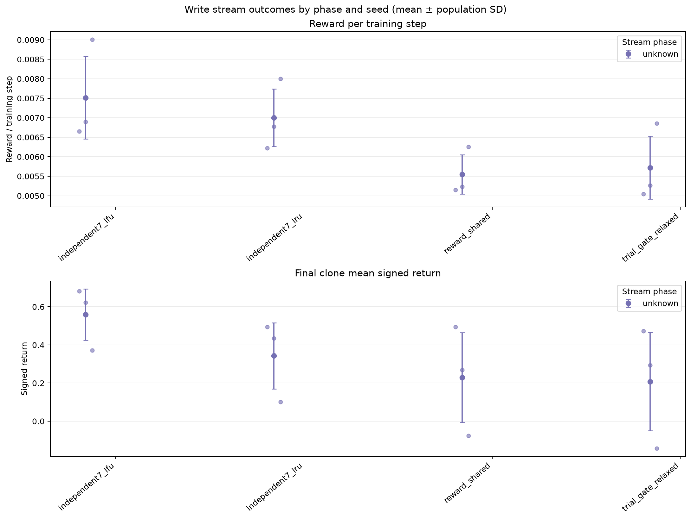

# Write Stream cohort analysis

## 统计口径

统计单位是 seed。episode 和 transition 只在 seed 内聚合，不作为独立样本。少于 4 个 seed 时只报告描述性结果；不做显著性结论。known 与 unknown phase 分开列出。

正向训练成功率只使用完整、起始和结束 taskobserver 相同、且 task 名以 `+` 结尾的 training episode。跨 task episode 会排除，并单独计数。评估回报按 final clone 的 signed return 汇总。

步骤成本由唯一的 `steps.csv` 核对，其中已经包含 training、probe 和 evaluation；不读取独立 probe ledger。训练与评估 episode 长度和也分别与交互账本核对。

## 每 seed 结果

| phase | seed | condition | reward / train step | 正向训练成功率 | 被排除跨 task episodes | final clone signed return | final 正向成功率 | unknown route 比例 | group 满载后未分组比例 | gate 接受 / 拒绝 | CPU s | wall s |
|---|---:|---|---:|---:|---:|---:|---:|---:|---:|---:|---:|---:|
| unknown | 1031 | independent7_lfu | 0.0067 | 0.1881 | 22 | 0.6817 | 0.2917 | 0.0073 | n/a | 0 / 0 | 62.16 | 63.47 |
| unknown | 1031 | independent7_lru | 0.0062 | 0.1400 | 22 | 0.4944 | 0.2500 | 0.0062 | n/a | 0 / 0 | 61.86 | 63.10 |
| unknown | 1031 | reward_shared | 0.0051 | 0.1369 | 22 | 0.4948 | 0.2500 | 0.0048 | 0.7365 | 0 / 0 | 84.28 | 85.80 |
| unknown | 1031 | trial_gate_relaxed | 0.0050 | 0.1345 | 22 | 0.4725 | 0.2917 | 0.0054 | 0.7365 | 8 / 5 | 83.94 | 85.56 |
| unknown | 1033 | independent7_lfu | 0.0069 | 0.1703 | 22 | 0.6225 | 0.2083 | 0.0063 | n/a | 0 / 0 | 64.59 | 65.28 |
| unknown | 1033 | independent7_lru | 0.0068 | 0.1566 | 22 | 0.4342 | 0.2083 | 0.0051 | n/a | 0 / 0 | 63.89 | 64.79 |
| unknown | 1033 | reward_shared | 0.0052 | 0.1225 | 22 | 0.2688 | 0.1667 | 0.0057 | 0.7374 | 0 / 0 | 64.59 | 65.88 |
| unknown | 1033 | trial_gate_relaxed | 0.0053 | 0.1139 | 22 | 0.2935 | 0.1250 | 0.0062 | 0.7373 | 9 / 3 | 64.53 | 65.63 |
| unknown | 1039 | independent7_lfu | 0.0090 | 0.1981 | 22 | 0.3715 | 0.4167 | 0.0047 | n/a | 0 / 0 | 62.59 | 63.32 |
| unknown | 1039 | independent7_lru | 0.0080 | 0.1675 | 22 | 0.1006 | 0.2083 | 0.0054 | n/a | 0 / 0 | 62.59 | 63.29 |
| unknown | 1039 | reward_shared | 0.0063 | 0.1194 | 22 | -0.0769 | 0.1250 | 0.0048 | 0.7142 | 0 / 0 | 64.70 | 65.48 |
| unknown | 1039 | trial_gate_relaxed | 0.0069 | 0.1478 | 22 | -0.1429 | 0.1250 | 0.0051 | 0.7145 | 8 / 6 | 64.52 | 65.10 |

## Paired reward / train step differences

### unknown

| condition | baseline | common seeds | 每 seed difference | mean difference |
|---|---|---|---|---:|
| independent7_lfu | reward_shared | 1031, 1033, 1039 | 1031: 0.0015, 1033: 0.0017, 1039: 0.0027 | 0.0020 |
| independent7_lfu | independent7_lru | 1031, 1033, 1039 | 1031: 0.0004, 1033: 0.0001, 1039: 0.0010 | 0.0005 |
| independent7_lru | reward_shared | 1031, 1033, 1039 | 1031: 0.0011, 1033: 0.0015, 1039: 0.0017 | 0.0015 |
| independent7_lru | independent7_lru | 1031, 1033, 1039 | 1031: 0.0000, 1033: 0.0000, 1039: 0.0000 | 0.0000 |
| reward_shared | reward_shared | 1031, 1033, 1039 | 1031: 0.0000, 1033: 0.0000, 1039: 0.0000 | 0.0000 |
| reward_shared | independent7_lru | 1031, 1033, 1039 | 1031: -0.0011, 1033: -0.0015, 1039: -0.0017 | -0.0015 |
| trial_gate_relaxed | reward_shared | 1031, 1033, 1039 | 1031: -0.0001, 1033: 0.0000, 1039: 0.0006 | 0.0002 |
| trial_gate_relaxed | independent7_lru | 1031, 1033, 1039 | 1031: -0.0012, 1033: -0.0015, 1039: -0.0011 | -0.0013 |

## Per-seed gate 与成本账本

| phase | seed | condition | full gate | 接受 | 拒绝 | no-holdout partial | gate reasons | train | probe | eval | total | CPU s | wall s | actor max B | checkpoint max B | W0 + checkpoint max B |
|---|---:|---|---:|---:|---:|---:|---|---:|---:|---:|---:|---:|---:|---:|---:|---:|
| unknown | 1031 | independent7_lfu | 0 | 0 | 0 | 0 | none | 49152 | 0 | 2652 | 51804 | 62.16 | 63.47 | 236 | 119896 | 175373 |
| unknown | 1031 | independent7_lru | 0 | 0 | 0 | 0 | none | 49152 | 0 | 2667 | 51819 | 61.86 | 63.10 | 236 | 119832 | 175309 |
| unknown | 1031 | reward_shared | 0 | 0 | 0 | 0 | none | 49152 | 0 | 2655 | 51807 | 84.28 | 85.80 | 230 | 116504 | 171981 |
| unknown | 1031 | trial_gate_relaxed | 13 | 8 | 5 | 3 | cold_gain_below_threshold:5, gate_accepted:4, provisional_current_evidence:4 | 49152 | 0 | 2649 | 51801 | 83.94 | 85.56 | 230 | 116440 | 171917 |
| unknown | 1033 | independent7_lfu | 0 | 0 | 0 | 0 | none | 49152 | 0 | 2781 | 51933 | 64.59 | 65.28 | 236 | 119768 | 175245 |
| unknown | 1033 | independent7_lru | 0 | 0 | 0 | 0 | none | 49152 | 0 | 2684 | 51836 | 63.89 | 64.79 | 236 | 119896 | 175373 |
| unknown | 1033 | reward_shared | 0 | 0 | 0 | 0 | none | 49152 | 0 | 2757 | 51909 | 64.59 | 65.88 | 230 | 116952 | 172429 |
| unknown | 1033 | trial_gate_relaxed | 12 | 9 | 3 | 6 | cold_support_failed:3, gate_accepted:5, provisional_current_evidence:4 | 49152 | 0 | 2851 | 52003 | 64.53 | 65.63 | 230 | 116824 | 172301 |
| unknown | 1039 | independent7_lfu | 0 | 0 | 0 | 0 | none | 49152 | 0 | 2490 | 51642 | 62.59 | 63.32 | 236 | 120024 | 175501 |
| unknown | 1039 | independent7_lru | 0 | 0 | 0 | 0 | none | 49152 | 0 | 2779 | 51931 | 62.59 | 63.29 | 236 | 119896 | 175373 |
| unknown | 1039 | reward_shared | 0 | 0 | 0 | 0 | none | 49152 | 0 | 2868 | 52020 | 64.70 | 65.48 | 230 | 116824 | 172301 |
| unknown | 1039 | trial_gate_relaxed | 14 | 8 | 6 | 4 | cold_gain_below_threshold:2, cold_support_failed:4, gate_accepted:3, gate_accepted_old_unsupported_skipped:1, provisional_current_evidence:4 | 49152 | 0 | 2830 | 51982 | 64.52 | 65.10 | 230 | 116824 | 172301 |

## 路由、分组与 gate 记录

unknown route 和 eviction 是观测到的路由事件；没有独立 route truth label，因此不能称为 false route/error 计数。组覆盖率是描述统计，低 unknown 或低未分组比例本身不代表算法优化。gate 的 surrogate 接受也不是共享有益的独立真值。

`gate_full_count` 统计有完整 gate 诊断的决定；`partial_no_holdout_count` 统计因没有新 holdout 而跳过 gate 的部分 cycle。两者在 analysis.json 中逐 seed 保留。

## 持久化容量与账本审计

每个 checkpoint 的物理 `.pt` 大小与 capacity ledger 对照；逐行检查 actor payload ≤ 236 B、声明 actor budget，以及 W0 foundation bytes + checkpoint bytes ≤ 256 KiB。CPU time、wall time、决策 CPU、评估 CPU 和 RSS 分开保存。

整体 cohort audit：**未通过**；失败检查数：1。

失败项：`all_runs_pass:unknown`

## 图表

解释限制：本报告不把低 unknown-route 比率当成算法优化，不把 gate surrogate 当成共享有益的真值，也不声称 SOTA 或已证明创新。
